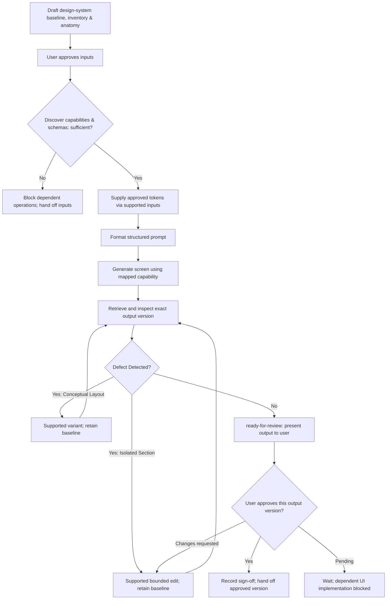

# Stitch UI/UX Blueprint & Pre-Flight Protocol

This reference defines the mandatory pre-flight discovery, screen inventory, anatomy validation, and iteration rules when prototyping or generating user interfaces using Google Stitch (`StitchMCP`).

---

## 1. Problem Statement & Core Invariants

Generative UI engines such as Stitch excel at rapid screen generation from text prompts. Three risks require explicit checks:
1. **Screen & Flow Omission**: Generative prompts focus predominantly on the "Happy Path", systematically omitting auxiliary drill-downs, confirmation modals, filter sheets, empty states, and system error states.
2. **Detail Attrition (Micro-UI Omission)**: Unstructured prompts allow the model to drop micro-controls (breadcrumbs, pagination, filter chips, status badges, contextual tooltips, and action menus).
3. **High Regeneration Penalty**: Regenerating an entire screen to fix a minor defect often causes severe layout drift, token hallucination, and loss of previously approved sections.

### Supreme Invariant
> **No Generation Without Approved Inventory**: Obtain explicit user approval of the Screen Inventory and applicable Page Anatomy Checklist before project creation or screen generation. Tool names below are examples, not assumed connector capabilities. Input approval does not approve generated screens.

---

## 2. 4-Category Screen Inventory Framework

Every UI-bearing project must construct a comprehensive Screen Inventory covering all four functional tiers:

```
┌────────────────────────────────────────────────────────────────────────┐
│                       SCREEN INVENTORY TAXONOMY                        │
├────────────────────────────────────────────────────────────────────────┤
│ 1. PRIMARY VIEWS       │ Main dashboards, master lists, workspace hubs  │
│ 2. DRILL-DOWN & FORMS  │ Multi-step wizards, editor sheets, detail pages│
│ 3. OVERLAYS & DRAWERS  │ Filter drawers, destructive modals, quick-view │
│ 4. EDGE & SYSTEM VIEWS │ Empty states, 404/403, success/error banners   │
└────────────────────────────────────────────────────────────────────────┘
```

### Screen Inventory Table Schema
```markdown
| Screen ID | Category | Screen Name | Route / Path | Core Objective & Primary CTA | Parent / Trigger |
| :--- | :--- | :--- | :--- | :--- | :--- |
| SCR-01 | Primary | Service Catalog | `/services` | Browse & select haircut service (CTA: "Book Now") | Global Nav |
| SCR-02 | Drill-Down | Stylist & Time Picker | `/book/step-2` | Pick barber and available slot (CTA: "Next") | SCR-01 |
| SCR-03 | Overlay | Cancellation Modal | Modal | Confirm appointment cancellation (CTA: "Confirm Cancel") | SCR-01 Menu |
| SCR-04 | Edge | Empty Booking History | `/history` | Onboard new user (CTA: "Book First Appointment") | Global Nav |
```

---

## 3. 8-Point Page Anatomy Checklist

Every individual screen prompt passed to Stitch must satisfy the **8-Point Anatomy Filter**. If any point applies to the screen context, it must be explicitly specified in the prompt:

1. **Orientation & Navigation**:
   * Hierarchical breadcrumbs (`Home > Services > Barber Selection`).
   * Explicit active state on primary navigation tabs.
   * Prominent back navigation button with contextual label.
2. **Search, Filter & Sort Controls**:
   * Search input with domain-specific placeholder text (e.g., `Search by stylist name or specialty...`).
   * Quick filter chips (`All`, `Available Today`, `Top Rated`, `Promotion`).
   * Sort dropdown selector with default criterion indicated (`Sort: Highest Rated`).
3. **Data Display & Status Visualization**:
   * Status indicators with semantic color coding (Pending: Amber, Confirmed: Emerald, Cancelled: Rose).
   * Clear visual grouping using cards, surface contrast, or dividers.
   * Essential metadata timestamps and creator attributions.
4. **Data Controls & Pagination**:
   * Summary pagination text (`Showing 1–10 of 48 items`).
   * Interactive page selector (`Previous`, page numbers, `Next`).
   * Configurable page-size selector (`10 / 25 / 50 per page`).
5. **Action Hierarchy (Fitts's Law)**:
   * **Primary Action**: Single high-contrast CTA button per view.
   * **Secondary Actions**: Subtle outline or tonal buttons.
   * **Destructive Actions**: Isolated red/rose ghost buttons with explicit warning confirmation.
   * **Row-Level Actions**: Contextual meatball/kebab menu (`...`) for secondary item operations.
6. **System Feedback & Toast Anchors**:
   * Dedicated notification placement (e.g., top-right floating toast container).
   * Banner alert slot for system-wide announcements or maintenance notices.
7. **Empty & Loading States**:
   * Dedicated empty state illustration, empathetic micro-copy, and direct recovery CTA.
   * Skeleton loader structure matching final card/table dimensions.
8. **Micro-copy & Accessibility (WCAG 2.1 AA)**:
   * Helper tooltips (`(?)`) explaining technical metrics or pricing tiers.
   * Accessible contrast ratio ($\ge 4.5:1$ for normal text, $\ge 3:1$ for large headings).
   * Minimum 44x44px touch targets on mobile viewports.

---

## 4. Stitch MCP Execution Pipeline

Use the following capability sequence. Discover the connector's available tools and input schemas before calling it; map each operation to actual supported tools. If a required capability is missing, block the dependent operation and hand off the prepared inputs. Continue independent documentation work or an already-authorized alternative; do not claim a Stitch run occurred.

Keep architecture in `docs/design.md` and design-system tokens in `docs/ui-design-system.md`, linked from the architecture baseline. Brownfield projects retain an existing design-system path with an explicit role/version mapping. Do not create architecture and design-system sources distinguished only by filename case. Upload/import only when supported; otherwise supply approved tokens through supported prompt inputs. Names such as `upload_design_md`, `create_design_system_from_design_md`, `generate_screen_from_text`, `get_screen`, `edit_screens`, and `generate_variants` illustrate capabilities, not a mandatory API.



Record output IDs/revisions (or an immutable export hash), approver, decision reference, and approved scope. Any edit or variant returns the affected output to `ready-for-review`; prior sign-off does not cover changed versions. Inspection/export for review is allowed within scope, but does not grant implementation approval.

### 4-Tier Structured Prompt Template
When constructing `prompt` for `generate_screen_from_text`:
```markdown
[Role & Viewport]: Desktop (1440x900px) enterprise dashboard for Clinic Administrators.
[Screen Objective]: Real-time patient appointment queue management for Dr. Smith.
[Layout & Anatomy]:
- Top Bar: Clinic logo, Search bar ("Search patient name or phone..."), Active Doctor Pill, Notification bell with badge "3", Admin Avatar.
- Left Sidebar: Navigation links with "Appointments" active (solid brand background, white text).
- Main Workspace:
  * Metric row: 3 cards (Today's Patients: 24, In-Progress: 2, Pending Arrival: 6).
  * Filter Bar: Date picker ("Today"), Status chips ("All", "Waiting", "In-Room", "Completed"), "Export CSV" button.
  * Queue Table: Columns (Time, Patient Name + Age, Reason, Status Badge, Doctor, Actions).
  * Table Actions: Row kebab menu ("Call Patient", "Reschedule", "Cancel").
  * Pagination: "Showing 1–10 of 24", Next/Prev buttons.
[Visual Constraints]: Follow the approved design-system version, 8pt spacing grid, clean borders without heavy drop-shadows, WCAG AA contrast.
```

---

## 5. Safe Modification & Isolation Rules

To prevent regeneration penalties when altering an existing screen:

1. **Targeted Sectional Instructions**:
   * When invoking `edit_screens`, designate exact preservation boundaries:
     > *"Retain the Sidebar, Top Bar, and Metric Cards exactly as-is. ONLY modify the Queue Table: add a new column 'Insurance Provider' between 'Patient Name' and 'Reason', and add a 'Refresh' icon button next to the Export button."*
2. **Branching via `generate_variants`**:
   * If exploring alternative visual treatments (e.g., Kanban cards vs. Data Table), preserve the base screen and use supported variant generation. Present alternatives for user selection; an agent cannot approve its preferred iteration.
3. **Modal & Drawer Isolation**:
   * Complex modals or slide-over filter sheets MUST be generated as separate, focused screens rather than crammed into the primary page prompt. This prevents prompt token exhaustion and ensures crisp component detail.
