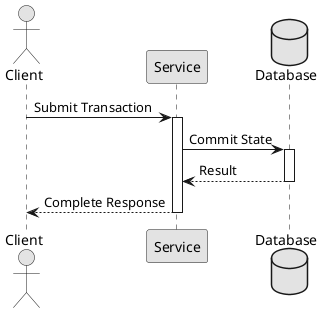

# Architectural Modeling, Tech Stack Selection, and System Diagramming

This reference guides agents through analyzing architectural topologies, evaluating technology stacks tailored to project constraints, and rendering actionable system diagrams during Step 1.3 of Phase 1.

---

## 1. Architectural Topology Selection Methodology

Never impose an arbitrary architectural pattern. System topology must strictly reflect **problem domain characteristics, data volume, and development lifecycle stage**:

| Architectural Pattern | Ideal Context | Core Advantage | Trade-offs & Challenges |
| :--- | :--- | :--- | :--- |
| **Monolith** | Greenfield MVPs, small teams, nascent business domains. | Fast time-to-market, straightforward E2E testing, trivial debugging, zero internal network overhead. | Can degrade into spaghetti code without strict module boundaries; difficult to scale components independently. |
| **Modular Monolith** | Maturing systems with multiple bounded contexts but no immediate need for distributed complexity. | Explicit domain and data boundaries within a single process/repo; straightforward extraction into microservices when justified. | Requires strict architectural linter enforcement to prevent circular imports or cross-module direct table queries. |
| **Microservices** | Large-scale platforms, multiple independent engineering teams, disparate domain scaling profiles and release cycles. | Independent service scaling, technology diversity per domain, isolated failure blast radiuses. | Extreme operational complexity; requires handling distributed consistency, network jitter, and distributed tracing. |
| **Event-Driven Architecture** | Real-time processing, asynchronous workflows, stream analytics (FinTech, IoT, e-commerce order routing). | Loose coupling, high surge resilience, horizontal scalability via independent event consumers. | Difficult end-to-end tracing, eventual consistency challenges, risk of queue deadlocks or duplicate event processing. |
| **Hexagonal / Clean / Onion** | Core business logic with long lifespan, requiring absolute decoupling from frameworks, databases, and UI layers. | Domain logic decoupled from external I/O; highly unit-testable; painless adapter or database swapping. | Increased file count, data transfer mappers/DTO overhead, initial boilerplate ceremony. |
| **CLI / Standalone Tool / Serverless** | Command-line utilities, scheduled batch jobs, or event-triggered workloads without persistent servers. | Minimal infrastructure cost, instantaneous startup, environment isolation. | Execution duration limits (serverless), ephemeral state management challenges. |

---

## 2. Evidence-Based Tech Stack Evaluation

When selecting a technology stack, avoid rigid defaults. Follow an **evidence-based candidate evaluation process**:

```
[Analyze Problem Domain & Constraints]
       ↓
[Identify 2-3 Candidate Technologies]
       ↓
[Construct 5-Criteria Trade-off Matrix]
       ↓
[Propose Optimal Stack with Technical Rationale for User Approval]
```

### Evaluation Criteria:
1. **Workload & Domain Character**: Compute-intensive, I/O-intensive, high-throughput event streaming, or standard CRUD?
2. **Deployment & Environmental Constraints**: On-premise enterprise environments, public cloud (AWS/GCP/Azure), embedded/IoT devices, or cross-platform desktop (Windows/macOS/Linux)?
3. **Data Model Requirements**: Relational ACID guarantees, dynamic JSON document schemas, time-series metrics, graph networks, or full-text search?
4. **Ecosystem & Specialized Tooling**: Mature ecosystem packages solving project-specific challenges (e.g., computer vision, payment gateway integrations, canvas rendering)?
5. **Operational Maintainability**: Packaging overhead, observability footprint, and talent accessibility for long-term maintenance.

---

## 3. Diagramming Options

Agents are **not restricted to a single diagramming tool**. Select the format best suited to the target reading environment:

### Option 1: Mermaid (Native in Markdown, GitHub, GitLab, IDEs)
Ideal when artifacts are consumed through Markdown viewers supporting Mermaid:

* **System Architecture / Data Flow (Flowchart)**:
  ```mermaid
  flowchart TD
      Client["Client Applications"] --> Gateway["API Gateway / Reverse Proxy"]
      Gateway --> ServiceA["Core Business Service"]
      Gateway --> ServiceB["Worker / Async Service"]
      ServiceA --> Storage[("Authoritative Database")]
  ```

* **Sequence Diagram**:
  ```mermaid
  sequenceDiagram
      autonumber
      actor U as Client
      participant S as Server
      participant D as Database
      U->>S: Request Operation
      S->>D: Validate Preconditions & Persist State
      D-->>S: Confirm Commit
      S-->>U: Return Contract Response
  ```

---

### Option 2: ASCII / Unicode Box Drawing (Direct CLI / Terminal / Plaintext View)
Highly recommended for **terminal environments (Antigravity CLI / Codex CLI / SSH sessions)** because it renders instantly without browser plugins or external tooling:

* **System Block Diagram**:
  ```text
  +-------------------------------------------------------------+
  |                      CLIENT INTERFACE                       |
  |         [Web Client]                  [Mobile App]          |
  +-------------------------------------------------------------+
                                 | (HTTPS / WSS)
                                 v
  +-------------------------------------------------------------+
  |                    API GATEWAY / PROXY                      |
  |          - Authentication       - Rate Limiting            |
  +-------------------------------------------------------------+
                                 |
         +-----------------------+-----------------------+
         |                                               |
         v                                               v
  +-----------------------------+                 +-----------------------------+
  |    CORE BUSINESS SERVICE    |                 |   BACKGROUND WORKER SERVICE |
  | (Synchronous Request Logic) | <-------------> | (Asynchronous Job Logic)    |
  +-----------------------------+                 +-----------------------------+
         |                                               |
         v                                               v
  +-----------------------------+                 +-----------------------------+
  | AUTHORITATIVE DATABASE      |                 | CACHE & MESSAGE BROKER      |
  | (PostgreSQL / MySQL)        |                 | (Redis / RabbitMQ / Kafka)  |
  +-----------------------------+                 +-----------------------------+
  ```

* **State Flow Diagram**:
  ```text
  [Initiated] ──> [Processing] ──(Success)──> [Completed] ──> (Terminal)
                      │
                  (Failure)
                      │
                      v
             [Requires Action] ──(Timeout)──> [Cancelled] ──> (Terminal)
  ```

---

### Option 3: PlantUML (Enterprise Standard & UML Modeling)
Suitable for formalized UML specifications, C4 Architecture models, or enterprise environments:



---

### Option 4: D2 / Graphviz DOT (Code-as-Diagram DSL)
Used when projects maintain automated living documentation pipelines.

---

## 4. Architectural Documentation Invariants

1. **Tie Diagrams to Verifiable Business Criteria**: Every diagram must illuminate an explicit dimension (high-level topology, trust boundaries, state transitions, or temporal concurrency); avoid ornamental, non-actionable diagrams.
2. **Authority Belongs to the User**: The agent provides objective trade-off analyses and technical recommendations; final architectural and tech-stack choices must be approved by authorized stakeholders before entering Phase 2 execution.
