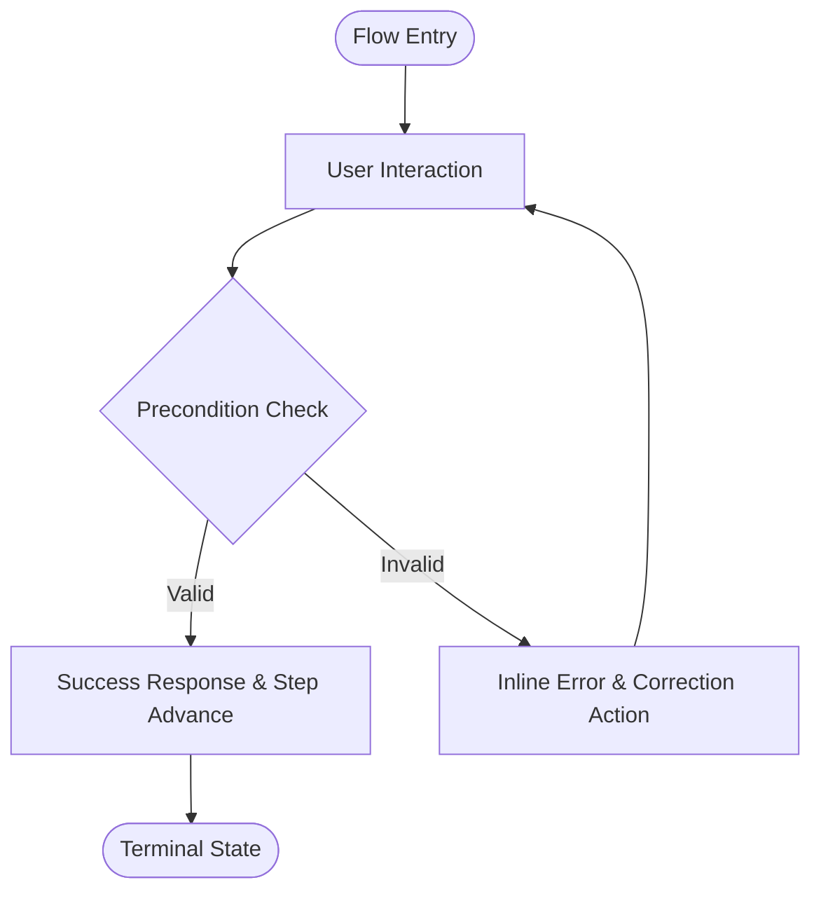

# UI Style Strategy and UX Journey Analysis

This reference guides agents through analyzing UI design aesthetics and mapping user experience (UX) flows tailored to specific project requirements during Steps 1.2 and 1.4 of Phase 1.

---

## 1. Contextual UI Strategy Methodology

Never impose an arbitrary design pattern or component library. Derive UI design strategies from **four contextual pillars**:

```
[Form Factor & Environment] + [Target Persona] + [Emotional Tone] + [Technical Constraints]
                                       ↓
        [Optimal UI Design Strategy & Tailored Component Ecosystem]
```

### Analytical Steps:

1. **Form Factor & Environmental Context**:
   * Target execution runtime: Desktop browser, mobile phone, tablet, public kiosk/POS, or Command Line Interface (CLI)?
   * Physical operating context: Focused office desktop, outdoor direct sunlight, low-light industrial setting, or one-handed mobile transit?
2. **Target User Demographics & Persona**:
   * *B2C / Consumer*: Friendly UI, generous whitespace, large touch targets, minimal cognitive load.
   * *B2B / Internal Enterprise Tools*: High information density, multi-column data tables, robust filters/sorting, keyboard shortcuts, minimal ornamental animations.
   * *DevTools / SRE Ops*: Native dark mode, high contrast, monospace code readability, collapsible tree hierarchies, terminal logs.
   * *High-Trust Domains (FinTech, Healthcare, Legal)*: Restrained palettes, unambiguous visual hierarchy, explicit multi-step validation, instant field-level feedback.
3. **Emotional Objective & Brand Tone**:
   * Determine primary brand perception: Reliable & Sturdy, Vibrant & Friendly, Minimal & Focused, or Modern & Innovative?
   * Select a color palette and typography hierarchy directly reinforcing this emotional goal.
4. **Platform-Appropriate UI Frameworks**:
   * Modern Web: Tailwind CSS, CSS Modules, Accessible/Headless primitives (Radix, AriaKit, Shadcn), or full component suites (Ant Design, MUI, Mantine) balanced by styling flexibility and implementation velocity.
   * Mobile: Native (SwiftUI, Jetpack Compose) or Cross-platform (Flutter, React Native).
   * Desktop: Electron, Tauri, Qt, WPF/WinUI.
   * CLI / Terminal: TUI frameworks (Inquirer, Ink, Bubble Tea, Textual, Rich).

5. **Supplementary Skill [UI/UX Pro Max](https://github.com/nextlevelbuilder/ui-ux-pro-max-skill)**:
   * When projects require sophisticated multi-platform styling, expert color harmony, typography pairing, or responsive layout patterns across React, Vue, Tailwind, Flutter, or SwiftUI, recommend integrating `ui-ux-pro-max-skill`.
   * **Installation via Agent Skills Standard**: Install via `npx skills i nextlevelbuilder/ui-ux-pro-max-skill` or configure within `.agents/skills.json`.
   * **Boundary**: Acts as domain-specific knowledge augmenting Step 1.4 (`sdlc-plan`) and Step 2.3 (`sdlc-code`), adhering strictly to Direwolf G1–G4 stage gates.

---

## 2. UX User Flows & Journeys

User experience design extends beyond static wireframes to model the **continuous interaction lifecycle** from entry to terminal completion.

### A. Three Scenario Paths
Analyze every interaction across three execution branches:
1. **Happy Path**: Ideal trajectory where preconditions hold, inputs are valid, and transactions complete successfully.
2. **Alternate & Error Paths**: Recoverable validation failures, session expiration, insufficient balance, or duplicate record conflicts.
3. **Edge & Failure Cases**: Mid-flight network disconnections, upstream server timeouts, or hardware permission revocations (camera/geolocation).

---

### B. Flexible Flow Representations

Select Mermaid or ASCII representations according to the display environment:

#### Option 1: Mermaid Flowchart (Markdown / Web / IDE Viewers)


#### Option 2: Plaintext ASCII / Unicode Flow (Terminal / CLI / SSH)
```text
[Flow Entry]
       │
       ▼
[User Submits Input]
       │
       ▼
   / Precondition \
  <   Validation   >
   \              /
     │          │
   (Valid)   (Invalid)
     │          │
     ▼          ▼
[Success]   [Display Actionable Error]
     │          │
     │          └──────> [Allow User Retry]
     ▼
[Terminal State]
```

---

### C. The 5 Mandatory UI Interaction States
Every interactive view or component must explicitly specify five fundamental states:
1. **Ideal State**: Standard populated display with full data loaded.
2. **Loading State**: Visual skeleton loaders or progress bars maintaining layout stability during asynchronous fetches.
3. **Empty State**: Clear guidance, helpful illustrations, and call-to-action buttons when zero records exist.
4. **Error State**: Actionable, human-readable error messages detailing causes and remediation triggers (`Retry`, `Back`).
5. **Disabled State**: Non-interactive visual cues when prerequisites are unfulfilled, with tooltips explaining required actions.

---

## 3. UI/UX Pre-Implementation Verification

* All UI style decisions and UX flow bifurcations must be approved by stakeholders or chosen from structured trade-off options; agents must never finalize design choices unilaterally.
* When interaction flows contain unresolved decisions (e.g., single-step vs two-factor authentication), document them as open questions and **block dependent implementation tasks** under Phase 1 protocol.

---

## 4. Generative Prototyping with Stitch (`StitchMCP`)

When utilizing Stitch for generative screen creation and design system synchronization:
* **Mandatory Pre-Flight**: Follow [Stitch UI/UX Blueprint Protocol](stitch_uiux_blueprint_protocol.md) to generate the 4-category Screen Inventory and 8-point Anatomy Checklist using [Screen Inventory Template](../resources/screen_inventory_template.md).
* **Capability Discovery**: Inspect actual connector tools/schemas before execution; tool names in references are examples. Missing required capabilities block dependent calls.
* **Input Approval**: Obtain user sign-off for inventory/anatomy before project creation or generation.
* **Output Approval**: Inspection yields `ready-for-review`, not approval. Record user sign-off against screen/export versions before dependent implementation; changed versions need renewed review.
* **Safe Section Editing**: Use supported bounded edits/variants to protect approved sections and preserve the baseline. Keep architecture separate from the linked design-system artifact, without case-only filename distinctions.
