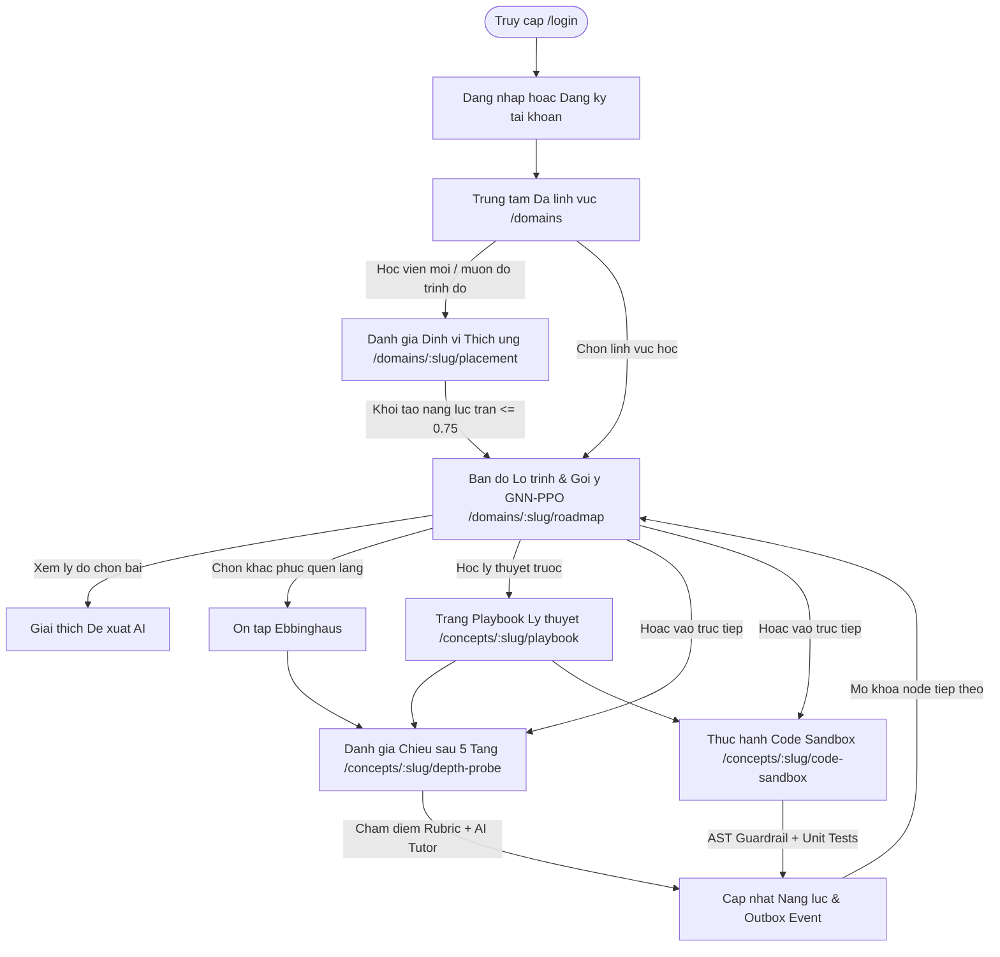
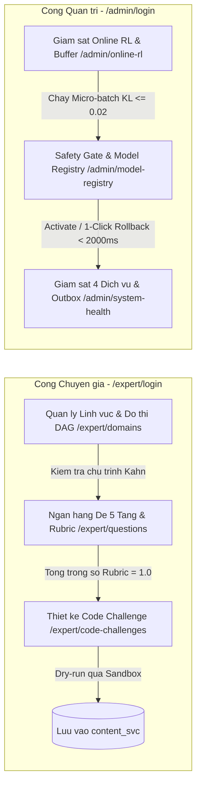
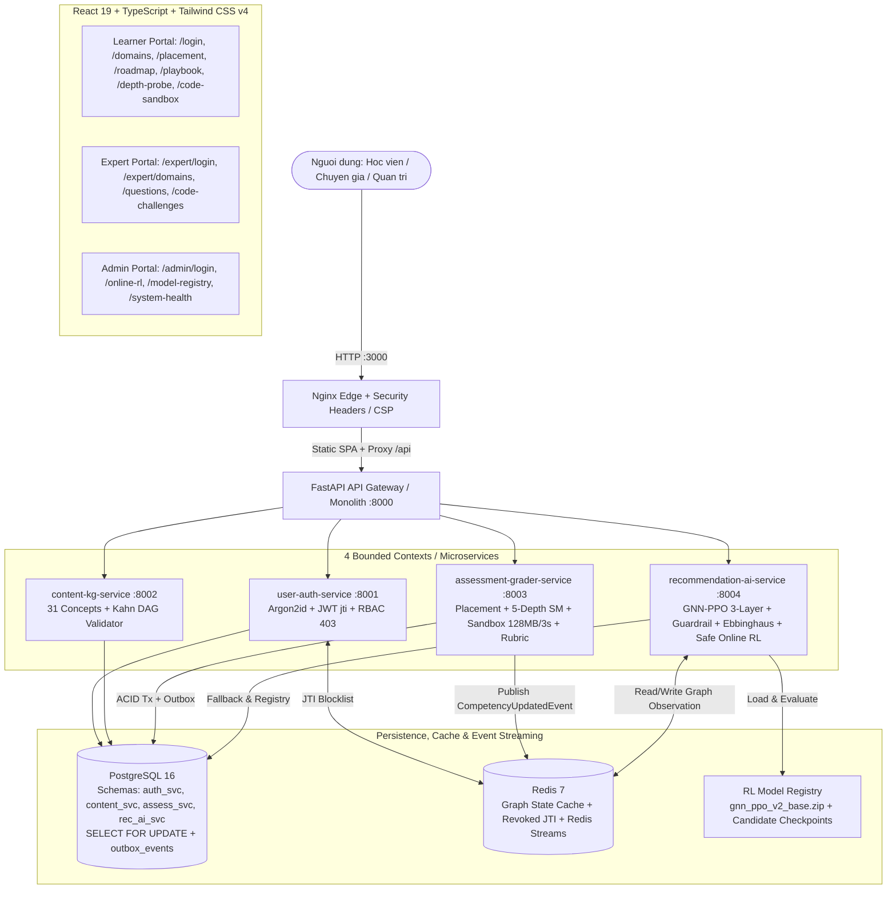

<p align="center">
  
</p>

# Plumora (`v2.0.0`)

**Hệ thống Quản lý và Khuyến nghị Lộ trình Học Cá nhân hóa Đa lĩnh vực bằng Học Tăng cường Đồ thị (`GNN-PPO`)**<br/>
*Adaptive Personalized Learning Path Platform — Inspired by the Plumule*

[](.github/workflows/ci.yml)
[](docs/decisions.md)
[](backend/pyproject.toml)
[](frontend/package.json)
[](docker-compose.yml)

---

## 1. Giới thiệu & Ý tưởng Cốt lõi

Tên gọi **Plumora** bắt nguồn từ *Plumule* (chồi cây non) — biểu tượng của một mầm tri thức biết cảm nhận và thích ứng với môi trường xung quanh để vươn lên vững chắc. Trong hệ thống hiện tại, triết lý đó được hiện thực hóa qua:

- **Đồ thị Tri thức Đa lĩnh vực (Multi-Domain Knowledge Graph):** Hệ thống quản lý **31 khái niệm** chia thành **3 lĩnh vực** (`backend`: 12, `frontend`: 10, `devops`: 9) theo Đồ thị Có hướng Không chu trình (**DAG** 4 tầng), trong đó có **7 khái niệm giao thoa** cho phép đồng bộ năng lực giữa các ngành.
- **Thích ứng theo Năng lực Thực tế (`GNN-PPO` + Ebbinghaus):**
  - Xác định điểm xuất phát phù hợp qua *Đánh giá Định vị Đầu vào* (*Adaptive Placement*, trần `<= 0.75`).
  - Gợi ý bài học và hình thức học tiếp theo bằng mô hình `GNN-PPO` 3 lớp kết hợp *Policy Guardrail* (đảm bảo không nhảy cóc điều kiện tiên quyết) và mô hình suy giảm trí nhớ *Ebbinghaus* $R(t) = e^{-\Delta t/S}$.
- **Chu trình Học tập Đầy đủ tại Mỗi Khái niệm:** *Đọc Playbook Lý thuyết* $\rightarrow$ *Đánh giá Chiều sâu 5 Tầng* (kèm *AI Tutor & Rubric*) $\rightarrow$ *Thực hành Code Sandbox* cô lập (Python/JavaScript, giới hạn RAM `128MB`, timeout `<= 3000ms`).

---

## 2. Luồng Nghiệp vụ Hệ thống

### 2.1. Luồng Nghiệp vụ Học viên (Learner Flow)



### 2.2. Luồng Nghiệp vụ Chuyên gia & Quản trị (Expert & Admin Flow)



---

## 3. Sơ đồ System Design Hệ thống Hiện tại

Chi tiết đầy đủ bộ sơ đồ C4 Container, Deployment Topology (`Docker` & `Kubernetes`), ERD 4 Schema độc lập và Sequence Diagrams xem tại [docs/design.md](docs/design.md).



- **PostgreSQL 16:** Lưu trữ toàn bộ dữ liệu nghiệp vụ, tách 4 schema (`auth_svc`, `content_svc`, `assess_svc`, `rec_ai_svc`), bảo toàn giao dịch bằng `SELECT ... FOR UPDATE` và chống nộp trùng qua `submission_id`.
- **Redis 7:** Lưu cache trạng thái đồ thị, danh sách thu hồi JWT (`jti`) sau đăng xuất và luồng sự kiện `Redis Streams` từ `Transactional Outbox`.
- **Chế độ Triển khai:** Hỗ trợ chạy cụm Monolith tiêu chuẩn (`docker compose up -d --build`) hoặc cụm 4 Microservices + API Gateway (`docker compose --profile microservices up -d --build`) cùng manifests Kubernetes (`k8s/` với `HPA` và `NetworkPolicy`).

---

## 4. Khởi chạy Bằng Docker Compose

Yêu cầu: đã cài **Docker** và **Docker Compose**.

```bash
# 1. Build và khởi chạy cụm 4 container (postgres, redis, backend, frontend)
docker compose up -d --build

# 2. Kiểm tra trạng thái hoạt động (tất cả Up / healthy)
docker compose ps
```

- **Giao diện Web:** [http://localhost:3000](http://localhost:3000)
- **Tài liệu API Swagger:** [http://localhost:8000/docs](http://localhost:8000/docs)
- **Health Check:**
  ```bash
  curl -s http://127.0.0.1:8000/api/v1/health
  ```

---

## 5. Tài khoản Seeded Thật Theo Từng Cổng

Mật khẩu chung cho toàn bộ tài khoản mẫu trong PostgreSQL: `PlumoraDemo#2026`

| Vai trò | Đường dẫn Cổng | Tên đăng nhập | Trạng thái Khởi tạo |
| :--- | :--- | :--- | :--- |
| **Học viên** | `/login` | `learner_new` | Học viên mới (`0/12` Backend) |
| **Học viên** | `/login` | `learner_foundation` | Đã hoàn thành nền tảng (`4/12` Backend) |
| **Học viên** | `/login` | `learner_api_stage` | Học viên nâng cao (`7/12` Backend) |
| **Chuyên gia** | `/expert/login` | `expert_demo` | Quản trị Knowledge Graph, câu hỏi & Code Challenge |
| **Quản trị** | `/admin/login` | `admin_demo` | Giám sát Online RL, Safety Gate & System Health |

Xem hướng dẫn thao tác kiểm thử từng màn hình tại [MANUAL_SYSTEM_TESTING_SCRIPT.md](docs/verification/MANUAL_SYSTEM_TESTING_SCRIPT.md).

---

## 6. Kết quả Đánh giá Mô hình `GNN-PPO` (Trong Mô phỏng)

Checkpoint `rl/artifacts/gnn_ppo_v2_base.zip` (`SHA-256 = 9977d5f606427d0eb25970b1ce8cf23fa0232e2d7ff0fe392e80d2413d534201`) được huấn luyện trên 3 seeds (`101`, `202`, `303`) và đánh giá trên **500 episodes** (`eval_seed = 2026`):

| Chỉ số | `GNN-PPO` (3 ngành đã biết) | `GNN-PPO` (*Zero-shot*: `heldout_data_eng_graph`) |
| :--- | :---: | :---: |
| **Phần thưởng tích lũy (`episodic_reward`)** | `66.65` | `67.36` |
| **Tỷ lệ vi phạm tiên quyết (`guardrail_violation_rate`)** | `0.0%` | `0.0%` |

> Kết quả trên được đo trong bộ mô phỏng đa ngành (`rl/src/plumora_rl/multidomain_sim.py`), không đồng nhất với hiệu quả học tập trên người thật. Chi tiết tại [RL_EXPERIMENTAL_REPORT.md](docs/defense/RL_EXPERIMENTAL_REPORT.md).

---

## 7. Kiểm tra Chất lượng & Tài liệu Liên quan

```bash
# Chạy toàn bộ chuỗi kiểm tra CI cục bộ (Lint, Mypy, TSC, Pytest, Vitest, Build, Live E2E)
./scripts/ci_check.sh
```

- **Đặc tả & Thiết kế:** [Intent](docs/intent.md) | [Spec](docs/spec.md) | [Design](docs/design.md) | [UI Design System](docs/ui-design-system.md) | [Decisions](docs/decisions.md)
- **Phân tích & Thực nghiệm RL:** [Phase 3 Analysis](docs/proposals/PHASE3_ANALYSIS.md) | [RL Plan](docs/research/RL_PLAN.md) | [RL Experimental Report](docs/defense/RL_EXPERIMENTAL_REPORT.md)
- **Hướng dẫn Test & Demo:** [Manual Testing Script](docs/verification/MANUAL_SYSTEM_TESTING_SCRIPT.md) | [Demo Runbook](docs/defense/DEMO_RUNBOOK.md)
