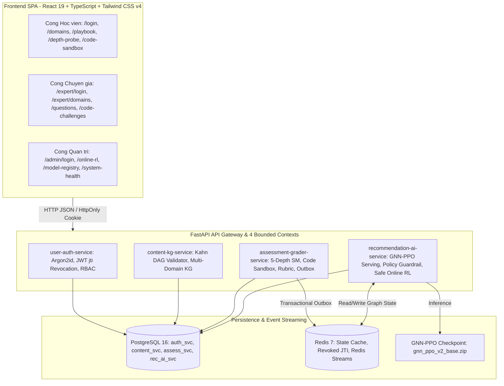

<p align="center">
  
</p>

# Plumora (`v2.0.0`)

**Hệ thống Quản lý và Khuyến nghị Lộ trình Học Cá nhân hóa Đa lĩnh vực bằng Học Tăng cường Đồ thị (`GNN-PPO`)**<br/>
*Adaptive Multi-Domain Learning Path Recommendation & Competency Assessment Platform*

[](.github/workflows/ci.yml)
[](docs/verification/VERIFICATION_GATE3_POST_POLISH.md)
[](docs/verification/RELEASE_GATE4_PHASE3.md)
[](backend/pyproject.toml)
[](frontend/package.json)
[](docker-compose.yml)
[](k8s/)

---

## 1. Giới thiệu Dự án

**Plumora** (lấy cảm hứng từ *Plumule* — chồi cây non) là đồ án tốt nghiệp đại học xây dựng nền tảng học tập thích ứng cá nhân hóa đa lĩnh vực, kết hợp **Knowledge Graph có hướng không chu trình (DAG)**, **đánh giá năng lực 5 tầng chiều sâu**, **thực hành Code Sandbox cô lập** và **Học tăng cường Đồ thị (`GNN-PPO`)**:

- **Đồ thị Tri thức Đa lĩnh vực (Multi-Domain KG):** Gồm **31 khái niệm** thuộc 3 lĩnh vực (`backend`: 12, `frontend`: 10, `devops`: 9) với **7 khái niệm giao thoa liên thông** (*Isomorphic Shared Nodes*) cho phép kế thừa năng lực giữa các ngành.
- **Đánh giá Chiều sâu 2 Chế độ & Playbook Lý thuyết:**
  - *Adaptive Placement* (chẩn đoán đầu vào thích ứng, giới hạn trần `<= 0.75`).
  - *Playbook Lý thuyết* toàn màn hình (`/concepts/:slug/playbook`) kèm bảng so sánh và mã nguồn mẫu.
  - *5-Depth Probing State Machine* (Tầng 1 Nhận biết $\rightarrow$ Tầng 5 Tự giải thích) kết hợp *LLM Rubric Adapter* (có *Deterministic Fallback* khi ngoại tuyến) và *AI Tutor Drawer*.
  - *Isolated Code Sandbox*: Thực thi mã Python/JavaScript cô lập với AST Guardrail, `RLIMIT_AS` 128MB và timeout `<= 3000ms`.
- **Suy giảm Trí nhớ Ebbinghaus & `GNN-PPO`:** Mô hình hóa độ duy trì trí nhớ $R(t) = e^{-\Delta t/S}$ ($S_0 = 3.0$) và khuyến nghị bước học tối ưu qua mạng `GNN-PPO` 3 lớp kết hợp `Policy Guardrail` (`0.0%` vi phạm tiên quyết).
- **Quản trị An toàn (`Safe Online RL`) & Phân tách Cổng RBAC:** Hỗ trợ 3 vai trò độc lập (`learner`, `expert`, `admin`), tinh chỉnh *Micro-batch* ràng buộc `KL-Divergence`, kiểm định *Safety Evaluation Gate* và *1-Click Rollback* (`< 2000ms`).

---

## 2. Kiến trúc Hệ thống



- **PostgreSQL 16 (Single Source of Truth):** Phân tách 4 schema cô lập (`auth_svc`, `content_svc`, `assess_svc`, `rec_ai_svc`) cùng khóa bi quan `SELECT ... FOR UPDATE` và `submission_id` chống nộp trùng lặp.
- **Redis 7 (State Cache & Streams):** Lưu trạng thái đồ thị người học, danh sách thu hồi JWT (`jti`) và truyền sự kiện bất đồng bộ qua `Transactional Outbox` + `Redis Streams`.
- **Triển khai Linh hoạt:** Hỗ trợ cả chế độ Monolith tiêu chuẩn và cụm 4 Microservices (`docker-compose.yml --profile microservices`) cùng manifests Kubernetes (`k8s/` với `HPA` và `NetworkPolicy`).

---

## 3. Khởi chạy Nhanh Bằng Docker Compose

Yêu cầu duy nhất: đã cài **Docker** và **Docker Compose**.

```bash
# 1. Khởi chạy cụm dịch vụ tiêu chuẩn (PostgreSQL 16, Redis 7, FastAPI Backend, Nginx Frontend)
docker compose up -d --build

# 2. Kiểm tra trạng thái container (tất cả đều Up / healthy)
docker compose ps
```

*(Tùy chọn)* Chạy chế độ **4 Microservices + API Gateway**:
```bash
docker compose --profile microservices up -d --build
```

- **Giao diện Web:** [http://localhost:3000](http://localhost:3000)
- **API Swagger Docs:** [http://localhost:8000/docs](http://localhost:8000/docs)
- **Health Probe:**
  ```bash
  curl -s http://127.0.0.1:8000/api/v1/health
  ```

---

## 4. Cổng Truy cập & Tài khoản Seeded Thật

Hệ thống khởi tạo sẵn các tài khoản thật trong PostgreSQL (mật khẩu chung: `PlumoraDemo#2026`):

| Vai trò | Cổng Đăng nhập | Tên đăng nhập (`username`) | Mô tả Trạng thái |
| :--- | :--- | :--- | :--- |
| **Học viên** | `/login` | `learner_new` | Học viên mới (`0/12` Backend), phù hợp test *Adaptive Placement* |
| **Học viên** | `/login` | `learner_foundation` | Đã vững nền tảng (`4/12` Backend), nhận gợi ý `GNN-PPO` & ôn tập |
| **Học viên** | `/login` | `learner_api_stage` | Học viên nâng cao (`7/12` Backend), mở khóa nhiều bài chuyên sâu |
| **Chuyên gia** | `/expert/login` | `expert_demo` | Quản trị Knowledge Graph, câu hỏi 5 tầng & Code Challenge |
| **Quản trị** | `/admin/login` | `admin_demo` | Giám sát Safe Online RL, Safety Gate, Rollback & System Health |

Hướng dẫn thao tác kiểm thử chi tiết từng màn hình xem tại [MANUAL_SYSTEM_TESTING_SCRIPT.md](docs/verification/MANUAL_SYSTEM_TESTING_SCRIPT.md).

---

## 5. Kết quả Thực nghiệm Học tăng cường (`GNN-PPO`)

Mô hình `GNN-PPO` 3 lớp PyTorch Tensor (`rl/artifacts/gnn_ppo_v2_base.zip`, `SHA-256 = 9977d5f606427d0eb25970b1ce8cf23fa0232e2d7ff0fe392e80d2413d534201`) được huấn luyện trên 3 seeds (`101`, `202`, `303`) và đánh giá trên **500 episodes** (`eval_seed = 2026`):

| Chỉ số Đánh giá | `GNN-PPO` (3 ngành đã biết) | `GNN-PPO` (*Zero-shot Transfer*: `heldout_data_eng_graph`) |
| :--- | :---: | :---: |
| **Phần thưởng tích lũy (`episodic_reward`)** | **`66.65`** | **`67.36`** |
| **Tỷ lệ vi phạm tiên quyết (`guardrail_violation_rate`)** | **`0.0%`** | **`0.0%`** |

> **Lưu ý khoa học:** Kết quả trên đo trong môi trường mô phỏng đa ngành (`rl/src/plumora_rl/multidomain_sim.py`), không đồng nhất trực tiếp với hiệu quả học tập trên người thật. Xem chi tiết tại [RL_EXPERIMENTAL_REPORT.md](docs/defense/RL_EXPERIMENTAL_REPORT.md).

---

## 6. Phát triển Cục bộ & Chuỗi Kiểm chứng CI

```bash
# Chạy cơ sở dữ liệu
docker compose up -d postgres redis

# Chạy toàn bộ chuỗi kiểm tra CI (Ruff, ESLint, Mypy, TSC, Pytest, Vitest, Build, Live E2E, Negative Control)
./scripts/ci_check.sh
```

---

## 7. Mục lục Tài liệu & Hồ sơ Nghiệm thu

- **Đặc tả & Kiến trúc (`v2.0.0`):** [Intent](docs/intent.md) | [Spec](docs/spec.md) | [Design](docs/design.md) | [UI Design System](docs/ui-design-system.md) | [RL Plan](docs/research/RL_PLAN.md) | [Decisions](docs/decisions.md)
- **Kiểm định & Phát hành:**
  - [Biên bản Thẩm định Độc lập Gate 3 Round 2 (APPROVED)](docs/verification/VERIFICATION_GATE3_POST_POLISH.md)
  - [Hồ sơ Phát hành Gate 4 Phase 3](docs/verification/RELEASE_GATE4_PHASE3.md)
  - [Báo cáo Đo tải 20 VU & Nhất quán Rubric](docs/verification/P3_SLICE_4_LOAD_AND_CONSISTENCY_REPORT.md)
- **Vận hành & Bảo vệ:** [Kịch bản Kiểm thử Hệ thống Thực](docs/verification/MANUAL_SYSTEM_TESTING_SCRIPT.md) | [Demo Runbook](docs/defense/DEMO_RUNBOOK.md) | [Báo cáo Thực nghiệm RL](docs/defense/RL_EXPERIMENTAL_REPORT.md)
