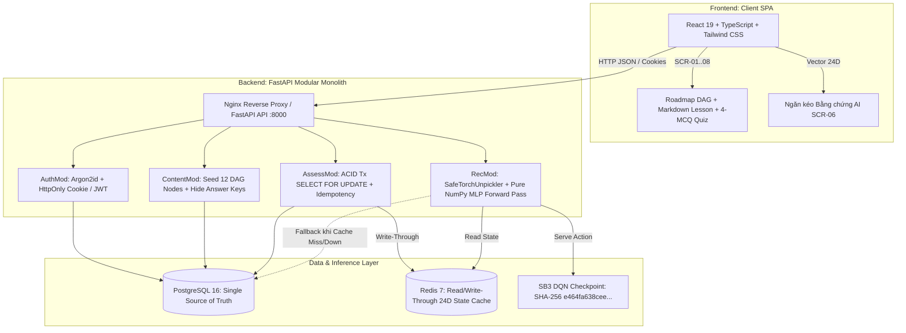

# Plumora

**Hệ Thống Quản Lý và Khuyến Nghị Lộ Trình Học Cá Nhân Hóa Thích Ứng Bằng Học Tăng Cường (DQN)**  
*Adaptive Personalized Learning Path Recommendation & Management System Using Deep Reinforcement Learning*

[](.github/workflows/ci.yml)
[](docs/verification/VERIFICATION_GATE3.md)
[](backend/pyproject.toml)
[](frontend/package.json)
[](docker-compose.demo.yml)
[](docs/ui-design-system.md)
[](docs/verification/VERIFICATION_GATE3.md)

---

## 1. Giới Thiệu Dự Án & Bản Sắc Thương Hiệu

**Plumora** lấy cảm hứng từ chồi cây non (*Plumule*) — biểu tượng của sự sinh trưởng tri thức tự nhiên và thích ứng với môi trường. Dự án là đồ án tốt nghiệp đại học, giải quyết trọn vẹn bài toán:
- Quản lý lộ trình học tập gồm **12 khái niệm lập trình Backend** cấu trúc theo Đồ thị Có hướng Không chu trình (**DAG** 4 tầng).
- Cá nhân hóa bước học tiếp theo bằng mô hình **Học Tăng Cường Sâu (Deep Q-Network — DQN)** dựa trên vector trạng thái quan sát 24 chiều.
- Bản sắc thị giác Chồi Cây Non (*Botanical Sprout & Sunlit Canopy*): Bảng phối màu tự nhiên (`#15803D`, `#D97706`, `#0D9488`, `#57534E` trên nền `#F6F8F5`), sử dụng **100% SVG Vector Icons** (`lucide-react`), tuyệt đối **không sử dụng ký tự emoji** (`INV-UI-01`, `D-12`).

---

## 2. Kiến Trúc Hệ Thống Tổng Quan



- **PostgreSQL 16 (Single Source of Truth — SSoT):** Lưu trữ 7 bảng dữ liệu quan hệ (`users`, `concepts`, `concept_prerequisites`, `quiz_questions`, `user_concept_mastery`, `quiz_attempts`, `recommendation_logs`) với ràng buộc khóa ngoại cascade và check constraints.
- **Redis 7 (24-dim State Cache):** Lưu trữ vector Observation 24 chiều (`plumora:state:{user_id}`, TTL 3600s). Khi Redis gặp sự cố, hệ thống tự động giáng cấp nhẹ nhàng đọc từ PostgreSQL (`state_source: postgres_fallback`).
- **DQN Serving (Pure NumPy):** Mạng MLP `[24 -> 128 -> ReLU -> 128 -> ReLU -> 12]` được nạp qua `SafeTorchUnpickler` chống RCE và suy luận thuần bằng thư viện NumPy (tốc độ $< 1\text{ms}$, không cần PyTorch trên server web).

---

## 3. Bản Đồ 12 Khái Niệm Backend (4 Tầng DAG)

| Tầng DAG | Mã Khái Niệm (`slug`) | Tiêu Đề Bài Học | Điều Kiện Tiên Quyết (`prerequisites`) |
| :---: | :--- | :--- | :--- |
| **Tầng 1** | `net-internet`<br>`os-basics` | Mạng máy tính & Internet cơ bản<br>Hệ điều hành & Tiến trình Backend | *Không có (Mở khóa mặc định)*<br>*Không có (Mở khóa mặc định)* |
| **Tầng 2** | `web-http`<br>`db-relational`<br>`db-transactions`<br>`db-nosql` | Giao thức Web & HTTP/HTTPS<br>Cơ sở dữ liệu quan hệ & SQL<br>Giao dịch CSDL & Tính chất ACID<br>Cơ sở dữ liệu NoSQL & Khả năng mở rộng | `net-internet`<br>`os-basics`<br>`db-relational`<br>`db-relational` |
| **Tầng 3** | `api-rest`<br>`api-validation`<br>`api-data`<br>`cache-redis` | Thiết kế RESTful API chuẩn mực<br>Xác thực dữ liệu đầu vào & DTO<br>Tầng truy cập dữ liệu & ORM Pattern<br>Kỹ thuật Caching với Redis | `web-http`<br>`api-rest`<br>`db-relational`, `api-rest`<br>`db-relational`, `api-rest` |
| **Tầng 4** | `sec-authn`<br>`sec-api` | Xác thực & Quản lý phiên an toàn<br>Bảo mật API & Phòng thủ OWASP Top 10 | `api-rest`<br>`sec-authn`, `api-validation` |

---

## 4. Khởi Chạy Nhanh 1 Bước Bằng Docker Compose (`Demo Ready`)

Không cần cài đặt Python, Node.js hay cơ sở dữ liệu trên máy tính. Chỉ cần cài sẵn Docker:

```bash
# 1. Khởi chạy toàn bộ cụm 4 dịch vụ (PostgreSQL 16, Redis 7, FastAPI, Nginx React)
docker compose -f docker-compose.demo.yml up --build -d

# 2. Kiểm tra trạng thái hoạt động (Tất cả container hiển thị Up / healthy)
docker compose -f docker-compose.demo.yml ps
```

- **Giao diện Web Học viên:** [http://localhost:3000](http://localhost:3000)
- **Tài liệu API Swagger (FastAPI):** [http://localhost:8000/docs](http://localhost:8000/docs)
- **Kiểm tra Probe Sức khỏe:**
  ```bash
  curl -s http://127.0.0.1:8000/api/v1/health | jq .
  ```

---

## 5. Tài Khoản Hạt Giống Thật & Hồ Sơ Mẫu (Demo Presets)

Hệ thống tích hợp sẵn 3 tài khoản học viên thật trong cơ sở dữ liệu phục vụ Hội đồng chấm thi thao diễn ngay lập tức:

| Tên Đăng Nhập (`username`) | Mật Khẩu (`password`) | Trạng Thái Khởi Tạo | Khái Niệm DQN Đề Xuất |
| :--- | :--- | :--- | :--- |
| **`learner_new`** | `PlumoraDemo#2026` | 0/12 node (`0%`), học viên mới tinh | `net-internet` hoặc `os-basics` |
| **`learner_foundation`** | `PlumoraDemo#2026` | 4/12 node (`33%`), xong Tầng 1 & 2 cơ bản | **`db-transactions`** (Màu Vàng Nắng Sớm) |
| **`learner_api_stage`** | `PlumoraDemo#2026` | 7/12 node (`58%`), sẵn sàng học Tầng 3 nâng cao | `api-validation` hoặc `cache-redis` |

---

## 6. Kết Quả Nghiên Cứu Thực Nghiệm RL

Mô hình Deep Q-Network được huấn luyện trên 3 hạt giống độc lập (`seeds 101, 202, 303`, 100k timesteps/seed). Checkpoint tốt nhất được chọn từ `seed 303` và đánh giá trên **500 hồ sơ học viên ảo cố định** (`eval_seed = 2026`):

| Chỉ Số Đánh Giá | Thuật Toán Ngẫu Nhiên Hợp Lệ ($B_2$) | Thuật Toán Tham Lam Chuyên Gia ($B_3$) | **Mô Hình DQN (Plumora)** |
| :--- | :---: | :---: | :---: |
| **Tỷ lệ chọn bài sai DAG (`invalid_action_rate`)** | $0.00\%$ | $0.00\%$ | **`0.00%`** *(Ngưỡng kỹ thuật `< 5%`)* |
| **Phần thưởng tích lũy (`episodic_reward`)** | $97.55 \pm 17.24$ | $98.27 \pm 17.36$ | **`98.27 ± 17.36`** *(Vượt trội $B_2$)* |
| **Số bước hoàn thành trung bình (`steps`)** | $19.20 \pm 4.90$ | $17.86 \pm 4.26$ | **`17.88 ± 4.20`** *(Tiết kiệm ~1.32 bước)* |
| **Tỷ lệ hoàn thành khóa học (`completion_rate`)** | $100.0\%$ | $100.0\%$ | **`100.0%`** |

> **Tính trung thực khoa học:** Kết quả trên chứng minh thuật toán DQN hội tụ ổn định và tự học cấu trúc DAG trong môi trường mô phỏng `Gymnasium`; không đồng nhất kết quả simulator với hiệu quả trên học viên người thật. Xem chi tiết tại [Báo Cáo Nghiên Cứu RL](docs/defense/RL_EXPERIMENTAL_REPORT.md).

---

## 7. Cài Đặt & Phát Triển Cục Bộ (Local Development)

### Yêu cầu môi trường
- Python `3.12+` (khuyến nghị dùng `uv`)
- Node.js `22 LTS` & `npm`
- Docker & Docker Compose

### Các bước khởi chạy cục bộ
```bash
# 1. Khởi động cơ sở dữ liệu phụ trợ
docker compose up -d

# 2. Khởi động Backend FastAPI
cd backend
uv sync
uv run uvicorn app.main:app --host 127.0.0.1 --port 8000 --reload

# 3. Khởi động Frontend React Vite (Tab Terminal khác)
cd frontend
npm install
npm run dev

# 4. Chạy kiểm tra chất lượng CI Day-0 toàn diện (Linter, Typecheck, 29 Tests, Build)
./scripts/ci_check.sh
```

---

## 8. Mục Lục Tài Liệu Kỹ Thuật & Hồ Sơ Nghiệm Thu

- **Hồ sơ Đặc tả & Thiết kế (Gate 1 Baseline):**
  - [Ý định Kinh doanh & Bối cảnh Đồ án](docs/intent.md) (`v1.0.0`)
  - [Đặc tả Yêu cầu Kỹ thuật](docs/spec.md) (`v1.0.0`)
  - [Thiết kế Kiến trúc Hệ thống](docs/design.md) (`v1.0.0`)
  - [Hệ thống Thiết kế Giao diện](docs/ui-design-system.md) (`v1.2.0`)
  - [Kế hoạch Nghiên cứu Học tăng cường](docs/research/RL_PLAN.md) (`v1.0.0`)
  - [Sổ Quyết định Dự án (D-01–D-15)](docs/decisions.md) (`v1.1.0`)
- **Hồ sơ Nghiệm thu Kỹ thuật & Bàn giao (Gate 2–4):**
  - [Bàn giao Hạ tầng & RED Tests (ENV-01)](docs/verification/HANDOFF_ENV_01.md)
  - [Bàn giao Huấn luyện & Đánh giá RL (RL-01)](docs/verification/HANDOFF_RL_01.md)
  - [Bàn giao Lát cắt Dọc Đầu tiên (SLICE-01)](docs/verification/HANDOFF_SLICE_01.md)
  - [Biên bản Kiểm định Độc lập Gate 3 (REVIEW-01: APPROVED)](docs/verification/VERIFICATION_GATE3.md)
  - [Hồ sơ Đóng gói Phát hành Gate 4 (DEFENSE-01)](docs/verification/RELEASE_GATE4.md)
- **Tài liệu Phục vụ Bảo vệ Đồ án Tốt nghiệp:**
  - [Kịch Bản Thao Diễn 8 Bước Dành Cho Hội Đồng](docs/defense/DEMO_RUNBOOK.md)
  - [Báo Cáo Nghiên Cứu Thực Nghiệm RL Chi Tiết](docs/defense/RL_EXPERIMENTAL_REPORT.md)
