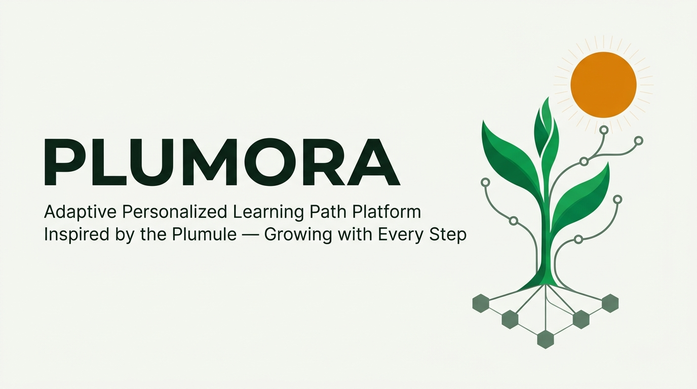
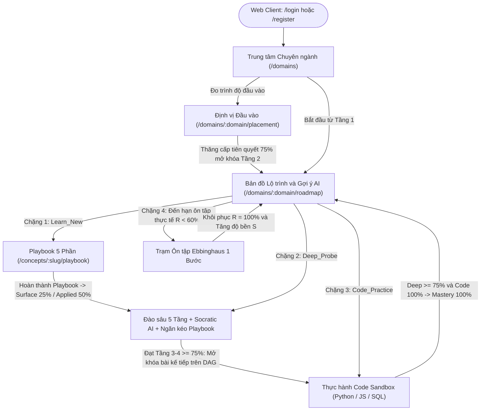
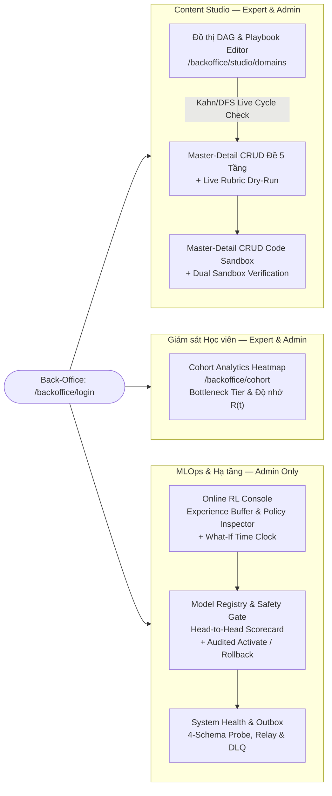
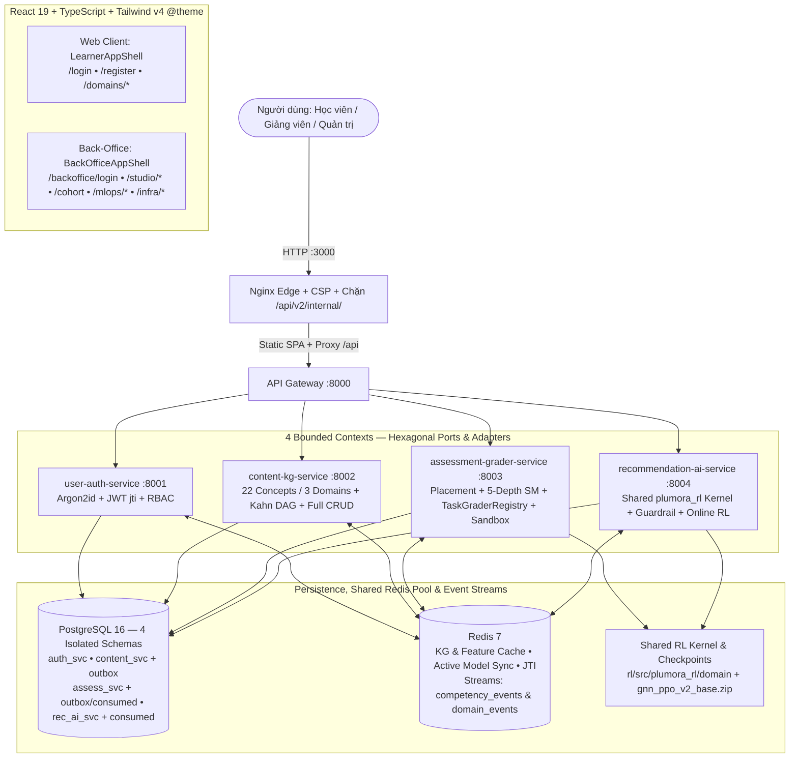

<p align="center">
  
</p>

# Plumora

**Hệ thống Quản lý và Khuyến nghị Lộ trình Học Cá nhân hóa Đa lĩnh vực bằng Học Tăng cường Đồ thị (`GNN-PPO`)**<br/>
*Adaptive Personalized Learning Path Platform — Inspired by the Plumule*

[](.github/workflows/ci.yml)
[](backend/pyproject.toml)
[](frontend/package.json)
[](docker-compose.yml)
[](docker-compose.yml)

---

## 1. Giới thiệu & Năng lực Hiện tại của Hệ thống

Tên gọi **Plumora** bắt nguồn từ *Plumule* (chồi cây non) — biểu tượng của hành trình học tập thích ứng, vững chắc từ gốc đến ngọn. Hệ thống hiện tại bao gồm:

- **Đồ thị Tri thức Đa lĩnh vực (Multi-Domain Knowledge Graph):** Quản lý **31 vị trí khái niệm** thuộc **3 lĩnh vực** (`backend`: 12, `frontend`: 10, `devops`: 9) theo Đồ thị Có hướng Không chu trình (**DAG** 4 tầng), quy về **22 khái niệm duy nhất** với **7 khái niệm giao thoa** đồng bộ tiến độ liên ngành.
- **Bộ Học liệu & Đánh giá Chuyên sâu trên Cả 3 Ngành:**
  - **Bài giảng Lý thuyết 5 Phần (`Playbook`):** Đầy đủ mô hình tư duy, cơ chế tầng sâu, ví dụ mã nguồn/cấu hình thực chiến, lỗi thường gặp và bảng đánh đổi kiến trúc.
  - **Ngân hàng 110 Câu hỏi Đào sâu 5 Tầng (`5-Depth Probing`):** Tầng 1–2 trắc nghiệm phân bổ cân bằng `A/B/C/D` (phản hồi tức thì, hỗ trợ phím tắt `1–4`); Tầng 3–5 tự luận tình huống (`troubleshooting`, `code_review`, `constraint_shifting`, `teach_back`) chấm theo biểu điểm Rubric tách biệt từng tầng (hỗ trợ đồng nghĩa song ngữ Việt–Anh, chống nhồi từ khóa/phủ định và đưa ra gợi ý *Socratic AI Tutor* không lộ đáp án ở lần thử đầu).
  - **22/22 Bài tập `Code Sandbox` Cô lập:** Hỗ trợ `Python`, `JavaScript` và `SQL` (hỗ trợ `setup_sql` riêng cho từng test case và `sqlite3.set_authorizer` chỉ đọc), giới hạn RAM `128MB`, timeout `<= 3000ms`, có test công khai và test ẩn chống hardcode.
- **Động cơ Thích ứng `GNN-PPO` & Đường cong Trí nhớ *Ebbinghaus*:**
  - Dùng chung lõi Toán/RL không phụ thuộc PyTorch (`rl/src/plumora_rl/domain/` và `inference/`) giữa huấn luyện và phục vụ: `GraphObservationBuilder` (chuẩn hóa bậc hàng $\tilde{\mathbf{A}} = \mathbf{D}^{-1}\mathbf{A}$), `PolicyGuardrailStrategy`, `EbbinghausMemoryModel` ($R(t) = e^{-\Delta t/S}$, lịch hẹn ôn tập thực tế `next_review_due_at`), `MultiObjectiveRewardCalculator` và `NumpyGnnPredictor`.
  - Hỗ trợ *Định vị Đầu vào Thích ứng* (*Adaptive Placement* với *Transitive Prerequisite Promotion* mở khóa thực sự Tầng 2) và lời giải thích khuyến nghị bằng ngôn ngữ sư phạm động (`PedagogicalRationaleBuilder`).
- **Tách biệt Rạch ròi 2 Cổng Ứng dụng (`Web Client` vs `Back-Office Console`):**
  - **Web Client (`/login`, `/register`, `/domains/*`):** Không gian học tập cá nhân gọn sạch theo phong cách *Chồi Cây Non*, không có nút demo hay biệt ngữ kỹ thuật nội bộ.
  - **Back-Office Console (`/backoffice/login`, `/backoffice/*`):** Bàn điều khiển chuyên biệt (Left Sidebar `240px`) dành riêng cho Giảng viên (`expert`) và Quản trị viên (`admin`) gồm *Content Studio* (Full CRUD), *Cohort Analytics*, *MLOps Console* và *Infrastructure Health*.

---

## 2. Luồng Nghiệp vụ Tuần tự Thực tế

### 2.1. Web Client — Hành trình Học viên Tuần tự (`INV-SEQ-01..04`)



### 2.2. Back-Office Console — Vận hành Học liệu, Đoàn hệ & MLOps



---

## 3. Kiến trúc Hệ thống (System Design)

Chi tiết thiết kế xem thêm tại [docs/design.md](docs/design.md). Kiến trúc triển khai hiện tại áp dụng **Hexagonal Ports & Adapters** (`ContentCatalogPort`, `CompetencyReaderPort`), **3-Phase `SqlAlchemyUnitOfWork`** (tách Sandbox/LLM I/O ra khỏi DB lock), **Shared `RedisConnectionProvider`** và **Shared Zero-Torch RL Kernel**:



- **PostgreSQL 16 (4 Schema cô lập):** `auth_svc`, `content_svc` (có `outbox_events` riêng), `assess_svc` (có `outbox_events` & `consumed_events` riêng), `rec_ai_svc` (có `consumed_events` riêng); kiểm tra cô lập thực tế qua `pg_catalog`, quét Outbox bằng `FOR UPDATE SKIP LOCKED` chống phát trùng đa worker.
- **Redis 7:** Kết nối tập trung qua `RedisConnectionProvider`, hỗ trợ Time-Aware Feature Cache (`plumora:raw_comp_state:*` xóa tức thời khi cập nhật năng lực), đồng bộ epoch cache đa worker (`plumora:kg:epoch`), đồng bộ con trỏ Active Model (`plumora:model_registry:active`), thu hồi JWT (`jti`) và 2 luồng `Redis Streams` (`plumora:competency_events`, `plumora:stream:domain_events` với `consumer_name = {hostname}-{pid}`).
- **Kiến trúc Docker Thống nhất (`v4.0` — `D-27`..`D-36`):** `docker compose up -d --build` dựng duy nhất cụm **4 Microservices + API Gateway (`:8000`, có `X-Request-ID` & Redis Sliding-Window Rate Limiter) + `db-migrate-seed` + non-root Nginx Frontend (`:3000`) + PostgreSQL 16 + Redis 7** kèm persistent volume `plumora_rl_candidates`. (`backend/app/main.py` chỉ giữ làm in-process harness cho `pytest`; thư mục `k8s/` đã đồng bộ lên chuẩn `v4.0.0`).

---

## 4. Khởi chạy Bằng Docker Compose

Yêu cầu: đã cài **Docker** và **Docker Compose**.

```bash
# Khởi dựng thống nhất cụm 4 Microservices + API Gateway + PostgreSQL + Redis + Frontend
docker compose up -d --build

# Kiểm tra trạng thái container (toàn bộ dịch vụ hiển thị Up / healthy)
docker compose ps
```

- **Web Client (Học viên):** [http://localhost:3000/login](http://localhost:3000/login) (hoặc đăng ký mới tại `/register`)
- **Back-Office Console (Giảng viên & Admin):** [http://localhost:3000/backoffice/login](http://localhost:3000/backoffice/login)
- **Tài liệu API Swagger:** [http://localhost:8000/docs](http://localhost:8000/docs)
- **Health Check:**
  ```bash
  curl -s http://localhost:3000/api/v1/health
  ```
- **Chấm tự luận LLM ngoài (Tùy chọn):** Sao chép `.env.example` sang `.env` và điền `PLUMORA_LLM_API_KEY` (hỗ trợ chuẩn OpenAI-compatible như Google AI Studio `gemini-3.8-flash`, timeout mặc định `PLUMORA_LLM_TIMEOUT_S=8.0`); nếu để trống key, `CircuitBreakerRubricService` tự động dùng `DeterministicRubricGrader` offline.

---

## 5. Tài khoản Seeded cho Môi trường Dev / Kiểm thử

Giao diện đăng nhập đã loại bỏ toàn bộ nút điền nhanh demo. Để kiểm thử cục bộ trên dữ liệu seed sẵn trong PostgreSQL, có thể đăng nhập thủ công với mật khẩu dev chung `PlumoraDemo#2026`:

| Vai trò | Cổng truy cập | Tên đăng nhập | Mục đích |
| :--- | :--- | :--- | :--- |
| **Học viên** | `/login` | `learner_new` | Học viên mới (`0/12` Backend) |
| **Học viên** | `/login` | `learner_foundation` | Đã hoàn thành nền tảng (`4/12` Backend) |
| **Học viên** | `/login` | `learner_api_stage` | Học viên nâng cao (`7/12` Backend) |
| **Chuyên gia** | `/backoffice/login` | `expert_demo` | Content Studio (DAG, Playbook, 5-Depth CRUD, Code Sandbox) & Cohort Analytics |
| **Quản trị** | `/backoffice/login` | `admin_demo` | Toàn quyền Content Studio, Cohort Analytics, MLOps & System Health |

---

## 6. Kết quả Đánh giá Mô hình `GNN-PPO` (Trong Mô phỏng `v4.0.0`)

Checkpoint cơ sở `rl/artifacts/gnn_ppo_v2_base.zip` (`selected_seed = 101`, `SHA-256 = 824bebf1c988b914e31b293787403de8b65f7f9d3d72c3e6caf68a1f3998d2f6`) được huấn luyện công bằng với cùng ngân sách `timesteps_per_seed = 60,000` trên 3 seeds (`101`, `202`, `303`), chọn trên `val_seed = 999` (`200` episodes) và đánh giá trên **500 episodes** (`eval_seed = 2026`, `dt = 0.25d`, đồng bộ bất biến `INV-SEQ-01..03`):

| Chỉ số | `GNN-PPO Masked` (3 ngành đã biết) | `GNN-PPO Masked` (*Zero-shot*: `heldout_data_eng_graph`) |
| :--- | :---: | :---: |
| **Phần thưởng tích lũy (`mean_reward ± std`)** | `59.30 ± 10.14` (`Unmasked`: `59.29 ± 10.07`) | `60.63 ± 10.93` (`Unmasked`: `60.56 ± 10.92`) |
| **Tỷ lệ hoàn thành khóa học (`completion_rate`)** | `53.6%` (`Unmasked`: `53.4%`) | `61.0%` (`Unmasked`: `61.2%`) |
| **Tỷ lệ lỗi `Unmasked` (cả tiên quyết & lặp thừa)** | `0.00%` (`DQN-MLP`: `78.58%`, `PPO-MLP`: `87.04%`) | `0.00%` (`DQN-MLP`: `78.22%`, `PPO-MLP`: `82.09%`) |
| **Tỷ lệ vi phạm có `Policy Guardrail`** | `0.00%` | `0.00%` |

> Kết quả trên được đo trong bộ mô phỏng đa ngành (`rl/src/plumora_rl/multidomain_sim.py`), không đồng nhất với hiệu quả học tập trên người thật. Chi tiết xem tại [RL_EXPERIMENTAL_REPORT.md](docs/defense/RL_EXPERIMENTAL_REPORT.md).

---

## 7. Kiểm tra Chất lượng Tự động & Tài liệu

```bash
# Chạy toàn bộ 7 cổng CI trực tiếp trên cụm Docker 4 Microservices + API Gateway sống
./scripts/ci_check.sh
```

- **Bộ kiểm thử hiện có:** `17` RL tests (bao gồm parity PyTorch $\leftrightarrow$ NumPy, zero-Torch import & hiệu chuẩn `v4.0`), `104` Backend tests (bao gồm `13` Architectural Fitness Functions tại `backend/tests/architecture/`), `13` Frontend Vitest unit tests, cùng Live Fullstack Integration & Real Chromium E2E trên cụm Microservices thật.
- **Tài liệu dự án:** [Intent](docs/intent.md) | [Spec](docs/spec.md) | [Design](docs/design.md) | [UI Design System](docs/ui-design-system.md) | [Decisions](docs/decisions.md) | [RL Plan](docs/research/RL_PLAN.md) | [RL Experimental Report](docs/defense/RL_EXPERIMENTAL_REPORT.md) | [Manual Testing Script](docs/verification/MANUAL_SYSTEM_TESTING_SCRIPT.md)
