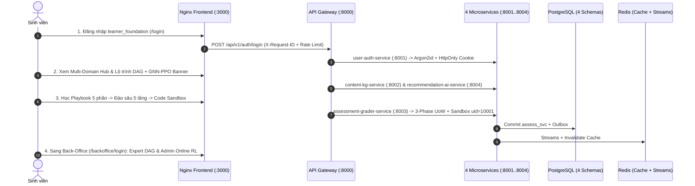

# Kịch Bản Thao Diễn & Phản Biện Bảo Vệ Đồ Án Tốt Nghiệp (`Plumora v4.0.0`)

> **Đề tài:** Hệ thống Quản lý và Khuyến nghị Lộ trình Học Cá nhân hóa Đa lĩnh vực bằng Học tăng cường Đồ thị (`GNN-PPO`)
> **Phiên bản:** `v4.0.0 Final Clean Baseline` (`D-31`–`D-36`)
> **Thời lượng thao diễn dự kiến:** 8–10 phút trình chiếu trực tiếp trên cụm Docker Microservices thật.

---

## 1. Chuẩn Bị Môi Trường Trước Giờ Hội Đồng

```bash
cd /home/diepvanhieu/workspace/plumora

# Khởi động sạch cụm 4 Microservices + API Gateway + Frontend + PostgreSQL + Redis
docker compose up -d --build --wait
docker compose ps
```

- **Kiểm tra nhanh sức khỏe cụm (`status: "ok"`, `mode: "microservices"`):**
  ```bash
  curl -s http://127.0.0.1:8000/api/v1/health
  ```
- **Mở sẵn 3 tab trình duyệt:**
  1. **Web Client (Học viên):** `http://localhost:3000/login`
  2. **Back-Office Console (Chuyên gia & Quản trị):** `http://localhost:3000/backoffice/login`
  3. **API Gateway Swagger:** `http://localhost:8000/docs`

> **Tài khoản Seed (mật khẩu chung `PlumoraDemo#2026`, không có nút điền nhanh demo):**
> - Học viên mới (`0/12` Backend): `learner_new` | Học viên nền tảng (`4/12` Backend): `learner_foundation`
> - Chuyên gia: `expert_demo` | Quản trị viên: `admin_demo`

---

## 2. Luồng Thao Diễn Trực Tiếp 8–10 Phút (`Live Demo Flow`)



### Phút 0–1: Kiến trúc Tổng thể & Bảo mật Tách 2 Cổng
- Mở `http://localhost:3000/backoffice/login`, thử đăng nhập bằng `learner_foundation` $\rightarrow$ bị từ chối `403 FORBIDDEN_ROLE` (học viên không thể vào cổng quản trị).
- Đăng nhập đúng tại `http://localhost:3000/login` (`learner_foundation` / `PlumoraDemo#2026`). Nhấn **`F5`** ngay sau khi vào trang để chứng minh phiên `HttpOnly __Host-` Cookie khôi phục mượt, không nháy màn hình đăng nhập.

### Phút 1–3: Đa lĩnh vực, Giao thoa Tri thức & Khuyến nghị `GNN-PPO`
- Tại **Multi-Domain Hub**, chỉ ra 3 đồ thị DAG: `Backend (12)`, `Frontend (10)`, `DevOps (9)` cùng **7 khái niệm giao thoa liên ngành** (học ở ngành này tự động đồng bộ sang ngành khác).
- Bấm vào ngành **Frontend** (hoặc **Backend**): chỉ ra Banner khuyến nghị **`GNN-PPO + Policy Guardrail`** kèm mã băm checkpoint `SHA-256 = 824bebf1...` và chỉ số trí nhớ *Ebbinghaus* $R(t) = e^{-\Delta t / S}$.
- Chỉ ra một node đang bị khóa: nút hành động bị khóa mờ và hiển thị rõ điều kiện tiên quyết cần đạt (`>= 75%`).

### Phút 3–6: Chuỗi Học Tuần Tự (`INV-SEQ-01` & Điều kiện Kép `1.00 Mastery`)
- Chọn một node đã mở khóa (chưa học Playbook): chỉ ra nút **"Kiểm tra 5 tầng"** và **"Thực hành Code"** đang bị khóa mờ kèm nhắc nhở *"Cần đọc và xác nhận hoàn thành Bài giảng Lý thuyết trước"* (`INV-SEQ-01`).
- Mở **Playbook 5 phần** $\rightarrow$ đọc lướt cấu trúc chuẩn 5 mục $\rightarrow$ bấm hoàn thành Playbook $\rightarrow$ hai nút kiểm tra mở khóa tức thì.
- Vào **Kiểm tra Đào sâu 5 tầng**:
  - Trả lời Tầng 1–2 (MCQ); cố tình chọn sai lượt 1 ở Tầng 1 để chứng minh hệ thống tự **xoay sang câu hỏi biến thể khác** từ ngân hàng **220 câu** (không lặp lại đề cũ).
  - Nếu qua Tầng 3–5 tự luận, mở **AI Tutor & Rubric Drawer** để xem điểm từng tiêu chí (chạy `LLM Adapter` với timeout `8.0s` hoặc `Deterministic Fallback` khi offline) và nút CTA **"Sang Phòng Thực hành Code để đạt Làm chủ (100%)"** (`INV-SEQ-02`).
- Vào **Code Sandbox** (`Python / JS / SQL`):
  - Thử nhập `import os` (hoặc `while True: pass`) $\rightarrow$ bị chặn `422 SANDBOX_SECURITY_VIOLATION` (hoặc cắt timeout `<= 3000ms` `408`).
  - Chạy lời giải đúng $\rightarrow$ Pass `100%` test cases.

### Phút 6–8: Cổng Chuyên gia (`Expert`) & Quản trị (`Admin` — `Safe Online RL` & Microservices)
- Đăng xuất $\rightarrow$ Đăng nhập `http://localhost:3000/backoffice/login` bằng `expert_demo` / `PlumoraDemo#2026`:
  - Tại **Quản lý Lĩnh vực**: thử nối cạnh tạo vòng lặp DAG $\rightarrow$ bị chặn ngay `422 DAG_CYCLE_DETECTED` (thuật toán Kahn).
  - Tại **Ngân hàng Câu hỏi & Code Sandbox**: chỉ ra đủ **220 câu hỏi** (2 câu/tầng/khái niệm), tổng trọng số Rubric $= 1.0$ và tính năng kiểm thử kép.
- Đăng xuất $\rightarrow$ Đăng nhập `admin_demo` / `PlumoraDemo#2026`:
  - Tại **Online RL & Safety Gate**: chỉ ra `Verified Experience Buffer`, **Policy Inspector** khớp `checkpoint_sha256`, **Safety Evaluation Gate** (`60` bước chuẩn, `KL <= 0.04`) và nút **`1-Click Rollback`** (`< 2000ms`).
  - Tại **System Health**: chỉ ra **4 Microservices** khỏe mạnh, **4 Schema PostgreSQL cô lập (`schemas_isolated: true` qua `pg_catalog`)** và hàng đợi `Outbox / Redis Streams`.

### Phút 8–9: Chứng minh Chịu lỗi & Bảo mật Biên (nếu Hội đồng yêu cầu)
```bash
# 1. Edge Security tại API Gateway (:8000): Internal route -> 403, Traversal -> 400
curl -i http://127.0.0.1:8000/api/v2/internal/domains/frontend/bundle
curl -i --path-as-is "http://127.0.0.1:8000/api/v2/domains/%25252e%25252e/health"

# 2. Chaos Fallback: Tắt Redis -> Web Client vẫn chạy bình thường nhờ PostgreSQL SSoT
docker stop plumora-redis
# (Reload trang web -> state_source chuyển sang postgres_fallback)
docker start plumora-redis
```

---

## 3. Bộ Câu Hỏi Hóc Búa Của Hội Đồng & Đáp Án Chuẩn Khoa Học (`v4.0.0`)

### Câu 1: Tại sao phải dùng `GNN-PPO` mà không dùng Heuristic (luật cứng) hay mạng MLP (`DQN-MLP`, `PPO-MLP`)?
- **Trả lời:**
  > *"Thưa Thầy Cô, mạng MLP thông thường nhận đầu vào dạng vector phẳng kích thước cố định, nên khi số lượng khái niệm thay đổi hoặc sang đồ thị mới, MLP không hiểu được cấu trúc cạnh tiên quyết. Thực nghiệm trên 500 học viên ảo (`eval_seed = 2026`, `60,000` steps/seed) chứng minh: khi tắt mặt nạ `Policy Guardrail`, `DQN-MLP` và `PPO-MLP` mắc lỗi chọn bài sai quy tắc tới **`78.58% – 87.04%`**, trong khi `GNN-PPO` nhờ truyền thông điệp trên đồ thị đạt **`0.00%` lỗi** trên cả 3 ngành đã biết lẫn đồ thị chưa từng thấy (`heldout_data_eng_graph`). Về điểm thưởng, `GNN-PPO Masked` đạt **`59.30`** (Known) và **`60.63`** (Zero-shot), vượt toàn bộ `Heuristic B1/B2/B3` (`36.08–55.47`) và `MLP` (`55.31–57.71`)."*

### Câu 2: Kết quả mô phỏng có chứng minh mô hình giúp người học thật giỏi hơn không?
- **Trả lời:**
  > *"Dạ thưa Thầy Cô, hoàn toàn không thể đánh đồng trực tiếp. Nhóm em tuân thủ nghiêm ngặt ranh giới khoa học: kết quả trên `MultiDomainStudentSimulatorEnv` (`dt = 0.25` ngày/bước, đường cong quên Ebbinghaus $R(t) = e^{-\Delta t/S}$, `30%` khởi tạo trạng thái Placement) chứng minh tính hội tụ toán học, khả năng tổng quát hóa Zero-shot và tính an toàn ràng buộc của giải thuật. Để khẳng định hiệu quả sư phạm trên người thật cần thử nghiệm A/B có đối chứng sau đồ án."*

### Câu 3: Khi chạy `Online RL` cập nhật mô hình từ dữ liệu người dùng thật, làm sao tránh mô hình học sai hoặc bị hỏng (`Catastrophic Forgetting`)?
- **Trả lời:**
  > *"Hệ thống áp dụng 4 lớp khóa an toàn (`INV-ONLINE-RL-01`): (1) Tinh chỉnh theo lô nhỏ (`Micro-batch PPO`) dùng TD Critic Advantage kèm ràng buộc **Trust-Region KL** (`target_kl = 0.04`, tự lùi bước nếu vượt ngưỡng); (2) Mọi checkpoint ứng viên bắt buộc đi qua **Safety Evaluation Gate** giả lập `200` episodes chuẩn 60 bước — nếu `unmasked_invalid_rate >= 5%` hoặc reward tụt dưới `98%` production sẽ bị khóa `BLOCKED`; (3) Tầng phục vụ luôn bọc `Policy Guardrail` đảm bảo `0%` vi phạm DAG; (4) Admin có nút **`1-Click Rollback`** khôi phục tức thì dưới `2000ms`."*

### Câu 4: Tại sao đồ án tốt nghiệp lại tách tới 4 Microservices + 4 Schema PostgreSQL? Có bị "over-engineering" không?
- **Trả lời:**
  > *"Việc tách 4 dịch vụ gắn với 4 miền nghiệp vụ tách biệt rõ ràng: `Auth`, `Content KG`, `Assessment & Sandbox` (tác vụ nặng I/O gọi LLM 8s và chạy subprocess Code Sandbox 3s), và `Recommendation AI` (suy luận GNN-PPO). Nhờ tách riêng và dùng mô hình **3-Phase Unit of Work**, độ trễ chấm LLM/Sandbox không làm nghẽn kết nối DB của luồng đăng nhập hay đọc lộ trình; đồng thời mỗi service bị khóa chặt quyền trên schema riêng (`pg_catalog` xác nhận không đọc/ghi chéo schema) và đồng bộ bất đồng bộ qua `Transactional Outbox + Redis Streams`. Benchmark 20 người dùng đồng thời trên cụm Docker thật đạt `126.93 req/s`, `0.0%` lỗi 5xx, `p95 GNN-PPO = 242.89ms`."*

### Câu 5: Chạy code Python/JS/SQL của người dùng trực tiếp trên server có bị tấn công RCE hay treo server không?
- **Trả lời:**
  > *"Hệ thống bảo vệ Sandbox đa lớp (`INV-SANDBOX-01`): (1) Kiểm tra tĩnh AST / SQLite authorizer chặn `import os/socket`, dunder attributes, `PRAGMA/ATTACH`, `require/process/fetch` trước khi thực thi; (2) Thực thi trong tiến trình con không đặc quyền (`uid = 10001`), xóa toàn bộ biến môi trường bí mật, giới hạn bộ nhớ `128MB` (`RLIMIT_AS`) và ngắt cứng vòng lặp vô hạn trong `<= 3000ms` (`408 SANDBOX_TIMEOUT`)."*

### Câu 6: Làm sao chống gian lận dữ liệu (Data Leakage) khi huấn luyện và đánh giá RL?
- **Trả lời:**
  > *"Biến ẩn năng lực học viên $\alpha$ chỉ nằm trong simulator và tuyệt đối không xuất hiện trong vector đặc trưng 8 chiều/node (`test_arch_rl_numerical_parity`). Tập hạt giống tách biệt hoàn toàn: `train_seeds = [101, 202, 303]`, chọn mô hình trên `val_seed = 999`, và đánh giá độc lập trên `eval_seed = 2026` (`500` episodes) cùng đồ thị giữ kín `heldout_data_eng_graph`."*
