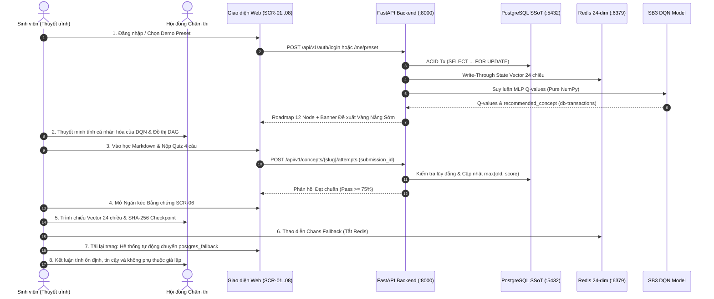

# Kịch Bản Thao Diễn Bảo Vệ Đồ Án Tốt Nghiệp (`Graduation Defense Demo Runbook`)

> **Đề tài:** Hệ thống Quản lý và Khuyến nghị Lộ trình Học Cá nhân hóa ứng dụng Mô hình Học Tăng cường (Plumora)  
> **Phiên bản:** `v1.0.0-mvp` (Gate 4 Release)  
> **Thời lượng thao diễn dự kiến:** 8–10 phút trình chiếu trực tiếp trên máy tính cá nhân.

---

## 1. Chuẩn Bị Môi Trường Trước Giờ Báo Cáo

Trước khi vào phòng hội đồng, hãy đảm bảo hệ thống ở trạng thái sạch và sẵn sàng:

```bash
# Di chuyển vào thư mục dự án
cd /home/diepvanhieu/workspace/plumora

# Dọn dẹp trạng thái cũ (nếu có) và khởi động cụm 4 dịch vụ
docker compose down -v
docker compose up --build -d

# Kiểm tra trạng thái toàn bộ dịch vụ (Cả 4 container phải hiển thị Up/healthy)
docker compose ps
```

- **Giao diện Web Người học (Frontend):** Mở trình duyệt tại `http://localhost:3000` (hoặc `http://localhost:5173` nếu chạy dev mode).
- **Tài liệu API Swagger (Backend):** Mở sẵn tại tab phụ `http://localhost:8000/docs`.

---

## 2. Kịch Bản Thao Diễn Trực Tiếp 8 Bước (`Live Demo Script`)



---

### Bước 1: Mở Đầu & Giới Thiệu Bản Sắc Thị Giác (Thời lượng: ~1 phút)
- **Hành động trên màn hình:** Hiển thị màn hình đăng nhập `SCR-01` tại `http://localhost:3000`.
- **Thuyết minh với Hội đồng:**
  > *"Kính thưa Thầy Cô trong Hội đồng, Plumora lấy cảm hứng từ chồi cây non (Plumule) — tượng trưng cho sự sinh trưởng tri thức thích ứng với từng cá nhân. Hệ thống áp dụng bảng màu tự nhiên Chồi Cây Non (Botanical Sprout & Sunlit Canopy: Xanh lá `#15803D`, Vàng Nắng Sớm `#D97706`), sử dụng 100% SVG Vector icons chuẩn mực, tuyệt đối không dùng ký tự emoji để đảm bảo tính chuyên nghiệp của một sản phẩm giáo dục đại học."*

---

### Bước 2: Đăng Nhập & Hồ Sơ Mẫu Demo Presets (Thời lượng: ~1.5 phút)
- **Hành động trên màn hình:**
  - Nhấp vào nút chọn nhanh **"Demo 2: Nền tảng sẵn sàng (4/12 node)"** (`learner_foundation`).
  - Hệ thống tự động điền thông tin và đăng nhập vào màn hình `SCR-02` (Bản đồ lộ trình DAG).
- **Thuyết minh với Hội đồng:**
  > *"Để hội đồng có thể kiểm chứng ngay khả năng thích ứng của mô hình mà không cần tốn 30 phút làm bài từ đầu, hệ thống cung cấp 3 tài khoản hạt giống thật (Seed Users) đi qua toàn bộ luồng mã hóa mật khẩu `Argon2id` và bảo mật phiên `HttpOnly Cookie`. Ở tài khoản này, học viên đã hoàn thành 4 khái niệm thuộc Tầng 1 và Tầng 2."*

---

### Bước 3: Bản Đồ 12 Khái Niệm DAG & Khuyến Nghị DQN (Thời lượng: ~1.5 phút)
- **Hành động trên màn hình:**
  - Chỉ vào **AiRecommendationBanner** nổi bật màu Vàng Nắng Sớm ở đầu trang: `db-transactions` (Giao dịch Cơ sở dữ liệu).
  - Lướt qua các tầng của đồ thị DAG:
    - *Tầng 1 & 2:* Các node đã xanh lá (`100%` hoặc `75%`).
    - *Tầng 3:* Node `db-transactions` viền vàng nhấp nháy (AI đề xuất), node `api-rest` viền xanh ngọc lá mạ (mới mở khóa), các node Tầng 4 màu xám đá ấm (đang khóa).
- **Thuyết minh với Hội đồng:**
  > *"Tại sao mô hình lại đề xuất `db-transactions` thay vì `api-rest` hay `db-nosql`? Ở đây, mạng Deep Q-Network đã được huấn luyện trên 24 chiều trạng thái: 12 chiều điểm thông thạo hiện tại và 12 chiều điều kiện tiên quyết hợp lệ. Mô hình nhận diện rằng học viên vừa nắm chắc `db-relational`, việc củng cố ngay tính chất ACID của Transaction sẽ tối ưu hóa khả năng tiếp thu và rút ngắn tổng số bước hoàn thành khóa học so với việc học ngẫu nhiên."*

---

### Bước 4: Học Lý Thuyết & Nộp Bài Quiz 4 Câu (Thời lượng: ~1.5 phút)
- **Hành động trên màn hình:**
  - Nhấp vào nút **"SCR-03: Bài học"** hoặc nhấp trực tiếp vào thẻ `db-transactions`.
  - Cuộn đọc bài học Markdown với các khái niệm ACID được định dạng rõ ràng.
  - Chuyển sang phần **"SCR-04: Trắc nghiệm"**:
    - Thử chọn 3 câu $\rightarrow$ Nút **"Nộp bài kiểm tra"** vẫn bị khóa mờ (`Disabled State`).
    - Chọn đủ câu thứ 4 (ví dụ 3 câu đúng, 1 câu sai để đạt mốc $3/4 = 75\%$).
    - Bấm **"Nộp bài kiểm tra"**.
  - Kết quả hiển thị thẻ chúc mừng màu xanh lá: `ĐẠT CHUẨN THÔNG THẠO (PASSED: 75% — 3/4 câu đúng)`.
- **Thuyết minh với Hội đồng:**
  > *"Hệ thống áp dụng bất biến đánh giá nghiêm ngặt: Mỗi bài kiểm tra cố định 4 câu hỏi trắc nghiệm một đáp án, bắt buộc hoàn thành 100% mới được nộp. Ngưỡng đạt chuẩn là từ 75% trở lên. Khi đạt, trạng thái bài học lập tức chuyển thành Mastered."*

---

### Bước 5: Giao Dịch ACID & Lũy Đẳng Chống Nộp Trùng (Thời lượng: ~1 phút)
- **Hành động trên màn hình:**
  - Nhấp lại vào nút nộp bài hoặc bấm Refresh trang.
  - Tiến độ thông thạo tăng từ `4 / 12 (33%)` lên `5 / 12 (42%)`.
  - Node tiếp theo trên tầng 3 (`api-rest`) được mở khóa.
- **Thuyết minh với Hội đồng:**
  > *"Dưới tầng Backend, toàn bộ quá trình nộp bài được bọc trong một giao dịch ACID của PostgreSQL với kỹ thuật Khóa Dòng Bị Động (`SELECT ... FOR UPDATE`). Hệ thống kiểm soát tính lũy đẳng bằng mã `submission_id` duy nhất: ngay cả khi học viên bị lag mạng và click đúp nộp 2 lần, hệ thống đảm bảo điểm số chỉ cập nhật một lần duy nhất, bảo lưu điểm cao nhất `mastery = max(old, score)`, không bao giờ khóa ngược các bài đã mở."*

---

### Bước 6: Ngăn Kéo Bằng Chứng RL & Minh Bạch AI (Thời lượng: ~1 phút)
- **Hành động trên màn hình:**
  - Nhấp vào nút **"Bằng chứng AI & Vector 24 chiều"** ở góc phải thanh điều hướng.
  - Ngăn kéo `SCR-06` trượt ra từ bên phải màn hình:
    - Hiển thị 24 ô vuông trạng thái: 12 ô thông thạo (`0.0` – `1.0`) và 12 ô hợp lệ (`1.0` hoặc `0.0`).
    - Hiển thị thông tin Checkpoint: `dqn-v1-seed303`, mã băm `SHA-256 = e464fa638cee...`, nguồn phục vụ `policy_source: dqn`.
- **Thuyết minh với Hội đồng:**
  > *"Plumora không phải là một chiếc hộp đen AI bí ẩn. Chúng em cung cấp cơ chế giải trình minh bạch: Hội đồng có thể quan sát trực tiếp vector đầu vào 24 chiều mà mạng Q-Network tiếp nhận, cùng mã băm SHA-256 bất biến của mô hình. Backend thực thi mạng nơ-ron này bằng pure NumPy tối ưu, đạt tốc độ suy luận dưới 1 phần nghìn giây mà không cần cài đặt thư viện PyTorch cồng kềnh trên server web."*

---

### Bước 7: Thao Diễn Khả Năng Chịu Lỗi Đối Kháng (Chaos / Fallback) (Thời lượng: ~1 phút)
- **Hành động trên màn hình:**
  - Mở terminal và chạy lệnh tạm dừng Redis:
    ```bash
    docker stop plumora-redis
    ```
  - Quay lại trình duyệt và tải lại trang web `http://localhost:3000`.
  - Web **hoàn toàn không bị lỗi 500 hay treo ứng dụng**. Mở ngăn kéo bằng chứng: trạng thái hiển thị rõ ràng: `state_source: postgres_fallback`.
  - Chạy lệnh bật lại Redis:
    ```bash
    docker start plumora-redis
    ```
- **Thuyết minh với Hội đồng:**
  > *"Trong kỹ thuật phần mềm doanh nghiệp, một mô hình AI xuất sắc vẫn vô nghĩa nếu hệ thống sập khi gặp sự cố mạng. Plumora thiết kế kiến trúc PostgreSQL làm nguồn chân lý duy nhất (SSoT) và Redis làm bộ đệm. Khi Redis gặp sự cố, hệ thống tự động giáng cấp nhẹ nhàng (Graceful Fallback), đọc trực tiếp từ PostgreSQL và tiếp tục phục vụ người học mà không làm gián đoạn bài giảng."*

---

### Bước 8: Tổng Kết & Mời Hội Đồng Đặt Câu Hỏi (Thời lượng: ~30 giây)
- **Thuyết minh với Hội đồng:**
  > *"Em xin kết thúc phần thao diễn thực tế của đề tài Plumora. Toàn bộ mã nguồn, dữ liệu thực nghiệm trên 500 tập học viên ảo và quy trình kiểm thử độc lập 4 trục đều đã được kiểm chứng xanh 100%. Em xin kính mời Quý Thầy Cô trong Hội đồng đặt câu hỏi phản biện ạ!"*

---

## 3. Bộ Câu Hỏi Phản Biện Thường Gặp Của Hội Đồng & Đáp Án Thuyết Phục

### Câu hỏi 1: Tại sao lại dùng Học tăng cường (DQN) cho đồ án này mà không dùng luật đơn giản (Heuristic/Cây quyết định)?
- **Trả lời:**
  > *"Thưa Thầy Cô, đối với đồ án tốt nghiệp, mục tiêu nghiên cứu của em là xây dựng nền tảng thích ứng thông minh dài hạn. Thuật toán luật (Heuristic) hoạt động tốt trên đồ thị nhỏ cố định, nhưng mang tính cứng nhắc và không có khả năng tự tối ưu hóa khi không gian bài học mở rộng hoặc khi người học có các đặc tính tiếp thu bất đối xứng.
  Mô hình DQN trong đồ án chứng minh khả năng tự học cấu trúc đồ thị tiên quyết mà không cần chỉ dẫn thủ công (đạt tỷ lệ chọn bài sai quy tắc `0.00%` trên tập kiểm thử), đồng thời hoàn thành khóa học nhanh hơn thuật toán ngẫu nhiên hợp lệ B2 trung bình 1.32 bước. Đây là nền tảng để nhóm phát triển tiếp sang học thích ứng trực tuyến (Online RL) trong tương lai."*

### Câu hỏi 2: Kết quả trên môi trường giả lập (Gymnasium Student Simulator) có đáng tin cậy trên người học thật không?
- **Trả lời:**
  > *"Thưa Thầy Cô, nhóm em hoàn toàn trung thực về mặt khoa học: Kết quả mô phỏng trên Gymnasium chứng minh tính hội tụ toán học và độ tin cậy phần mềm của giải thuật, nhưng **không thể đánh đồng trực tiếp với hiệu quả học tập trên học viên thực tế**. 
  Trong môi trường giả lập, học viên ảo có năng lực $\alpha$ cố định và không bị quên kiến thức. Trong thực tế, trí nhớ con người suy giảm theo thời gian (Ebbinghaus curve). Nhóm đã nêu rõ giới hạn này trong báo cáo khoa học và coi đây là tiền đề để mở rộng sang các thuật toán Lặp lại Ngắt quãng (Spaced Repetition) ở Giai đoạn 2."*

### Câu hỏi 3: Tại sao nhóm không tích hợp chấm code tự động (Auto-grader) hay AI Tutor bằng LLM vào ngay giai đoạn này?
- **Trả lời:**
  > *"Dạ thưa Thầy Cô, theo phương pháp luận phát triển phần mềm chuẩn mực (Agile MVP), một sản phẩm tốt phải giải quyết dứt điểm bài toán cốt lõi trước khi mở rộng. Bài toán cốt lõi của đề tài này là **Cá nhân hóa lộ trình bằng Học tăng cường**. 
  Nếu đưa thêm Auto-grader (cần sandbox Docker cô lập) hoặc AI Tutor (gọi LLM bên ngoài), phạm vi đề tài sẽ bị phân tán, gia tăng rủi ro bảo mật và chi phí vận hành. Nhóm quyết định khóa chặt phạm vi MVP ở 12 khái niệm Backend với trắc nghiệm MCQ 4 câu để kiểm soát chất lượng kỹ thuật đạt chuẩn Gate 3, và đưa Auto-grader vào lộ trình Giai đoạn 2 sau tốt nghiệp."*

### Câu hỏi 4: Nhóm đã làm thế nào để đảm bảo hệ thống không bị rò rỉ dữ liệu (Data Leakage) khi huấn luyện RL?
- **Trả lời:**
  > *"Dạ thưa Thầy Cô, nhóm áp dụng 3 biện pháp kỹ thuật nghiêm ngặt:
  1. **Tách biệt không gian trạng thái:** Vector quan sát 24 chiều chỉ chứa điểm thông thạo và cờ hợp lệ; biến ẩn năng lực học viên $\alpha$ tuyệt đối không xuất hiện trong vector quan sát (được kiểm chứng qua bài test `INV-RL-01`).
  2. **Tách biệt Hạt giống độc lập:** Nhóm tách biệt hoàn toàn giữa các hạt giống huấn luyện (`train_seeds = [101, 202, 303]`), hạt giống chọn mô hình (`val_seed = 999`) và hạt giống đánh giá độc lập (`eval_seed = 2026`).
  3. **Tập kiểm thử Held-out cố định:** Đánh giá trên 500 hồ sơ học viên hoàn toàn mới mà mô hình chưa từng gặp trong quá trình huấn luyện."*
