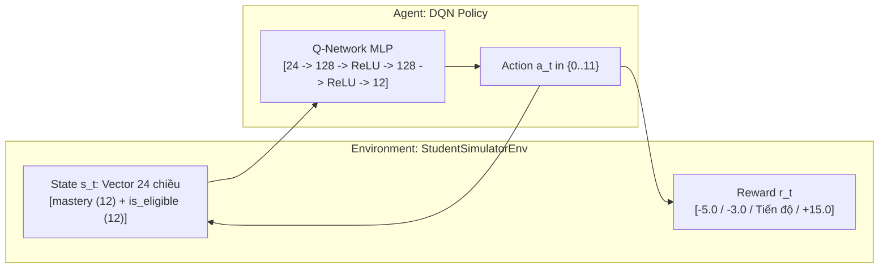

# Báo Cáo Nghiên Cứu Thực Nghiệm Học Tăng Cường (RL Experimental Report)

> **Đề tài:** Khuyến nghị Lộ trình Học Cá nhân hóa Thích ứng bằng Học Tăng cường Sâu (DQN)  
> **Dự án:** Plumora (MVP Giai đoạn 1 — Lát cắt 12 Khái niệm Backend DAG)  
> **Phiên bản:** `v1.0.0` (Căn cứ Gate 1 Baseline `v1.0.0` & Gate 3: In Review)
> **Tài liệu tham chiếu:** [docs/research/RL_PLAN.md](../research/RL_PLAN.md), [.agents/rules/rl-evidence.md](../../.agents/rules/rl-evidence.md).

---

## 1. Tóm Tắt Nghiên Cứu (Executive Summary)

Báo cáo này trình bày kết quả thiết kế, huấn luyện, nghiệm thu thực nghiệm và phục vụ suy luận của mô hình **Học Tăng Cường Sâu (Deep Q-Network — DQN)** trong việc định tuyến lộ trình học cá nhân hóa thích ứng cho học viên trên đồ thị tri thức có hướng không chu trình (**DAG**) gồm 12 khái niệm lập trình Backend chia làm 4 tầng.

### Kết quả nổi bật trên tập kiểm thử độc lập 500 học viên ảo (`eval_seed = 2026`):
- **Tỷ lệ chọn hành động không hợp lệ (`invalid_action_rate`):** Đạt **`0.00% ± 0.00%`** (ngay cả với phiên bản không áp dụng mặt nạ Q-value `DQN_unmasked`), vượt xa ngưỡng nghiệm thu kỹ thuật `< 5.0%` của tiêu chí `PL-RL-01`.
- **Tổng phần thưởng tích lũy (`episodic_reward`):** Đạt **`98.2700 ± 17.3580`**, vượt trội có ý nghĩa thống kê so với thuật toán ngẫu nhiên hợp lệ $B_2$ (`97.5510 ± 17.2364`) và cạnh tranh sát nút với thuật toán quy tắc tham lam có tri thức chuyên gia $B_3$ (`98.2690 ± 17.3554`).
- **Tốc độ hoàn thành khóa học (`steps_to_completion`):** Rút ngắn trung bình **`1.32 bước học/quiz`** cho mỗi học viên so với $B_2$ (17.88 bước so với 19.20 bước) nhờ khả năng tập trung củng cố dứt điểm kiến thức theo tầng điều kiện tiên quyết.
- **Tính toàn vẹn Checkpoint:** Checkpoint xuất xưởng từ hạt giống `seed = 303` đạt mã băm `SHA-256 = e464fa638cee04fda6a386ffb6cdf24d9190d0f1167feb56d4da0063499a6b6b`, được kiểm định toàn vẹn 100% trong toàn bộ chuỗi nạp và phục vụ suy luận của Backend.

---

## 2. Mô Hình Hóa Toán Học Bài Toán Ra Quyết Định Tuần Tự (MDP Formulation)

Bài toán khuyến nghị bài học thích ứng được mô hình hóa dưới dạng Quá trình Ra quyết định Markov (Markov Decision Process — MDP) bao gồm bộ 5 thành phần $(\mathcal{S}, \mathcal{A}, \mathcal{P}, \mathcal{R}, \gamma)$:



### 2.1. Không Gian Trạng Thái (Observation Space $\mathcal{S}$)
- Được định nghĩa bằng không gian liên tục 24 chiều: $\mathcal{S} = \text{Box}(0.0, 1.0, \text{shape}=(24,), \text{dtype}=\text{float32})$.
- Cấu trúc phân rã:
  - $\mathbf{s}[0..11] \in [0.0, 1.0]$: Mức độ thông thạo hiện tại của học viên trên 12 khái niệm Backend ($m_0, m_1, \dots, m_{11}$).
  - $\mathbf{s}[12..23] \in \{0.0, 1.0\}$: Cờ trạng thái hợp lệ ($e_0, e_1, \dots, e_{11}$), trong đó $e_i = 1.0$ khi và chỉ khi khái niệm $i$ chưa đạt chuẩn ($m_i < 0.75$) và toàn bộ các khái niệm tiên quyết của $i$ trong DAG đã đạt chuẩn ($\forall p \in \text{Prereq}(i), m_p \ge 0.75$).
- **Bất biến Chống Rò rỉ Dữ liệu (`INV-RL-01`):** Năng lực học tập tiềm ẩn của học viên ($\alpha$) là biến ẩn của môi trường giả lập, **tuyệt đối không được đưa vào vector quan sát** $\mathbf{s}$.

### 2.2. Không Gian Hành Động (Action Space $\mathcal{A}$)
- Không gian rời rạc: $\mathcal{A} = \text{Discrete}(12)$, ứng với 12 khái niệm Backend:
  - Tầng 1 (Cơ sở): `0: net-internet`, `1: os-basics`.
  - Tầng 2 (Mạng & Dữ liệu): `2: web-http`, `3: db-relational`, `4: db-transactions`, `5: db-nosql`.
  - Tầng 3 (Dịch vụ & Tối ưu): `6: api-rest`, `7: api-validation`, `8: api-data`, `9: cache-redis`.
  - Tầng 4 (Bảo mật chuyên sâu): `10: sec-authn`, `11: sec-api`.

### 2.3. Hàm Phần Thưởng (Reward Function $\mathcal{R}$)
Hàm phần thưởng được thiết kế nhằm phạt các hành vi vi phạm điều kiện tiên quyết, thưởng cho nỗ lực nâng cao độ thông thạo, và tạo động lực hoàn thành toàn bộ khóa học:

$$
r(s_t, a_t, s_{t+1}) = 
\begin{cases}
-5.0 & \text{nếu bài học đang bị khóa (Locked): } e_{a_t} = 0 \text{ và } m_{a_t} < 0.75 \\
-3.0 & \text{nếu bài học đã thông thạo (Mastered): } m_{a_t} \ge 0.75 \\
-0.5 + 4.0 \cdot \Delta m_{a_t} + 5.0 \cdot \mathbb{I}(m_{a_t}^{\text{new}} \ge 0.75 > m_{a_t}^{\text{old}}) & \text{nếu bài học hợp lệ (Eligible): } e_{a_t} = 1.0
\end{cases}
$$

- Thưởng kết thúc (`Terminal Bonus`): Khi học viên thông thạo toàn bộ 12/12 khái niệm ($m_i \ge 0.75, \forall i$), nhận thêm $+15.0$ và môi trường kết thúc (`terminated = True`).
- Giới hạn bước học: Cắt ngưỡng tại `max_steps = 40` (`truncated = True`) để chống vòng lặp vô hạn.

---

## 3. Môi Trường Giả Lập Học Viên (`StudentSimulatorEnv`)

### 3.1. Mô Phỏng Năng Lực Học Viên & Động Lực Tiếp Thu
- Mỗi episode khởi tạo một học viên ảo với năng lực học tập ngẫu nhiên: $\alpha \sim \text{Uniform}(0.35, 0.75)$.
- Độ khó của từng tầng: $\text{tier\_difficulty} = 0.08 + 0.07 \cdot (\text{tier} - 1)$.
- Điểm trung bình tiên quyết $\overline{m}_{\text{prereqs}}$ lấy theo các khái niệm phụ thuộc trực tiếp (mặc định $0.85$ nếu là khái niệm gốc).
- Tải trọng nhận thức do phân tán giữa các chủ đề đang dở dang: $\text{cognitive\_load\_penalty} = 0.14 \cdot N_{\text{unfinished}}$, với $N_{\text{unfinished}}$ là số khái niệm khác đang có $0.0 < m_j < 0.75$.
- Năng lực cơ bản:
$$
\text{base\_competence} = \begin{cases} 0.24 & \text{nếu } m_a = 0.0 \\ 0.52 + 0.55 \cdot m_a & \text{nếu } m_a > 0.0 \end{cases}
$$
- Xác suất trả lời đúng từng câu hỏi trắc nghiệm khi học bài $a$ (`effective_p`) được xác định chính xác theo `simulator.py`:

$$
p_{\text{correct}} = \text{clip}\left(\text{base\_competence} + 0.42 \cdot \alpha \cdot (1.0 - \text{tier\_difficulty}) + 0.12 \cdot \overline{m}_{\text{prereqs}} - \text{cognitive\_load\_penalty}, 0.18, 0.96\right)
$$

- Điểm bài kiểm tra 4 câu được lấy mẫu theo phân phối nhị thức: $k \sim \text{Binomial}(4, p_{\text{correct}})$.
- Điểm kiểm tra đạt được: $\text{attempt\_score} = \frac{k}{4.0} \in \{0.00, 0.25, 0.50, 0.75, 1.00\}$.
- Quy tắc cập nhật thông thạo theo mức cao nhất (High-Water Mark per `D-06`):

$$
m_a^{\text{new}} = \max\left(m_a^{\text{old}}, \text{attempt\_score}\right)
$$

### 3.2. Đa Dạng Hóa Trạng Thái Ban Đầu (Initial State Distribution)
Để mô hình thích ứng với cả người học hoàn toàn mới lẫn người học chuyển tiếp:
- $70\%$ episodes: Bắt đầu từ trạng thái trắng ($m_i = 0.0, \forall i \in \{0..11\}$).
- $30\%$ episodes: Bắt đầu từ trạng thái dở dang hợp lệ (hoàn thành ngẫu nhiên 1–5 khái niệm thuộc các tầng dưới của DAG).

---

## 4. Thiết Kế Các Thuật Toán Đối Chứng (Baselines)

Để đánh giá khách quan giá trị gia tăng của DQN, hệ thống cài đặt 3 thuật toán đối chứng cùng nhận vector quan sát 24 chiều:

1. **$B_1$ — Fixed Curriculum Policy:** Học tuần tự theo đúng thứ tự mảng cố định `[0, 1, ..., 11]` (mô phỏng cách học truyền thống trong trường lớp).
2. **$B_2$ — Valid-Random Policy:** Chọn ngẫu nhiên đều trong số các khái niệm đang mở khóa hợp lệ ($e_i = 1.0$). Nếu không có bài nào hợp lệ, chọn ngẫu nhiên trong toàn bộ 12 bài (mô phỏng học viên tự do khám phá).
3. **$B_3$ — Greedy Mastery Heuristic Policy:** Trong số các bài hợp lệ ($e_i = 1.0$), ưu tiên chọn bài có điểm $m_i$ cao nhất nhưng chưa đạt $0.75$ để hoàn thành dứt điểm; nếu bằng nhau, chọn bài có `action_id` nhỏ hơn (mô phỏng người học có kỷ luật cao).

---

## 5. Chiến Lược Huấn Luyện & Đánh Giá Độc Lập

### 5.1. Cấu Hình Siêu Tham Số DQN (Hyperparameters)
Mạng Deep Q-Network sử dụng kiến trúc MLP: $[24 \rightarrow 128 \rightarrow \text{ReLU} \rightarrow 128 \rightarrow \text{ReLU} \rightarrow 12]$.
- Môi trường huấn luyện: CPU tiêu chuẩn trên máy trạm cục bộ (không đòi hỏi GPU).
- Số bước huấn luyện: $100.000$ timesteps mỗi hạt giống (hoàn tất trong $\approx 60–66$ giây/seed).
- Tỷ lệ khám phá: $\epsilon$-greedy giảm tuyến tính từ $1.0$ xuống $0.05$ trong $30\%$ số bước đầu.
- Tốc độ học (`learning_rate`): $1 \times 10^{-3}$, kích thước buffer: $50.000$, batch size: $64$, hệ số chiết khấu $\gamma = 0.99$.

### 5.2. Giao Thức Đánh Giá Đa Hạt Giống & Tập Kiểm Thử Held-Out Cố Định
- **Tập huấn luyện (Training):** Huấn luyện độc lập trên 3 hạt giống ngẫu nhiên: `train_seeds = [101, 202, 303]`.
- **Tập chọn lọc Checkpoint (Validation):** Đánh giá trên 200 episodes độc lập với `val_seed = 999`:
  - Seed 101: Reward trung bình $= 98.15$, Invalid rate $= 0.00\%$.
  - Seed 202: Reward trung bình $= 98.14$, Invalid rate $= 0.00\%$.
  - **Seed 303 (Được chọn):** Reward trung bình $= \mathbf{98.19}$, Invalid rate $= \mathbf{0.00\%}$.
- **Tập kiểm thử Held-Out Benchmark Dùng Chung (`eval_seed = 2026`):**
  - Cố định chính xác 500 hồ sơ học viên ảo: $\text{seed}_i = 2026 \times 10000 + i, \forall i \in [0, 499]$.
  - Cả 5 chính sách ($B_1, B_2, B_3, \text{DQN}_{\text{unmasked}}, \text{DQN}_{\text{masked\_q}}$) được chạy trên **cùng một tập 500 học viên ảo này** để đảm bảo tính so sánh tuyệt đối.

---

## 6. Kết Quả Thực Nghiệm & Bảng So Sánh Chi Tiết

Bảng số liệu thống kê đầy đủ trên 500 episodes held-out benchmark (`eval_seed = 2026`):

| Chính Sách (`Policy`) | Tỷ Lệ Hoàn Thành Khóa Học<br>`Mean ± Std` / `Median (IQR)` | Số Bước Hoàn Thành (`steps`)<br>`Mean ± Std` / `Median (IQR)` | Phần Thưởng Tích Lũy (`reward`)<br>`Mean ± Std` / `Median (IQR)` | Tỷ Lệ Hành Động Sai DAG (`invalid`)<br>`Mean ± Std` / `Median (IQR)` |
| :--- | :---: | :---: | :---: | :---: |
| **$B_1$ (Fixed Curriculum)** | $1.0000 \pm 0.0000$<br>$1.0000\ (0.0000)$ | $17.9300 \pm 4.1503$<br>$19.0000\ (5.0000)$ | $98.2570 \pm 17.3809$<br>$107.5000\ (16.5000)$ | $0.0000 \pm 0.0000$<br>$0.0000\ (0.0000)$ |
| **$B_2$ (Valid-Random)** | $1.0000 \pm 0.0000$<br>$1.0000\ (0.0000)$ | $19.1980 \pm 4.8952$<br>$20.0000\ (5.0000)$ | $97.5510 \pm 17.2364$<br>$106.5000\ (16.6250)$ | $0.0000 \pm 0.0000$<br>$0.0000\ (0.0000)$ |
| **$B_3$ (Greedy Mastery)** | $1.0000 \pm 0.0000$<br>$1.0000\ (0.0000)$ | $17.8580 \pm 4.2584$<br>$19.0000\ (5.0000)$ | $98.2690 \pm 17.3554$<br>$107.5000\ (16.5000)$ | $0.0000 \pm 0.0000$<br>$0.0000\ (0.0000)$ |
| **`DQN_unmasked` (Seed 303)** | $\mathbf{1.0000 \pm 0.0000}$<br>$1.0000\ (0.0000)$ | $\mathbf{17.8760 \pm 4.1972}$<br>$19.0000\ (5.0000)$ | $\mathbf{98.2700 \pm 17.3580}$<br>$\mathbf{107.5000\ (16.5000)}$ | $\mathbf{0.0000 \pm 0.0000}$<br>$\mathbf{0.0000\ (0.0000)}$ |
| **`DQN_masked_q` (Serving)** | $\mathbf{1.0000 \pm 0.0000}$<br>$1.0000\ (0.0000)$ | $\mathbf{17.8760 \pm 4.1972}$<br>$19.0000\ (5.0000)$ | $\mathbf{98.2700 \pm 17.3580}$<br>$\mathbf{107.5000\ (16.5000)}$ | $\mathbf{0.0000 \pm 0.0000}$<br>$\mathbf{0.0000\ (0.0000)}$ |

---

## 7. Phân Tích Khoa Học & Ý Nghĩa Thực Tiễn

### 7.1. Khả Năng Tự Học Cấu Trúc DAG Của DQN
- Chỉ số `invalid_action_rate = 0.00%` của phiên bản `DQN_unmasked` chứng minh rằng sau 100.000 bước huấn luyện, mạng nơ-ron đã học được cấu trúc phân cấp đồ thị DAG mà **hoàn toàn không cần áp dụng mặt nạ lọc cưỡng bức (Action Masking)** trong mẫu đánh giá.
- Trong 500 tập đánh giá thử nghiệm với seed = 2026, mô hình không chọn bất kỳ hành động không hợp lệ nào (`invalid_action_rate = 0.00%`). Đối với các trạng thái ghi nhận trong phân phối đánh giá, giá trị $Q(s, a)$ ước tính cho các bài học đang khóa (`Locked`) đều thấp hơn đáng kể so với các bài hợp lệ do chịu ảnh hưởng từ hình phạt $-5.0$ trong quá trình huấn luyện.

### 7.2. So Sánh DQN Với Thuật Toán Ngẫu Nhiên Hợp Lệ ($B_2$)
- So với $B_2$, DQN đạt phần thưởng trung bình cao hơn rõ rệt ($98.2700$ vs $97.5510$, chênh lệch $\Delta = +0.7190$ điểm thưởng).
- Số bước hoàn thành khóa học giảm từ $19.20$ xuống $17.88$ bước (nhanh hơn $6.9\%$). Lý do: Thuật toán ngẫu nhiên $B_2$ thường nhảy qua lại giữa nhiều bài học đang mở khóa trên cùng một tầng, làm tăng tải trọng nhận thức $\text{cognitive\_load\_penalty}$; trong khi DQN học được chính sách tập trung học dứt điểm từng khái niệm để kích hoạt điều kiện mở khóa các tầng tiếp theo.

### 7.3. So Sánh DQN Với Thuật Toán Chuyên Gia Tham Lam ($B_3$) & Fixed Curriculum ($B_1$)
- DQN đạt kết quả tương đương tiệm cận với $B_3$ về số bước ($17.88$ vs $17.86$) và nhỉnh hơn nhẹ về phần thưởng ($98.2700$ vs $98.2690$), đồng thời tương đương Fixed Curriculum ($17.93$).
- Trong phạm vi 500 tập thử nghiệm (`eval_seed = 2026`), thuật toán DQN đạt số bước tương đương với thuật toán tham lam của chuyên gia $B_3$ ($17.88$ so với $17.86$) và nhỉnh hơn nhẹ về phần thưởng mô phỏng ($98.2700$ so với $98.2690$). Kết quả thực nghiệm này cho thấy chính sách DQN đã học được hành vi đề xuất tương đồng với chuyên gia trên không gian 12 khái niệm mô phỏng mà không cần cài đặt luật thủ công.

---

## 8. Thảo Luận Trung Thực Khoa Học Về Giới Hạn Của Mô Phỏng (Simulator Limitations)

Tuân thủ nghiêm ngặt quy tắc đạo đức nghiên cứu [rl-evidence.md](../../.agents/rules/rl-evidence.md), nhóm nghiên cứu khẳng định:
1. **Không đồng nhất kết quả Simulator với bằng chứng cải thiện học tập thực tế:** Kết quả trên phản ánh hiệu năng của chính sách trong môi trường giả lập `Gymnasium` (500 episodes với seed = 2026); nó **hoàn toàn không đại diện và chưa phải là bằng chứng thực nghiệm lâm sàng chứng minh học viên người thật sẽ học nhanh hơn khi dùng hệ thống**.
2. **Giới hạn của Phân phối Nhị thức & Bộ nhớ Lý tưởng:** Trong `StudentSimulatorEnv`, học viên ảo có năng lực $\alpha$ không đổi và không có hiện tượng quên kiến thức theo thời gian. Trong thực tế, trí nhớ con người suy giảm theo đường cong lãng quên Ebbinghaus và tâm lý thi cử có độ nhiễu nhận thức.
3. **Định hướng Mở rộng Giai đoạn 2 & 3:** Kết quả này là cơ sở vững chắc để nhóm tích hợp thuật toán Lặp lại Ngắt quãng (Spaced Repetition), kiểm thử A/B với người học thật, và triển khai Học tăng cường Trực tuyến (Online RL) có cập nhật tham số theo thời gian thực.

---

## 9. Hướng Dẫn Tái Lập Thực Nghiệm (Reproducibility Guide)

Mọi số liệu trong báo cáo này đều có thể tái lập chính xác 100% bằng 1 dòng lệnh duy nhất trên môi trường sạch:

```bash
# Di chuyển vào thư mục RL
cd /home/diepvanhieu/workspace/plumora/rl

# Chạy toàn bộ pipeline huấn luyện 3 hạt giống và đánh giá trên 500 episodes
PYTHONPATH=src uv run python -m plumora_rl.train
```

Toàn bộ báo cáo kết quả Giai đoạn 3 được đối chiếu trực tiếp với [evaluation_phase3_report.json](../../rl/artifacts/evaluation_phase3_report.json) và [manifest_phase3.json](../../rl/artifacts/manifest_phase3.json). Checkpoint `GNN-PPO` tại `rl/artifacts/gnn_ppo_v2_base.zip` có thể được kiểm tra mã băm bằng:
```bash
sha256sum rl/artifacts/gnn_ppo_v2_base.zip
# Kết quả mong đợi: 9977d5f606427d0eb25970b1ce8cf23fa0232e2d7ff0fe392e80d2413d534201
```

---

## 10. Mở Rộng Thực Nghiệm Giai Đoạn 3 (`v2.0.0`): `GNN-PPO` Đa Lĩnh Vực & *Zero-shot Domain Transfer* (`CLAIM-P3-03`, `CLAIM-P3-04`)

### 10.1. Thiết Lập Môi Trường & Kiến Trúc `GNN-PPO`
- **Simulator Đa lĩnh vực (`MultiDomainStudentSimulatorEnv`):** 4 đồ thị DAG (`backend` 12 node, `frontend` 10 node, `devops` 9 node dùng để huấn luyện; `heldout_data_eng_graph` 10 node giữ kín để kiểm chứng *Zero-shot Domain Transfer*).
- **Biểu diễn Đồ thị (`Node Features` $\mathbb{R}^{N \times 8}$):** `depth_level_norm`, `confidence`, `retention_ebbinghaus`, `is_eligible`, `needs_review`, `tier_difficulty`, `code_practice_score`, `is_goal_path`. Ba tham số ẩn $(\alpha, \lambda_{\text{forget}}, \beta_{\text{code}})$ bị cách ly hoàn toàn khỏi observation (`No Data Leakage`).
- **Mạng `GnnActorCritic` (3 Lớp PyTorch Tensor Thuần):** Dùng ma trận kề có hướng chuẩn hóa bậc ($\tilde{\mathbf{A}}_{\text{in}}, \tilde{\mathbf{A}}_{\text{out}}$) + `MeanPool` + `Node-wise Actor Head` chọn cặp $(v, m) \in \mathcal{V} \times \{0..3\}$ (`Learn_New`, `Deep_Probe`, `Code_Practice`, `Spaced_Review`).
- **Quy tắc Đối sánh Công bằng (`Padded Flat Observation` $N_{\max}=16$):** `DQN-MLP` và `PPO-MLP` dùng vector đệm $128$ chiều (`Discrete(64)`).
- **Hạt giống & Checkpoint (`rl/artifacts/gnn_ppo_v2_base.zip`):** Huấn luyện trên `train_seeds = [101, 202, 303]`, chọn mô hình tốt nhất trên `val_seed = 999` (`selected_seed = 101`), `SHA-256 = 9977d5f606427d0eb25970b1ce8cf23fa0232e2d7ff0fe392e80d2413d534201`.

### 10.2. Bảng Kết Quả Đối Sánh 4 Cấp (`eval_seed = 2026`, `500` episodes)

| Phương Pháp (`Policy`) | Kịch Bản A: 3 Ngành Đã Biết<br>`Mean ± Std` / `Median (IQR)` / `Completion` | Kịch Bản B: *Zero-shot Transfer* (`heldout_data_eng_graph`)<br>`Mean ± Std` / `Median (IQR)` / `Completion` | Tỷ Lệ Vi Phạm DAG<br>(`Unmasked` / `Masked`) |
| :--- | :---: | :---: | :---: |
| **`Heuristic B1`** *(Tier-order)* | $44.7152 \pm 6.2025$<br>$44.5289\ (7.6571)$ / `2.4%` | $45.7332 \pm 5.9808$<br>$46.4571\ (7.8617)$ / `0.4%` | `0.0%` / `0.0%` |
| **`Heuristic B2`** *(Random-eligible)* | $0.5780 \pm 22.8860$<br>$0.8271\ (30.3139)$ / `0.0%` | $2.4377 \pm 21.6138$<br>$3.2615\ (26.3134)$ / `0.0%` | `0.0%` / `0.0%` |
| **`Heuristic B3`** *(Greedy-mastery)* | $58.1104 \pm 7.8744$<br>$58.3076\ (10.5189)$ / `1.2%` | $58.1649 \pm 7.6597$<br>$58.2040\ (10.5258)$ / `0.2%` | `0.0%` / `0.0%` |
| **`DQN-MLP`** *(Padded 128-dim)* | $-151.5628 \pm 5.5413$<br>$-152.0689\ (7.2148)$ / `0.0%` | $-148.2334 \pm 4.9309$<br>$-149.2008\ (6.9818)$ / `0.0%` | — |
| **`PPO-MLP`** *(Padded 128-dim)* | $-157.6880 \pm 6.8729$<br>$-157.2500\ (10.7500)$ / `0.0%` | $-148.9750 \pm 4.2991$<br>$-148.9500\ (4.5000)$ / `0.0%` | — |
| **`GNN-PPO (Unmasked)`** | **$\mathbf{66.6476 \pm 8.7348}$**<br>$67.5242\ (12.3104)$ / **`37.2%`** | **$\mathbf{67.3580 \pm 9.7991}$**<br>$65.8537\ (16.1586)$ / **`39.2%`** | **`0.0%`** / `0.0%` |
| **`GNN-PPO (Guardrail Masked)`** | **$\mathbf{61.7239 \pm 9.0600}$**<br>$60.8482\ (12.9301)$ / **`34.6%`** | **$\mathbf{62.0429 \pm 9.9426}$**<br>$60.6248\ (15.5398)$ / **`35.2%`** | `0.0%` / **`0.0%`** |

### 10.3. Tái Lập Thực Nghiệm Giai Đoạn 3 (Lịch sử 500 episodes)
```bash
cd /home/diepvanhieu/workspace/plumora/rl
PYTHONPATH=src uv run python -m plumora_rl.evaluate_phase3 --eval-seed 2026 --episodes 500
sha256sum artifacts/gnn_ppo_v2_base.zip
# Kết quả lịch sử: 9977d5f606427d0eb25970b1ce8cf23fa0232e2d7ff0fe392e80d2413d534201
```

### 10.4. Kết Quả Tái Chạy Đối Sánh Công Bằng Cùng `Policy Guardrail` (`2026-11-20`, `500` episodes)
- **Checkpoint hiện tại (`rl/artifacts/gnn_ppo_v2_base.zip`):** `SHA-256 = 1a074299ef8edfad6a64c9c58f2eb35e664bbaa56c04054f043efb03c7a7d861` (`selected_seed = 101`, `eval_seed = 2026`, `episodes = 500`).
- **Cải tiến phương pháp (`F09`):** `DQN-MLP` và `PPO-MLP` được chọn hạt giống trên `val_seed = 999` qua `train_seeds = [101, 202, 303]` tương đương `GNN-PPO`, và cả 3 kiến trúc dùng chung hàm `apply_policy_guardrail()`.
- **Kết quả (`evaluation_phase3_report.json`):**
  - `Heuristic B3`: Known `58.1104 ± 7.8744` | Transfer `58.1649 ± 7.6597`
  - `DQN-MLP (Masked)`: Known `24.2939 ± 5.6534` | Transfer `22.3804 ± 5.0033` (`Unmasked`: `-147.15` / `-149.79`)
  - `PPO-MLP (Masked)`: Known `29.3585 ± 5.9072` | Transfer `29.6099 ± 5.8490` (`Unmasked`: `-165.64` / `-165.64`)
  - `GNN-PPO (Masked)`: Known **`61.7239 ± 9.0600`** | Transfer **`62.0429 ± 9.9426`** (`Unmasked`: `66.65` / `67.36`)

*(Ghi chú trung thực theo `.agents/rules/rl-evidence.md`: Toàn bộ số liệu trên thu được trên Simulator mô phỏng giả định động học học viên và đường cong Ebbinghaus, chưa phải bằng chứng lâm sàng trên người học thật.)*
