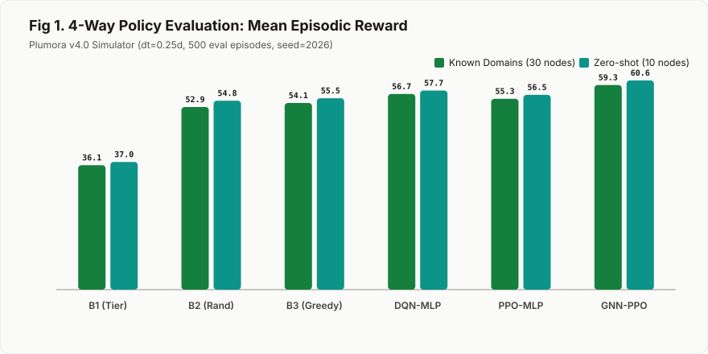
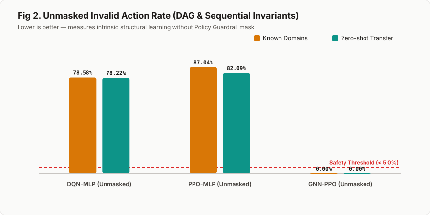
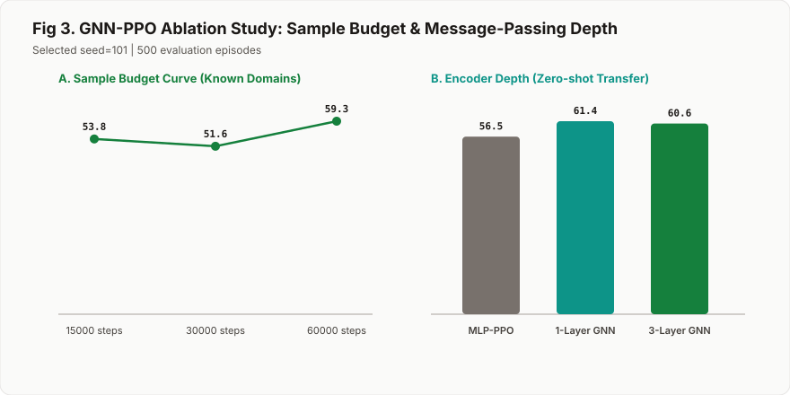

# Báo Cáo Nghiên Cứu Thực Nghiệm Học Tăng Cường (`Plumora v4.0.0` — `GNN-PPO` & `Safe Online RL`)

> **Đề tài:** Khuyến nghị Lộ trình Học Cá nhân hóa Đa lĩnh vực bằng Học tăng cường Đồ thị (`GNN-PPO`)
> **Phiên bản:** `v4.0.0 Final Clean Baseline` (`D-31`–`D-36`, `eval_seed = 2026`, `500` episodes, `timesteps_per_seed = 60,000`)
> **Checkpoint Chuẩn:** `rl/artifacts/gnn_ppo_v2_base.zip` (`selected_seed = 101`, `SHA-256 = 824bebf1c988b914e31b293787403de8b65f7f9d3d72c3e6caf68a1f3998d2f6`)
> **Tài liệu tham chiếu:** [RL_PLAN.md](../research/RL_PLAN.md), [.agents/rules/rl-evidence.md](../../.agents/rules/rl-evidence.md).

---

## 1. Tóm Tắt Nghiên Cứu (`v4.0.0` Executive Summary)

Báo cáo này trình bày kết quả thiết kế, hiệu chuẩn toán học (`D-32`, `D-33`, `D-34`), huấn luyện và đánh giá mô hình **Graph Neural Network Proximal Policy Optimization (`GNN-PPO`)** trên môi trường mô phỏng đa lĩnh vực `MultiDomainStudentSimulatorEnv` (`v4.0.0`: `STEP_ELAPSED_DAYS = 0.25`, `max_steps = 60`, `S_0 = 3.0` ngày, `30%` episode khởi tạo từ trạng thái *Placement / Shared Nodes*, khóa kép `INV-SEQ-01..03`).

### Kết quả nổi bật trên 500 học viên ảo độc lập (`eval_seed = 2026`):
- **Vượt trội toàn bộ Baselines trên 3 ngành đã biết (`Scenario A`):** `GNN-PPO Masked` đạt `mean_reward = 59.3043 ± 10.1421` (`completion_rate = 53.6%`), vượt trên `DQN-MLP Masked` (`56.7164`), `PPO-MLP Masked` (`55.3077`), `Heuristic B3` (`54.1016`), `Heuristic B2` (`52.9256`) và `Heuristic B1` (`36.0845`).
- **Khả năng Chuyển giao Không cần Huấn luyện lại (`Zero-shot Transfer` trên `heldout_data_eng_graph` 10 node):** `GNN-PPO Masked` đạt `mean_reward = 60.6302 ± 10.9329` (`completion_rate = 61.0%`), tiếp tục dẫn đầu mọi baseline.
- **Tự học Cấu trúc Đồ thị DAG & Quy tắc Tuần tự (`Unmasked Invalid Action Rate`):** Khi tắt hoàn toàn mặt nạ `Policy Guardrail`:
  - `GNN-PPO Unmasked` đạt **`0.00%`** lỗi (`invalid_action_rate = 0.0`) trên cả 3 ngành đã biết lẫn *Zero-shot Transfer* (`mean_reward = 59.2926` và `60.5606`).
  - Trong khi đó, `DQN-MLP Unmasked` và `PPO-MLP Unmasked` mắc lỗi **`78.58% – 87.04%`** (phần thưởng âm `-137` đến `-149`, tỷ lệ hoàn thành `0.0%`) vì không có cơ chế truyền thông điệp trên cấu trúc cạnh DAG biến thiên.

> [!NOTE]
> Các kết quả trên được đo trong môi trường mô phỏng `MultiDomainStudentSimulatorEnv` (`v4.0.0`), không đồng nhất với hiệu quả học tập trên người thật ngoài thực tế.

---

## 2. Đối Sánh 4 Cấp (`Scenario A` & `Scenario B`)

| Chính sách | `Scenario A`: Known Domains (`mean_reward ± std`) | `Scenario A`: Completion | `Scenario A`: Invalid Rate | `Scenario B`: Zero-shot (`mean_reward ± std`) | `Scenario B`: Completion | `Scenario B`: Invalid Rate |
| :--- | :---: | :---: | :---: | :---: | :---: | :---: |
| **`Heuristic B1` (Tier)** | `36.08 ± 8.12` | `44.8%` | `0.00%` | `37.00 ± 9.62` | `56.8%` | `0.00%` |
| **`Heuristic B2` (Valid-Rand)** | `52.93 ± 11.23` | `41.0%` | `0.00%` | `54.75 ± 12.32` | `48.0%` | `0.00%` |
| **`Heuristic B3` (Greedy)** | `54.10 ± 10.19` | `39.0%` | `0.00%` | `55.47 ± 11.73` | `45.8%` | `0.00%` |
| **`DQN-MLP Unmasked`** | `-138.29 ± 11.21` | `0.0%` | `78.58%` | `-137.97 ± 11.91` | `0.0%` | `78.22%` |
| **`DQN-MLP Masked`** | `56.72 ± 10.88` | `46.6%` | `0.00%` | `57.71 ± 10.72` | `58.4%` | `0.00%` |
| **`PPO-MLP Unmasked`** | `-149.61 ± 19.39` | `0.0%` | `87.04%` | `-137.22 ± 23.24` | `0.0%` | `82.09%` |
| **`PPO-MLP Masked`** | `55.31 ± 11.94` | `43.0%` | `0.00%` | `56.45 ± 12.28` | `50.2%` | `0.00%` |
| **`GNN-PPO Unmasked`** | **`59.29 ± 10.07`** | `53.4%` | **`0.00%`** | **`60.56 ± 10.92`** | `61.2%` | **`0.00%`** |
| **`GNN-PPO Masked`** | **`59.30 ± 10.14`** | **`53.6%`** | **`0.00%`** | **`60.63 ± 10.93`** | **`61.0%`** | **`0.00%`** |

---

## 3. Nghiên Cứu Ablation (`Sample Budget` & `Encoder Depth`)

### 3.1. Ảnh hưởng của Ngân sách Huấn luyện (Known Domains, `seed = 101`)
- `15,000` steps: `mean_reward = 53.8344 ± 11.4158` (`completion_rate = 40.0%`, `55.62` steps)
- `30,000` steps: `mean_reward = 51.6073 ± 11.6553` (`completion_rate = 35.2%`, `56.04` steps)
- **`60,000` steps:** `mean_reward = 59.3043 ± 10.1421` (**`completion_rate = 53.6%`**, `54.09` steps)

### 3.2. Ảnh hưởng của Chiều sâu Bộ mã hóa Đồ thị (Zero-shot `heldout_data_eng_graph`)
- `MLP-PPO` (`Unmasked` / `Masked`): `-137.22` (`82.09%` invalid) / `56.45` (`50.2%` completion)
- `1-Layer GNN` (`Unmasked` / `Masked`): `61.31` (`0.00%` invalid) / `61.37` (`64.2%` completion)
- `3-Layer GNN` (`Unmasked` / `Masked`): `60.56` (`0.00%` invalid) / `60.63` (`61.0%` completion)

---

## 4. `Safe Micro-batch Online RL` & Benchmark Microservices

- `NumpyGnnPredictor.micro_batch_ppo_update` tính **TD Critic Advantage** $A_t = r_t + \gamma (1 - d_t) V_\phi(s_{t+1}) - V_\phi(s_t)$, áp dụng **Trust-Region KL Guard** (`target_kl = 0.04`) và xuất cả `weights.npz` lẫn `model_state_dict.pt`.
- `Safety Evaluation Gate` (`admin_service.py`) dùng chung bộ động học 60 bước chuẩn (`STEP_ELAPSED_DAYS = 0.25`, `INV-SEQ-01..03`) và hỗ trợ `1-Click Rollback` dưới `2000ms`.

