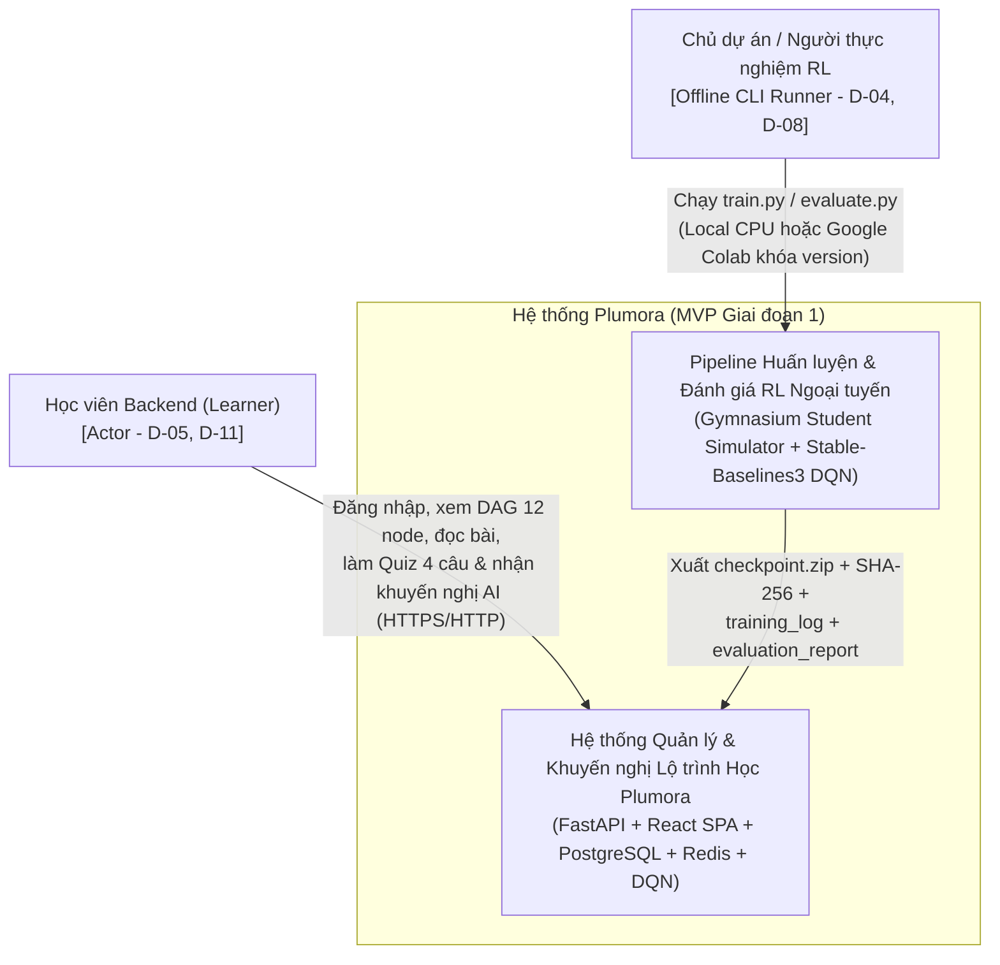
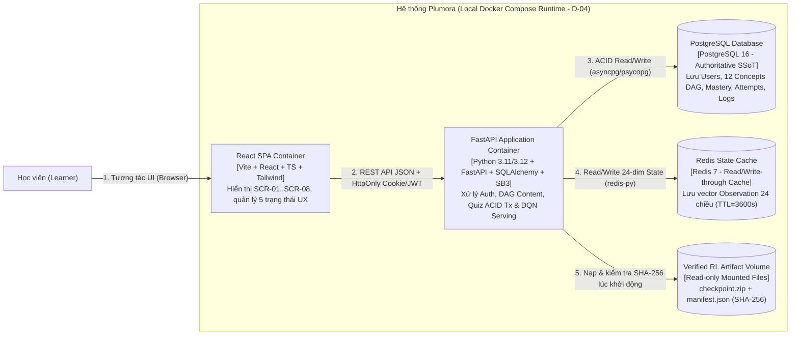
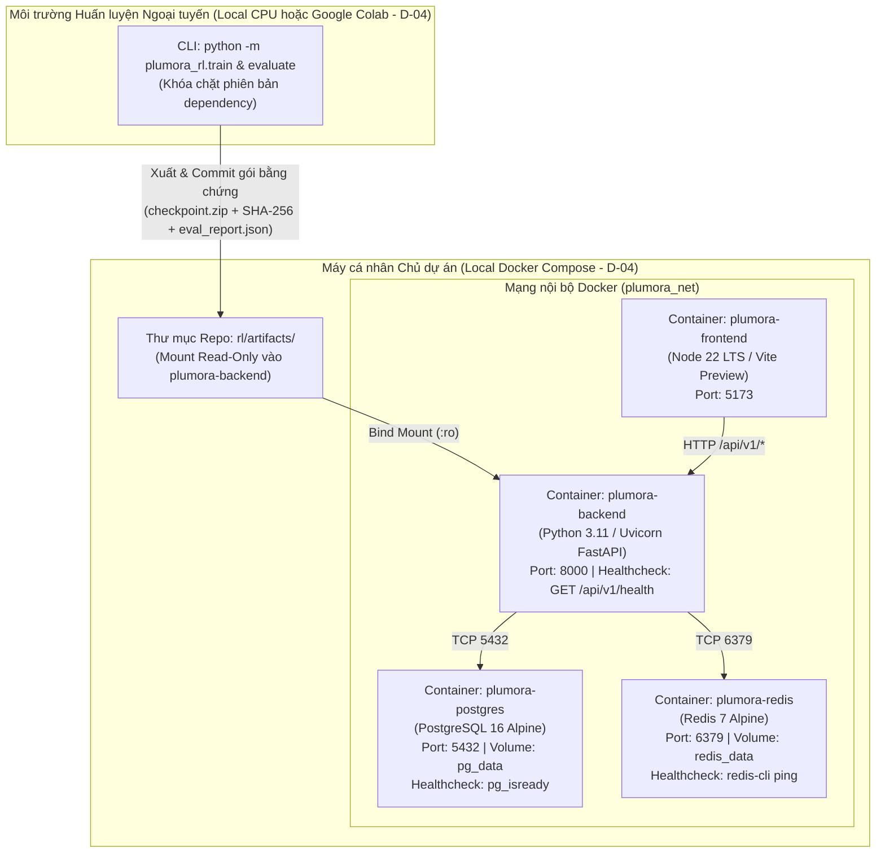
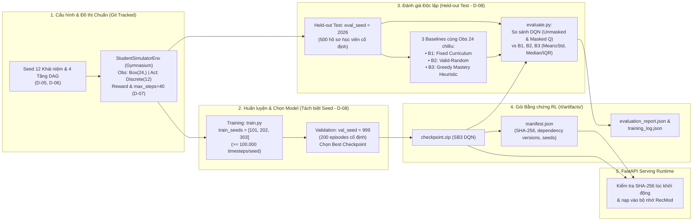

# Thiết kế hệ thống Plumora (System Design)

Phiên bản: `1.0.0` — **APPROVED (Gate 1 Baseline — Chủ dự án duyệt tại `D-14` / `O-10` ngày 2026-11-16)**.
Nguồn: [Định hướng gốc (`docs/brief/project-direction.md`)](brief/project-direction.md), [Intent (`docs/intent.md`)](intent.md) (`v1.0.0`), [Đặc tả (`docs/spec.md`)](spec.md) (`v1.0.0`), [Sổ quyết định (`docs/decisions.md`)](decisions.md) (`v1.0.0`, `D-01`–`D-14`).
Tài liệu Hệ thống Thiết kế Giao diện liên kết: **[UI Design System (`docs/ui-design-system.md`)](ui-design-system.md) (`v1.0.0` — APPROVED Gate 1 Baseline)**.

> **Lưu ý thẩm quyền:** Tài liệu này là **System Design Baseline (`v1.0.0`)** đã được chủ dự án phê duyệt tại **Gate 1 (`D-14` / `O-10`)**, liên kết hai chiều với **[Design System (`docs/ui-design-system.md`)](ui-design-system.md) (`v1.0.0`)**. Nhiệm vụ `ENV-01` đã mở khóa (`ready`); việc viết business logic trong `RL-01` và `SLICE-01` bắt buộc tuân thủ quy trình **Gate 2** (nhánh task, Day-0 CI, Docker Compose healthy và RED tests).

---

## 1. Kiến trúc Tổng thể, Ranh giới Module và Mẫu Thiết kế

### 1.1. Lựa chọn Kiến trúc & Đánh đổi (`B-03`, `D-04`, `D-09`, `D-10`, `D-11`)
- **Kiến trúc được chọn:** **Modular Monolith** với Backend `FastAPI` (`Python 3.11/3.12`), Frontend **React SPA (`Vite` + `TypeScript` + `Tailwind CSS`, `Node.js 22 LTS`)**, cơ sở dữ liệu chuẩn `PostgreSQL` (Single Source of Truth) và bộ nhớ đệm `Redis` (Read/Write-through State Cache), tích hợp lõi `Gymnasium` + `Stable-Baselines3 DQN`.
- **Các phương án đã loại bỏ (Discarded Alternatives):**
  - *Microservices + Kubernetes:* Quá nặng cho phạm vi đồ án 12 khái niệm, phát sinh độ trễ mạng nội bộ và chi phí vận hành không cần thiết (được giữ ở Giai đoạn 3 — `B-04`).
  - *Next.js SSR:* Dư thừa lớp Node.js server vì toàn bộ API và suy luận `DQN` đều nằm tại `FastAPI` (`D-09`).
- **Mẫu thiết kế phần mềm áp dụng (Software Design Patterns):**
  1. **Unit of Work / Transactional Repository (`AssessMod`):** Đóng gói việc kiểm tra idempotency, ghi `quiz_attempts`, cập nhật `user_concept_mastery` và tăng `state_version` trong **1 ACID Transaction** duy nhất trên PostgreSQL trước khi chạm tới Redis.
  2. **Read-Through / Write-Through Cache kèm Graceful Fallback (`RecMod` & `RedisStateStore`):** Đọc/ghi vector Observation 24 chiều trên Redis (`TTL = 3600s`); tự động chuyển về đọc trực tiếp PostgreSQL khi Cache Miss hoặc Redis mất kết nối mà không làm gián đoạn luồng học.
  3. **Strategy + Safety Guardrail Decorator (`RecMod`):** Tách biệt rõ 3 chiến lược xuất khuyến nghị: `DqnDirectPolicy` (`policy_source = "dqn"`), `DqnMaskedQPolicy` (`policy_source = "dqn_masked_q"` lọc theo `is_eligible == 1.0`), và `DagTierFallbackPolicy` (`policy_source = "fallback_rule"` khi thiếu/hỏng checkpoint).

### 1.2. Ranh giới Module và Trách nhiệm trong `FastAPI Modular Monolith`

| Module | Trách nhiệm cốt lõi | Dữ liệu sở hữu (`Write Owner`) | Phụ thuộc nội bộ | Tiêu chí (`AC-ID`) |
| --- | --- | --- | --- | --- |
| **`AuthMod`** (`app/modules/auth`) | Đăng ký, đăng nhập (`Argon2id`/`bcrypt`), đăng xuất, cấp/kiểm tra `HttpOnly Cookie / JWT (HS256)`, trích xuất `current_user.id` và seed 3 tài khoản mẫu thật | `users` | — | `PL-AUTH-01`, `PL-E2E-01` |
| **`ContentMod`** (`app/modules/content`) | Nạp tự động (idempotent seed) 12 khái niệm Backend, cạnh đồ thị tiên quyết 4 tầng DAG và ngân hàng câu hỏi MCQ từ JSON/YAML; phục vụ truy vấn lộ trình và bài học Markdown | `concepts`, `concept_prerequisites`, `quiz_questions` | Đọc trạng thái mở khóa từ `AssessMod` | `PL-CONTENT-01` |
| **`AssessMod`** (`app/modules/assessment`) | Kiểm tra điều kiện mở khóa (`INV-DAG-01`), kiểm tra `submission_id` chống nộp lặp (`INV-IDEMP-01`), chấm điểm Quiz 4 câu (`attempt_score = correct/4`), cập nhật `mastery = max(old, score)` (`INV-MASTERY-01`), đặt lại `Demo Presets` và đồng bộ Redis | `user_concept_mastery`, `quiz_attempts`, Redis key `plumora:state:{user_id}` | `ContentMod` (đọc đáp án đúng & DAG) | `PL-QUIZ-01`, `PL-PROGRESS-01` |
| **`RecMod`** (`app/modules/recommendation`) | Nạp và kiểm tra mã băm `SHA-256` của `checkpoint.zip` lúc khởi động; dựng vector Observation 24 chiều từ Redis (hoặc fallback PostgreSQL); suy luận $Q(s,a)$, áp dụng Q-masking / fallback minh bạch (`INV-RL-01`) và ghi log khuyến nghị | `recommendation_logs` | `AssessMod` (đọc vector 24 chiều) | `PL-REC-01`, `PL-REC-02` |
| **`OfflineRL`** (`rl/plumora_rl`) | Môi trường `StudentSimulatorEnv` (`Gymnasium` 24 chiều), 3 thuật toán cơ sở (`B1`, `B2`, `B3`), huấn luyện `DQN` (`train_seeds = [101, 202, 303]`), chọn checkpoint (`val_seed = 999`), đánh giá độc lập (`eval_seed = 2026`, `500` episodes) và xuất gói bằng chứng | Thư mục `rl/artifacts/` (`checkpoint.zip`, `manifest.json`, `evaluation_report.json`) | Độc lập với HTTP runtime; dùng chung định nghĩa DAG 12 node | `PL-RL-01` |

---

## 2. Hệ thống Sơ đồ Kiến trúc C4, Triển khai, ERD và Luồng Tuần tự

### 2.1. Sơ đồ C4 — Cấp độ Ngữ cảnh (`DIAG-C4-CTX`: C4 System Context)



### 2.2. Sơ đồ C4 — Cấp độ Container (`DIAG-C4-CNT`: C4 Container View)

*(Lưu ý: C4 Container biểu diễn các đơn vị ứng dụng/lưu trữ độc lập về mặt kiến trúc, không trộn lẫn với mức hàm/lớp).*



### 2.3. Sơ đồ Triển khai & Hạ tầng (`DIAG-DEPLOY`: Deployment Topology)



### 2.4. Sơ đồ Thực thể Liên kết (`DIAG-ERD`: Logical & Physical Data Model)


### 2.5. Sơ đồ Tuần tự Luồng Chính 1 (`DIAG-SEQ-01`): Học $\rightarrow$ Quiz $\rightarrow$ Lưu ACID $\rightarrow$ Cập nhật Mastery $\rightarrow$ Khuyến nghị RL (Kèm Nhánh Lỗi)

```mermaid
sequenceDiagram
    autonumber
    actor Learner as Học viên (Learner)
    participant SPA as React SPA (SCR-02/03/04)
    participant API as FastAPI (AssessMod & RecMod)
    participant PG as PostgreSQL (SSoT)
    participant RD as Redis State Cache
    participant DQN as DQN Policy Engine

    Learner->>SPA: Chọn bài học đã mở khóa & làm 4 câu Quiz (SCR-04)
    SPA->>API: POST /api/v1/concepts/{slug}/attempts {submission_id, answers[4]}
    API->>API: Xác thực phiên -> trích xuất current_user.id (401 nếu thiếu)
    API->>PG: BEGIN ACID Transaction (SELECT FOR UPDATE user state)

    alt Đã tồn tại (user_id, submission_id) [Idempotent Retry - INV-IDEMP-01]
        PG-->>API: Trả bản ghi quiz_attempts đã lưu trước đó
        API->>PG: COMMIT
        API-->>SPA: 200 OK (Trả lại đúng kết quả lần nộp đầu, idempotent_replay = true)
    else Khái niệm đang ở trạng thái Locked [Vi phạm tiên quyết - INV-DAG-01]
        PG-->>API: Phát hiện prerequisite có mastery < 0.75
        API->>PG: ROLLBACK
        API-->>SPA: 403 Forbidden {error_code: "CONCEPT_LOCKED", missing_prerequisites: [...]}
    else Lượt nộp hợp lệ mới
        API->>PG: Chấm 4 câu -> attempt_score = correct/4, passed = (score >= 0.75)
        API->>PG: mastery_after = max(mastery_before, attempt_score) [INV-MASTERY-01]
        API->>PG: INSERT quiz_attempts; UPDATE user_concept_mastery; UPDATE users SET state_version = state_version + 1
        API->>PG: COMMIT
        API->>RD: SETEX plumora:state:{user_id} 3600 {state_version, observation_24d} (Bắt lỗi nếu Redis Down)
        API-->>SPA: 200 OK {attempt_score, passed, mastery_before, mastery_after, state_version}
    end

    Learner->>SPA: Bấm "Nhận bài khuyến nghị tiếp theo từ AI"
    SPA->>API: POST /api/v1/recommendations

    alt Đọc Redis thành công & khớp state_version
        API->>RD: GET plumora:state:{user_id}
        RD-->>API: Vector 24 chiều (state_source = "redis_cache")
    else Redis Cache Miss hoặc Redis Down / Timeout
        API->>PG: SELECT user_concept_mastery & concept_prerequisites
        PG-->>API: Dựng lại Vector 24 chiều (state_source = "postgres_cache_warm" hoặc "postgres_fallback")
        opt Nếu Redis còn sống (Cache Miss)
            API->>RD: SETEX plumora:state:{user_id} 3600 {observation_24d}
        end
    end

    alt Cả 12/12 khái niệm đều đạt mastery >= 0.75
        API-->>SPA: 200 OK {status: "completed", recommended_concept: null, policy_source: "completed"}
    else Còn bài chưa thông thạo (< 12 node) & Checkpoint DQN hợp lệ
        API->>DQN: Tính Q(s, a) cho 12 actions từ observation_24d
        alt argmax Q(s,a) nằm trong tập is_eligible == 1.0
            DQN-->>API: action_id = argmax Q(s,a), policy_source = "dqn", guardrail_applied = false
        else argmax Q(s,a) rơi vào bài Locked hoặc đã Mastered
            DQN-->>API: action_id = argmax_{eligible} Q(s,a), policy_source = "dqn_masked_q", guardrail_applied = true
        end
        API->>PG: INSERT recommendation_logs
        API-->>SPA: 200 OK {status: "active", recommended_concept, policy_source, state_source, guardrail_applied, checkpoint_sha256}
    else Thiếu hoặc hỏng Checkpoint DQN [Degraded Fallback]
        API->>API: Chọn bài đầu tiên có is_eligible == 1.0 theo thứ tự tầng DAG
        API->>PG: INSERT recommendation_logs (policy_source = "fallback_rule")
        API-->>SPA: 200 OK {status: "active", recommended_concept, policy_source: "fallback_rule", degraded: true}
    end
```

### 2.6. Sơ đồ Luồng Dữ liệu & Tuần tự Nghiên cứu RL (`DIAG-SEQ-02` / `DIAG-DFD-RL`): Simulator $\rightarrow$ Training $\rightarrow$ Evaluation $\rightarrow$ Checkpoint $\rightarrow$ Serving



---

## 3. Hợp đồng API Chi tiết, Mã lỗi Máy đọc được, Quyền và Idempotency

### 3.1. Bảng Hợp đồng REST API (`FastAPI` — `D-05`–`D-11`)

| Endpoint | Xác thực & Quyền | Đầu vào (`Request Contract`) | Đầu ra thành công (`200`/`201`) | Mã lỗi & Bất biến bảo toàn (`Error Semantics`) | Tiêu chí (`AC-ID`) |
| --- | --- | --- | --- | --- | --- |
| `POST /api/v1/auth/register` | Public | `{username: str (3..32), display_name: str (1..64), password: str (8..128)}` | `201`: `{user: {id, username, display_name, state_version: 1}}` + Set Cookie/Token | `409 USERNAME_TAKEN`, `422 VALIDATION_ERROR` | `PL-AUTH-01` |
| `POST /api/v1/auth/login` | Public | `{username: str, password: str}` | `200`: `{user: {id, username, display_name, state_version}}` + Set Cookie/Token | `401 INVALID_CREDENTIALS` (không tiết lộ user hay password sai) | `PL-AUTH-01` |
| `POST /api/v1/auth/logout` | `Learner` | Không có body | `200`: `{logged_out: true}` + Xóa Cookie | `401 AUTH_REQUIRED` | `PL-AUTH-01` |
| `GET /api/v1/auth/me` | `Learner` | Header/Cookie xác thực | `200`: `{id, username, display_name, state_version}` | `401 AUTH_REQUIRED` | `PL-AUTH-01` |
| `GET /api/v1/roadmap` | `Learner` (`current_user.id`) | Header/Cookie xác thực | `200`: `{state_version, mastered_count, total_concepts: 12, nodes: [{action_id, slug, title, tier, prerequisites, mastery_score, status: "locked"\|"unlocked"\|"mastered"}]}` | `401 AUTH_REQUIRED` | `PL-CONTENT-01` |
| `GET /api/v1/concepts/{slug}` | `Learner` (`current_user.id`) | Path `slug` | `200`: `{action_id, slug, title, tier, lesson_markdown, mastery_score, status, prerequisites, questions: [{id, display_order, prompt, options: {A,B,C,D}}]}` *(ẩn `correct_option_key`)* | `401 AUTH_REQUIRED`, `403 CONCEPT_LOCKED` (kèm `missing_prerequisites`), `404 CONCEPT_NOT_FOUND` | `PL-CONTENT-01`, `PL-QUIZ-01` |
| `POST /api/v1/concepts/{slug}/attempts` | `Learner` (`current_user.id`) | `{submission_id: UUID, answers: [{question_id: UUID, selected_option: "A"\|"B"\|"C"\|"D"}] (đủ 4 câu)}` | `200`: `{attempt_id, submission_id, idempotent_replay: bool, correct_count, attempt_score, passed, mastery_before, mastery_after, state_version, newly_unlocked_slugs: [...]}` | `401 AUTH_REQUIRED`, `403 CONCEPT_LOCKED` (`INV-DAG-01`), `404 CONCEPT_NOT_FOUND`, `422 QUIZ_VALIDATION_ERROR` (thiếu câu / sai ID câu hỏi; không đổi DB) | `PL-QUIZ-01`, `PL-PROGRESS-01` |
| `POST /api/v1/me/preset` | `Learner` (`current_user.id`) | `{preset_key: "new_learner" \| "foundation_ready" \| "api_stage_ready"}` | `200`: `{preset_key, state_version, mastered_count, nodes: [...]}` | `401 AUTH_REQUIRED`, `422 PRESET_INVALID` | `PL-CONTENT-01`, `PL-PROGRESS-01` |
| `POST /api/v1/recommendations` | `Learner` (`current_user.id`) | Không cần body (lấy state của `current_user.id`) | `200`: `{status: "active"\|"completed", recommended_concept: {...}\|null, policy_source: "dqn"\|"dqn_masked_q"\|"fallback_rule"\|"completed", state_source: "redis_cache"\|"postgres_cache_warm"\|"postgres_fallback", guardrail_applied: bool, degraded: bool, checkpoint_sha256: str\|null, state_version: int}` | `401 AUTH_REQUIRED` (Nếu thiếu checkpoint hoặc mất Redis thì tự động fallback trả `200` kèm `degraded = true`, không trả `500`) | `PL-REC-01`, `PL-REC-02` |
| `GET /api/v1/health` | Public | — | `200`: `{status: "ok"\|"degraded", postgres: "up", redis: "up"\|"down", rl_checkpoint: {loaded: bool, sha256_verified: bool}}` | `503 DATABASE_UNAVAILABLE` (nếu PostgreSQL SSoT mất kết nối) | `ENV-01` |

### 3.2. Cấu trúc Phản hồi Lỗi Chuẩn (`Standard Error Envelope`)
Mọi phản hồi lỗi HTTP (`4xx`, `5xx`) đều trả về cấu trúc JSON thống nhất để Frontend hiển thị trạng thái `Error` rõ ràng:
```json
{
  "error_code": "CONCEPT_LOCKED",
  "message": "Khái niệm này chưa mở khóa. Bạn cần đạt tối thiểu 75% ở các bài tiên quyết.",
  "details": {
    "concept_slug": "api-data",
    "missing_prerequisites": ["db-transactions", "api-rest"]
  }
}
```

---

## 4. Vai trò PostgreSQL / Redis, Nguồn Trạng thái Chuẩn và Xử lý Mất Cache (`D-10`)

| Khía cạnh | Quy tắc Thiết kế & Vận hành |
| --- | --- |
| **Nguồn dữ liệu chuẩn (`Authoritative SSoT`)** | `PostgreSQL` giữ toàn quyền chuẩn xác cho mọi bảng. Không bao giờ dùng Redis làm nơi lưu duy nhất của dữ liệu tiến độ. |
| **Định dạng Key & TTL trên Redis** | Key: `plumora:state:{user_id}` — TTL: `3600` giây (1 giờ). Payload lưu `state_version` (int), `mastery` (mảng 12 float), `is_eligible` (mảng 12 float `0.0/1.0`), và `observation_24d` (mảng 24 float32). |
| **Đồng bộ khi Ghi (`Write-Through / Invalidate`)** | Khi `POST /attempts` hoặc `POST /me/preset` `COMMIT` xong trên PostgreSQL (tăng `state_version`), backend gọi `SETEX plumora:state:{user_id}` với `state_version` mới. Nếu lệnh ghi Redis lỗi, backend thử `DEL` key và ghi log cảnh báo (không rollback PostgreSQL). |
| **Xử lý Cache Miss (`postgres_cache_warm`)** | Khi `GET plumora:state:{user_id}` trả về `nil`, backend truy vấn `user_concept_mastery` + `concept_prerequisites` từ PostgreSQL, tính lại vector 24 chiều, ghi lại vào Redis (`SETEX`) và trả `state_source = "postgres_cache_warm"`. |
| **Xử lý Mất kết nối Redis (`postgres_fallback`)** | Đặt timeout kết nối/đọc Redis ngắn (`200ms`). Nếu Redis dừng hoạt động hoặc timeout, bộ bọc `RedisStateStore` bắt ngoại lệ (`RedisError`), đọc trực tiếp từ PostgreSQL, trả `state_source = "postgres_fallback"` và giữ hệ thống hoạt động bình thường (`PL-REC-02`). |

---

## 5. Phân biệt Thành phần MVP (Giai đoạn 1) và Hướng Mở rộng (Giai đoạn 2–3)

| Thành phần / Tính năng | Trong phạm vi MVP (Giai đoạn 1 — Hiện tại) | Hướng mở rộng Giai đoạn 2–3 (Ngoài phạm vi MVP — `B-04`, `DEFERRED`) |
| --- | --- | --- |
| **Miền kiến thức & Quản lý nội dung** | 12 khái niệm Backend cố định chia 4 tầng DAG, nạp tự động qua Seed JSON/YAML (`D-05`). | Đa lĩnh vực (Frontend, DevOps, Data Science), đồ thị động hàng ngàn bài học, CMS quản trị nội dung. |
| **Hình thức Đánh giá** | Trắc nghiệm khách quan (MCQ) cố định 4 câu Single-choice/bài, ngưỡng thông thạo $\ge 75\%$ (`D-06`). | Chấm code tự động trong Docker Sandbox cô lập (`Code Submission & Auto-grader` — Giai đoạn 2). |
| **Mô hình Trạng thái Học viên** | Điểm thông thạo đơn điệu `mastery = max(old, score)` + cờ mở khóa tiên quyết (vector 24 chiều — `D-06`, `D-07`). | Tích hợp đường cong lãng quên Ebbinghaus $e^{-t}$ (`Spaced Repetition` — Giai đoạn 2). |
| **Hỗ trợ Giải đáp** | Hiển thị kết quả chấm điểm, đáp án và hướng dẫn xem lại bài lý thuyết Markdown. | Trợ lý chat LLM giải thích lỗi sai theo ngữ cảnh (`AI Tutor` — Giai đoạn 2). |
| **Thuật toán & Huấn luyện RL** | `DQN` (`MlpPolicy`, `Stable-Baselines3`) huấn luyện ngoại tuyến trên `Student Simulator` (`Gymnasium`), cố định checkpoint khi Serving (`D-07`, `D-08`). | Thuật toán `PPO` / `Actor-Critic`, mạng `Graph Neural Networks (GNN)` và tinh chỉnh `Online RL` từ người học thật kèm Human-in-the-Loop (Giai đoạn 3). |
| **Kiến trúc & Triển khai** | **Modular Monolith** (`FastAPI` + `React SPA` + `PostgreSQL` + `Redis`) chạy trên **Local Docker Compose** (`D-04`, `D-09`). | Tách **Microservices** độc lập, triển khai trên Kubernetes có Auto-scaling (Giai đoạn 3). |

---

## 6. Danh mục Kiểm kê Sơ đồ (`Diagram Inventory`)

| Mã Sơ đồ (`ID`) | Loại Sơ đồ (`View`) | Phạm vi & Mục đích | Nguồn / Phiên bản / Trạng thái | Tham chiếu `AC-ID` / Quyết định / Task | Người duyệt | Kiểm tra Render |
| --- | --- | --- | --- | --- | --- | --- |
| `DIAG-C4-CTX` | C4 System Context (Core) | Ranh giới hệ thống Plumora, Học viên và Pipeline RL ngoại tuyến | `docs/design.md` (`v1.0.0` — `APPROVED`) | `D-04`, `D-05`, `PL-E2E-01` | Chủ dự án duyệt G1 (`D-14`) | Mermaid source verified; CLI image render `NOT RUN` |
| `DIAG-C4-CNT` | C4 Container View (Core) | Trách nhiệm và giao thức giữa React SPA, FastAPI, PostgreSQL, Redis, RL Artifact | `docs/design.md` (`v1.0.0` — `APPROVED`) | `D-09`, `D-10`, `D-11`, `ENV-01`, `SLICE-01` | Chủ dự án duyệt G1 (`D-14`) | Mermaid source verified; CLI image render `NOT RUN` |
| `DIAG-DEPLOY` | Deployment Topology (Core) | Ánh xạ các container vào Local Docker Compose và môi trường train Local CPU / Colab | `docs/design.md` (`v1.0.0` — `APPROVED`) | `D-04`, `ENV-01` | Chủ dự án duyệt G1 (`D-14`) | Mermaid source verified; CLI image render `NOT RUN` |
| `DIAG-ERD` | Entity Relationship Diagram (Core) | Mô hình dữ liệu 7 bảng PostgreSQL (PK/FK/UK/CHECK) và liên kết ownership | `docs/design.md` (`v1.0.0` — `APPROVED`) | `D-05`, `D-06`, `D-10`, `D-11`, `PL-PROGRESS-01` | Chủ dự án duyệt G1 (`D-14`) | Mermaid source verified; CLI image render `NOT RUN` |
| `DIAG-SEQ-01` | Sequence Diagram (Core) | Luồng Học $\rightarrow$ Quiz $\rightarrow$ ACID Tx $\rightarrow$ Mastery $\rightarrow$ Redis $\rightarrow$ DQN & các nhánh lỗi | `docs/design.md` (`v1.0.0` — `APPROVED`) | `PL-QUIZ-01`, `PL-PROGRESS-01`, `PL-REC-01`, `PL-REC-02` | Chủ dự án duyệt G1 (`D-14`) | Mermaid source verified; CLI image render `NOT RUN` |
| `DIAG-SEQ-02` | Data Flow / Pipeline RL (Conditional — ML Trigger) | Luồng Simulator $\rightarrow$ Train $\rightarrow$ Val $\rightarrow$ Eval vs Baselines $\rightarrow$ Checkpoint $\rightarrow$ Serving | `docs/design.md` (`v1.0.0` — `APPROVED`) & `docs/research/RL_PLAN.md` | `D-04`, `D-07`, `D-08`, `PL-RL-01`, `RL-01` | Chủ dự án duyệt G1 (`D-14`) | Mermaid source verified; CLI image render `NOT RUN` |
| `DIAG-UX-FLOW` | UX Activity / Journey Flow (Conditional — UI Trigger) | Luồng màn hình `SCR-01`..`SCR-08`, rẽ nhánh lỗi và trạng thái `Disabled`/`Locked` | `docs/ui-design-system.md` (`v1.0.0` — `APPROVED`) | `D-09`, `D-12`, `D-13`, `PL-CONTENT-01`, `PL-E2E-01` | Chủ dự án duyệt G1 (`D-13`, `D-14`) | Mermaid source verified; CLI image render `NOT RUN` |

---

## 7. Ma trận Liên kết Thiết kế Hệ thống $\leftrightarrow$ Design System $\leftrightarrow$ Lát cắt Đầu tiên

*(Chi tiết Design Tokens Chồi Cây Non, Typography, SVG Icons `lucide-react`, 5 trạng thái UX và Wireframe xem tại **[`docs/ui-design-system.md`](ui-design-system.md) (`v1.0.0`)**).*

| `AC-ID` / Hành trình | Màn hình & Route ([`ui-design-system.md`](ui-design-system.md)) | Component & 5 Trạng thái UX | API Endpoint & Quyền (`design.md`) | Lưu trữ & Bất biến (`Persistence & Invariants`) | Task & Kiểm chứng Thực thi | Trạng thái Sẵn sàng |
| --- | --- | --- | --- | --- | --- | --- |
| `PL-AUTH-01` (Đăng nhập & Tài khoản mẫu) | `SCR-01`: `/login`, `/register` | `AuthForm`, `DemoAccountQuickPick` (`Ideal/Loading/Error/Disabled`) | `POST /api/v1/auth/login`, `POST /register`, `GET /me` (Public $\rightarrow$ `Learner`) | `PostgreSQL` bảng `users` (`Argon2id`/`bcrypt`), khởi tạo 12 dòng `mastery = 0.0` | `ENV-01`, `SLICE-01` (`pytest` auth + `Playwright`) | **Đã duyệt G1 (`D-14`)** — `ENV-01 ready` |
| `PL-CONTENT-01` (Bản đồ DAG 12 Node & Lý thuyết) | `SCR-02`: `/roadmap`<br>`SCR-03`: `/concepts/:slug`<br>`SCR-05`: Modal Preset | `RoadmapDagGrid`, `DagNodeCard`, `DemoPresetToolbar`, `MarkdownLessonViewer` (Đủ 5 trạng thái UX + 100% SVG icons) | `GET /api/v1/roadmap`, `GET /api/v1/concepts/{slug}`, `POST /api/v1/me/preset` (`current_user.id`) | `PostgreSQL` (`concepts`, `concept_prerequisites`, `user_concept_mastery`) + `Redis` sync; `INV-DAG-01`, `INV-UI-01` | `ENV-01`, `SLICE-01` (`pytest` DAG + `Vitest` + `Playwright`) | **Đã duyệt G1 (`D-14`)** — `ENV-01 ready` |
| `PL-QUIZ-01`, `PL-PROGRESS-01` (Làm Quiz 4 câu & Lưu Mastery) | `SCR-04`: `/concepts/:slug/quiz`<br>`SCR-08`: `/concepts/:slug` (khi Locked) | `McqQuizForm`, `QuizResultCard`, `MasteryProgressBar` (Kiểm tra biên $50\% / 75\% / 100\%$) | `POST /api/v1/concepts/{slug}/attempts` kèm `submission_id` (`current_user.id`) | **ACID Tx `PostgreSQL`**: `UNIQUE(user_id, submission_id)` (`INV-IDEMP-01`), `mastery = max(old, score)` (`INV-MASTERY-01`) $\rightarrow$ Write-through `Redis` | `ENV-01`, `SLICE-01` (Unit/Integration biên 75% + Idempotency test) | **Đã duyệt G1 (`D-14`)** — `ENV-01 ready` |
| `PL-REC-01`, `PL-REC-02` (Khuyến nghị RL & Fallback) | `SCR-02`: `/roadmap`<br>`SCR-06`: Drawer bằng chứng<br>`SCR-07`: Hoàn thành 12/12 | `AiRecommendationBanner`, `ProvenanceBadge`, `RlProvenanceDrawer` | `POST /api/v1/recommendations` (`current_user.id`) | Đọc 24-dim từ `Redis` (`plumora:state:{user_id}`), fallback `PostgreSQL`; ghi `recommendation_logs` (`INV-RL-01`) | `RL-01`, `SLICE-01` (Test `dqn`, `dqn_masked_q`, `fallback_rule`, tắt Redis) | **Đã duyệt G1 (`D-14`)** — `ENV-01 ready` |
| `PL-RL-01` (Huấn luyện & Đánh giá Ngoại tuyến) | Hiển thị tóm tắt trong `SCR-06` Drawer & Báo cáo nghiên cứu | — (Chạy qua CLI ngoại tuyến) | CLI `plumora_rl.train` & `plumora_rl.evaluate` | Xuất `rl/artifacts/checkpoint.zip`, `manifest.json` (`SHA-256`), `evaluation_report.json` | `RL-01` (`pytest` simulator invariants + benchmark `eval_seed=2026`) | **Đã duyệt G1 (`D-14`)** — Chờ `ENV-01 (G2)` |
| `PL-E2E-01` (Hành trình Vàng Đầu-Cuối) | Toàn bộ `SCR-01` $\rightarrow$ `SCR-02` $\rightarrow$ `SCR-03` $\rightarrow$ `SCR-04` $\rightarrow$ `SCR-02` | Toàn bộ Component trên hệ thống thật | Chuỗi API thực tế trên Docker Compose | PostgreSQL + Redis + Checkpoint `DQN` thật 100% (không fake DOM/SUT) | `SLICE-01` (`Playwright` E2E Golden Journey) | **Đã duyệt G1 (`D-14`)** — Chờ `ENV-01 (G2)` & `RL-01` |
