# Thiết kế hệ thống Plumora (System Design)

Phiên bản: `2.0.0` — **APPROVED (Gate 1 Baseline Giai đoạn 3 — Chủ dự án duyệt tại `D-16`..`D-26` ngày 2026-11-18; bảo lưu trọn vẹn lịch sử Gate 1 Baseline MVP `v1.0.0` duyệt tại `D-14` / `O-10` ngày 2026-11-16)**.
Nguồn: [Định hướng gốc (`docs/brief/project-direction.md`)](brief/project-direction.md), [Intent (`docs/intent.md`)](intent.md) (`v2.0.0`), [Đặc tả (`docs/spec.md`)](spec.md) (`v2.0.0`), [Phân tích Giai đoạn 3 (`docs/proposals/PHASE3_ANALYSIS.md`)](proposals/PHASE3_ANALYSIS.md), [Sổ quyết định (`docs/decisions.md`)](decisions.md) (`v2.0.0`, `D-01`–`D-26`).
Tài liệu Hệ thống Thiết kế Giao diện liên kết: **[UI Design System (`docs/ui-design-system.md`)](ui-design-system.md) (`v2.0.0` — APPROVED Gate 1 Baseline & 20 Màn hình Stitch `SCR-01`..`SCR-20`)**.

> **Lưu ý thẩm quyền:** Tài liệu này bao gồm cả **System Design Baseline MVP (`v1.0.0` — Mục 1..7)** đã hoàn thành Gate 1–4 và **System Design Mở rộng Đích Giai đoạn 3 (`v2.0.0` — Mục 6 & Mục 8)** đã được chủ dự án phê duyệt tại **Gate 1 (`D-16`..`D-26`)**, liên kết hai chiều với **[Design System (`docs/ui-design-system.md`)](ui-design-system.md) (`v2.0.0`)**. Nhiệm vụ `P3-SLICE-1` đang ở trạng thái `ready`; việc viết business logic trong `P3-SLICE-1`..`P3-SLICE-4` bắt buộc tuân thủ quy trình **Gate 2** (nhánh task, Day-0 CI, Docker Compose healthy và RED tests).

---

## 1. Kiến trúc Tổng thể, Ranh giới Module và Mẫu Thiết kế

### 1.1. Lựa chọn Kiến trúc & Đánh đổi (`B-03`, `D-04`, `D-09`, `D-10`, `D-11`)
- **Kiến trúc được chọn:** **Modular Monolith** với Backend `FastAPI` (`Python 3.11/3.12`), Frontend **React SPA (`Vite` + `TypeScript` + `Tailwind CSS`, `Node.js 22 LTS`)**, cơ sở dữ liệu chuẩn `PostgreSQL` (Single Source of Truth) và bộ nhớ đệm `Redis` (Read/Write-through State Cache), tích hợp lõi `Gymnasium` + `Stable-Baselines3 DQN`.
- **Các phương án đã loại bỏ (Discarded Alternatives):**
  - *Microservices + Kubernetes:* Quá nặng cho phạm vi đồ án 12 khái niệm, phát sinh độ trễ mạng nội bộ và chi phí vận hành không cần thiết (được giữ ở Giai đoạn 3 — `B-04`).
  - *Next.js SSR:* Dư thừa lớp Node.js server vì toàn bộ API và suy luận `DQN` đều nằm tại `FastAPI` (`D-09`).
- **Mẫu thiết kế phần mềm áp dụng (Software Design Patterns):**
  1. **Unit of Work / Transactional Repository (`AssessMod`):** Đóng gói việc kiểm tra idempotency, ghi `quiz_attempts`, cập nhật `user_concept_mastery` và tăng `state_version` trong **1 ACID Transaction** duy nhất trên PostgreSQL trước khi chạm tới Redis.
  2. **Read-Through / Write-Through Cache kèm Graceful Fallback (`RecMod` & `RedisStateStore`):** Đọc/ghi vector Observation 24 chiều trên Redis (`TTL = 3600s`); tự động chuyển về đọc trực tiếp PostgreSQL khi Cache Miss hoặc Redis mất kết nối mà không làm gián đoạn luồng học.
  3. **Strategy + Safety Guardrail Decorator (`RecMod`):** Tách biệt rõ 3 chiến lược xuất khuyến nghị: `DqnDirectPolicy` (`policy_source = "dqn"`), `DqnMaskedQPolicy` (`policy_source = "dqn_masked_q"` lọc theo `is_eligible == 1.0`), và `DagTierFallbackPolicy` (`policy_source = "fallback_rule"` khi thiếu/hỏng checkpoint).

### 1.2. Ranh giới Module và Trách nhiệm trong `FastAPI Modular Monolith`

| Module | Trách nhiệm cốt lõi | Dữ liệu sở hữu (`Write Owner`) | Phụ thuộc nội bộ | Tiêu chí (`AC-ID`) |
| --- | --- | --- | --- | --- |
| **`AuthMod`** (`app/modules/auth`) | Đăng ký, đăng nhập (`Argon2id`/`bcrypt`), đăng xuất, cấp/kiểm tra `HttpOnly Cookie / JWT (HS256)`, trích xuất `current_user.id` và seed 3 tài khoản mẫu thật | `users` | — | `PL-AUTH-01`, `PL-E2E-01` |
| **`ContentMod`** (`app/modules/content`) | Nạp tự động (idempotent seed) 12 khái niệm Backend, cạnh đồ thị tiên quyết 4 tầng DAG và ngân hàng câu hỏi MCQ từ JSON/YAML; phục vụ truy vấn lộ trình và bài học Markdown | `concepts`, `concept_prerequisites`, `quiz_questions` | Đọc trạng thái mở khóa từ `AssessMod` | `PL-CONTENT-01` |
| **`AssessMod`** (`app/modules/assessment`) | Kiểm tra điều kiện mở khóa (`INV-DAG-01`), kiểm tra `submission_id` chống nộp lặp (`INV-IDEMP-01`), chấm điểm Quiz 4 câu (`attempt_score = correct/4`), cập nhật `mastery = max(old, score)` (`INV-MASTERY-01`), đặt lại `Demo Presets` và đồng bộ Redis | `user_concept_mastery`, `quiz_attempts`, Redis key `plumora:state:{user_id}` | `ContentMod` (đọc đáp án đúng & DAG) | `PL-QUIZ-01`, `PL-PROGRESS-01` |
| **`RecMod`** (`app/modules/recommendation`) | Nạp và kiểm tra mã băm `SHA-256` của `checkpoint.zip` lúc khởi động; dựng vector Observation 24 chiều từ Redis (hoặc fallback PostgreSQL); suy luận $Q(s,a)$, áp dụng Q-masking / fallback minh bạch (`INV-RL-01`) và ghi log khuyến nghị | `recommendation_logs` | `AssessMod` (đọc vector 24 chiều) | `PL-REC-01`, `PL-REC-02` |
| **`OfflineRL`** (`rl/plumora_rl`) | Môi trường `StudentSimulatorEnv` (`Gymnasium` 24 chiều), 3 thuật toán cơ sở (`B1`, `B2`, `B3`), huấn luyện `DQN` (`train_seeds = [101, 202, 303]`), chọn checkpoint (`val_seed = 999`), đánh giá độc lập (`eval_seed = 2026`, `500` episodes) và xuất gói bằng chứng | Thư mục `rl/artifacts/` (`checkpoint.zip`, `manifest.json`, `evaluation_report.json`) | Độc lập với HTTP runtime; dùng chung định nghĩa DAG 12 node | `PL-RL-01` |

---

## 2. Hệ thống Sơ đồ Kiến trúc C4, Triển khai, ERD và Luồng Tuần tự

### 2.1. Sơ đồ C4 — Cấp độ Ngữ cảnh (`DIAG-C4-CTX`: C4 System Context)

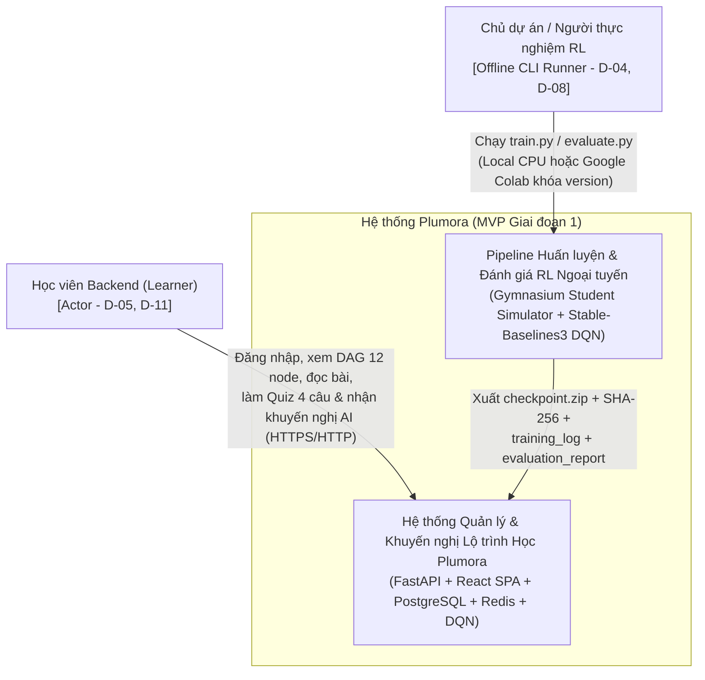

### 2.2. Sơ đồ C4 — Cấp độ Container (`DIAG-C4-CNT`: C4 Container View)

*(Lưu ý: C4 Container biểu diễn các đơn vị ứng dụng/lưu trữ độc lập về mặt kiến trúc, không trộn lẫn với mức hàm/lớp).*

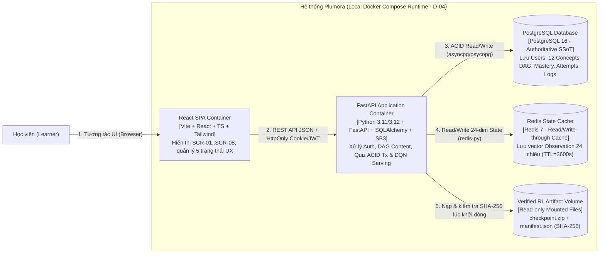

### 2.3. Sơ đồ Triển khai & Hạ tầng (`DIAG-DEPLOY`: Deployment Topology)

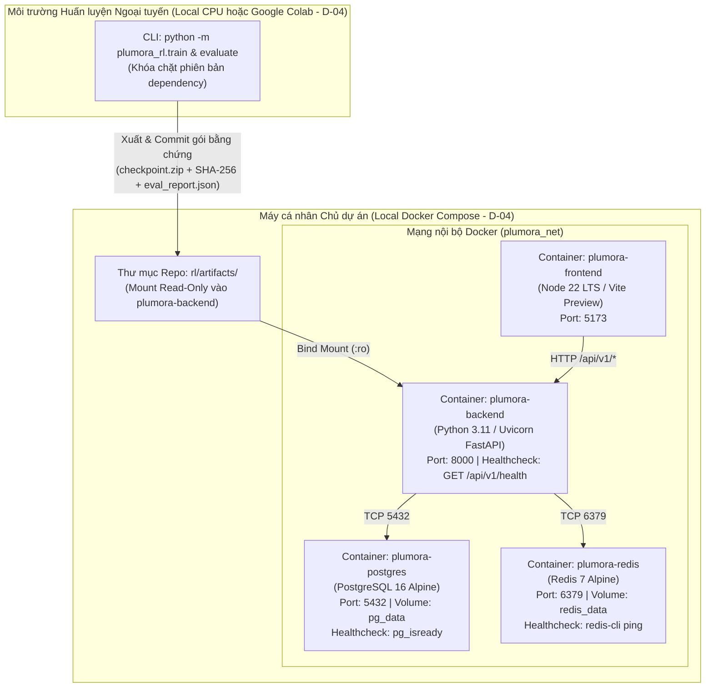

### 2.4. Sơ đồ Thực thể Liên kết (`DIAG-ERD`: Logical & Physical Data Model)

```mermaid
erDiagram
    USERS ||--o{ USER_CONCEPT_MASTERY : "sở hữu (12 dòng/user)"
    USERS ||--o{ QUIZ_ATTEMPTS : "nộp bài"
    USERS ||--o{ RECOMMENDATION_LOGS : "nhận gợi ý"
    CONCEPTS ||--o{ CONCEPT_PREREQUISITES : "cần bài tiên quyết"
    CONCEPTS ||--o{ QUIZ_QUESTIONS : "chứa (4-6 câu/bài)"
    CONCEPTS ||--o{ USER_CONCEPT_MASTERY : "được đo ở"
    CONCEPTS ||--o{ QUIZ_ATTEMPTS : "được chấm ở"

    USERS {
        uuid id PK "UUID v4"
        varchar_32 username UK "NOT NULL, UNIQUE, index"
        varchar_64 display_name "NOT NULL"
        varchar_255 password_hash "NOT NULL (Argon2id/bcrypt)"
        int state_version "NOT NULL DEFAULT 1 (tăng mỗi lần đổi state)"
        timestamptz created_at "NOT NULL DEFAULT now()"
    }
    CONCEPTS {
        int action_id PK "0..11 (khớp Discrete(12) của DQN)"
        varchar_64 slug UK "NOT NULL, UNIQUE (vd: db-transactions)"
        varchar_128 title "NOT NULL"
        int tier "NOT NULL CHECK (tier BETWEEN 1 AND 4)"
        text lesson_markdown "NOT NULL"
        varchar_32 content_version "NOT NULL"
    }
    CONCEPT_PREREQUISITES {
        int concept_action_id PK, FK "FK -> CONCEPTS.action_id"
        int prereq_action_id PK, FK "FK -> CONCEPTS.action_id (CHECK != concept_action_id)"
    }
    QUIZ_QUESTIONS {
        uuid id PK
        int concept_action_id FK "FK -> CONCEPTS.action_id, index"
        int display_order "NOT NULL (1..6)"
        text prompt "NOT NULL"
        jsonb options_json "NOT NULL ({A, B, C, D})"
        varchar_1 correct_option_key "NOT NULL CHECK IN ('A','B','C','D') - Ẩn khỏi API GET"
    }
    USER_CONCEPT_MASTERY {
        uuid user_id PK, FK "FK -> USERS.id ON DELETE CASCADE"
        int concept_action_id PK, FK "FK -> CONCEPTS.action_id"
        float mastery_score "NOT NULL DEFAULT 0.0 CHECK (0.0 <= mastery_score <= 1.0)"
        boolean is_mastered "NOT NULL DEFAULT false (mastery_score >= 0.75)"
        timestamptz updated_at "NOT NULL DEFAULT now()"
    }
    QUIZ_ATTEMPTS {
        uuid id PK
        uuid user_id FK "FK -> USERS.id, index"
        uuid submission_id "NOT NULL, UNIQUE(user_id, submission_id) cho Idempotency"
        int concept_action_id FK "FK -> CONCEPTS.action_id"
        int correct_count "NOT NULL CHECK (0 <= correct_count <= 4)"
        float attempt_score "NOT NULL IN (0.0, 0.25, 0.5, 0.75, 1.0)"
        boolean passed "NOT NULL (attempt_score >= 0.75)"
        float mastery_before "NOT NULL"
        float mastery_after "NOT NULL (max(mastery_before, attempt_score))"
        jsonb answers_json "NOT NULL (4 lựa chọn của học viên)"
        timestamptz created_at "NOT NULL DEFAULT now()"
    }
    RECOMMENDATION_LOGS {
        uuid id PK
        uuid user_id FK "FK -> USERS.id, index"
        int state_version "NOT NULL"
        int recommended_action_id "NULLABLE (NULL khi đã hoàn thành 12/12)"
        varchar_32 policy_source "NOT NULL IN ('dqn','dqn_masked_q','fallback_rule','completed')"
        varchar_32 state_source "NOT NULL IN ('redis_cache','postgres_cache_warm','postgres_fallback')"
        boolean guardrail_applied "NOT NULL DEFAULT false"
        varchar_64 checkpoint_sha256 "NULLABLE"
        timestamptz created_at "NOT NULL DEFAULT now()"
    }
```

### 2.5. Sơ đồ Tuần tự Luồng Chính 1 (`DIAG-SEQ-01`): Học $\rightarrow$ Quiz $\rightarrow$ Lưu ACID $\rightarrow$ Cập nhật Mastery $\rightarrow$ Khuyến nghị RL (Kèm Nhánh Lỗi)

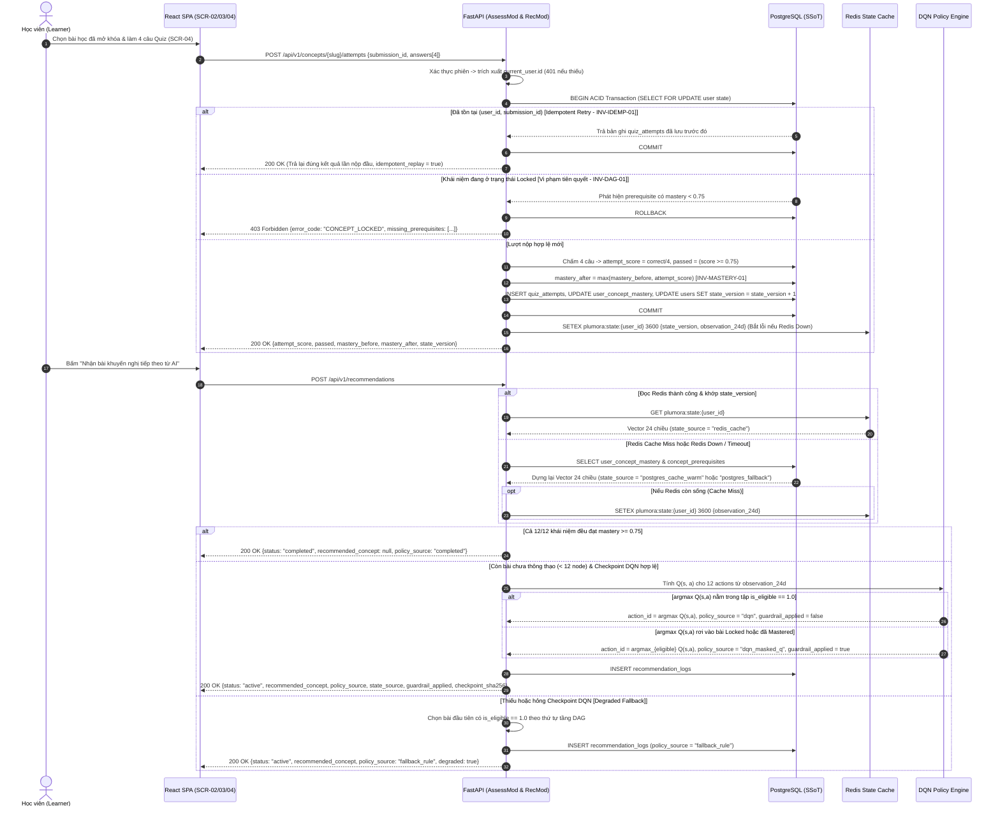

### 2.6. Sơ đồ Luồng Dữ liệu & Tuần tự Nghiên cứu RL (`DIAG-SEQ-02` / `DIAG-DFD-RL`): Simulator $\rightarrow$ Training $\rightarrow$ Evaluation $\rightarrow$ Checkpoint $\rightarrow$ Serving

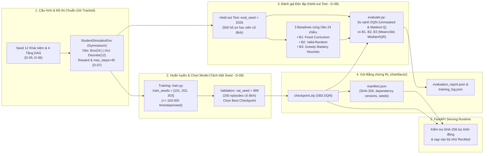

---

## 3. Hợp đồng API Chi tiết, Mã lỗi Máy đọc được, Quyền và Idempotency

### 3.1. Bảng Hợp đồng REST API (`FastAPI` — `D-05`–`D-11`)

| Endpoint | Xác thực & Quyền | Đầu vào (`Request Contract`) | Đầu ra thành công (`200`/`201`) | Mã lỗi & Bất biến bảo toàn (`Error Semantics`) | Tiêu chí (`AC-ID`) |
| --- | --- | --- | --- | --- | --- |
| `POST /api/v1/auth/register` | Public | `{username: str (3..32), display_name: str (1..64), password: str (8..128)}` | `201`: `{user: {id, username, display_name, state_version: 1}}` + Set Cookie/Token | `409 USERNAME_TAKEN`, `422 VALIDATION_ERROR` | `PL-AUTH-01` |
| `POST /api/v1/auth/login` | Public | `{username: str, password: str}` | `200`: `{user: {id, username, display_name, state_version}}` + Set Cookie/Token | `401 INVALID_CREDENTIALS` (không tiết lộ user hay password sai) | `PL-AUTH-01` |
| `POST /api/v1/auth/logout` | `Learner` | Không có body | `200`: `{logged_out: true}` + Xóa Cookie | `401 AUTH_REQUIRED` | `PL-AUTH-01` |
| `GET /api/v1/auth/me` | `Learner` | Header/Cookie xác thực | `200`: `{id, username, display_name, state_version}` | `401 AUTH_REQUIRED` | `PL-AUTH-01` |
| `GET /api/v1/roadmap` | `Learner` (`current_user.id`) | Header/Cookie xác thực | `200`: `{state_version, mastered_count, total_concepts: 12, nodes: [{action_id, slug, title, tier, prerequisites, mastery_score, status: "locked"\|"unlocked"\|"mastered"}]}` | `401 AUTH_REQUIRED` | `PL-CONTENT-01` |
| `GET /api/v1/concepts/{slug}` | `Learner` (`current_user.id`) | Path `slug` | `200`: `{action_id, slug, title, tier, lesson_markdown, mastery_score, status, prerequisites, questions: [{id, display_order, prompt, options: {A,B,C,D}}]}` *(ẩn `correct_option_key`)* | `401 AUTH_REQUIRED`, `403 CONCEPT_LOCKED` (kèm `missing_prerequisites`), `404 CONCEPT_NOT_FOUND` | `PL-CONTENT-01`, `PL-QUIZ-01` |
| `POST /api/v1/concepts/{slug}/attempts` | `Learner` (`current_user.id`) | `{submission_id: UUID, answers: [{question_id: UUID, selected_option: "A"\|"B"\|"C"\|"D"}] (đủ 4 câu)}` | `200`: `{attempt_id, submission_id, idempotent_replay: bool, correct_count, attempt_score, passed, mastery_before, mastery_after, state_version, newly_unlocked_slugs: [...]}` | `401 AUTH_REQUIRED`, `403 CONCEPT_LOCKED` (`INV-DAG-01`), `404 CONCEPT_NOT_FOUND`, `422 QUIZ_VALIDATION_ERROR` (thiếu câu / sai ID câu hỏi; không đổi DB) | `PL-QUIZ-01`, `PL-PROGRESS-01` |
| `POST /api/v1/me/preset` | `Learner` (`current_user.id`) | `{preset_key: "new_learner" \| "foundation_ready" \| "api_stage_ready"}` | `200`: `{preset_key, state_version, mastered_count, nodes: [...]}` | `401 AUTH_REQUIRED`, `422 PRESET_INVALID` | `PL-CONTENT-01`, `PL-PROGRESS-01` |
| `POST /api/v1/recommendations` | `Learner` (`current_user.id`) | Không cần body (lấy state của `current_user.id`) | `200`: `{status: "active"\|"completed", recommended_concept: {...}\|null, policy_source: "dqn"\|"dqn_masked_q"\|"fallback_rule"\|"completed", state_source: "redis_cache"\|"postgres_cache_warm"\|"postgres_fallback", guardrail_applied: bool, degraded: bool, checkpoint_sha256: str\|null, state_version: int}` | `401 AUTH_REQUIRED` (Nếu thiếu checkpoint hoặc mất Redis thì tự động fallback trả `200` kèm `degraded = true`, không trả `500`) | `PL-REC-01`, `PL-REC-02` |
| `GET /api/v1/health` | Public | — | `200`: `{status: "ok"\|"degraded", postgres: "up", redis: "up"\|"down", rl_checkpoint: {loaded: bool, sha256_verified: bool}}` | `503 DATABASE_UNAVAILABLE` (nếu PostgreSQL SSoT mất kết nối) | `ENV-01` |

### 3.2. Cấu trúc Phản hồi Lỗi Chuẩn (`Standard Error Envelope`)
Mọi phản hồi lỗi HTTP (`4xx`, `5xx`) đều trả về cấu trúc JSON thống nhất để Frontend hiển thị trạng thái `Error` rõ ràng:
```json
{
  "error_code": "CONCEPT_LOCKED",
  "message": "Khái niệm này chưa mở khóa. Bạn cần đạt tối thiểu 75% ở các bài tiên quyết.",
  "details": {
    "concept_slug": "api-data",
    "missing_prerequisites": ["db-transactions", "api-rest"]
  }
}
```

---

## 4. Vai trò PostgreSQL / Redis, Nguồn Trạng thái Chuẩn và Xử lý Mất Cache (`D-10`)

| Khía cạnh | Quy tắc Thiết kế & Vận hành |
| --- | --- |
| **Nguồn dữ liệu chuẩn (`Authoritative SSoT`)** | `PostgreSQL` giữ toàn quyền chuẩn xác cho mọi bảng. Không bao giờ dùng Redis làm nơi lưu duy nhất của dữ liệu tiến độ. |
| **Định dạng Key & TTL trên Redis** | Key: `plumora:state:{user_id}` — TTL: `3600` giây (1 giờ). Payload lưu `state_version` (int), `mastery` (mảng 12 float), `is_eligible` (mảng 12 float `0.0/1.0`), và `observation_24d` (mảng 24 float32). |
| **Đồng bộ khi Ghi (`Write-Through / Invalidate`)** | Khi `POST /attempts` hoặc `POST /me/preset` `COMMIT` xong trên PostgreSQL (tăng `state_version`), backend gọi `SETEX plumora:state:{user_id}` với `state_version` mới. Nếu lệnh ghi Redis lỗi, backend thử `DEL` key và ghi log cảnh báo (không rollback PostgreSQL). |
| **Xử lý Cache Miss (`postgres_cache_warm`)** | Khi `GET plumora:state:{user_id}` trả về `nil`, backend truy vấn `user_concept_mastery` + `concept_prerequisites` từ PostgreSQL, tính lại vector 24 chiều, ghi lại vào Redis (`SETEX`) và trả `state_source = "postgres_cache_warm"`. |
| **Xử lý Mất kết nối Redis (`postgres_fallback`)** | Đặt timeout kết nối/đọc Redis ngắn (`200ms`). Nếu Redis dừng hoạt động hoặc timeout, bộ bọc `RedisStateStore` bắt ngoại lệ (`RedisError`), đọc trực tiếp từ PostgreSQL, trả `state_source = "postgres_fallback"` và giữ hệ thống hoạt động bình thường (`PL-REC-02`). |

---

## 5. Phân biệt Thành phần MVP (Giai đoạn 1) và Hướng Mở rộng (Giai đoạn 2–3)

| Thành phần / Tính năng | Trong phạm vi MVP (Giai đoạn 1 — Hiện tại) | Hướng mở rộng Giai đoạn 2–3 (Ngoài phạm vi MVP — `B-04`, `DEFERRED`) |
| --- | --- | --- |
| **Miền kiến thức & Quản lý nội dung** | 12 khái niệm Backend cố định chia 4 tầng DAG, nạp tự động qua Seed JSON/YAML (`D-05`). | Đa lĩnh vực (Frontend, DevOps, Data Science), đồ thị động hàng ngàn bài học, CMS quản trị nội dung. |
| **Hình thức Đánh giá** | Trắc nghiệm khách quan (MCQ) cố định 4 câu Single-choice/bài, ngưỡng thông thạo $\ge 75\%$ (`D-06`). | Chấm code tự động trong Docker Sandbox cô lập (`Code Submission & Auto-grader` — Giai đoạn 2). |
| **Mô hình Trạng thái Học viên** | Điểm thông thạo đơn điệu `mastery = max(old, score)` + cờ mở khóa tiên quyết (vector 24 chiều — `D-06`, `D-07`). | Tích hợp đường cong lãng quên Ebbinghaus $e^{-t}$ (`Spaced Repetition` — Giai đoạn 2). |
| **Hỗ trợ Giải đáp** | Hiển thị kết quả chấm điểm, đáp án và hướng dẫn xem lại bài lý thuyết Markdown. | Trợ lý chat LLM giải thích lỗi sai theo ngữ cảnh (`AI Tutor` — Giai đoạn 2). |
| **Thuật toán & Huấn luyện RL** | `DQN` (`MlpPolicy`, `Stable-Baselines3`) huấn luyện ngoại tuyến trên `Student Simulator` (`Gymnasium`), cố định checkpoint khi Serving (`D-07`, `D-08`). | Thuật toán `PPO` / `Actor-Critic`, mạng `Graph Neural Networks (GNN)` và tinh chỉnh `Online RL` từ người học thật kèm Human-in-the-Loop (Giai đoạn 3). |
| **Kiến trúc & Triển khai** | **Modular Monolith** (`FastAPI` + `React SPA` + `PostgreSQL` + `Redis`) chạy trên **Local Docker Compose** (`D-04`, `D-09`). | Tách **Microservices** độc lập, triển khai trên Kubernetes có Auto-scaling (Giai đoạn 3). |

---

## 6. Danh mục Kiểm kê Sơ đồ (`Diagram Inventory` — `v1.0.0` & `v2.0.0`)

| Mã Sơ đồ (`ID`) | Loại Sơ đồ (`View`) | Phạm vi & Mục đích | Nguồn / Phiên bản / Trạng thái | Tham chiếu `AC-ID` / Quyết định / Task | Người duyệt | Kiểm tra Render |
| --- | --- | --- | --- | --- | --- | --- |
| `DIAG-C4-CTX` | C4 System Context (Core — MVP) | Ranh giới hệ thống Plumora, Học viên và Pipeline RL ngoại tuyến | `docs/design.md` (`v1.0.0` — `APPROVED`) | `D-04`, `D-05`, `PL-E2E-01` | Chủ dự án duyệt G1 (`D-14`) | Mermaid source verified; CLI image render `NOT RUN` |
| `DIAG-C4-CNT` | C4 Container View (Core — MVP) | Trách nhiệm và giao thức giữa React SPA, FastAPI, PostgreSQL, Redis, RL Artifact | `docs/design.md` (`v1.0.0` — `APPROVED`) | `D-09`, `D-10`, `D-11`, `ENV-01`, `SLICE-01` | Chủ dự án duyệt G1 (`D-14`) | Mermaid source verified; CLI image render `NOT RUN` |
| `DIAG-DEPLOY` | Deployment Topology (Core — MVP) | Ánh xạ các container vào Local Docker Compose và môi trường train Local CPU / Colab | `docs/design.md` (`v1.0.0` — `APPROVED`) | `D-04`, `ENV-01` | Chủ dự án duyệt G1 (`D-14`) | Mermaid source verified; CLI image render `NOT RUN` |
| `DIAG-ERD` | Entity Relationship Diagram (Core — MVP) | Mô hình dữ liệu 7 bảng PostgreSQL (PK/FK/UK/CHECK) và liên kết ownership | `docs/design.md` (`v1.0.0` — `APPROVED`) | `D-05`, `D-06`, `D-10`, `D-11`, `PL-PROGRESS-01` | Chủ dự án duyệt G1 (`D-14`) | Mermaid source verified; CLI image render `NOT RUN` |
| `DIAG-SEQ-01` | Sequence Diagram (Core — MVP) | Luồng Học $\rightarrow$ Quiz $\rightarrow$ ACID Tx $\rightarrow$ Mastery $\rightarrow$ Redis $\rightarrow$ DQN & các nhánh lỗi | `docs/design.md` (`v1.0.0` — `APPROVED`) | `PL-QUIZ-01`, `PL-PROGRESS-01`, `PL-REC-01`, `PL-REC-02` | Chủ dự án duyệt G1 (`D-14`) | Mermaid source verified; CLI image render `NOT RUN` |
| `DIAG-SEQ-02` | Data Flow / Pipeline RL (Conditional — ML Trigger MVP) | Luồng Simulator $\rightarrow$ Train $\rightarrow$ Val $\rightarrow$ Eval vs Baselines $\rightarrow$ Checkpoint $\rightarrow$ Serving | `docs/design.md` (`v1.0.0` — `APPROVED`) & `docs/research/RL_PLAN.md` | `D-04`, `D-07`, `D-08`, `PL-RL-01`, `RL-01` | Chủ dự án duyệt G1 (`D-14`) | Mermaid source verified; CLI image render `NOT RUN` |
| `DIAG-UX-FLOW` | UX Activity / Journey Flow (Conditional — UI Trigger MVP) | Luồng màn hình `SCR-01`..`SCR-08`, rẽ nhánh lỗi và trạng thái `Disabled`/`Locked` | `docs/ui-design-system.md` (`v1.0.0` — `APPROVED`) | `D-09`, `D-12`, `D-13`, `PL-CONTENT-01`, `PL-E2E-01` | Chủ dự án duyệt G1 (`D-13`, `D-14`) | Mermaid source verified; CLI image render `NOT RUN` |
| `DIAG-C4-CNT-V2` | C4 Container View (Core — Phase 3) | Kiến trúc 4 Microservices sau API Gateway, Isolated Code Sandbox, LLM Adapter, 4 PG Schemas & Redis Streams (`SCR-01`..`SCR-20`) | `docs/design.md` (`v2.0.0` — `APPROVED`) | `D-22`, `D-23`, `PL3-ARCH-01`, `P3-SLICE-3` | Chủ dự án duyệt G1 (`D-25`, `D-26`) | Mermaid v11 parse & SVG render verified in headless Chromium (`0` errors) |
| `DIAG-DEPLOY-V2` | Deployment Topology (Core — Phase 3) | Sơ đồ triển khai Cụm 4 Microservices + Sandbox Worker trên Local Docker Compose và Kubernetes Manifests (`k8s/` HPA) | `docs/design.md` (`v2.0.0` — `APPROVED`) | `D-22`, `PL3-GRADER-01`, `PL3-ARCH-01`, `P3-SLICE-3` | Chủ dự án duyệt G1 (`D-25`, `D-26`) | Mermaid v11 parse & SVG render verified in headless Chromium (`0` errors) |
| `DIAG-ERD-V2` | Entity Relationship Diagram (Core — Phase 3) | Mô hình dữ liệu phân tách 4 Schema PostgreSQL (`auth_svc`, `content_svc`, `assess_svc`, `rec_ai_svc`) không khóa ngoại chéo schema | `docs/design.md` (`v2.0.0` — `APPROVED`) | `D-18`, `D-19`, `D-22`, `PL3-KG-01`, `PL3-ARCH-01` | Chủ dự án duyệt G1 (`D-25`, `D-26`) | Mermaid v11 parse & SVG render verified in headless Chromium (`0` errors) |
| `DIAG-SEQ-V2` | Sequence Diagram (Core — Phase 3) | Luồng Đánh giá 5 tầng, Code Sandbox, LLM Adapter/Circuit Breaker, Outbox/Redis Streams & `GNN-PPO` (đủ nhánh lỗi `alt/else`) | `docs/design.md` (`v2.0.0` — `APPROVED`) | `PL3-ASSESS-01`, `PL3-GRADER-01`, `PL3-TUTOR-01`, `PL3-GUARD-01` | Chủ dự án duyệt G1 (`D-25`, `D-26`) | Mermaid v11 parse & SVG render verified in headless Chromium (`0` errors) |
| `DIAG-SM-ASSESS` | State Machine Diagram (Conditional — State Trigger Phase 3) | Máy trạng thái `Adaptive Placement` (tối đa 5–6 câu, trần `0.75`) và `5-Depth Probing State Machine` (Tầng 1..5, `Knowledge Ceiling`, `Insufficient Evidence`) | `docs/design.md` (`v2.0.0` — `APPROVED`) | `D-19`, `PL3-ASSESS-01`, `INV-DEPTH-01`, `P3-SLICE-1` | Chủ dự án duyệt G1 (`D-25`, `D-26`) | Mermaid v11 parse & SVG render verified in headless Chromium (`0` errors) |
| `DIAG-SEC-V2` | Security & Trust Boundary Diagram (Conditional — Security Trigger Phase 3) | Ranh giới tin cậy: RBAC 3 vai trò (`learner`/`expert`/`admin`), cô lập Code Sandbox (`network_mode: none`, `timeout <= 3000ms`), cô lập 4 Schema DB | `docs/design.md` (`v2.0.0` — `APPROVED`) | `D-17`, `D-22`, `PL3-ROLE-01`, `PL3-GRADER-01`, `INV-SANDBOX-01` | Chủ dự án duyệt G1 (`D-25`, `D-26`) | Mermaid v11 parse & SVG render verified in headless Chromium (`0` errors) |
| `DIAG-DFD-RL-V2` | Data Flow / Pipeline RL (Conditional — ML Trigger Phase 3) | Luồng Multi-Domain Simulator $\rightarrow$ Đối sánh 4 cấp & *Zero-shot Transfer* (`heldout_data_eng_graph`) $\rightarrow$ `Safe Micro-batch Online RL` & `Safety Gate` | `docs/design.md` (`v2.0.0` — `APPROVED`) & `docs/research/RL_PLAN.md` | `D-20`, `D-21`, `PL3-RL-01`, `INV-ONLINE-RL-01`, `P3-SLICE-2` | Chủ dự án duyệt G1 (`D-25`, `D-26`) | Mermaid v11 parse & SVG render verified in headless Chromium (`0` errors) |
| `DIAG-UX-FLOW-V2` | UX Activity / Journey Flow (Conditional — UI Trigger Phase 3) | Luồng hành trình 3 vai trò (`Learner`, `Expert`, `Admin`) qua 12 màn hình mới `SCR-09`..`SCR-20` và các nhánh lỗi/fallback | `docs/ui-design-system.md` (`v2.0.0` — `APPROVED`) | `D-17`, `D-23`, `D-26`, `PL3-KG-01`..`PL3-ROLE-01` | Chủ dự án duyệt G1 (`D-25`, `D-26`) | Mermaid v11 parse & SVG render verified in headless Chromium (`0` errors) |

---

## 7. Ma trận Liên kết Thiết kế Hệ thống $\leftrightarrow$ Design System $\leftrightarrow$ Lát cắt Đầu tiên

*(Chi tiết Design Tokens Chồi Cây Non, Typography, SVG Icons `lucide-react`, 5 trạng thái UX và Wireframe xem tại **[`docs/ui-design-system.md`](ui-design-system.md) (`v1.0.0`)**).*

| `AC-ID` / Hành trình | Màn hình & Route ([`ui-design-system.md`](ui-design-system.md)) | Component & 5 Trạng thái UX | API Endpoint & Quyền (`design.md`) | Lưu trữ & Bất biến (`Persistence & Invariants`) | Task & Kiểm chứng Thực thi | Trạng thái Sẵn sàng |
| --- | --- | --- | --- | --- | --- | --- |
| `PL-AUTH-01` (Đăng nhập & Tài khoản mẫu) | `SCR-01`: `/login`, `/register` | `AuthForm`, `DemoAccountQuickPick` (`Ideal/Loading/Error/Disabled`) | `POST /api/v1/auth/login`, `POST /register`, `GET /me` (Public $\rightarrow$ `Learner`) | `PostgreSQL` bảng `users` (`Argon2id`/`bcrypt`), khởi tạo 12 dòng `mastery = 0.0` | `ENV-01`, `SLICE-01` (`pytest` auth + `Playwright`) | **Đã duyệt G1 (`D-14`)** — `ENV-01 ready` |
| `PL-CONTENT-01` (Bản đồ DAG 12 Node & Lý thuyết) | `SCR-02`: `/roadmap`<br>`SCR-03`: `/concepts/:slug`<br>`SCR-05`: Modal Preset | `RoadmapDagGrid`, `DagNodeCard`, `DemoPresetToolbar`, `MarkdownLessonViewer` (Đủ 5 trạng thái UX + 100% SVG icons) | `GET /api/v1/roadmap`, `GET /api/v1/concepts/{slug}`, `POST /api/v1/me/preset` (`current_user.id`) | `PostgreSQL` (`concepts`, `concept_prerequisites`, `user_concept_mastery`) + `Redis` sync; `INV-DAG-01`, `INV-UI-01` | `ENV-01`, `SLICE-01` (`pytest` DAG + `Vitest` + `Playwright`) | **Đã duyệt G1 (`D-14`)** — `ENV-01 ready` |
| `PL-QUIZ-01`, `PL-PROGRESS-01` (Làm Quiz 4 câu & Lưu Mastery) | `SCR-04`: `/concepts/:slug/quiz`<br>`SCR-08`: `/concepts/:slug` (khi Locked) | `McqQuizForm`, `QuizResultCard`, `MasteryProgressBar` (Kiểm tra biên $50\% / 75\% / 100\%$) | `POST /api/v1/concepts/{slug}/attempts` kèm `submission_id` (`current_user.id`) | **ACID Tx `PostgreSQL`**: `UNIQUE(user_id, submission_id)` (`INV-IDEMP-01`), `mastery = max(old, score)` (`INV-MASTERY-01`) $\rightarrow$ Write-through `Redis` | `ENV-01`, `SLICE-01` (Unit/Integration biên 75% + Idempotency test) | **Đã duyệt G1 (`D-14`)** — `ENV-01 ready` |
| `PL-REC-01`, `PL-REC-02` (Khuyến nghị RL & Fallback) | `SCR-02`: `/roadmap`<br>`SCR-06`: Drawer bằng chứng<br>`SCR-07`: Hoàn thành 12/12 | `AiRecommendationBanner`, `ProvenanceBadge`, `RlProvenanceDrawer` | `POST /api/v1/recommendations` (`current_user.id`) | Đọc 24-dim từ `Redis` (`plumora:state:{user_id}`), fallback `PostgreSQL`; ghi `recommendation_logs` (`INV-RL-01`) | `RL-01`, `SLICE-01` (Test `dqn`, `dqn_masked_q`, `fallback_rule`, tắt Redis) | **Đã duyệt G1 (`D-14`)** — `ENV-01 ready` |
| `PL-RL-01` (Huấn luyện & Đánh giá Ngoại tuyến) | Hiển thị tóm tắt trong `SCR-06` Drawer & Báo cáo nghiên cứu | — (Chạy qua CLI ngoại tuyến) | CLI `plumora_rl.train` & `plumora_rl.evaluate` | Xuất `rl/artifacts/checkpoint.zip`, `manifest.json` (`SHA-256`), `evaluation_report.json` | `RL-01` (`pytest` simulator invariants + benchmark `eval_seed=2026`) | **Đã duyệt G1 (`D-14`)** — Chờ `ENV-01 (G2)` |
| `PL-E2E-01` (Hành trình Vàng Đầu-Cuối) | Toàn bộ `SCR-01` $\rightarrow$ `SCR-02` $\rightarrow$ `SCR-03` $\rightarrow$ `SCR-04` $\rightarrow$ `SCR-02` | Toàn bộ Component trên hệ thống thật | Chuỗi API thực tế trên Docker Compose | PostgreSQL + Redis + Checkpoint `DQN` thật 100% (không fake DOM/SUT) | `SLICE-01` (`Playwright` E2E Golden Journey) | **Đã duyệt G1 (`D-14`)** — Chờ `ENV-01 (G2)` & `RL-01` |

---

## 8. Thiết kế Mở rộng Giai đoạn 3: Kiến trúc Microservices, Đánh giá 5 Tầng, Code Sandbox & `GNN-PPO` (`v2.0.0` — APPROVED tại `D-16`..`D-26`)

- **Nguồn căn cứ:** [intent.md](intent.md) (`v2.0.0`), [spec.md](spec.md) (`v2.0.0`), [ui-design-system.md](ui-design-system.md) (`v2.0.0`), [research/RL_PLAN.md](research/RL_PLAN.md) (`v2.0.0`) và các quyết định `D-16`–`D-26` trong [decisions.md](decisions.md) (Chủ dự án phê duyệt ngày `2026-11-18`).

### 8.1. Ranh giới 4 Microservices, Quyền Sở hữu Schema DB & Cơ chế Đồng bộ Không Truy vấn Chéo Schema (`PL3-ARCH-01`, `D-22`, `D-23`)

| Dịch vụ (`Microservice`) | Trách nhiệm cốt lõi | Schema PostgreSQL sở hữu (`Strict Write Owner`) | Mẫu thiết kế áp dụng (`Design Patterns`) |
| --- | --- | --- | --- |
| **1. `user-auth-service`** | Đăng ký, đăng nhập (`Argon2id` + `HttpOnly Cookie / JWT`), quản lý tài khoản và phân quyền RBAC 3 vai trò (`learner`, `expert`, `admin`). | Schema `auth_svc`: `users`, `user_roles`, `audit_sessions` | `Repository`, `RBAC Security Guard` |
| **2. `content-kg-service`** | Quản lý đa lĩnh vực (`backend` 12 node, `frontend` 10 node, `devops` 9 node & lĩnh vực do `Expert` tạo), các node khái niệm giao thoa, kiểm tra chu trình DAG, lưu bài học Markdown, ngân hàng đề 5 tầng sâu & Rubric chấm điểm. | Schema `content_svc`: `domains`, `concepts`, `domain_concept_map`, `concept_prerequisites`, `depth_questions`, `grading_rubrics`, `code_challenges`, `outbox_events` | `DAG Validator Strategy`, `Versioned Content Repository`, `Transactional Outbox` |
| **3. `assessment-grader-service`** | Điều khiển *Adaptive Placement* & phiên đào sâu 5 tầng (`5-Depth State Machine`), chấm bài thực hành qua **Isolated Code Sandbox Worker**, chấm tự luận ngắn & sinh giải thích **AI Tutor** qua `LLM Adapter` (có fallback deterministic), tính suy giảm trí nhớ *Ebbinghaus* $R(t) = e^{-\Delta t / S}$ và phát sự kiện cập nhật năng lực. | Schema `assess_svc`: `user_node_competency` (lưu `depth_level_norm`, `confidence`, `stability_s`, `last_practiced_at`, `code_score`), `assessment_sessions`, `attempt_records`, `outbox_events`, `consumed_events` | `Unit of Work` (`SELECT ... FOR UPDATE`), `State Machine` (5 tầng sâu), `Adapter + DI` (LLM & Sandbox), `Transactional Outbox`, `Circuit Breaker` |
| **4. `recommendation-ai-service`** | Dựng biểu diễn đồ thị 8 chiều/node từ Redis Graph-State Cache (hoặc sự kiện đồng bộ), suy luận mô hình **`GNN-PPO`** chọn cặp `(concept_slug, learning_mode)`, áp dụng **`Policy Guardrail`** tự động, thu thập `Experience Buffer`, chạy **`Safe Micro-batch Online RL`** + `Safety Evaluation Gate`, phục vụ `Admin` duyệt/rollback checkpoint 1-click. | Schema `rec_ai_svc`: `recommendation_logs`, `rl_experience_buffer`, `model_registry`, `online_eval_runs`, `consumed_events` | `Strategy + Policy Guardrail Decorator`, `Read/Write-Through Graph Cache`, `Safe Model Registry & Rollback` |

#### A. Cơ chế Đồng bộ Đồ thị, Đề bài & Rubric giữa các Microservices (Cấm tuyệt đối SQL JOIN chéo Schema)
1. **Nguyên tắc Cô lập Dữ liệu (`Strict Schema Isolation`):** Mỗi Microservice kết nối PostgreSQL bằng DB role riêng chỉ có quyền `SELECT, INSERT, UPDATE, DELETE` trên đúng schema của mình (`search_path = <service_schema>`). Mọi truy vấn SQL chéo schema (`SELECT ... FROM content_svc.concepts` từ `assess_svc` hoặc `rec_ai_svc`) đều bị chặn ở mức phân quyền PostgreSQL (`42501 insufficient_privilege`).
2. **Read-Through Redis Cache cho Cấu trúc Đồ thị & Gói Nội dung Chấm điểm (`plumora:kg:{domain_slug}`):**
   - `content-kg-service` xuất bản gói cấu trúc đồ thị chuẩn hóa (danh sách node `slug`, `tier`, `is_shared`, ma trận cạnh kề DAG `adjacency_edges`, tóm tắt Rubric và bộ test cases) vào Redis key `plumora:kg:{domain_slug}` kèm `graph_version` (`TTL = 3600s`).
   - Khi `assessment-grader-service` hoặc `recommendation-ai-service` cần cấu trúc DAG / Rubric / Test Cases:
     - **Bước 1 (Cache Hit):** Đọc trực tiếp từ Redis key `plumora:kg:{domain_slug}` ($< 2\text{ms}$).
     - **Bước 2 (Cache Miss / Redis Down):** Gọi Internal REST API nội bộ `GET http://content-kg-service:8002/internal/v2/domains/{domain_slug}/bundle` (timeout `500ms`, có bộ đệm in-memory LRU ngắn hạn `60s`) để lấy gói dữ liệu và làm ấm lại Redis.
3. **Đồng bộ Bất đồng bộ qua Sự kiện (`DomainGraphUpdatedEvent`):**
   - Khi `Expert` cập nhật đồ thị, câu hỏi 5 tầng hoặc Rubric trên `content-kg-service`, giao dịch ACID ghi đồng thời vào bảng `content_svc.outbox_events` và phát sự kiện `DomainGraphUpdatedEvent` lên `Redis Streams` (`plumora:stream:domain_events`).
   - `content-kg-service` cập nhật ngay key `plumora:kg:{domain_slug}`; `assessment-grader-service` và `recommendation-ai-service` tiêu thụ sự kiện (idempotent theo `event_id` trong bảng `consumed_events`) để xóa bộ đệm cục bộ và nạp `graph_version` mới.

#### B. Chiến lược Chuyển đổi Cơ sở Dữ liệu (`Expand & Contract Migration Strategy`: `P3-SLICE-1` $\rightarrow$ `P3-SLICE-3`)
- **Giai đoạn 1 — `Expand` tại `P3-SLICE-1` (Tương thích ngược 100% với Monolith MVP):**
  - Giữ nguyên các bảng MVP (`users`, `concepts`, `concept_prerequisites`, `quiz_questions`, `user_concept_mastery`, `quiz_attempts`, `recommendation_logs`) để toàn bộ CI/E2E của `/api/v1/*` tiếp tục xanh 100%.
  - Mở rộng thêm các bảng mới có tiền tố module rõ ràng (`domains`, `domain_concept_map`, `depth_questions`, `grading_rubrics`, `code_challenges`, `user_node_competency`, `assessment_sessions`, `attempt_records`) qua migration có phiên bản trong `backend/app/db/migrations.py`. Đồng bộ hai chiều giữa `user_concept_mastery` (12 node Backend) và `user_node_competency` trong cùng Unit of Work.
- **Giai đoạn 2 — `Logical Partition & Dual-Schema View` tại `P3-SLICE-2`:**
  - Bổ sung các bảng `rl_experience_buffer`, `model_registry`, `online_eval_runs` và `outbox_events`. Thiết lập ranh giới Repository tách biệt hoàn toàn theo 4 module (`auth`, `content_kg`, `assessment_grader`, `recommendation_ai`) không dùng ORM relationship chéo module.
- **Giai đoạn 3 — `Contract & Physical Schema Isolation` tại `P3-SLICE-3`:**
  - Script migration khởi tạo 4 schema vật lý (`CREATE SCHEMA IF NOT EXISTS auth_svc, content_svc, assess_svc, rec_ai_svc`), di chuyển/ánh xạ bảng về đúng schema sở hữu, thu hồi quyền truy cập chéo (`REVOKE ALL ON SCHEMA ...`) và chuyển toàn bộ giao tiếp liên dịch vụ sang `Transactional Outbox` + `Redis Streams` + Internal REST API.

### 8.2. Hệ thống Sơ đồ Kiến trúc, Dữ liệu, Máy trạng thái, Bảo mật & Luồng RL Giai đoạn 3

#### 1. Sơ đồ C4 Container Mở rộng Giai đoạn 3 (`DIAG-C4-CNT-V2`)

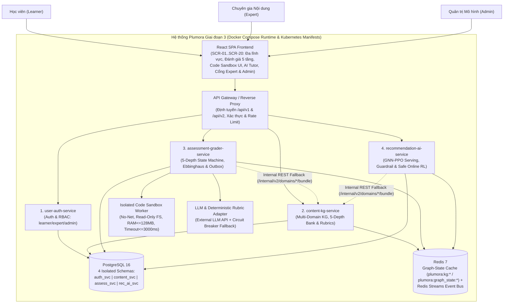

#### 2. Sơ đồ Triển khai Hạ tầng Docker Compose & Kubernetes (`DIAG-DEPLOY-V2`)

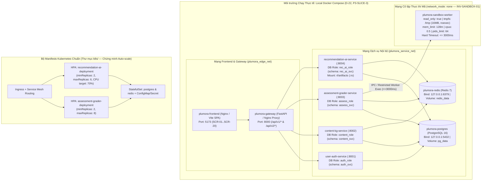

#### 3. Sơ đồ Thực thể Liên kết 4 Schema Độc lập (`DIAG-ERD-V2`)

```mermaid
erDiagram
    AUTH_SVC__USERS ||--o{ AUTH_SVC__USER_ROLES : "có vai trò RBAC"
    CONTENT_SVC__DOMAINS ||--o{ CONTENT_SVC__DOMAIN_CONCEPT_MAP : "ánh xạ N-N"
    CONTENT_SVC__CONCEPTS ||--o{ CONTENT_SVC__DOMAIN_CONCEPT_MAP : "thuộc lĩnh vực (is_shared)"
    CONTENT_SVC__CONCEPTS ||--o{ CONTENT_SVC__CONCEPT_PREREQUISITES : "tiên quyết DAG"
    CONTENT_SVC__CONCEPTS ||--o{ CONTENT_SVC__DEPTH_QUESTIONS : "chứa đề 5 tầng"
    CONTENT_SVC__DEPTH_QUESTIONS ||--o| CONTENT_SVC__GRADING_RUBRICS : "chấm theo Rubric"
    CONTENT_SVC__CONCEPTS ||--o{ CONTENT_SVC__CODE_CHALLENGES : "chứa bài Code Sandbox"
    ASSESS_SVC__ASSESSMENT_SESSIONS ||--o{ ASSESS_SVC__ATTEMPT_RECORDS : "ghi nhận từng bước"
    REC_AI_SVC__MODEL_REGISTRY ||--o{ REC_AI_SVC__ONLINE_EVAL_RUNS : "kiểm định Safety Gate"

    AUTH_SVC__USERS {
        uuid id PK
        varchar_32 username UK "NOT NULL, UNIQUE"
        varchar_64 display_name "NOT NULL"
        varchar_255 password_hash "NOT NULL (Argon2id)"
        int state_version "NOT NULL DEFAULT 1"
        timestamptz created_at "NOT NULL"
    }
    AUTH_SVC__USER_ROLES {
        uuid user_id PK, FK "FK -> auth_svc.users.id"
        varchar_16 role PK "CHECK IN ('learner','expert','admin')"
        timestamptz granted_at "NOT NULL"
    }
    CONTENT_SVC__DOMAINS {
        varchar_32 slug PK "backend | frontend | devops | custom"
        varchar_128 title "NOT NULL"
        int graph_version "NOT NULL DEFAULT 1"
        boolean is_published "NOT NULL DEFAULT true"
    }
    CONTENT_SVC__CONCEPTS {
        varchar_64 slug PK "vd: web-http, fe-dom-events, docker-containers"
        varchar_128 title "NOT NULL"
        boolean is_shared "NOT NULL DEFAULT false (node giao thoa)"
        text lesson_markdown "NOT NULL"
    }
    CONTENT_SVC__DOMAIN_CONCEPT_MAP {
        varchar_32 domain_slug PK, FK
        varchar_64 concept_slug PK, FK
        int node_idx "NOT NULL (0..N-1 trong lĩnh vực)"
        int tier "NOT NULL CHECK (tier BETWEEN 1 AND 4)"
    }
    CONTENT_SVC__CONCEPT_PREREQUISITES {
        varchar_32 domain_slug PK, FK
        varchar_64 concept_slug PK, FK
        varchar_64 prereq_slug PK, FK "CHECK (prereq_slug != concept_slug)"
    }
    CONTENT_SVC__DEPTH_QUESTIONS {
        uuid id PK
        varchar_64 concept_slug FK
        int depth_tier "NOT NULL CHECK (depth_tier BETWEEN 1 AND 5)"
        varchar_32 task_type "mcq | troubleshooting | constraint_shift | reverse_explain"
        text prompt "NOT NULL"
        jsonb options_or_context_json "NOT NULL"
    }
    CONTENT_SVC__GRADING_RUBRICS {
        uuid id PK
        uuid question_id FK "UNIQUE"
        jsonb criteria_weights_json "NOT NULL ([{id, desc, weight, required_keywords}])"
        text reference_explanation "NOT NULL (dùng cho AI Tutor & Deterministic Fallback)"
    }
    CONTENT_SVC__CODE_CHALLENGES {
        uuid id PK
        varchar_64 concept_slug FK
        varchar_16 language "CHECK IN ('python','sql','javascript')"
        text buggy_starter_code "NOT NULL"
        jsonb test_cases_json "NOT NULL (public & hidden assertions)"
        int timeout_ms "NOT NULL DEFAULT 3000 CHECK (timeout_ms <= 3000)"
    }
    ASSESS_SVC__USER_NODE_COMPETENCY {
        uuid user_id PK "Logical ref -> auth_svc.users.id"
        varchar_64 concept_slug PK "Logical ref -> content_svc.concepts.slug"
        float depth_level_norm "NOT NULL DEFAULT 0.0 IN (0.0, 0.25, 0.5, 0.75, 1.0)"
        float peak_depth_level_norm "NOT NULL DEFAULT 0.0 (High-water mark INV-MASTERY-01)"
        float confidence "NOT NULL DEFAULT 0.0 CHECK (0.0 <= confidence <= 1.0)"
        float stability_s "NOT NULL DEFAULT 3.0 CHECK (1.5 <= stability_s <= 60.0)"
        float code_practice_score "NOT NULL DEFAULT 0.0"
        timestamptz last_practiced_at "NULLABLE"
    }
    ASSESS_SVC__ASSESSMENT_SESSIONS {
        uuid id PK
        uuid user_id "NOT NULL, index"
        varchar_32 domain_slug "NOT NULL"
        varchar_64 concept_slug "NULLABLE (NULL khi là Adaptive Placement)"
        varchar_24 session_mode "placement | depth_probe | code_practice | spaced_review"
        int current_depth_tier "NOT NULL DEFAULT 1 CHECK (1..5)"
        int consecutive_failures_in_tier "NOT NULL DEFAULT 0"
        varchar_24 status "active | completed | ceiling_reached | insufficient_evidence"
    }
    ASSESS_SVC__ATTEMPT_RECORDS {
        uuid id PK
        uuid user_id "NOT NULL"
        uuid submission_id "NOT NULL, UNIQUE(user_id, submission_id) (INV-IDEMP-01)"
        uuid session_id FK
        int depth_tier "NOT NULL"
        float verified_score "NOT NULL CHECK (0.0 <= verified_score <= 1.0)"
        varchar_32 grader_source "deterministic_mcq | sandbox_tests | llm_rubric | deterministic_fallback"
        jsonb tutor_feedback_json "NOT NULL"
    }
    ASSESS_SVC__OUTBOX_EVENTS {
        uuid event_id PK "Idempotency key cho Redis Streams consumer"
        varchar_64 event_type "CompetencyUpdatedEvent"
        jsonb payload_json "NOT NULL"
        boolean published "NOT NULL DEFAULT false"
        timestamptz created_at "NOT NULL"
    }
    REC_AI_SVC__RL_EXPERIENCE_BUFFER {
        uuid id PK
        uuid source_event_id UK "UNIQUE (chống nạp trùng từ Redis Streams)"
        uuid user_id "NOT NULL"
        varchar_32 domain_slug "NOT NULL"
        jsonb graph_obs_before_json "NOT NULL (N x 8)"
        varchar_64 action_concept_slug "NOT NULL"
        varchar_24 action_learning_mode "Learn_New | Deep_Probe | Code_Practice | Spaced_Review"
        float verified_reward "NOT NULL (INV-DEPTH-01)"
        jsonb graph_obs_after_json "NOT NULL (N x 8)"
    }
    REC_AI_SVC__MODEL_REGISTRY {
        uuid id PK
        varchar_64 version_tag UK "vd: gnn-ppo-v2.0.0-base, gnn-ppo-online-b1"
        varchar_64 checkpoint_sha256 "NOT NULL"
        varchar_16 status "active_prod | candidate | archived | rolled_back"
        boolean safety_gate_passed "NOT NULL DEFAULT false"
        timestamptz activated_at "NULLABLE"
    }
    REC_AI_SVC__ONLINE_EVAL_RUNS {
        uuid id PK
        uuid candidate_model_id FK
        float invalid_action_rate_unmasked "NOT NULL (< 0.05 để PASS)"
        float masked_violation_rate "NOT NULL (== 0.00 để PASS)"
        float mean_reward_ratio_vs_prod "NOT NULL (>= 0.98 để PASS)"
        float kl_divergence "NOT NULL (<= delta_max)"
        varchar_16 gate_verdict "PASSED | BLOCKED"
    }
```

#### 4. Sơ đồ Máy Trạng thái Đánh giá Chẩn đoán & Đào sâu 5 Tầng (`DIAG-SM-ASSESS`)

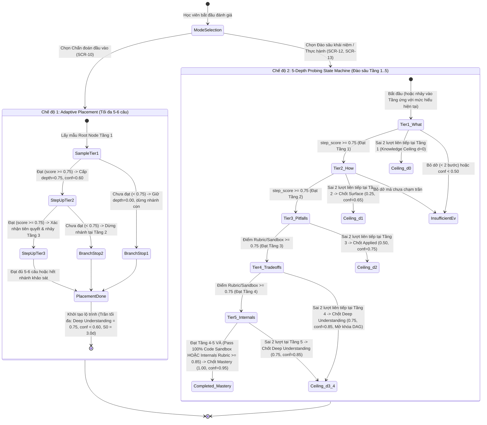

#### 5. Sơ đồ Tuần tự Luồng Đánh giá 5 Tầng, Chấm Đa phương thức, Outbox & Khuyến nghị `GNN-PPO` (`DIAG-SEQ-V2` — Đầy đủ Nhánh Lỗi `alt/else`)

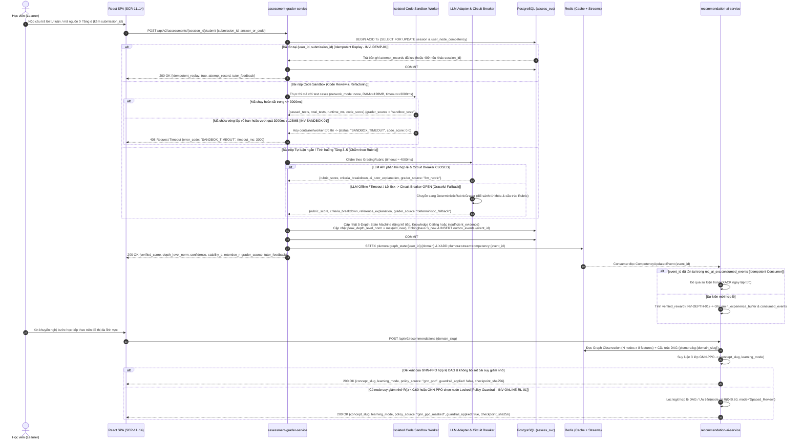

#### 6. Sơ đồ Ranh giới Bảo mật & Cô lập Thực thi (`DIAG-SEC-V2`)

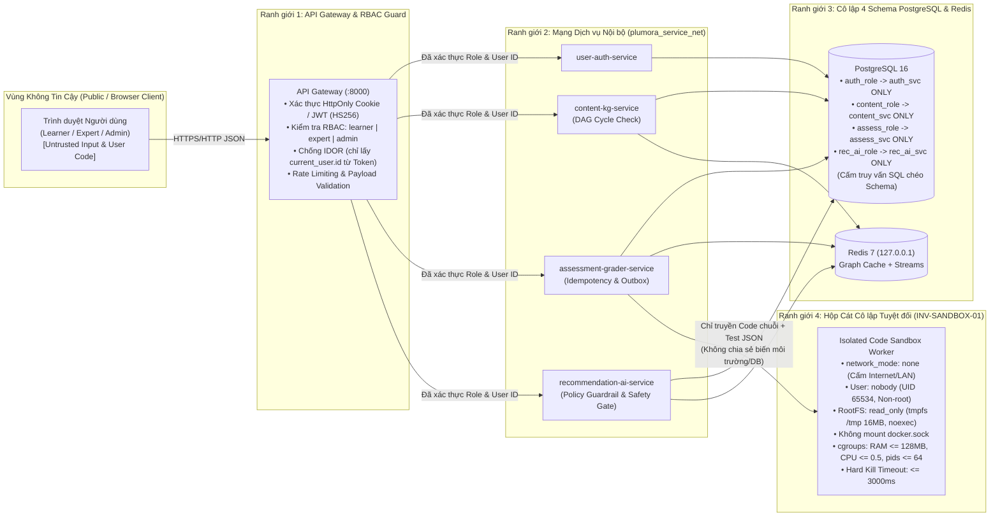

#### 7. Sơ đồ Luồng Dữ liệu Huấn luyện Đa lĩnh vực, Đối sánh 4 Cấp & `Safe Micro-batch Online RL` (`DIAG-DFD-RL-V2`)

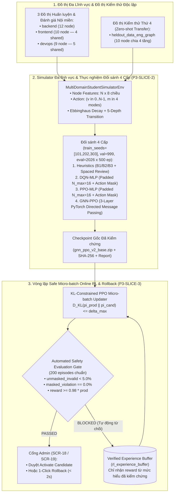

### 8.3. Hợp đồng REST API `/api/v2/*` & Hợp đồng Sự kiện `Redis Streams` (`PL3-KG-01`..`PL3-ARCH-01`)

#### A. Bảng Hợp đồng REST API `/api/v2/*`

| Phân hệ / Dịch vụ | Endpoint | Quyền RBAC | Đầu vào (`Request Contract`) | Đầu ra thành công (`200`/`201`) | Mã lỗi & Bất biến bảo toàn | Tiêu chí (`AC-ID`) |
| --- | --- | --- | --- | --- | --- | --- |
| **Learner — Đa lĩnh vực** (`content-kg` + `assess`) | `GET /api/v2/domains` | `learner`, `expert`, `admin` | Header/Cookie xác thực | `200`: `{domains: [{slug, title, total_nodes, shared_nodes_count, user_summary: {surface_count, applied_count, deep_count, mastery_count, needs_review_count, placement_completed}}]}` | `401 AUTH_REQUIRED` | `PL3-KG-01`, `PL3-MEMORY-01` |
| **Learner — Bản đồ KG & *Ebbinghaus*** | `GET /api/v2/domains/{slug}/roadmap` | `learner`, `expert`, `admin` | Path `slug`, Query tùy chọn `simulated_time_offset_days` (chỉ bật ở `dev`/`test`) | `200`: `{domain_slug, graph_version, nodes: [{node_idx, slug, title, tier, is_shared, prerequisites, depth_level_norm, depth_label, confidence, stability_s, retention_ebbinghaus, is_eligible, needs_review, code_practice_score}]}` | `401 AUTH_REQUIRED`, `404 DOMAIN_NOT_FOUND` | `PL3-KG-01`, `PL3-MEMORY-01` |
| **Learner — Chẩn đoán đầu vào (`SCR-10`)** | `POST /api/v2/domains/{slug}/placement/start` | `learner` | Path `slug` | `201`: `{session_id, domain_slug, max_questions: 6, current_question: {question_id, concept_slug, tier, prompt, options}}` | `401 AUTH_REQUIRED`, `404 DOMAIN_NOT_FOUND` | `PL3-ASSESS-01` |
| **Learner — Nộp câu Chẩn đoán (`SCR-10`)** | `POST /api/v2/domains/{slug}/placement/{session_id}/answer` | `learner` | `{submission_id: UUID, question_id: UUID, selected_option: "A"\|"B"\|"C"\|"D"}` | `200`: `{step_passed, placement_status: "in_progress"\|"completed", next_question: {...}\|null, initialized_nodes: [{concept_slug, depth_level_norm (<=0.75), confidence: 0.60 (khi đạt) \| 0.30 (khi dừng nhánh), stability_s: 3.0}]}` | `401`, `404`, `409 SUBMISSION_ID_CONFLICT`, `422` | `PL3-ASSESS-01` |
| **Learner — Khởi tạo Phiên Đào sâu 5 tầng / Ôn tập (`SCR-12`, `SCR-14`)** | `POST /api/v2/assessments/start` | `learner` | `{domain_slug: str, concept_slug: str, session_mode: "depth_probe"\|"spaced_review"}` | `201`: `{session_id, concept_slug, session_mode, current_depth_tier: 1..5, step_item: {question_id, depth_tier, task_type, prompt, options_or_context, rubric_summary}}` | `401 AUTH_REQUIRED`, `403 CONCEPT_LOCKED` (`INV-DAG-01`) | `PL3-ASSESS-01`, `PL3-MEMORY-01` |
| **Learner — Nộp bước Đào sâu 5 tầng & AI Tutor (`SCR-12`, `SCR-14`)** | `POST /api/v2/assessments/{session_id}/submit` | `learner` | `{submission_id: UUID, question_id: UUID, selected_option: str\|null, written_explanation: str\|null}` | `200`: `{attempt_id, idempotent_replay: bool, step_score, step_passed, grader_source: "deterministic_mcq"\|"llm_rubric"\|"deterministic_fallback", session_status: "active"\|"ceiling_reached"\|"completed"\|"insufficient_evidence", next_depth_tier: int\|null, next_step_item: {...}\|null, updated_competency: {depth_level_norm, depth_label, confidence, stability_s, retention_ebbinghaus}, tutor_feedback: {summary, criteria_results: [...]}}` | `401`, `403`, `404`, `409 SUBMISSION_ID_CONFLICT`, `422` (`INV-DEPTH-01`) | `PL3-ASSESS-01`, `PL3-TUTOR-01`, `PL3-MEMORY-01` |
| **Learner — Chấm Code Sandbox Cô lập (`SCR-13`)** | `POST /api/v2/concepts/{slug}/code-sandbox/submit` | `learner` | `{submission_id: UUID, challenge_id: UUID, language: "python"\|"sql"\|"javascript", source_code: str}` | `200`: `{attempt_id, idempotent_replay: bool, passed_tests: int, total_tests: int, code_score: float, runtime_ms: int, memory_kb: int, test_results: [...], updated_competency: {depth_level_norm, confidence, stability_s}}` | `401`, `403 CONCEPT_LOCKED`, `408 SANDBOX_TIMEOUT` ($>3000\text{ms}$, `INV-SANDBOX-01`), `422 SANDBOX_SECURITY_VIOLATION` | `PL3-GRADER-01`, `PL3-ASSESS-01` |
| **Learner — Khuyến nghị `GNN-PPO` (`SCR-11`)** | `POST /api/v2/recommendations` | `learner` | `{domain_slug: str}` | `200`: `{domain_slug, status: "active"\|"completed", recommended_action: {concept_slug, title, tier, learning_mode: "Learn_New"\|"Deep_Probe"\|"Code_Practice"\|"Spaced_Review", reason_vi}, policy_source: "gnn_ppo"\|"gnn_ppo_masked"\|"fallback_rule", state_source: "redis_graph_cache"\|"postgres_fallback", guardrail_applied: bool, retention_alert: bool, checkpoint_sha256: str, node_features_snapshot: [...]}` | `401 AUTH_REQUIRED` (Tự động fallback trả `200` nếu thiếu checkpoint hoặc lỗi Redis, $p95 < 250\text{ms}$) | `PL3-RL-01`, `PL3-GUARD-01` |
| **Expert — Quản lý Lĩnh vực & Đồ thị DAG (`SCR-15`)** | `POST /api/v2/expert/domains`<br>`PUT /api/v2/expert/domains/{slug}/graph` | `expert`, `admin` | `{slug, title, nodes: [{slug, title, tier, is_shared, lesson_markdown}], edges: [{concept_slug, prereq_slug}]}` | `200`/`201`: `{domain_slug, graph_version, dag_valid: true, total_nodes, shared_nodes_count, published_event_id}` | `401`, `403 FORBIDDEN_ROLE` (nếu là `learner`), `422 DAG_CYCLE_DETECTED` (kèm `cycle_path`) | `PL3-KG-01`, `PL3-ROLE-01` |
| **Expert — Biên soạn Đề 5 Tầng, Rubric & Code Challenge (`SCR-16`, `SCR-17`)** | `POST /api/v2/expert/concepts/{slug}/questions`<br>`POST /api/v2/expert/concepts/{slug}/code-challenges` | `expert`, `admin` | `{depth_tier: 1..5, task_type, prompt, rubric: {criteria_weights, reference_explanation}}` hoặc `{language, buggy_starter_code, solution_code, test_cases, timeout_ms: <=3000}` | `201`: `{item_id, concept_slug, validation_run: {solution_passed_all_tests: true, runtime_ms}}` | `401`, `403 FORBIDDEN_ROLE`, `422 RUBRIC_WEIGHT_SUM_INVALID` ($\sum w_j \ne 1.0$) | `PL3-ASSESS-01`, `PL3-GRADER-01`, `PL3-TUTOR-01`, `PL3-ROLE-01` |
| **Admin — Giám sát `Online RL` & Chạy Lô Tinh chỉnh (`SCR-18`)** | `GET /api/v2/admin/online-rl/status`<br>`POST /api/v2/admin/online-rl/micro-batch` | `admin` | `{batch_size: int (default 128), kl_target_max: float (default 0.02)}` | `200`: `{candidate_model_id, version_tag, checkpoint_sha256, kl_divergence, safety_eval: {gate_verdict: "PASSED"\|"BLOCKED", invalid_action_rate_unmasked, masked_violation_rate, mean_reward_ratio_vs_prod}}` | `401`, `403 FORBIDDEN_ROLE` (nếu là `learner` hoặc `expert`), `409 INSUFFICIENT_BUFFER_SAMPLES` | `PL3-RL-01`, `PL3-GUARD-01`, `PL3-ROLE-01` |
| **Admin — Duyệt Phát hành & `1-Click Rollback` (`SCR-19`)** | `POST /api/v2/admin/models/{model_id}/activate`<br>`POST /api/v2/admin/models/rollback` | `admin` | `{reason: str}` | `200`: `{active_model_id, previous_model_id, active_checkpoint_sha256, switched_at, switch_latency_ms (<2000ms)}` | `401`, `403 FORBIDDEN_ROLE`, `422 SAFETY_GATE_NOT_PASSED` (`INV-ONLINE-RL-01` — cấm kích hoạt model `BLOCKED`) | `PL3-RL-01`, `PL3-ROLE-01` |
| **Admin — Sức khỏe Cụm 4 Microservices & Outbox (`SCR-20`)** | `GET /api/v2/admin/system-health` | `admin` | — | `200`: `{services: {auth: "up", content_kg: "up", assessment_grader: "up", recommendation_ai: "up"}, schemas_isolated: true, outbox_pending_count: int, redis_stream_lag_ms: float (<500ms), graph_cache_hit_rate: float}` | `401`, `403 FORBIDDEN_ROLE` | `PL3-ARCH-01`, `PL3-ROLE-01` |

#### B. Hợp đồng Sự kiện `Redis Streams` & `Transactional Outbox` (`Idempotent Event Contract`)

| Tên Sự kiện (`event_type`) | Kênh `Redis Streams` | Dịch vụ Phát (`Producer`) | Dịch vụ Tiêu thụ (`Consumer`) | Cấu trúc Payload Chuẩn (`JSON Schema`) | Cơ chế Chống xử lý trùng & Chịu lỗi (`Idempotency & Retry`) |
| --- | --- | --- | --- | --- | --- |
| **`CompetencyUpdatedEvent`** | `plumora:stream:competency` (Consumer Group: `rec_ai_cg`) | `assessment-grader-service` (ghi vào `assess_svc.outbox_events` trong cùng ACID Tx chấm bài) | `recommendation-ai-service` | `{event_id: UUID, occurred_at: ISO8601, user_id: UUID, domain_slug: str, concept_slug: str, session_mode: str, depth_before: float, depth_after: float, confidence: float, stability_s: float, retention_recovered: float, code_score_delta: float, verified_reward: float, graph_obs_before: float[N][8], graph_obs_after: float[N][8]}` | Consumer kiểm tra `event_id` trong bảng `rec_ai_svc.consumed_events` (`UNIQUE (event_id)`) trong cùng transaction ghi `rl_experience_buffer`. Nếu đã tồn tại $\rightarrow$ bỏ qua và gửi `XACK`. Độ trễ đích $p95 < 500\text{ms}$. |
| **`DomainGraphUpdatedEvent`** | `plumora:stream:domain_events` (Consumer Groups: `assess_cg`, `rec_ai_cg`) | `content-kg-service` (ghi vào `content_svc.outbox_events` khi `Expert` xuất bản đồ thị/Rubric/Code Challenge) | `assessment-grader-service`, `recommendation-ai-service` | `{event_id: UUID, occurred_at: ISO8601, domain_slug: str, graph_version: int, updated_by_expert_id: UUID, change_summary: str}` | Cập nhật ngay Redis key `plumora:kg:{domain_slug}`; các consumer kiểm tra `event_id` trong `consumed_events`, làm mới cache đồ thị in-memory và gửi `XACK`. |

### 8.4. Đặc tả 6 Yếu tố cho các Mẫu Thiết kế Phần mềm Mới Giai đoạn 3 (`P3-07`, `D-23`)

| Mẫu Thiết kế (`Design Pattern`) | 1. Vấn đề (`Problem`) | 2. Phương án đơn giản đã loại bỏ (`Simpler Alternative`) | 3. Mẫu được chọn (`Selected Pattern`) | 4. Thành phần tham gia (`Participants`) | 5. Đánh đổi (`Trade-offs`) | 6. Bằng chứng kiểm thử (`Verification Evidence`) |
| --- | --- | --- | --- | --- | --- | --- |
| **1. `5-Depth Probing State Machine`** (`PL3-ASSESS-01`) | Phiên đánh giá đào sâu cần điều hướng linh hoạt qua 5 tầng (*What $\rightarrow$ Internals*) và dừng đúng lúc học viên chạm *Knowledge Ceiling* hoặc báo `insufficient_evidence` khi bỏ dở, đồng thời không làm phình không gian hành động của RL. | Dùng hàm `if/else` tĩnh hoặc giao luôn việc chọn từng câu hỏi tầng 1..5 cho RL (làm không gian hành động tăng gấp $5\times$, khó hội tụ và dễ hỏi câu Tầng 5 khi chưa biết Tầng 1). | **State Machine Pattern** tất định điều khiển luồng câu hỏi bên trong phiên đánh giá và ánh xạ 3 chiều sang `(depth_level_norm, confidence)`. | `AssessmentSessionStateMachine`, `PlacementSampler`, `DepthStepTransition`, `CeilingDetector`, `CompetencyMapper` (trong `assessment-grader-service`). | Tăng thêm bảng trạng thái phiên `assessment_sessions`, nhưng tách bạch hoàn hảo quyết định cấp lộ trình $(v, m)$ của RL với quyết định bóc tách chiều sâu từng khái niệm. | `pytest tests/test_depth_state_machine.py`: kiểm chứng chuyển tầng $1 \rightarrow 5$, dừng khi sai 2 lần liên tiếp cùng tầng (`ceiling_reached`), trần Placement `0.75` và nhánh `insufficient_evidence`. |
| **2. `Adapter + Dependency Injection + Circuit Breaker`** (`PL3-GRADER-01`, `PL3-TUTOR-01`) | Hệ thống cần chấm tự luận theo Rubric qua LLM ngoài và chấm code qua Sandbox Worker, nhưng khi bảo vệ đồ án offline hoặc khi LLM/Sandbox quá tải thì hệ thống tuyệt đối không được sập `500`. | Gọi trực tiếp SDK của nhà cung cấp LLM hoặc chạy `subprocess` trực tiếp trong controller API (gây khóa luồng, phụ thuộc cứng vào mạng và mất an toàn thực thi). | **Adapter Pattern + DI + Circuit Breaker**: định nghĩa giao diện trừu tượng `RubricGraderPort` và `CodeSandboxPort`; bọc LLM bằng `CircuitBreaker` tự động chuyển sang `DeterministicRubricGrader` khi lỗi/offline. | `RubricGraderPort`, `LlmRubricGraderAdapter`, `DeterministicRubricGrader`, `CircuitBreakerGuard`, `IsolatedSandboxWorkerAdapter`. | Cần duy trì bộ từ khóa & giải thích mẫu trong `grading_rubrics` để phục vụ fallback, đổi lại hệ thống đạt độ sẵn sàng 100% khi offline và minh bạch qua trường `grader_source`. | `pytest tests/test_llm_rubric_adapter.py` & `test_code_sandbox_security.py`: ngắt mạng ép Circuit Breaker mở $\rightarrow$ xác nhận trả `grader_source = "deterministic_fallback"` (`200 OK`); gửi `while True` $\rightarrow$ xác nhận cắt trong $\le 3000\text{ms}$. |
| **3. `Transactional Outbox + Idempotent Stream Consumer`** (`PL3-ARCH-01`) | Khi tách thành 4 Microservices với 4 Schema DB riêng, nếu `assessment-grader-service` cập nhật DB xong nhưng mất kết nối Redis trước khi gửi sự kiện thì `recommendation-ai-service` sẽ mất mẫu `Experience Buffer` (lỗi Dual-Write). | Gửi trực tiếp sự kiện lên Redis hoặc gọi HTTP đồng bộ sang `recommendation-ai-service` ngay sau lệnh `db.commit()` (dễ mất sự kiện khi mạng chập chờn hoặc gây nhân bản dữ liệu khi retry). | **Transactional Outbox + Idempotent Consumer**: ghi bản ghi vào `assess_svc.outbox_events` trong cùng ACID Transaction với `attempt_records`, relay sang `Redis Streams` và chống xử lý trùng bằng `event_id` tại `rec_ai_svc.consumed_events`. | `AssessmentUnitOfWork`, `OutboxRelayWorker`, `RedisStreamPublisher`, `IdempotentExperienceConsumer` (`consumed_events`). | Phát sinh độ trễ bất đồng bộ nhỏ ($p95 < 500\text{ms}$) và bảng `outbox_events`/`consumed_events`, nhưng bảo đảm tính nhất quán *At-least-once Delivery* + *Exactly-once Processing*. | `pytest tests/test_microservices_outbox_streams.py`: giả lập lỗi Redis lúc commit $\rightarrow$ relay tự phát bù khi Redis sống lại; phát lặp cùng `event_id` 3 lần $\rightarrow$ `rl_experience_buffer` chỉ ghi đúng 1 dòng. |
| **4. `Strategy + Policy Guardrail Decorator & Safe Model Registry`** (`PL3-RL-01`, `PL3-GUARD-01`, `INV-ONLINE-RL-01`) | Mô hình `GNN-PPO` và các bản cập nhật `Online RL` có thể đề xuất bài vi phạm tiên quyết DAG, bỏ sót bài suy giảm nhớ $R(t) < 0.60$, hoặc suy giảm chất lượng sau khi fine-tune. | Tin tưởng tuyệt đối đầu ra của mạng nơ-ron và ghi đè trực tiếp file `checkpoint.zip` đang chạy khi có lô dữ liệu mới (rủi ro quên thảm khốc và phá vỡ luật sư phạm DAG). | **Strategy + Guardrail Decorator & Safe Model Registry**: bọc chiến lược `GnnPpoStrategy` trong `PolicyGuardrailDecorator` (ép luật DAG + ưu tiên `Spaced_Review`); quản lý vòng đời `candidate` $\rightarrow$ `Safety Evaluation Gate` $\rightarrow$ `Admin Activate` / `1-Click Rollback`. | `RecommendationStrategyPort`, `GnnPpoStrategy`, `PolicyGuardrailDecorator`, `SafeOnlineRlTrainer`, `SafetyEvaluationGate`, `ModelRegistryService`. | Cần lưu trữ nhiều phiên bản checkpoint và chạy 200 episodes kiểm định trước khi kích hoạt, đổi lại đảm bảo `masked_violation_rate == 0.0%` và khôi phục tức thì $< 2000\text{ms}$. | `pytest tests/test_gnn_ppo_guardrail_serving.py` & `test_rbac_expert_admin.py`: kiểm chứng chặn 100% action Locked, ưu tiên node $R(t)<0.60$, từ chối kích hoạt checkpoint `BLOCKED` (`422`) và test `1-Click Rollback`. |

### 8.5. Ma trận Liên kết Mở rộng Giai đoạn 3 (`System Design` $\leftrightarrow$ `UI Design System` $\leftrightarrow$ `4 Lát cắt`)

| `AC-ID` | Màn hình chuyên biệt (`ui-design-system.md` `SCR-09`..`SCR-20`) | Dịch vụ & API Chính | Lưu trữ & Bất biến | Lát cắt (`plan.md`) |
| --- | --- | --- | --- | --- |
| `PL3-KG-01`, `PL3-MEMORY-01` | `SCR-09`: Trung tâm Đa lĩnh vực (`/domains`)<br>`SCR-11`: Bản đồ KG Đa lĩnh vực & *Ebbinghaus* (`/domains/:domain/roadmap`) | `GET /api/v2/domains`, `GET /api/v2/domains/{slug}/roadmap` | `domains`, `domain_concept_map`, `user_node_competency` ($R(t) = e^{-\Delta t/S}$, $S_0 = 3.0$) | `P3-SLICE-1` |
| `PL3-ASSESS-01`, `PL3-GRADER-01`, `PL3-TUTOR-01` | `SCR-10`: Chẩn đoán Đầu vào (`/domains/:domain/placement`)<br>`SCR-12`: Phòng Đào sâu 5 Tầng (`/concepts/:slug/depth-probe`)<br>`SCR-13`: Phòng Code Sandbox (`/concepts/:slug/code-sandbox`)<br>`SCR-14`: Ngăn kéo AI Tutor, Rubric & Ôn tập *Ebbinghaus* | `POST /api/v2/domains/{slug}/placement/*`, `POST /api/v2/assessments/*`, `POST /api/v2/concepts/{slug}/code-sandbox/submit` | `assessment_sessions`, `attempt_records`; `INV-DEPTH-01`, `INV-SANDBOX-01` | `P3-SLICE-1` |
| `PL3-RL-01`, `PL3-GUARD-01` | `SCR-11` Banner `GNN-PPO` & `SCR-06` Mở rộng (Graph Provenance 8 features/node) | `POST /api/v2/recommendations` & CLI `plumora_rl.train_gnn_ppo` / `evaluate_phase3` | `rl_experience_buffer`, `model_registry`; `INV-RL-01`, `INV-ONLINE-RL-01` | `P3-SLICE-2` |
| `PL3-ROLE-01`, `PL3-ARCH-01` | **Phân hệ `Expert`:** `SCR-15` (Đồ thị DAG), `SCR-16` (Đề 5 tầng & Rubric), `SCR-17` (Code Challenge & Tests)<br>**Phân hệ `Admin`:** `SCR-18` (Online RL & Buffer), `SCR-19` (Safety Gate & Rollback), `SCR-20` (4 Microservices & Outbox Health) | `/api/v2/expert/*`, `/api/v2/admin/*` | 4 Schema PG (`auth_svc`, `content_svc`, `assess_svc`, `rec_ai_svc`) + `outbox_events` + Redis Streams + K8s manifests (`k8s/`) | `P3-SLICE-3`, `P3-SLICE-4` |

---

## 9. Bổ sung Thiết kế Chuẩn hóa `v3.1` (`D-27`..`D-30` — `REM-01`..`REM-04`)

1. **Kiến trúc Docker Thống nhất (`Phương án A` — `D-27`):**
   - `docker-compose.yml` chuẩn hóa về duy nhất 1 topo chạy thật gồm: `postgres`, `redis`, `db-migrate-seed` (chạy migrations `0001`..`0010` + seed idempotent một lần trước khi mở các service), `user-auth-service:8001`, `content-kg-service:8002`, `assessment-grader-service:8003`, `recommendation-ai-service:8004` (gắn volume bền vững `plumora_rl_candidates:/app/rl/artifacts/candidates`), `api-gateway:8000` và `frontend:3000` (Nginx non-root `:8080` render `/etc/nginx/templates/default.conf.template` trỏ `http://api-gateway:8000`).
   - `backend/Dockerfile` cài sẵn `nodejs` để chạy PASS đủ 22/22 bài Code Sandbox (`Python`, `SQL`, `JavaScript`).
   - `backend/app/main.py` chỉ được giữ làm in-process test harness nội bộ cho `pytest`; thư mục `k8s/` được duy trì ở mức **Experimental Production Blueprint** (ngoài phạm vi nghiệm thu hiện tại).
2. **Dọn dẹp Phần dư MVP `v1` (`Quyết định A1` — `D-28`):**
   - Gỡ bỏ hoàn toàn `backend/app/db/redis_store.py`, `_sync_v2_to_mvp_if_backend`, việc ghi `UserConceptMasteryModel` lúc đăng ký và các route v1 đã xóa (`/api/v1/roadmap`, `/api/v1/concepts`, `/api/v1/recommendations`), chỉ giữ `/api/v1/auth/*` và `/api/v1/health` (giữ nguyên các bảng ORM lịch sử trong DB, không chạy `DROP TABLE`).
3. **Liên thông Nội bộ & Nhất quán Cache/Outbox Đa Worker (`REM-03` — `D-29`):**
   - **Cache Năng lực `GNN-PPO`:** `recommendation/service_v2.py` kiểm tra Redis `plumora:raw_comp_state:{user_id}:{domain_slug}` trước khi gọi HTTP; `assessment/service_v2.py` xóa tức thời `plumora:raw_comp_state:{user_id}:*` sau mỗi giao dịch cập nhật năng lực và tính `state_version` đơn điệu theo số lượt làm bài + microsecond `updated_at`.
   - **Đồng bộ `_BUNDLE_CACHE` đa worker:** Mọi thao tác CRUD của `Expert` trên `content-kg-service` tăng `graph_version`, ghi `DomainGraphUpdatedEvent` vào `content_svc.outbox_events` và tăng khóa `plumora:kg:epoch` trên Redis để toàn bộ các worker của `assessment-grader-service` và `recommendation-ai-service` làm mới bộ đệm ngay lập tức.
   - **3 Internal APIs Liên Service (`X-Service-Token`):** `POST /api/v2/internal/analytics/cohort` (trên `assessment-grader-service` phục vụ `Cohort Analytics`), `GET /api/v2/internal/outbox/pending-count` (trả số đếm theo `event_type` trên cả `assessment` và `content`) và `POST /api/v2/internal/outbox/relay` (điều phối từ `Admin Console`).
   - **Kiểm tra Cô lập Schema & Outbox Consumer:** `get_system_health_status` truy vấn `pg_catalog.pg_namespace` / `pg_catalog.pg_class` / `pg_catalog.pg_roles` (không bị ẩn bởi phân quyền của `information_schema`); `outbox.py` định danh consumer động `{hostname}-{pid}` và bắt riêng `IntegrityError` để `XACK` an toàn chống kẹt PEL.
