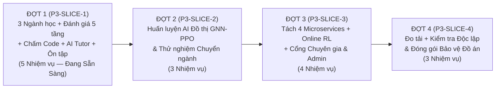

# Kế hoạch Phát triển Dự án Plumora (Lộ trình Công việc & Task DAG)

Phiên bản: `2.0.0` — **APPROVED (Gate 1 Baseline Giai đoạn 3 — Chủ dự án duyệt tại `D-16`..`D-26` ngày 2026-11-18; bảo lưu trọn vẹn lịch sử Gate 1 Baseline MVP `v1.0.0` duyệt tại `D-14` / `O-10` ngày 2026-11-16)**.
- **Trạng thái tổng quan:**
  - **Giai đoạn 1 (MVP — 12 bài Backend & AI `DQN` cơ bản):** **ĐÃ HOÀN THÀNH 100%** (xem Phụ lục Lịch sử ở Mục 3 cuối file).
  - **Giai đoạn 3 (Mở rộng Đa ngành, Đánh giá 5 tầng, Chấm Code, Gia sư AI, `GNN-PPO`, `Online RL` & 4 Microservices):** Chia làm **4 Đợt triển khai tuần tự với 15 nhiệm vụ cụ thể** dưới đây. Hiện tại **Đợt 1 (`P3-SLICE-1`) đang ở trạng thái SẴN SÀNG LÀM NGAY (`ready`)**.

---

## 1. Danh sách Công việc Cần Làm ở Giai đoạn 3 (4 Đợt — 15 Nhiệm vụ Cụ thể)

### ĐỢT 1 (`P3-SLICE-1`): Mở rộng 3 Ngành học, Đánh giá 5 Tầng, Chấm Code, Gia sư AI & Nhắc Ôn tập
*Trạng thái: **SẴN SÀNG LÀM NGAY (`ready`)** — Trọng tâm: Nâng cấp toàn diện trải nghiệm học và đánh giá năng lực của Học viên (`Learner`)*

| STT | Tên nhiệm vụ dễ hiểu | Công việc cụ thể sẽ làm | Làm xong bạn sẽ thấy gì? |
| :-: | :--- | :--- | :--- |
| **Việc 1.1** | **Mở rộng dữ liệu lên 3 ngành học có bài học liên thông** | Thêm dữ liệu ngành **Frontend (10 bài)** và **DevOps (9 bài)** bên cạnh **Backend (12 bài)**; nối 7 bài học dùng chung giữa các ngành (`net-internet`, `os-basics`, `web-http`, `api-rest`, `cache-redis`, `sec-authn`, `sec-api`). | Khi học viên đã học xong `HTTP` hoặc `Redis` ở ngành Backend rồi chuyển sang ngành Frontend/DevOps, các bài đó **tự động được tính đã học**, không phải học lại từ đầu. |
| **Việc 1.2** | **Làm bài Kiểm tra đầu vào nhanh & Hỏi đào sâu 5 tầng** | Xây dựng 2 chế độ kiểm tra tự động: 1. *Chẩn đoán đầu vào (5 câu)* khi mới vào ngành để mở khóa nhanh các bài cơ bản. 2. *Đào sâu 5 tầng độ khó* (Khái niệm $\rightarrow$ Cơ chế $\rightarrow$ Xử lý lỗi $\rightarrow$ Đánh đổi $\rightarrow$ Nội tại) sau mỗi bài học để đo đúng trình độ thực (*Biết bề mặt / Biết áp dụng / Hiểu sâu / Làm chủ*). | Học viên có nền tảng được mở khóa sớm bài cơ bản; hệ thống tự động hỏi khó dần và dừng lại đúng chỗ học viên chạm giới hạn kiến thức (*Knowledge Ceiling*). |
| **Việc 1.3** | **Làm máy chấm bài sửa Code an toàn & Gia sư AI giải thích lỗi** | • Tạo phòng chấm Code cô lập (*Code Sandbox* chạy Python/SQL/JS trong tối đa 3 giây, cấm mạng ngoài) để học viên thực hành sửa code lỗi. • Kết nối *Gia sư AI (AI Tutor)* chấm câu trả lời tình huống theo biểu điểm (*Rubric*) và giải thích cặn kẽ vì sao sai (có chế độ chấm offline dự phòng khi mất mạng). | Học viên gõ/sửa code chạy bộ test ngay trên web và nhận được lời giải thích chi tiết từng ý đạt hay thiếu từ Gia sư AI. |
| **Việc 1.4** | **Làm bộ đo độ quên kiến thức & Nhắc ôn tập (*Ebbinghaus*)** | Áp dụng công thức đường cong quên lãng theo số ngày chưa ôn lại bài; khi mức nhớ tụt xuống dưới `60%`, tự động bật cảnh báo nhắc ôn tập. | Những bài học lâu ngày không đụng tới sẽ hiện thanh cảnh báo màu vàng **"Cần ôn tập"**; học viên ôn xong thanh trí nhớ đầy lại `100%` và lâu quên hơn. |
| **Việc 1.5** | **Ráp 6 màn hình mới của Học viên (`SCR-09` $\rightarrow$ `SCR-14`)** | Đưa 6 màn hình Stitch đã duyệt vào ứng dụng React: Trang chọn ngành (`SCR-09`), Kiểm tra đầu vào (`SCR-10`), Bản đồ đa ngành (`SCR-11`), Phòng hỏi 5 tầng (`SCR-12`), Phòng sửa Code (`SCR-13`), Ngăn kéo Gia sư AI & Ôn tập (`SCR-14`). | Trải nghiệm trọn vẹn hành trình học tập mới của Học viên trên trình duyệt thật. |

---

### ĐỢT 2 (`P3-SLICE-2`): Nâng cấp Lõi Trí tuệ Nhân tạo lên `GNN-PPO` Đa ngành
*Trạng thái: **Làm ngay sau Đợt 1** — Trọng tâm: Huấn luyện mô hình AI đọc hiểu đồ thị đa ngành và chứng minh hiệu quả nghiên cứu*

| STT | Tên nhiệm vụ dễ hiểu | Công việc cụ thể sẽ làm | Làm xong bạn sẽ thấy gì? |
| :-: | :--- | :--- | :--- |
| **Việc 2.1** | **Nâng cấp môi trường giả lập học viên (*Simulator*) lên đa ngành** | Nâng cấp bộ giả lập từ 12 bài trắc nghiệm đơn giản lên 31 bài thuộc 3 ngành, mô phỏng cả 4 hoạt động: *Học bài mới*, *Đào sâu 5 tầng*, *Thực hành sửa Code* và *Ôn tập bài sắp quên*. | Có môi trường huấn luyện AI sát với hành vi học thật và sự quên kiến thức theo thời gian. |
| **Việc 2.2** | **Huấn luyện mô hình AI Đồ thị (`GNN-PPO`) & Chạy so sánh 4 phương pháp** | Huấn luyện mạng nơ-ron đồ thị `GNN-PPO` (đọc hiểu cấu trúc cây môn học) và chạy thực nghiệm so sánh với 3 phương pháp cũ (`Heuristics B1/B2/B3`, `DQN-MLP` của MVP, `PPO-MLP` thường), kể cả thử nghiệm trên **ngành thứ 4 mới tinh (*Data Engineering* — 10 bài)** mà AI chưa từng thấy lúc học. | Có bảng số liệu, biểu đồ và file mô hình (`gnn_ppo_v2_base.zip`) chứng minh `GNN-PPO` gợi ý thông minh hơn và tự thích nghi được với ngành học mới mà không cần huấn luyện lại từ đầu. |
| **Việc 2.3** | **Kết nối `GNN-PPO` & Bộ lọc kiểm duyệt lộ trình tự động vào Web** | Đưa mô hình `GNN-PPO` vào gợi ý trực tiếp trên bản đồ học tập kèm **Bộ lọc an toàn tự động (*Policy Guardrail*)**: luôn chặn gợi ý nhảy cóc sai bài tiên quyết và ưu tiên nhắc bài đang bị quên. | Trên màn hình Bản đồ (`SCR-11`), AI không chỉ gợi ý *"Học bài nào tiếp theo"* mà còn chỉ rõ *"Nên học theo chế độ nào (Học mới / Đào sâu / Sửa code / Ôn tập)"*. |

---

### ĐỢT 3 (`P3-SLICE-3`): Tách 4 Microservices, Tự học từ Người dùng thật (`Online RL`) & Cổng Chuyên gia / Admin
*Trạng thái: **Làm ngay sau Đợt 2** — Trọng tâm: Kiến trúc Microservices công nghiệp, AI tự học an toàn và giao diện quản trị cho Chuyên gia & Admin*

| STT | Tên nhiệm vụ dễ hiểu | Công việc cụ thể sẽ làm | Làm xong bạn sẽ thấy gì? |
| :-: | :--- | :--- | :--- |
| **Việc 3.1** | **Tách hệ thống thành 4 dịch vụ độc lập (*4 Microservices*)** | Tách Backend thành 4 dịch vụ chạy độc lập đứng sau cổng `API Gateway`: 1. Dịch vụ Tài khoản & Phân quyền (`user-auth-service`) 2. Dịch vụ Nội dung & Cây kiến thức (`content-kg-service`) 3. Dịch vụ Đánh giá, Chấm Code & Gia sư AI (`assessment-grader-service`) 4. Dịch vụ Khuyến nghị AI & Kiểm định mô hình (`recommendation-ai-service`) Mỗi dịch vụ có vùng cơ sở dữ liệu riêng (`auth_svc`, `content_svc`, `assess_svc`, `rec_ai_svc`) và truyền sự kiện qua `Transactional Outbox` + `Redis Streams`. | Hệ thống đạt chuẩn kiến trúc Microservices công nghiệp; phần lõi AI có thể nhân bản (auto-scale) độc lập khi đông người học. |
| **Việc 3.2** | **Làm tính năng AI tự tinh chỉnh an toàn (*Safe Online RL*) & Khôi phục 1-Click** | Gom dữ liệu học thật vào kho kinh nghiệm $\rightarrow$ cho AI học tinh chỉnh theo từng đợt nhỏ (*Micro-batch*) $\rightarrow$ tự động chạy qua **Cổng kiểm định an toàn (*Safety Gate* 200 kịch bản)** $\rightarrow$ nếu đạt mới cho Admin bấm áp dụng, và có nút **Khôi phục 1-Click (*Rollback*)** về bản cũ trong tích tắc. | AI tiến bộ dần từ người học thật nhưng tuyệt đối không bao giờ bị lỗi làm hỏng lộ trình đang chạy. |
| **Việc 3.3** | **Ráp 3 màn hình Cổng Chuyên gia (`SCR-15`..`SCR-17`) & 3 màn hình Cổng Admin (`SCR-18`..`SCR-20`)** | • **Cổng Chuyên gia (`Expert`):** Màn hình tự tạo ngành học mới & kiểm tra vòng lặp đồ thị (`SCR-15`), soạn câu hỏi 5 tầng & biểu điểm (`SCR-16`), soạn bài tập Code Sandbox (`SCR-17`). • **Cổng Admin (`Admin`):** Màn hình theo dõi dữ liệu học trực tuyến (`SCR-18`), duyệt mô hình qua Safety Gate & Rollback 1-Click (`SCR-19`), giám sát sức khỏe 4 Microservices (`SCR-20`). | Chuyên gia có thể thêm môn học/bài tập mới ngay trên giao diện web mà không cần sửa code; Admin kiểm soát hoàn toàn mô hình AI và cụm dịch vụ. |
| **Việc 3.4** | **Đóng gói cấu hình Docker Compose đa dịch vụ & Kubernetes (`k8s/`)** | Cấu hình chạy toàn bộ cụm dịch vụ trên Docker Compose máy cá nhân và viết bộ file cấu hình Kubernetes (`k8s/` kèm tự động co giãn pod `HPA`). | Chạy lệnh một phát lên nguyên cụm Microservices trên máy cá nhân khi Demo và có đủ cấu hình chuẩn Kubernetes để báo cáo đồ án. |

---

### ĐỢT 4 (`P3-SLICE-4`): Kiểm thử Chịu tải, Nghiệm thu Độc lập & Đóng gói Bảo vệ Đồ án
*Trạng thái: **Làm ngay sau Đợt 3** — Trọng tâm: Kiểm định chất lượng cuối cùng và đóng gói hồ sơ bảo vệ tốt nghiệp*

| STT | Tên nhiệm vụ dễ hiểu | Công việc cụ thể sẽ làm | Làm xong bạn sẽ thấy gì? |
| :-: | :--- | :--- | :--- |
| **Việc 4.1** | **Kiểm định độ chính xác chấm bài & Đo chịu tải hệ thống** | Kiểm tra độ nhất quán giữa chấm bằng AI và chấm dự phòng; chạy bài đo tải 20 người dùng thao tác đồng thời vào cụm Microservices. | Có bảng số đo độ trễ thực tế ($p95$), tốc độ chấm bài và tỷ lệ lỗi $0\%$ để đưa vào quyển báo cáo. |
| **Việc 4.2** | **Đánh giá độc lập 4 trục kỹ thuật (Gate 3 Review)** | Chạy kiểm tra độc lập toàn bộ 20 màn hình (`SCR-01`..`SCR-20`), chất lượng mã nguồn, an ninh phân quyền/Sandbox và toàn vẹn cơ sở dữ liệu. | Hồ sơ nghiệm thu độc lập đạt chuẩn `APPROVED` (0 lỗi nghiêm trọng). |
| **Việc 4.3** | **Đóng gói Kịch bản Demo 20 màn hình & Báo cáo Bảo vệ (Gate 4)** | Tổng hợp báo cáo thực nghiệm `GNN-PPO`, ma trận 5 luận điểm bảo vệ và kịch bản bấm Demo từng bước cho cả 3 vai trò (`Học viên`, `Chuyên gia`, `Admin`). | Sẵn sàng 100% để trình diễn và bảo vệ đồ án tốt nghiệp ở mức Giai đoạn 3 hoàn chỉnh. |

---

## 2. Đặc tả Kỹ thuật & Kiểm chứng cho Lập trình / CI (Chuẩn `sdlc-plan` Gate 1 `v2.0.0`)

- **Nguồn căn cứ:** [intent.md](intent.md) (`v2.0.0`), [spec.md](spec.md) (`v2.0.0`), [design.md](design.md) (`v2.0.0`), [ui-design-system.md](ui-design-system.md) (`v2.0.0`), [research/RL_PLAN.md](research/RL_PLAN.md) (`v2.0.0`), [proposals/PHASE3_ANALYSIS.md](proposals/PHASE3_ANALYSIS.md) và các quyết định `D-16`–`D-26` trong [decisions.md](decisions.md) (`2026-11-18`).

### 2.1. Bảng Tóm tắt Kỹ thuật 4 Lát cắt (`Phase 3 Task DAG`)

| Mã Đợt (`Task ID`) | Phụ thuộc (`depends_on`) | Độ phức tạp / Nỗ lực | Đầu ra Kỹ thuật & Tiêu chí (`AC-ID`) | Lớp Kiểm chứng Bắt buộc (`Verification Layers`) | Trạng thái Hiện tại |
| --- | --- | --- | --- | --- | --- |
| **`P3-SLICE-1`** *(Đợt 1: Việc 1.1 $\rightarrow$ 1.5)* | `DEFENSE-01` (MVP Baseline) | `high` / `high` | • Đồ thị 3 lĩnh vực (`backend` 12 node, `frontend` 10 node, `devops` 9 node) có 7 node giao thoa đồng bộ năng lực (`PL3-KG-01`). • *Adaptive Placement* (tối đa 5–6 câu, trần `0.75`) & `5-Depth Probing State Machine` dừng khi chạm *Knowledge Ceiling* (`PL3-ASSESS-01`). • Worker **Code Sandbox cô lập** (`Python`/`SQL`/`JS`, `timeout <= 3000ms`, `RAM <= 128MB`, `PL3-GRADER-01`). • Chấm tự luận ngắn theo Rubric + **AI Tutor** qua `LLM Adapter` có `Circuit Breaker` & `DeterministicRubricGrader` fallback (`PL3-TUTOR-01`). • Hồ sơ năng lực 4 bậc + suy giảm trí nhớ **Ebbinghaus** $R(t) = e^{-\Delta t/S}$ ($S_0 = 3.0$ ngày) trên cụm 6 màn hình `Learner` mới **`SCR-09`..`SCR-14`** (`PL3-MEMORY-01`). | **Gate 2 (RED $\rightarrow$ GREEN) + Layer 1–4:** • Unit/Integration tests cho DAG multi-domain, 5-depth State Machine, Ebbinghaus decay (`simulated_time_offset_days`) & Sandbox timeout/isolation. • Browser E2E trên **`SCR-09`..`SCR-14`**. | **`ready`** — Đã mở khóa tại `D-25`, `D-26` (`2026-11-18`) |
| **`P3-SLICE-2`** *(Đợt 2: Việc 2.1 $\rightarrow$ 2.3)* | `P3-SLICE-1` | `high` / `high` | • Môi trường giả lập đa lĩnh vực (Node Features 8 chiều, Action `(concept_slug, learning_mode)`, $\Delta t = 1.0\text{d/step}$, `max_steps = 60/120`). • Huấn luyện & Đối sánh 4 cấp (`Heuristics B1/B2/B3` vs `DQN-MLP` đệm $N_{\max}=16$ vs `PPO-MLP` vs `GNN-PPO` 3 lớp PyTorch Tensor) trên cả Đa lĩnh vực và **Zero-shot Domain Transfer** (`heldout_data_eng_graph` 10 node) (`PL3-RL-01`). • Tích hợp serving `GNN-PPO` + `Policy Guardrail` tự động ($p95 < 250\text{ms}$) trên `SCR-11` (`PL3-GUARD-01`). | **Layer 1–4 + RL Evidence Rules:** • Kiểm chứng không lộ biến ẩn $(\alpha, \lambda_{\text{forget}}, \beta_{\text{code}})$, đối sánh trên `eval_seed=2026` (`500` episodes), xuất checkpoint `SHA-256` & báo cáo thực nghiệm. | `blocked` (chờ `P3-SLICE-1`) |
| **`P3-SLICE-3`** *(Đợt 3: Việc 3.1 $\rightarrow$ 3.4)* | `P3-SLICE-2` | `critical` / `high` | • Tách thành **4 Microservices** (`user-auth`, `content-kg`, `assessment-grader`, `recommendation-ai`) sau API Gateway với 4 Schema PostgreSQL riêng (`auth_svc`, `content_svc`, `assess_svc`, `rec_ai_svc`) + `Transactional Outbox` + `Redis Streams` ($p95 < 500\text{ms}$) (`PL3-ARCH-01`). • Vòng lặp `Safe Micro-batch Online RL` + `Safety Evaluation Gate` + `1-Click Rollback` ($< 2000\text{ms}$, `INV-ONLINE-RL-01`). • Phân quyền 3 vai trò RBAC và cụm 6 màn hình Cổng `Expert` (**`SCR-15`..`SCR-17`**) & Cổng `Admin` (**`SCR-18`..`SCR-20`**) (`PL3-ROLE-01`) + bộ manifest **Kubernetes** (`k8s/`). | **Layer 1–4:** • Kiểm thử hợp đồng liên dịch vụ, cấm query SQL chéo schema, chống xử lý trùng sự kiện Outbox/Streams (`event_id`), RBAC anti-IDOR/403, kích hoạt/rollback checkpoint 1-click & validate K8s manifests. | `blocked` (chờ `P3-SLICE-2`) |
| **`P3-SLICE-4`** *(Đợt 4: Việc 4.1 $\rightarrow$ 4.3)* | `P3-SLICE-3` | `high` / `medium` | • Kiểm định độ nhất quán chấm Rubric/Sandbox & kiểm duyệt lộ trình tự động. • Benchmark tải cục bộ `20 concurrent users` có số đo thực tế ($5\text{xx} = 0.0\%$) trên cụm 4 Microservices. • **Review độc lập 4 trục (Gate 3)** trên toàn bộ 20 màn hình (`SCR-01`..`SCR-20`) và đóng gói hồ sơ bảo vệ đồ án ở **Đích Giai đoạn 3 (Gate 4)**. | **Gate 3 & Gate 4:** • Independent 4-Axis Review (`PASS`, 0 Blocker/Critical) + Ma trận luận điểm $\rightarrow$ thí nghiệm $\rightarrow$ bằng chứng bảo vệ (Mục 2.3). | `blocked` (chờ `P3-SLICE-3`) |

### 2.2. Đặc tả Kỹ thuật Chi tiết cho Đợt 1 Sắp Triển khai: `P3-SLICE-1` (`ready`)

#### 1. Truy vết Giá trị (`Value & Traceability Mapping`)
- **Năng lực / Miền (`Capability / Domain`):** Quản lý Knowledge Graph đa lĩnh vực có giao thoa khái niệm (`backend`, `frontend`, `devops`), đánh giá chiều sâu năng lực tự động 2 chế độ (*Adaptive Placement* + *5-Depth Probing State Machine*), chấm điểm thực hành qua *Isolated Code Sandbox* & *LLM Rubric Adapter (AI Tutor)*, và theo dõi độ suy giảm trí nhớ *Ebbinghaus*.
- **Hành trình người dùng (`Golden Journey` trên `SCR-09`..`SCR-14`):**
  Học viên đăng nhập $\rightarrow$ vào `SCR-09` chọn lĩnh vực (`Backend` 12 node, `Frontend` 10 node, `DevOps` 9 node) và quan sát các node giao thoa tự động liên thông năng lực $\rightarrow$ thực hiện bài chẩn đoán đầu vào *Adaptive Placement* tối đa 5–6 câu trên `SCR-10` (nhận mức hiểu khởi tạo tối đa `Deep Understanding = 0.75`, `confidence = 0.60`, $S_0 = 3.0$ ngày) $\rightarrow$ vào Bản đồ KG `SCR-11` xem 4 bậc chiều sâu và thanh duy trì trí nhớ *Ebbinghaus* $R(t) = e^{-\Delta t/S}$ $\rightarrow$ chọn 1 khái niệm mở khóa vào `SCR-12` làm phiên đào sâu 5 tầng (*What $\rightarrow$ Internals*, nhận giải thích **AI Tutor** theo Rubric trên `SCR-14`) và vào `SCR-13` sửa lỗi code thực tế trên **Code Sandbox cô lập** ($\le 3000\text{ms}$) để nâng lên `Mastery = 1.00` (`confidence = 0.95`) hoặc ôn tập khôi phục $R(t) \rightarrow 1.00$ và tăng độ bền $S_{\text{new}}$.
- **Tiêu chí nghiệm thu & Bất biến khóa chặt:** `PL3-KG-01`, `PL3-ASSESS-01`, `PL3-GRADER-01`, `PL3-TUTOR-01`, `PL3-MEMORY-01` cùng các bất biến `INV-DAG-01`, `INV-MASTERY-01`, `INV-IDEMP-01`, `INV-DEPTH-01`, `INV-SANDBOX-01`, `INV-UI-01`.
- **Tài liệu nguồn căn cứ (`v2.0.0` — APPROVED tại `D-16`..`D-26`):** [`docs/intent.md`](intent.md), [`docs/spec.md`](spec.md) (Mục 10.1–10.5), [`docs/design.md`](design.md) (Mục 8.1–8.5), [`docs/ui-design-system.md`](ui-design-system.md) (Mục 10.1–10.6, Stitch `SCR-09`..`SCR-14`).

#### 2. Ranh giới Phạm vi (`In-scope` / `Out-of-scope`) và Tệp tin Mục tiêu (`target_files`)
- **Trong phạm vi (`In-scope` của `P3-SLICE-1`):**
  - Mở rộng schema DB theo chiến lược *Expand* (tương thích ngược 100% với `/api/v1/*`): thêm bảng `domains`, `domain_concept_map`, `depth_questions`, `grading_rubrics`, `code_challenges`, `user_node_competency`, `assessment_sessions`, `attempt_records`.
  - Seed đầy đủ dữ liệu chuẩn cho 3 lĩnh vực (`backend` 12 node, `frontend` 10 node với 4 node giao thoa, `devops` 9 node với 5 node giao thoa), ngân hàng câu hỏi 5 tầng sâu, Rubric có cấu trúc và bài tập Code Sandbox (`Python`/`SQL`/`JS`).
  - Hiện thực hóa `AdaptivePlacementEngine` (tối đa 5–6 câu, trần `0.75`), `FiveDepthStateMachine` (ánh xạ 3 chiều, *Knowledge Ceiling*, `insufficient_evidence`), `EbbinghausMemoryTracker` ($S_0 = 3.0$, $S_{\text{new}}$, `simulated_time_offset_days`), `IsolatedCodeSandboxWorker` (`timeout <= 3000ms`, `RAM <= 128MB`, `network_mode: none`), và `LlmRubricGraderAdapter` + `CircuitBreaker` + `DeterministicRubricGrader`.
  - Hiện thực hóa 6 màn hình Frontend mới cho `Learner` (`SCR-09`..`SCR-14`) theo đúng thiết kế Stitch đã duyệt tại `D-26` (`100% SVG lucide-react`, không emoji, đủ 5+2 trạng thái UX).
- **Ngoài phạm vi (`Out-of-scope` của `P3-SLICE-1` — thuộc Đợt 2 & Đợt 3):**
  - Chưa huấn luyện mô hình `GNN-PPO` đa lĩnh vực và đối sánh 4 cấp trên `heldout_data_eng_graph` (thuộc `P3-SLICE-2`).
  - Chưa tách vật lý thành 4 container Microservices độc lập, chưa bật vòng lặp `Safe Micro-batch Online RL` và chưa làm 6 màn hình Cổng `Expert`/`Admin` `SCR-15`..`SCR-20` (thuộc `P3-SLICE-3`).
- **Danh sách tệp tin mục tiêu (`target_files`):**
  - Backend Seed & DB: `backend/app/db/migrations.py`, `backend/app/seed/backend_12_concepts.json`, `backend/app/seed/frontend_10_concepts.json`, `backend/app/seed/devops_9_concepts.json`, `backend/app/seed/depth_questions_and_rubrics.json`, `backend/app/seed/code_challenges.json`.
  - Backend Modules: `backend/app/modules/content_kg/` (`schemas.py`, `dag_validator.py`, `service.py`, `router.py`), `backend/app/modules/assessment_v2/` (`schemas.py`, `placement_engine.py`, `depth_state_machine.py`, `ebbinghaus.py`, `sandbox_worker.py`, `rubric_grader.py`, `service.py`, `router.py`).
  - Frontend UI (`SCR-09`..`SCR-14`): `frontend/src/pages/MultiDomainHubPage.tsx` (`SCR-09`), `frontend/src/pages/AdaptivePlacementPage.tsx` (`SCR-10`), `frontend/src/pages/MultiDomainRoadmapPage.tsx` (`SCR-11`), `frontend/src/pages/DepthProbePage.tsx` (`SCR-12`), `frontend/src/pages/CodeSandboxPage.tsx` (`SCR-13`), `frontend/src/components/AiTutorRubricDrawer.tsx` (`SCR-14`), `frontend/src/components/MultiDomainKgNodeCard.tsx`.
  - Verification Tests: `backend/tests/test_multi_domain_kg.py`, `backend/tests/test_depth_state_machine.py`, `backend/tests/test_code_sandbox_security.py`, `backend/tests/test_llm_rubric_adapter.py`, `backend/tests/test_ebbinghaus_memory.py`, `frontend/src/__tests__/p3_slice1_ui.test.tsx`, `frontend/e2e/p3_slice1_journey.spec.ts`.

#### 3. Bốn Lớp Kiểm chứng Bắt buộc (`4-Layer Verification Harness`)
1. **Layer 1 — Gate 2 Readiness, Schema Migration & Observed RED Tests:**
   - Tạo nhánh `feat/p3-slice-1-depth-assessment`, kiểm tra cụm Docker Compose healthy, chạy migration *Expand* không làm gãy 14 bài test Backend MVP hiện có, viết và quan sát **RED behavioral tests** cho `PL3-KG-01`..`PL3-MEMORY-01` trước khi viết business logic.
2. **Layer 2 — Unit & Contract Tests (`pytest` & `Vitest`):**
   - Kiểm chứng cấu trúc 3 đồ thị (`12 / 10 / 9` node), đồng bộ tức thời năng lực tại các node giao thoa (`net-internet`, `os-basics`, `web-http`, `api-rest`, `cache-redis`, `sec-authn`, `sec-api`), phát hiện chu trình DAG (`422 DAG_CYCLE_DETECTED`).
   - Kiểm chứng trần *Adaptive Placement* (`depth_level_norm <= 0.75`, `confidence == 0.60`), bảng ánh xạ 3 chiều của *5-Depth Probing State Machine* (Tầng $1 \rightarrow 5$, dừng khi sai 2 lần liên tiếp cùng tầng, trạng thái `insufficient_evidence` khi bỏ dở).
   - Kiểm chứng công thức *Ebbinghaus* ($S_0 = 3.0$, suy giảm $R(t) = e^{-\Delta t/S}$ qua `simulated_time_offset_days`, bật `needs_review` khi $R(t) < 0.60$, cập nhật $S_{\text{new}}$ khi pass/fail).
3. **Layer 3 — Live Full-Stack Integration & Real Chromium Browser E2E:**
   - Chạy kịch bản E2E xuyên suốt trên trình duyệt thật qua `SCR-09` $\rightarrow$ `SCR-10` $\rightarrow$ `SCR-11` $\rightarrow$ `SCR-12` $\rightarrow$ `SCR-13` $\rightarrow$ `SCR-14`, kiểm chứng `0px` tràn ngang mobile (`390px`), `CLS = 0`, và `0` ký tự Unicode Emoji (`INV-UI-01`).
4. **Layer 4 — Adversarial, Security & Fault-Injection Tests:**
   - Gửi mã vòng lặp vô hạn (`while True: pass`), mã đọc file nhạy cảm / mở socket mạng và mã vượt `128MB` RAM vào Code Sandbox $\rightarrow$ xác nhận Worker cô lập chặn an toàn và cắt trong $\le 3000\text{ms}$ (`408 SANDBOX_TIMEOUT`, `INV-SANDBOX-01`).
   - Ngắt kết nối LLM ngoài $\rightarrow$ xác nhận `Circuit Breaker` tự động chuyển sang `DeterministicRubricGrader` (`grader_source = "deterministic_fallback"`, `200 OK`).
   - Gửi lặp cùng `(user_id, submission_id)` trên cả Placement, 5-Depth Probe và Code Sandbox $\rightarrow$ xác nhận lũy đẳng tuyệt đối (`INV-IDEMP-01`).

#### 4. Điều kiện Dừng Khẩn cấp (`Stop Conditions`) & Phục hồi (`Rollback`)
1. Nếu bất kỳ bài kiểm thử nào của MVP (`v1.0.0`, `/api/v1/*`, `SCR-01`..`SCR-08`) bị suy giảm hoặc thất bại trong `./scripts/ci_check.sh` $\rightarrow$ dừng ngay lập tức và khôi phục tương thích ngược trước khi đi tiếp.
2. Nếu Worker Code Sandbox cho phép kết nối mạng ra ngoài, chạy quyền `root` hoặc không cắt được vòng lặp vô hạn trong $\le 3.2\text{s}$ $\rightarrow$ chặn hoàn toàn endpoint `/code-sandbox/submit` cho đến khi khóa chặt cấu hình cô lập (`INV-SANDBOX-01`).
3. Nếu điểm thô chưa qua Rubric/Test-case của LLM bị nối trực tiếp vào cập nhật `depth_level_norm` mà bỏ qua quy tắc kiểm chứng của `5-Depth State Machine` (`INV-DEPTH-01`) $\rightarrow$ dừng và sửa lại bộ tổng hợp bằng chứng.

### 2.3. Ma trận 5 Luận điểm Bảo vệ Đồ án $\rightarrow$ Thí nghiệm $\rightarrow$ Bằng chứng $\rightarrow$ Nội dung Báo cáo (`P3-10`)

| Mã Luận điểm | Luận điểm Khoa học & Kỹ thuật tại Hội đồng Bảo vệ | Thiết kế Thí nghiệm & Phương pháp Đo lường | Gói Bằng chứng Kiểm chứng (`Verification Artifacts`) | Vị trí trong Báo cáo & Kịch bản Demo Bảo vệ (`SCR-01`..`SCR-20`) |
| --- | --- | --- | --- | --- |
| **`CLAIM-P3-01`** *(Đánh giá Chiều sâu Năng lực 3 Chiều)* | Đánh giá thích ứng 2 chế độ (*Adaptive Placement* + *5-Depth Probing State Machine* kết hợp 4 dạng bài thực tế, Code Sandbox và Rubric) đo đúng trần hiểu biết (*Knowledge Ceiling*) và ngăn chặn hiện tượng học vẹt trắc nghiệm bề mặt. | Kiểm thử tất định toàn bộ nhánh chuyển trạng thái Tầng $1 \rightarrow 5$, trần Placement `0.75` (`confidence = 0.60`), nhánh `insufficient_evidence` và kiểm định độ nhất quán giữa `LLM Rubric Adapter` với `DeterministicRubricGrader`. | `backend/tests/test_depth_state_machine.py`, `test_llm_rubric_adapter.py`, `test_code_sandbox_security.py` + Báo cáo độ nhất quán chấm tự động (`P3-SLICE-4`). | Chương 3 (Mô hình Đánh giá Năng lực 5 Tầng) & Demo trực tiếp trên `SCR-10`, `SCR-12`, `SCR-13`, `SCR-14`. |
| **`CLAIM-P3-02`** *(Đa lĩnh vực Giao thoa & Đường cong Nhớ Ebbinghaus)* | Biểu diễn Knowledge Graph đa lĩnh vực (`backend` 12 node, `frontend` 10 node, `devops` 9 node) với các node giao thoa kết hợp mô hình suy giảm trí nhớ *Ebbinghaus* $R(t) = e^{-\Delta t/S}$ giúp kế thừa tri thức liên ngành và gợi ý ôn tập đúng thời điểm $R(t) < 0.60$. | Kiểm thử chuyển giao năng lực tức thời qua 7 node giao thoa (`net-internet`, `os-basics`, `web-http`, `api-rest`, `cache-redis`, `sec-authn`, `sec-api`) và mô phỏng trôi thời gian qua `simulated_time_offset_days` để đo sự phục hồi $S_0 = 3.0 \rightarrow S_{\text{new}}$. | `backend/tests/test_multi_domain_kg.py`, `test_ebbinghaus_memory.py` + Log đồng bộ Redis Graph-State Cache. | Chương 3 (Đồ thị Tri thức Đa lĩnh vực & Trí nhớ Dài hạn) & Demo chuyển lĩnh vực trên `SCR-09`, `SCR-11`, `SCR-14`. |
| **`CLAIM-P3-03`** *(Kiến trúc `GNN-PPO` & Chuyển giao Lĩnh vực Zero-shot)* | Mạng `GNN-PPO` (3 lớp truyền thông điệp có hướng trên đặc trưng 8 chiều/node, chọn cặp $(v, m)$) vượt trội so với `Heuristics (B1/B2/B3)`, `DQN-MLP` và `PPO-MLP` (đệm $N_{\max}=16$), đặc biệt khi chuyển giao không cần huấn luyện lại (*Zero-shot Domain Transfer*) sang đồ thị mới. | Thực nghiệm đối sánh 4 cấp trên `train_seeds=[101,202,303]`, `val_seed=999` và đánh giá độc lập trên `eval_seed=2026` (`500` episodes) ở cả Kịch bản A (3 lĩnh vực đã biết) và Kịch bản B (đồ thị kiểm thử độc lập `heldout_data_eng_graph` 10 node). | `rl/artifacts/gnn_ppo_v2_base.zip` (`SHA-256`), `evaluation_phase3_report.json` (`Mean ± Std`, `Median/IQR`, `invalid_action_rate < 5%`, vượt $\ge 15\%$ trên *Zero-shot Transfer*) & [`docs/defense/RL_EXPERIMENTAL_REPORT.md`](defense/RL_EXPERIMENTAL_REPORT.md). | Chương 4 (Thực nghiệm Học Tăng cường Đồ thị `GNN-PPO`) & Demo suy luận $p95 < 250\text{ms}$ trên `SCR-11`. |
| **`CLAIM-P3-04`** *(An toàn Tinh chỉnh `Safe Micro-batch Online RL`)* | Vòng lặp `Safe Micro-batch Online RL` với ràng buộc `KL-divergence` ($\le 0.02$), `Policy Guardrail` (`masked_violation_rate == 0.0%`), `Automated Safety Evaluation Gate` (`200` episodes) và `1-Click Rollback` ($< 2000\text{ms}$) ngăn chặn hoàn toàn rủi ro suy thoái mô hình khi học từ tương tác thật. | Thử nghiệm tinh chỉnh micro-batch trên `Verified Experience Buffer`: (a) lô dữ liệu tốt vượt `Safety Gate` (`PASSED`) và kích hoạt thành công; (b) lô dữ liệu nhiễu bị `Safety Gate` chặn tự động (`BLOCKED`, trả `422` nếu cố kích hoạt) và thử nghiệm `1-Click Rollback`. | `backend/tests/test_gnn_ppo_guardrail_serving.py`, `test_rbac_expert_admin.py` + Nhật ký `online_eval_runs` & `model_registry`. | Chương 4 (Cơ chế Online RL Có Giám sát & Kiểm duyệt Lộ trình) & Demo Cổng `Admin` trên `SCR-18`, `SCR-19`. |
| **`CLAIM-P3-05`** *(Kiến trúc 4 Microservices, Cô lập Sandbox & Chịu tải)* | Kiến trúc 4 Microservices với 4 Schema PostgreSQL cô lập, đồng bộ qua `Transactional Outbox` + `Redis Streams` ($p95 < 500\text{ms}$), Worker Code Sandbox không mạng (`timeout <= 3000ms`, `RAM <= 128MB`) và bộ manifest Kubernetes HPA đảm bảo tính sẵn sàng, bảo mật và khả năng mở rộng thực tế. | Kiểm thử xâm nhập Sandbox (vòng lặp vô hạn, truy cập mạng/FS), kiểm thử cấm truy vấn SQL chéo schema, kiểm thử chống xử lý trùng `event_id` khi Redis chập chờn và benchmark tải cục bộ `20 concurrent users` trong 60 giây ($5\text{xx} = 0.0\%$). | `backend/tests/test_microservices_outbox_streams.py`, `k8s/` manifests, `scripts/benchmark_p3_slice4.py`. | Chương 5 (Kiến trúc Microservices, Bảo mật & Kiểm thử Hiệu năng) & Demo Cổng `Expert`/`Admin` trên `SCR-15`..`SCR-20`. |

---

## 3. Phụ lục Lịch sử: Các Nhiệm vụ Giai đoạn 1 MVP (`v1.0.0` — ĐÃ HOÀN THÀNH 100%)

### 3.1. Bảng Nhiệm vụ MVP Đã Nghiệm thu (`BOOT-01` $\rightarrow$ `DEFENSE-01`)

| Nhiệm vụ | Phụ thuộc (`depends_on`) | Độ phức tạp / Nỗ lực (`complexity` / `effort`) | Kết quả bàn giao & Tiêu chí (`AC-ID`) | Lớp kiểm chứng (Verification Layers) | Trạng thái & Hồ sơ Bàn giao |
| --- | --- | --- | --- | --- | --- |
| `BOOT-01` | — | `low` / `low` | Tiếp nhận brief, bộ luật, skills cố định, hướng dẫn CLI và prompt | File & whitespace checks (`docs/verification/BOOTSTRAP.md`) | `accepted` (trong phạm vi hồ sơ bootstrap) |
| `PLAN-01` | `BOOT-01` | `high` / `high` | Giải quyết `O-01`–`O-10` (`D-04`–`D-14`), hoàn thiện `intent.md` (`v1.0.0`), `spec.md` (`v1.0.0`), `design.md` (`v1.0.0`), `ui-design-system.md` (`v1.0.0`), `plan.md` (`v1.0.0`) | Traceability check: Intent $\rightarrow$ Spec (`AC-ID`) $\rightarrow$ System Design $\leftrightarrow$ Design System $\rightarrow$ DAG | `accepted` — **Đã duyệt Gate 1 (`D-14` / `O-10`)** |
| `PLAN-02` | `BOOT-01` | `high` / `high` | Chốt hợp đồng `Student Simulator` 24 chiều và thiết kế thực nghiệm `DQN` vs `B1/B2/B3` (`D-07`, `D-08`) | Kiểm tra hợp đồng RL (`docs/research/RL_PLAN.md` v1.0.0) | `accepted` — **Đã duyệt Gate 1 (`D-14` / `O-10`)** |
| `ENV-01` (`is_foundation: true`) | `PLAN-01`, `PLAN-02` | `medium` / `medium` | Nhánh task (`feat/mvp-slice-1`), scaffold chính thức (`FastAPI` + `Vite React TS` + `rl` theo `D-09`), Day-0 CI, Docker Compose (`PostgreSQL` + `Redis` với volumes & healthchecks theo `D-04`, `D-10`) và bộ **RED behavioral tests** cho `PL-AUTH-01`, `PL-CONTENT-01`, `PL-QUIZ-01`, `PL-PROGRESS-01`, `PL-REC-01`, `PL-REC-02`, `PL-RL-01` | **Gate 2 Readiness (Layer 1):** Container healthchecks xanh, lint/typecheck chạy thật, RED tests quan sát được trước khi viết business logic | **`accepted`** |
| `RL-01` | `ENV-01` | `high` / `high` | Hiện thực hóa `Student Simulator` 24 chiều, 3 Baselines (`B1`, `B2`, `B3`), huấn luyện `DQN` trên `train_seeds=[101,202,303]`, chọn model trên `val_seed=999` và đánh giá độc lập trên `eval_seed=2026` (`500` episodes); xuất `checkpoint.zip`, `SHA-256`, `training_log`, `evaluation_report` (`PL-RL-01`) | **Layer 1 & 2:** Unit/integration tests cho Simulator invariants (unlock, reward, terminal, no leakage); tái lập kết quả đánh giá và kiểm tra `invalid_action_rate < 5%` | **`accepted` — Đạt chuẩn `PL-RL-01` (`invalid_action_rate = 0.00%`, vượt `B2`)** |
| `SLICE-01` | `ENV-01`, `RL-01` | `critical` / `high` | Lát cắt dọc đầu tiên (Golden Journey): Xác thực & 3 tài khoản Seed thật (`PL-AUTH-01`) $\rightarrow$ Bản đồ DAG 12 khái niệm & Demo Presets (`PL-CONTENT-01`) $\rightarrow$ Học lý thuyết & Nộp Quiz 4 câu trong ACID Tx + Idempotency + Redis sync (`PL-QUIZ-01`, `PL-PROGRESS-01`) $\rightarrow$ Khuyến nghị `DQN` nạp đúng checkpoint + Graceful Fallback (`PL-REC-01`, `PL-REC-02`) $\rightarrow$ Hành trình E2E trên `SCR-01`..`SCR-08` với hệ màu Chồi Cây Non & 100% SVG icons (`PL-E2E-01`) | **Layer 1, 2, 3, 4:** Backend `pytest` + Frontend `Vitest` (Layer 1–2); Full-Stack E2E trên hệ thống thật (Layer 3); kiểm thử nộp trùng `submission_id`, tắt Redis để xác nhận `postgres_fallback`, hỏng checkpoint để xác nhận `fallback_rule`, và chống IDOR (Layer 4) | **`accepted`** |
| `REVIEW-01` | `RL-01`, `SLICE-01` | `high` / `high` | Review độc lập 4 trục (UI/UX, Code Quality, Security, Database) trên đúng commit snapshot trong phiên tách biệt (`isolated_subagent`) (**Gate 3**) | **Gate 3 Verification:** Bằng chứng độc lập trên cả 4 trục và đối chiếu chuỗi bằng chứng RL | **`verified` — Đạt chuẩn Gate 3 (`APPROVED`)** |
| `DEFENSE-01` | `REVIEW-01` | `medium` / `medium` | Đóng gói bản chạy Full-Stack Docker Compose (`docker-compose.yml`), kịch bản bảo vệ đồ án 8 bước ([`docs/defense/DEMO_RUNBOOK.md`](defense/DEMO_RUNBOOK.md)), báo cáo thực nghiệm RL ([`docs/defense/RL_EXPERIMENTAL_REPORT.md`](defense/RL_EXPERIMENTAL_REPORT.md)), cập nhật README và hồ sơ phát hành Gate 4 | Kiểm tra đóng gói Docker Compose 4 container, probe sức khỏe, và hợp nhất vào `main` | **`accepted` — Đã hoàn tất đóng gói Gate 4** |

### 3.2. Hồ sơ Đặc tả Lịch sử của Lát cắt MVP (`ENV-01` $\rightarrow$ `RL-01` $\rightarrow$ `SLICE-01`)
- **Năng lực / Miền (Capability/Domain):** Quản lý lộ trình học Backend 12 khái niệm DAG và khuyến nghị bài học cá nhân hóa bằng `DQN`.
- **Hành trình người dùng (Golden Journey):** Học viên đăng nhập $\rightarrow$ Xem bản đồ 12 khái niệm 4 tầng DAG và bài học được `DQN` khuyến nghị $\rightarrow$ Đọc bài lý thuyết Markdown $\rightarrow$ Làm bài Quiz 4 câu Single-choice $\rightarrow$ Hệ thống chấm điểm trong ACID transaction, cập nhật `mastery = max(old, score)` và đồng bộ Redis $\rightarrow$ Xin khuyến nghị bài tiếp theo từ `DQN` $\rightarrow$ Tải lại trang vẫn bảo toàn tiến độ.
- **Nguyên tắc thực thi xuyên suốt:** Mỗi lát cắt đi qua bốn pha Direwolf: phân tích/thiết kế (`G1`) $\rightarrow$ môi trường/triển khai TDD (`G2`) $\rightarrow$ review độc lập 4 trục (`G3`) $\rightarrow$ bàn giao/phát hành theo quyền (`G4`).
