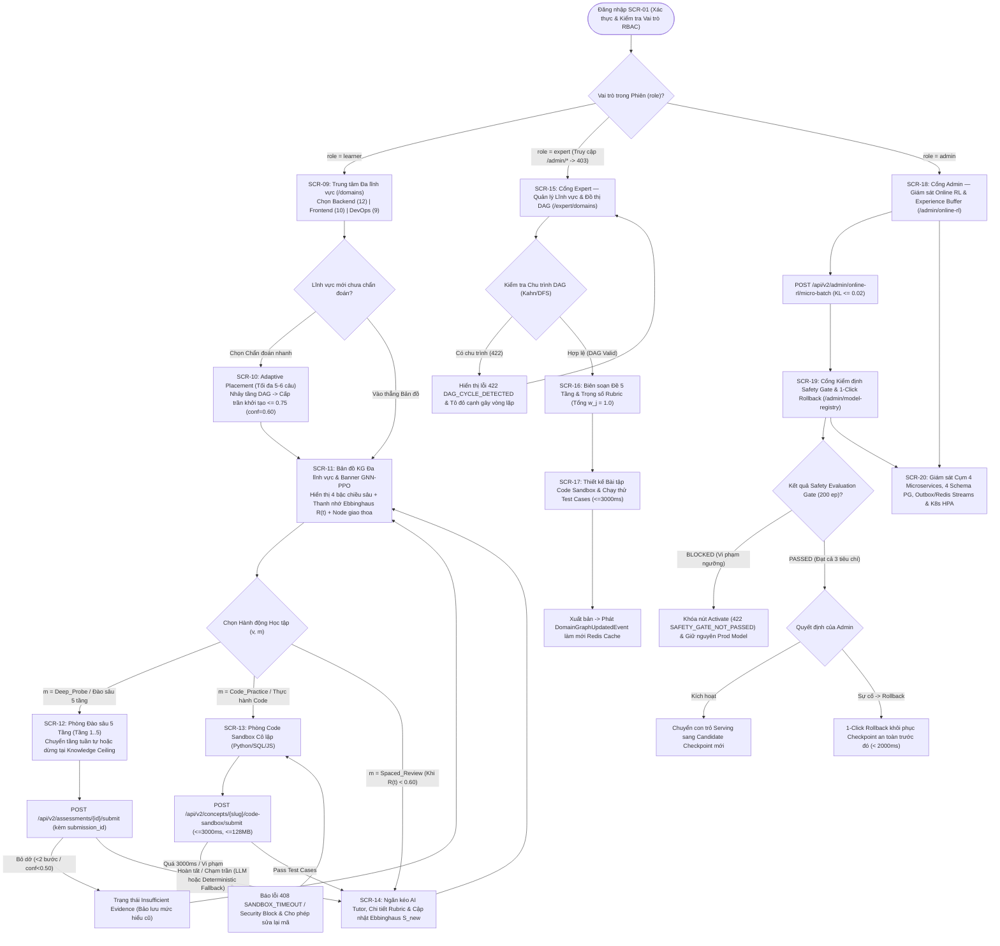

# Hệ thống Thiết kế Giao diện Plumora (UI Design System)

Phiên bản: `2.0.0` — **APPROVED (Gate 1 Baseline Giai đoạn 3 & 20 Màn hình Stitch `SCR-01`..`SCR-20` — Chủ dự án duyệt tại `D-23`, `D-25`, `D-26` ngày 2026-11-18; bảo lưu trọn vẹn lịch sử Gate 1 Baseline MVP `v1.0.0`/`v1.2.0` duyệt tại `D-13`, `D-14`, `D-15` ngày 2026-11-16)**.
Tài liệu kiến trúc liên kết: [Thiết kế hệ thống (`docs/design.md`)](design.md) (`v2.0.0`), [Đặc tả hành vi (`docs/spec.md`)](spec.md) (`v2.0.0`), [Sổ quyết định (`docs/decisions.md`)](decisions.md) (`v2.0.0`).

> **Lưu ý thẩm quyền:** Toàn bộ bảng phối màu Chồi Cây Non (*Botanical Sprout & Sunlit Canopy*), typography, design tokens, quy tắc 100% SVG vector icons `lucide-react` (cấm tuyệt đối emoji), danh mục 8 màn hình MVP (`SCR-01`–`SCR-08`, duyệt tại `D-13`..`D-15`) và **12 màn hình mở rộng Giai đoạn 3 (`SCR-09`–`SCR-20`, duyệt tại `D-23`, `D-25`, `D-26`)** dưới đây đã được chủ dự án phê duyệt chính thức làm **Gate 1 Baseline (`v2.0.0`)**.

---

## 1. Định hướng Thị giác & Thương hiệu (Brand & Visual Direction)

### 1.1. Câu chuyện Thương hiệu: Chồi Cây Non (*Plumule $\rightarrow$ Plumora*)
- Tên gọi **Plumora** bắt nguồn từ *Plumule* (chồi mầm / chồi cây non trong thực vật học). Hệ thống coi hành trình chinh phục 12 khái niệm Backend như sự phát triển tự nhiên của một cái cây tri thức:
  1. **Hạt giống ngủ yên (`Locked / Dormant Seed`):** Các khái niệm chưa đủ điều kiện tiên quyết, mang sắc Xám Đá / Đất Ấm (`Warm Stone`).
  2. **Mầm non đang hé (`Unlocked / Sprouting Shoot`):** Các khái niệm đã mở khóa và sẵn sàng tiếp nhận kiến thức, mang sắc Xanh Ngọc Lá Mạ (`Teal / Sage Shoot`).
  3. **Đỉnh sinh trưởng đón nắng (`Recommended by DQN / Sunlit Apical Bud`):** Khái niệm được mô hình Học tăng cường (`DQN`) tính toán là điểm phát triển tối ưu tiếp theo, mang sắc **Vàng Nắng Sớm (`Sunlit Amber / Warm Gold`)** nổi bật tự nhiên giữa tán lá.
  4. **Tán lá trưởng thành (`Mastered >= 75% / Mature Canopy`):** Khái niệm đã thông thạo vững chắc, mang sắc **Xanh Rừng Sâu (`Deep Forest & Sprout Green`)**.

### 1.2. Quy tắc Bắt buộc về Biểu tượng (Strict Vector Iconography — Cấm Emoji)
- **Cấm tuyệt đối sử dụng ký tự Emoji** (như check xanh, ổ khóa, tên lửa, ngôi sao...) ở bất kỳ đâu trên giao diện web hoặc trong tài liệu thiết kế.
- Toàn bộ biểu tượng bắt buộc dùng **SVG Vector Icons đồng nhất từ thư viện `lucide-react`** (`stroke-width: 1.75px`, kích thước chuẩn `16px / 20px / 24px`, gắn `aria-hidden="true"` khi đi kèm nhãn chữ):
  - Biểu trưng thương hiệu Plumora: `<Sprout />`
  - Node đã thông thạo (`Mastered >= 75%`): `<CheckCircle2 />`
  - Node được AI khuyến nghị (`Recommended by DQN`): `<Compass />`
  - Node đã mở khóa (`Unlocked < 75%`): `<CircleDot />`
  - Node đang khóa (`Locked`): `<Lock />`
  - Bài học lý thuyết: `<BookOpen />`
  - Bài kiểm tra Quiz: `<FileCheck2 />`
  - Bằng chứng mô hình RL & Checkpoint: `<Activity />`, `<ShieldCheck />`
  - Thanh chuyển đổi Hồ sơ mẫu (`Demo Presets`): `<SlidersHorizontal />`

---

## 2. Hệ thống Design Tokens (Màu sắc Thực vật, Typography, Spacing)

### 2.1. Bảng Phối màu "Botanical Sprout & Sunlit Canopy" (Đạt chuẩn tương phản WCAG 2.1 AA)

| Token CSS / Lớp Tailwind | Mã Hex | Tỷ lệ tương phản (WCAG 2.1 AA) | Ý nghĩa ngữ nghĩa & Quy tắc sử dụng |
| --- | --- | --- | --- |
| `--bg-canvas` (`bg-[#F6F8F5]`) | `#F6F8F5` | — | Nền tổng thể màu Trắng Kem Lá Nhạt (Warm Botanical Alabaster), dịu mắt khi đọc lâu |
| `--bg-surface` (`bg-white`) | `#FFFFFF` | — | Nền thẻ bài học (Card), khung đọc Markdown, khung làm Quiz |
| `--bg-subtle` (`bg-stone-100`) | `#F5F5F4` | — | Nền khu vực phụ, thanh công cụ và thẻ node đang bị khóa (`Locked`) |
| `--border-default` (`border-[#D8E2D8]`) | `#D8E2D8` | — | Viền thẻ mặc định pha sắc xanh xám thực vật nhẹ |
| `--text-primary` (`text-[#14241B]`) | `#14241B` | `15.8:1` (trên `#FFFFFF`) | Chữ tiêu đề, nội dung bài học chính, câu hỏi Quiz (Xanh Đen Rừng Thẳm) |
| `--text-secondary` (`text-[#3F5247]`) | `#3F5247` | `7.9:1` (trên `#FFFFFF`) | Chữ phụ đề, mô tả điều kiện tiên quyết, metadata |
| `--text-muted` (`text-stone-600`) | `#57534E` | `5.8:1` (trên `#F5F5F4`) | Chữ trạng thái khóa, nhãn phụ (vượt chuẩn AA $\ge 4.5:1$) |
| `--brand-primary` (`bg-green-700`) | `#15803D` | `5.1:1` (với chữ `#FFFFFF`) | **Màu thương hiệu Plumora & Nút Primary CTA** (Xanh Chồi Rừng Sâu) |
| `--brand-hover` (`bg-green-800`) | `#166534` | `6.8:1` (với chữ `#FFFFFF`) | Trạng thái hover/active của nút Primary CTA |
| `--brand-sprout-accent` (`text-emerald-600` / `bg-emerald-500`) | `#16A34A` / `#22C55E` | — | Điểm nhấn biểu tượng `<Sprout />` và thanh tiến độ sinh trưởng |
| `--ai-sunlit-bg` (`bg-amber-50/80`) | `#FFFBEB` | — | Nền thẻ `AI Recommendation Banner` và node được `DQN` dẫn đường (Nắng Sớm) |
| `--ai-sunlit-border` (`border-amber-600`) | `#D97706` | `4.6:1` (trên `#FFFBEB`) | Viền nổi bật (`2px`) cho node đang được `DQN` khuyến nghị |
| `--ai-sunlit-text` (`text-amber-900`) | `#78350F` | `8.4:1` (trên `#FFFBEB`) | Chữ tiêu đề & huy hiệu `<Compass />` của khuyến nghị `DQN` |
| `--state-mastered` (`text-green-900` / `bg-green-50` / `border-green-600`) | `#14532D` / `#F0FDF4` / `#16A34A` | `9.2:1` | Node đã thông thạo ($\text{Mastery} \ge 75\%$) — Tán lá trưởng thành |
| `--state-unlocked` (`text-teal-900` / `bg-teal-50` / `border-teal-600`) | `#134E4A` / `#F0FDFA` / `#0D9488` | `8.7:1` | Node đã mở khóa (`is_eligible = 1.0`, $\text{Mastery} < 75\%$) — Mầm mới hé |
| `--state-locked` (`text-stone-600` / `bg-stone-100` / `border-stone-300`) | `#57534E` / `#F5F5F4` / `#D6D3D1` | `5.8:1` | Node chưa đủ điều kiện tiên quyết (`Locked`) — Hạt giống ngủ yên |
| `--state-error` (`text-rose-800` / `bg-rose-50` / `border-rose-300`) | `#9F1239` / `#FFF1F2` / `#FDA4AF` | `6.9:1` | Báo lỗi xác thực (`401`), chưa đạt ngưỡng Quiz ($< 75\%$), lỗi kết nối |

### 2.2. Typography & Phân cấp Chữ (Typography Scale)
- **Font hiển thị & Nội dung (`--font-sans`):** `'Plus Jakarta Sans', 'Inter', system-ui, -apple-system, sans-serif` (nét chữ hiện đại, thân thiện, hỗ trợ hoàn hảo dấu tiếng Việt).
- **Font kỹ thuật & Mã nguồn (`--font-mono`):** `'JetBrains Mono', 'Fira Code', monospace` (dùng cho mã `slug` như `db-transactions`, câu lệnh SQL/HTTP trong bài học, và mã băm `checkpoint_sha256`).
- **Thang kích thước chữ (Type Scale):**
  - `H1 (Page Title)`: `28px` (`1.75rem`), `line-height: 1.25`, `font-weight: 700`
  - `H2 (Section / Concept Title)`: `22px` (`1.375rem`), `line-height: 1.3`, `font-weight: 600`
  - `H3 (Card / Question Title)`: `18px` (`1.125rem`), `line-height: 1.4`, `font-weight: 600`
  - `Body Large (Lesson Markdown & Quiz Prompt)`: `16px` (`1rem`), `line-height: 1.65`, độ rộng dòng tối đa `68ch` giúp đọc lý thuyết thoải mái.
  - `Body Default (UI Controls)`: `14px` (`0.875rem`), `line-height: 1.5`
  - `Caption / Badge / Hash Metadata`: `12px` (`0.75rem`), `line-height: 1.4`, `font-weight: 500`

### 2.3. Hệ lưới Khoảng cách, Bo góc & Độ nổi (Spacing, Radius & Elevation)
- **Hệ lưới 8pt (`8pt Grid System`):** `4px (0.25rem)`, `8px (0.5rem)`, `12px (0.75rem)`, `16px (1rem)`, `24px (1.5rem)`, `32px (2rem)`, `48px (3rem)`.
- **Bo góc (`Border Radius`):** Nút bấm & Input `8px` (`rounded-lg`); Thẻ Node DAG & Khung Quiz `12px` (`rounded-xl`); Huy hiệu trạng thái `6px` (`rounded-md`).
- **Viền & Độ nổi:** Viền mặc định `1px solid #D8E2D8` kết hợp `shadow-sm`; node được `DQN` khuyến nghị dùng viền `2px solid #D97706` (`border-amber-600`) kèm `ring-4 ring-amber-100` để nổi bật như chồi non đón nắng giữa nền xanh thực vật.

---

## 3. Danh mục Màn hình 4 Nhóm (`4-Category Screen Inventory`) & Ánh xạ `AC-ID`

Hệ thống gồm **8 màn hình/trạng thái giao diện (`SCR-01` $\rightarrow$ `SCR-08`)** bao phủ đủ 4 phân nhóm:

| Mã MH (`Screen ID`) | Phân nhóm (`Category`) | Tên màn hình | Route / Vị trí | Mục tiêu cốt lõi & Nút hành động chính (`Primary CTA`) | Kích hoạt từ | Tiêu chí (`AC-ID`) |
| --- | --- | --- | --- | --- | --- | --- |
| **`SCR-01`** | `1. Primary View` | Đăng nhập, Đăng ký & Chọn nhanh Tài khoản Demo | `/login`, `/register` | Xác thực học viên hoặc chọn 1 trong 3 tài khoản Seed thật (`learner_new`, `learner_foundation`, `learner_api_stage`); CTA: `"Đăng nhập vào Lộ trình"` | Màn hình khởi đầu / Khi chưa có phiên | `PL-AUTH-01`, `PL-E2E-01` |
| **`SCR-02`** | `1. Primary View` | Bản đồ Lộ trình 12 Khái niệm (4 Tầng DAG) & Khuyến nghị AI | `/roadmap` | Quan sát toàn cảnh 12 node, tiến độ tổng thể, thẻ giải thích khuyến nghị của `DQN` và thanh `Demo Presets`; CTA: `"Học bài AI đề xuất"` | Sau khi đăng nhập / Thanh điều hướng chính | `PL-CONTENT-01`, `PL-REC-01`, `PL-REC-02`, `PL-E2E-01` |
| **`SCR-03`** | `2. Drill-Down` | Màn hình Học Lý thuyết Khái niệm (Markdown Reader) | `/concepts/:slug` | Đọc nội dung bài giảng Markdown của khái niệm đã mở khóa, xem các bài tiên quyết và điểm `mastery` hiện tại; CTA: `"Làm bài Quiz kiểm tra (4 câu)"` | Nhấp vào node `Unlocked`/`Mastered` trên `SCR-02` hoặc từ `AI Banner` | `PL-CONTENT-01`, `PL-E2E-01` |
| **`SCR-04`** | `2. Drill-Down / Form` | Khung Làm Quiz 4 Câu Single-choice & Phản hồi Mastery | `/concepts/:slug/quiz` | Trả lời đủ 4 câu hỏi trắc nghiệm, nộp bài với `submission_id` (chống nộp trùng), xem điểm số, biên đạt $\ge 75\%$ và cập nhật `mastery`; CTA: `"Nộp bài kiểm tra"` $\rightarrow$ `"Nhận bài học tiếp theo từ AI"` | Nút CTA trên `SCR-03` hoặc nút `"Làm Quiz"` trên thẻ node `SCR-02` | `PL-QUIZ-01`, `PL-PROGRESS-01`, `PL-E2E-01` |
| **`SCR-05`** | `3. Overlay / Modal` | Hộp thoại Xác nhận Đặt lại Tiến độ theo Hồ sơ mẫu (`Demo Preset Modal`) | Modal trên `/roadmap` | Cảnh báo rõ việc áp dụng Preset (`new_learner`, `foundation_ready`, `api_stage_ready`) sẽ ghi đè tiến độ của tài khoản hiện tại; CTA: `"Xác nhận áp dụng Preset"` | Chọn 1 Preset trên thanh `Demo Presets` ở `SCR-02` | `PL-CONTENT-01`, `PL-PROGRESS-01` |
| **`SCR-06`** | `3. Overlay / Drawer` | Ngăn kéo Chi tiết Bằng chứng RL & Lịch sử Làm bài (`RL Provenance & History Drawer`) | Slide-over Drawer bên phải trên `/roadmap` | Hiển thị minh bạch vector Observation 24 chiều, nguồn `policy_source` (`dqn` / `dqn_masked_q` / `fallback_rule`), `state_source` (`redis_cache` / `postgres_fallback`), `checkpoint_sha256` và lịch sử các lần nộp `QuizAttempt`; CTA: `"Đóng"` | Nhấp `"Bằng chứng AI & Lịch sử"` trên `SCR-02` | `PL-REC-01`, `PL-REC-02`, `PL-PROGRESS-01` |
| **`SCR-07`** | `4. Edge & System View` | Trạng thái Hoàn thành Khóa học 12/12 Node & Trạng thái Chưa có Lịch sử | Banner/View trên `/roadmap` & Drawer | Thông báo hoàn tất khi đạt `12/12 Mastered >= 75%` (`status = "completed"`) kèm thống kê tổng số lượt làm bài, hoặc hướng dẫn khi tài khoản mới chưa có lượt nộp nào; CTA: `"Ôn tập lại bài bất kỳ"` / `"Chọn Preset khác"` | Khi `mastered_count == 12` hoặc `attempts.length == 0` | `PL-REC-02`, `PL-CONTENT-01` |
| **`SCR-08`** | `4. Edge & System View` | Màn hình Chặn Bài học Đang Khóa (`403 Concept Locked`) & Cảnh báo Chế độ Fallback | `/concepts/:slug` (khi Locked) & Alert Banner | Giải thích rõ những bài tiên quyết nào cần đạt $\ge 75\%$ trước khi mở khóa bài này, hoặc hiển thị cảnh báo trung thực khi hệ thống chạy ở chế độ `fallback_rule` / `postgres_fallback`; CTA: `"Quay về Bản đồ & Học bài tiên quyết"` | Truy cập URL trực tiếp vào bài đang `Locked` hoặc khi Redis/Checkpoint gặp sự cố | `PL-QUIZ-01`, `PL-REC-02` |

---

## 4. Kiểm tra Giải phẫu 8 Điểm (`8-Point Page Anatomy`) cho các Màn hình Chính

1. **Định hướng & Điều hướng (`Orientation & Navigation`):**
   - Header cố định gồm: Biểu tượng SVG `<Sprout />` + chữ **Plumora**, thanh tiến độ tổng quát (`Đã thông thạo X / 12 khái niệm`), nút mở `RL Provenance Drawer` (`<Activity /> Bằng chứng AI`), tên người học (`display_name`) và nút `<LogOut /> Đăng xuất`.
   - Breadcrumb rõ ràng trên `SCR-03` và `SCR-04`: `Bản đồ lộ trình / Tầng 2: Giao thức & Dữ liệu / Giao thức HTTP/HTTPS / Làm bài Quiz`.
2. **Bộ lọc & Chuyển đổi Nhanh (`Filter & Preset Controls`):**
   - Trên `SCR-02`: Bộ lọc nhanh theo trạng thái node (`Tất cả (12)`, `AI Đề xuất (1)`, `Đã mở khóa`, `Đã thông thạo`, `Đang khóa`) và thanh chọn nhanh 3 `Demo Presets` (`Mới bắt đầu`, `Xong Nền tảng`, `Tầng API`).
3. **Hiển thị Dữ liệu & Trạng thái (`Data Display & Status Visualization` — Chỉ dùng SVG Icon `lucide-react`):**
   - Mỗi thẻ Node trên DAG (`DagNodeCard`) hiển thị đủ **5 thông tin**: (1) Nhãn tầng & mã `slug` monospace, (2) Tên khái niệm, (3) Huy hiệu trạng thái kèm SVG icon chuẩn (`<Lock /> Đang khóa`, `<CircleDot /> Đã mở khóa`, `<Compass /> AI Khuyến nghị`, `<CheckCircle2 /> Đã thông thạo`), (4) Thanh phần trăm `Mastery` (`0%` / `25%` / `50%` / `75%` / `100%` với vạch đích tại mốc `75%`), và (5) Danh sách các node tiên quyết.
4. **Kiểm soát Dữ liệu & Tiến trình (`Progress & Step Controls`):**
   - Trên `SCR-04` (`Quiz View`): Bộ đếm `"Đã chọn X / 4 câu hỏi"` và thanh chỉ báo tiến độ làm bài.
5. **Phân cấp Hành động (`Action Hierarchy — Fitts's Law`):**
   - Mỗi màn hình chỉ có **1 nút Primary CTA** màu Xanh Chồi Rừng Sâu (`#15803D`, chiều cao tối thiểu `44px`); các hành động phụ (`Quay lại`, `Xem bằng chứng AI`) dùng nút viền (`Outline`); hành động đặt lại tiến độ (`Reset Preset`) có hộp thoại xác nhận `SCR-05`.
6. **Phản hồi Hệ thống (`System Feedback & Alerts`):**
   - Toast góc trên bên phải khi áp dụng Preset hoặc đăng nhập thành công; Banner cảnh báo khi `policy_source = "fallback_rule"` hoặc `state_source = "postgres_fallback"`.
7. **Trạng thái Trống & Đang tải (`Empty & Loading States`):**
   - Skeleton giữ nguyên kích thước lưới 4 tầng DAG khi đang tải `GET /api/v1/roadmap`; trạng thái trống có hướng dẫn khi chưa có lịch sử làm Quiz.
8. **Micro-copy & Khả năng tiếp cận (`WCAG 2.1 AA`):**
   - Mọi trạng thái luôn kết hợp **Màu sắc + Kiểu viền + Biểu tượng SVG `lucide-react` + Nhãn chữ tiếng Việt** (không bao giờ chỉ dựa vào màu sắc đơn thuần và không dùng emoji).

---

## 5. Sơ đồ Luồng Trải nghiệm Người học (`UX User Flows`)


---

## 6. Đặc tả Component Dùng chung & Ma trận 5 Trạng thái UX (`Ideal / Loading / Empty / Error / Disabled`)

| Component | Vai trò & Props chính | `Ideal` | `Loading` | `Empty` | `Error` | `Disabled` |
| --- | --- | --- | --- | --- | --- | --- |
| `AiRecommendationBanner` | Hiển thị bài học `DQN` khuyên học tiếp theo (`concept`, `policy_source`, `state_source`, `guardrail_applied`, `checkpoint_sha256`) | Nền Vàng Nắng Sớm (`#FFFBEB`), viền `#D97706`, icon `<Compass />`, tên bài học được đề xuất, lý do, huy hiệu `DQN Policy` + mã băm 8 ký tự đầu, nút `"Bắt đầu học bài này"` (`#15803D`) | Khung shimmer skeleton cao `112px` kèm chữ `"AI đang phân tích trạng thái 24 chiều..."` | Khi đạt 12/12 bài (`status = "completed"`): chuyển sang thẻ hoàn tất khóa học `SCR-07` | Khi thiếu checkpoint (`policy_source = "fallback_rule"`) hoặc lỗi mạng: hiển thị rõ nhãn `"Chế độ Fallback theo tầng DAG"` + nút `"Thử lại"` | Khi đang gửi kết quả Quiz chưa xong: khóa tạm thời nút xin khuyến nghị mới |
| `DagNodeCard` | Thẻ biểu diễn 1 trong 12 khái niệm trên lưới 4 tầng (`slug`, `title`, `tier`, `mastery`, `status`, `prerequisites`, `isRecommended`) | Viền và huy hiệu SVG theo trạng thái (`<Lock /> Locked`, `<CircleDot /> Unlocked`, `<Compass /> Recommended`, `<CheckCircle2 /> Mastered`), thanh tiến độ có vạch mốc `75%` | Skeleton card kích thước cố định `280x140px` không gây nhảy bố cục (`CLS = 0`) | `mastery = 0%`: hiển thị `"Chưa làm bài (0%)"` | Nếu tải chi tiết thất bại: báo lỗi nhỏ ngay trên thẻ kèm nút tải lại | Khi `status == "locked"`: nền xám đá `#F5F5F4`, icon `<Lock />`, nhấp vào hiện rõ tooltip `"Cần đạt >= 75% ở: [Tên bài tiên quyết]"` |
| `DemoPresetToolbar` | Thanh chuyển đổi nhanh 3 trạng thái mẫu (`new_learner`, `foundation_ready`, `api_stage_ready`) | Hiển thị icon `<SlidersHorizontal />` và 3 nút chọn Preset kèm mô tả số node đã hoàn thành | Hiện spinner SVG trên nút Preset đang áp dụng (`Đang đồng bộ PostgreSQL & Redis...`) | Không áp dụng (luôn có 3 Presets cố định) | Toast báo lỗi nếu `POST /api/v1/me/preset` thất bại | Khóa cả 3 nút trong lúc request cập nhật đang chạy |
| `McqQuizForm` | Khung 4 câu hỏi trắc nghiệm Single-choice (`questions[4]`, `submissionId`) | Hiển thị 4 câu hỏi, mỗi câu 4 lựa chọn `A, B, C, D` dạng radio card có vùng bấm lớn ($\ge 48\text{px}`), viền xanh `#15803D` khi đang chọn | Khi bấm `"Nộp bài"`: nút chuyển sang `"Đang chấm điểm..."` và khóa chỉnh sửa đáp án | Không áp dụng (Seed đảm bảo luôn đủ 4 câu) | Khi lỗi mạng lúc nộp: giữ nguyên 4 đáp án đã chọn và cùng `submission_id` để bấm `"Gửi lại an toàn (Idempotent Retry)"` | Nút `"Nộp bài kiểm tra"` ở trạng thái `Disabled` khi số câu đã chọn $< 4$, kèm dòng nhắc `"Vui lòng chọn đủ 4/4 câu hỏi"` |
| `ProvenanceBadge` | Huy hiệu minh bạch nguồn AI & nguồn State (`policy_source`, `state_source`, `guardrail_applied`) | Icon `<Cpu />` / `<Database />` kèm nhãn rõ ràng: `DQN Policy`, `DQN Masked Q`, hoặc `Fallback Rule`; `Redis Cache` hoặc `PG Fallback` | Skeleton pill `96x24px` | — | Báo viền đỏ/vàng khi `degraded = true` | — |

---

## 7. Quy tắc Hiển thị Tiến độ, Điều kiện Tiên quyết, Khuyến nghị RL & Khả năng Tiếp cận

1. **Quy tắc Hiển thị Tiến độ & Ngưỡng 75% (`D-06`):**
   - Thanh tiến độ của mỗi node chia làm 4 vạch rõ ràng (`25%`, `50%`, **`75% (Mốc Đạt)`**, `100%`).
   - Khi `mastery` đạt `75%` ($3/4$ câu) hoặc `100%` ($4/4$ câu), thanh chuyển sang màu Xanh Rừng Sâu (`#16A34A`) kèm icon SVG `<CheckCircle2 />` và nhãn `ĐÃ THÔNG THẠO (MASTERED)`. Nếu học viên làm lại đạt điểm thấp hơn (ví dụ $2/4 = 50\%$), giao diện hiển thị: `"Điểm lượt này: 50% (2/4) — Điểm thông thạo bảo lưu: 75% (Đã đạt chuẩn)"`.
2. **Quy tắc Minh bạch Khuyến nghị RL (`D-07`, [rl-evidence.md](../.agents/rules/rl-evidence.md)):**
   - Giao diện **bắt buộc hiển thị trung thực** giá trị `policy_source` từ API:
     - `policy_source == "dqn"`: Hiển thị huy hiệu `<Cpu /> Đề xuất bởi DQN Policy` + mã `SHA-256` rút gọn của checkpoint.
     - `policy_source == "dqn_masked_q"`: Hiển thị huy hiệu `<ShieldCheck /> Đề xuất bởi DQN (Lọc Q-value hợp lệ DAG)` kèm chú thích `guardrail_applied = true`.
     - `policy_source == "fallback_rule"`: Hiển thị cảnh báo `<AlertTriangle /> Đề xuất dự phòng theo tầng DAG (Chưa nạp Checkpoint DQN)` — tuyệt đối không hiển thị nhãn `DQN` khi đang fallback.
3. **Responsive, Điều hướng Bàn phím & Khả năng Tiếp cận (`WCAG 2.1 AA`):**
   - **Responsive Breakpoints:**
     - `Desktop (>= 1024px)`: Hiển thị lưới 4 tầng DAG rõ ràng, `RL Provenance Drawer` mở cạnh phải.
     - `Tablet (768px - 1023px)`: Lưới 2 cột cho mỗi tầng DAG.
     - `Mobile (< 768px)`: Danh sách xếp dọc theo Tầng 1 $\rightarrow$ Tầng 4, các nút bấm chiếm trọn chiều ngang (`w-full`, chiều cao $\ge 44\text{px}$).
   - **Keyboard Navigation & Screen Reader (`a11y`):**
     - Mọi node DAG, lựa chọn đáp án `A/B/C/D` và nút bấm đều đi qua được bằng phím `Tab` / `Shift+Tab` với viền focus rõ nét màu Xanh Chồi Rừng (`focus-visible:ring-2 focus-visible:ring-green-700 focus-visible:ring-offset-2`).
     - Trong màn hình Quiz (`SCR-04`), hỗ trợ phím mũi tên hoặc phím `1-4` để chọn đáp án trong câu hỏi đang focus.
     - Vùng kết quả chấm điểm Quiz và thẻ `AI Recommendation Banner` gắn thuộc tính `aria-live="polite"`.

---

## 8. Bản Xem Trước Wireframe / Mockup Trực Quan (Không Dùng Emoji — Ký hiệu `[SVG: ...]` đại diện cho `lucide-react`)

### 8.1. Bản xem trước `SCR-02`: Bản đồ Lộ trình 12 Khái niệm DAG & AI Recommendation Banner (`/roadmap`)

```text
+----------------------------------------------------------------------------------------------------+
| [SVG:Sprout] PLUMORA — Lộ trình Backend RL   [Tiến độ: 4/12 Đã thông thạo (33%)]  [SVG:Activity AI]|
| Nền: #F6F8F5 (Botanical Alabaster)                       [SVG:User] learner_foundation  [Đăng xuất]|
+----------------------------------------------------------------------------------------------------+
| [SVG:Sliders] HỒ SƠ MẪU (DEMO PRESETS):  [ 1. Mới bắt đầu (0/12) ] [(*) 2. Xong Nền tảng (4/12)]   |
+----------------------------------------------------------------------------------------------------+
| [SVG:Compass] KHUYẾN NGHỊ TỪ MÔ HÌNH HỌC TĂNG CƯỜNG (DQN POLICY) — Nền Vàng Nắng #FFFBEB / #D97706 |
| +------------------------------------------------------------------------------------------------+ |
| | [SVG:Compass] Bài học đề xuất tiếp theo: [Tầng 2] #4. Transaction (ACID) & Indexing trong RDBMS| |
| | Lý do: Bạn đã đạt chuẩn "CSDL Quan hệ & SQL (75%)". Hoàn thành bài này sẽ mở khóa Tầng 3 API.  | |
| | Policy: [SVG:Cpu DQN Policy (Unmasked)] | State: [SVG:Zap Redis Cache v5] | SHA: a8f3...91c2   | |
| |                                                 [ Nút CTA #15803D: Bắt đầu học bài này -> ]    | |
| +------------------------------------------------------------------------------------------------+ |
+----------------------------------------------------------------------------------------------------+
| BẢN ĐỒ LỘ TRÌNH KIẾN THỨC BACKEND (12 KHÁI NIỆM — 4 TẦNG TIÊN QUYẾT DAG)                           |
| Bộ lọc: (● Tất cả 12)  (○ AI Đề xuất 1)  (○ Đã mở khóa 3)  (○ Đã thông thạo 4)  (○ Đang khóa 5)    |
|                                                                                                    |
| === TẦNG 1: NỀN TẢNG CỐT LÕI (ROOT NODES) ======================================================== |
| +----------------------------------------------+    +--------------------------------------------+ |
| | [0] net-internet   [SVG:CheckCircle2 100%]   |    | [1] os-basics      [SVG:CheckCircle2 75%]  | |
| | Màu: Xanh Rừng #F0FDF4 / Viền #16A34A        |    | Màu: Xanh Rừng #F0FDF4 / Viền #16A34A      | |
| | Internet & Mô hình Mạng cơ bản               |    | Hệ điều hành, Process/Thread & I/O         | |
| | [████████████████████] 100% (Mốc đạt: 75%)   |    | [███████████████░░░░░] 75% (Mốc đạt: 75%)  | |
| | Tiên quyết: Không có         [Xem bài | Quiz]|    | Tiên quyết: Không có       [Xem bài | Quiz]| |
| +----------------------------------------------+    +--------------------------------------------+ |
|                        │                                                  │                        |
|                        ▼                                                  ▼                        |
| === TẦNG 2: GIAO THỨC & CƠ SỞ DỮ LIỆU ============================================================ |
| +----------------------------------------------+    +--------------------------------------------+ |
| | [2] web-http       [SVG:CheckCircle2 75%]    |    | [3] db-relational  [SVG:CheckCircle2 75%]  | |
| | Giao thức HTTP/HTTPS                         |    | CSDL Quan hệ & SQL cơ bản                  | |
| | [███████████████░░░░░] 75%                   |    | [███████████████░░░░░] 75%                 | |
| | Cần: net-internet (Đạt)      [Xem bài | Quiz]|    | Cần: os-basics (Đạt)       [Xem bài | Quiz]| |
| +----------------------------------------------+    +--------------------------------------------+ |
|                                                               │                         │          |
|                                               ┌───────────────┘                         ▼          |
|                                               ▼                                                    |
| +----------------------------------------------+    +--------------------------------------------+ |
| | ╔══════════════════════════════════════════╗ |    | [5] db-nosql       [SVG:CircleDot 25%]     | |
| | ║ [4] db-transactions [SVG:Compass AI GỢI Ý]║ |    | Màu: Xanh Ngọc Lá Mạ #F0FDFA / #0D9488    | |
| | ║ Màu: Vàng Nắng #FFFBEB / Viền #D97706    ║ |    | CSDL NoSQL (Document & Key-Value)          | |
| | ║ Transaction (ACID) & Indexing            ║ |    | [█████░░░░░░░░░░░░░░░] 25% (Chưa đạt 75%)  | |
| | ║ [░░░░░░░░░░░░░░░░░░░░] 0% (Đã mở khóa)   ║ |    | Cần: db-relational (Đạt)   [Học bài | Quiz]| |
| | ║ Cần: db-relational (Đạt)  [Học bài ngay] ║ |    +--------------------------------------------+ |
| | ╚══════════════════════════════════════════╝ |                                                   |
| +----------------------------------------------+                                                   |
|                                                                                                    |
| === TẦNG 3: THIẾT KẾ API & QUẢN LÝ TRẠNG THÁI ==================================================== |
| +----------------------------------------------+    +--------------------------------------------+ |
| | [6] api-rest       [SVG:CircleDot 0%]        |    | [7] api-validation [SVG:Lock LOCKED 0%]    | |
| | Màu: Xanh Ngọc Lá Mạ #F0FDFA / #0D9488       |    | Màu: Xám Đá Ấm #F5F5F4 / Viền #D6D3D1      | |
| | Thiết kế RESTful API chuẩn                   |    | Validation, Serialization & Xử lý lỗi API  | |
| | Cần: web-http (Đạt)          [Học bài | Quiz]|    | [SVG:Lock] Cần đạt >=75% ở: api-rest       | |
| +----------------------------------------------+    +--------------------------------------------+ |
| +----------------------------------------------+    +--------------------------------------------+ |
| | [8] api-data       [SVG:Lock LOCKED 0%]      |    | [9] cache-redis    [SVG:Lock LOCKED 0%]    | |
| | Kết nối API với Database & Query Patterns    |    | Caching & Quản lý State với Redis          | |
| | [SVG:Lock] Cần: db-transactions, api-rest    |    | [SVG:Lock] Cần: db-nosql, api-rest         | |
| +----------------------------------------------+    +--------------------------------------------+ |
|                                                                                                    |
| === TẦNG 4: BẢO MẬT BACKEND CƠ BẢN =============================================================== |
| +----------------------------------------------+    +--------------------------------------------+ |
| | [10] sec-authn     [SVG:Lock LOCKED 0%]      |    | [11] sec-api       [SVG:Lock LOCKED 0%]    | |
| | Xác thực & Phân quyền (Session/JWT, RBAC)    |    | Bảo mật API (SQLi, Rate Limit, CORS)       | |
| | [SVG:Lock] Cần: api-rest, cache-redis        |    | [SVG:Lock] Cần: api-validation, api-data...| |
| +----------------------------------------------+    +--------------------------------------------+ |
+----------------------------------------------------------------------------------------------------+
```

### 8.2. Bản xem trước `SCR-03` & `SCR-04`: Đọc Lý thuyết & Làm Quiz 4 Câu Single-choice (`/concepts/:slug/quiz`)

```text
+----------------------------------------------------------------------------------------------------+
| [SVG:ArrowLeft] Quay về Bản đồ   |  Tầng 2 / [4] db-transactions: Transaction (ACID) & Indexing    |
+----------------------------------------------------------------------------------------------------+
| [ Tab 1: [SVG:BookOpen] Bài học Lý thuyết ]  [(*) Tab 2: [SVG:FileCheck2] Làm Quiz (4 câu) ]       |
+----------------------------------------------------------------------------------------------------+
| ĐỀ KIỂM TRA TRẮC NGHIỆM KHÁCH QUAN (4 CÂU SINGLE-CHOICE — ĐIỂM ĐẠT CHUẨN >= 75% TỨC >= 3/4 CÂU)    |
| Tiến độ chọn đáp án: [███████████████░░░░░] Đã chọn 3 / 4 câu hỏi                                  |
|                                                                                                    |
| Câu 1 / 4: Tính chất nào trong bộ ACID đảm bảo rằng một giao dịch (Transaction) hoặc được thực     |
| hiện trọn vẹn tất cả các bước, hoặc không có bước nào được ghi nhận nếu xảy ra lỗi giữa chừng?    |
|   (●) A. Atomicity (Tính nguyên tử)          [Viền Xanh Chồi Rừng #15803D, Nền #F0FDF4]            |
|   ( ) B. Consistency (Tính nhất quán)                                                              |
|   ( ) C. Isolation (Tính cô lập)                                                                   |
|   ( ) D. Durability (Tính bền vững)                                                                |
|                                                                                                    |
| Câu 2 / 4: Khi hai Transaction chạy đồng thời...                                                   |
|   ( ) A. ...   (●) B. ...   ( ) C. ...   ( ) D. ...                                                |
|                                                                                                    |
| Câu 3 / 4: Đánh chỉ mục (B-Tree Index) trên cột thường dùng trong mệnh đề WHERE giúp...            |
|   ( ) A. ...   ( ) B. ...   (●) C. ...   ( ) D. ...                                                |
|                                                                                                    |
| Câu 4 / 4: [Chưa chọn đáp án — Vui lòng chọn 1 phương án dưới đây]                                 |
|   ( ) A. ...   ( ) B. ...   ( ) C. ...   ( ) D. ...                                                |
|                                                                                                    |
| +------------------------------------------------------------------------------------------------+ |
| | [SVG:Info] Bạn cần chọn đủ 4/4 câu hỏi để mở khóa nút Nộp bài. (ID lượt nộp: 7b9e...410a)      | |
| |                                           [ [SVG:Lock] Nộp bài kiểm tra (Còn thiếu 1 câu) ]    | |
| +------------------------------------------------------------------------------------------------+ |
+----------------------------------------------------------------------------------------------------+
| SAU KHI NỘP BÀI THÀNH CÔNG (VÍ DỤ ĐẠT 3/4 CÂU = 75%):                                              |
| +------------------------------------------------------------------------------------------------+ |
| | [SVG:CheckCircle2] ĐẠT CHUẨN THÔNG THẠO KHÁI NIỆM (ĐIỂM LƯỢT NÀY: 75% — 3/4 CÂU ĐÚNG)          | |
| | • Điểm thông thạo cập nhật (max): 0% ──► 75% (Đạt ngưỡng >= 75% — Màu Xanh Rừng #16A34A)       | |
| | • Đã đồng bộ PostgreSQL (state_version = 6) & Redis State Cache.                               | |
| |   [ Làm lại Quiz để đạt 100% ]             [ Nút CTA #15803D: Nhận bài khuyến nghị tiếp theo ] | |
| +------------------------------------------------------------------------------------------------+ |
+----------------------------------------------------------------------------------------------------+
```

---

## 9. Biên bản Giao diện Sinh từ Stitch MCP (`Generated Output Review — APPROVED tại D-15`)

- **Stitch Project Resource ID:** `projects/1237345840857188241` (`Plumora — Adaptive Backend Learning Path (RL MVP)`)
- **Stitch Design System Asset ID:** `assets/14991308797519536796` (`Plumora Botanical Sprout & Sunlit Canopy`, version `2`)
- **Trạng thái phê duyệt đầu ra:** **`approved` (`D-15` / `O-11` — Chủ dự án phê duyệt ngày 2026-11-16)** làm chuẩn thị giác chính thức cho việc triển khai Frontend trong `SLICE-01`.

| Mã MH (`Screen ID`) | Stitch Screen Resource Name | File Ảnh & HTML (`projects/1237345840857188241/files/...`) | Mã băm `SHA-256` ảnh PNG xuất ra | Bằng chứng kiểm tra (`Inspection Evidence`) | Quyết định của Chủ dự án (`D-15` / `O-11`) |
| --- | --- | --- | --- | --- | --- |
| **`SCR-01`** (Đăng nhập & 3 Tài khoản Seed thật) | `projects/1237345840857188241/screens/eb65366969174dd490f801b025070213` | PNG: `5acbb0b93e8444d18e3edc46f7a01b05`<br>HTML: `e993a2115bd14a7a8c5f16d6721a1d63` | `3a3d5b719174c6f4a600f7bda37bb95ddcc625d0acf9188b638970b4d071283b` | Bố cục 2 cột rõ ràng: form đăng nhập chuẩn `D-11` bên trái, 3 tài khoản Seed thật (`learner_new`, `learner_foundation`, `learner_api_stage`) bên phải; không emoji, không màu tím | **`approved` (`D-15` — Chủ dự án)** |
| **`SCR-02`** (Bản đồ 12 Khái niệm 4 Tầng DAG & DQN Banner) | `projects/1237345840857188241/screens/2c9e5833473a4127b1b9f18a32dc50f4` | PNG: `14121cde3a0249109c6a9f69f915d468`<br>HTML: `91d2da84033042f6bce2496f3f64d99e` | `1d88d784e717781ce4026d9098feaf3bbd476ce9f63538dad61d24445abc16de` | Hiển thị đủ 12 node 4 tầng DAG, thanh `Demo Presets`, thẻ `DQN Recommendation Banner` màu Vàng Nắng `#FFFBEB`/`#D97706` cho `db-transactions` kèm `SHA-256` và `redis_cache (v5)` | **`approved` (`D-15` — Chủ dự án)** |
| **`SCR-03`** (Đọc Lý thuyết Markdown `db-transactions`) | `projects/1237345840857188241/screens/404835853d18408cb7f69734e346a966` | PNG: `1863f49945b84348ac59b1f4d2d1edb8`<br>HTML: `56f2f30f7e0d4dae91d233f5a02b4593` | `7ab2d824572edd401a7df61a7dc33447113ade57066ba58995994dd32dbeb8a5` | Bố cục đọc 2 cột: bảng ACID, khối lệnh SQL `JetBrains Mono`, hộp đánh đổi B-Tree Index, sidebar tiên quyết (`db-relational` $\rightarrow$ `api-data`) và CTA chuyển sang Quiz | **`approved` (`D-15` — Chủ dự án)** |
| **`SCR-04`** (Làm Quiz 4 câu Single-choice & Phản hồi Mastery) | `projects/1237345840857188241/screens/cbdb75a539e8432da8456023c40e70e9` | PNG: `10f62db00e5e44f88c47ecd61c3614a1`<br>HTML: `1d11fe59a0d440d28385a7be32ec6906` | `ffb68ec41a97000fd79d21447f6dd2cb71cf5a448ae89f675ef525f3fc1edc28` | Hiển thị đủ 4 câu hỏi Single-choice, `submission_id` chống nộp trùng, thẻ `PASSED >= 75% (3/4)`, cập nhật `max(old, score)`, trạng thái `PostgreSQL COMMITTED` + `Redis UPDATED` và gợi ý bài tiếp theo `api-rest` | **`approved` (`D-15` — Chủ dự án)** |
| **`SCR-06`** (Drawer Bằng chứng RL 24 chiều & Lịch sử) | `projects/1237345840857188241/screens/6265788d661f4e1aa269760e7d959564` | PNG: `596d6772b1274b738670b634b06073ac`<br>HTML: `12c70893fffd495ca0e2ffd2d43debb0` | `8aab21eba005d62877e559f6b533f1b405deca6c6a0d8cf69fcc33bf635eb950` | Ngăn kéo trượt 560px trên nền `SCR-02` làm mờ: hiển thị `policy_source: dqn`, `guardrail_applied: false`, bảng Vector Observation 24 chiều (`12 mastery + 12 is_eligible`) và mã băm `checkpoint_sha256` | **`approved` (`D-15` — Chủ dự án)** |

---

## 10. Mở rộng Hệ thống Thiết kế Giao diện Giai đoạn 3 (`v2.0.0` — APPROVED tại `D-23`, `D-25`, `D-26`)

- **Nguyên tắc thị giác kế thừa 100% (`INV-UI-01`):** Giữ trọn vẹn bản sắc **Chồi Cây Non (*Botanical Sprout & Sunlit Canopy*: `#15803D`, `#D97706`, `#0D9488`, `#57534E` trên nền `#F6F8F5`)**, kiểu chữ `Plus Jakarta Sans` / `Inter` + `JetBrains Mono`, **100% SVG Vector Icons `lucide-react` (cấm tuyệt đối emoji)**.
- **Nguyên tắc tách màn hình độc lập (1 Màn hình = 1 Mục tiêu trọng tâm):** Không nhồi nhét nhiều luồng nghiệp vụ vào một trang. Mở rộng từ 8 màn hình MVP (`SCR-01`..`SCR-08`) thêm **12 màn hình chuyên biệt mới (`SCR-09`..`SCR-20`, nâng tổng số lên 20 màn hình toàn hệ thống)** chia theo 3 phân hệ vai trò (`Learner`, `Expert`, `Admin`).

### 10.1. Bảng Token Ngữ nghĩa Bổ sung cho Chiều sâu Năng lực & Trí nhớ *Ebbinghaus*

| Khái niệm hiển thị | Nhãn Tiếng Việt | Màu nền / Viền / Chữ | Icon `lucide-react` chuẩn |
| --- | --- | --- | --- |
| **Mức 1 — `Surface` ($25\%$)** | Biết bề mặt (Khái niệm) | `#F5F5F4` / `#D6D3D1` / `#57534E` | `Layers` |
| **Mức 2 — `Applied` ($50\%$)** | Biết áp dụng (Cơ chế & Thực hành) | `#F0FDFA` / `#5EEAD4` / `#0F766E` | `Wrench` |
| **Mức 3 — `Deep Understanding` ($75\%$)** | Hiểu bản chất (Đánh đổi & Xử lý lỗi) | `#F0FDF4` / `#86EFAC` / `#15803D` | `ShieldCheck` |
| **Mức 4 — `Mastery` ($100\%$)** | Làm chủ (Tối ưu & Nội tại hệ thống) | `#ECFDF5` / `#16A34A` / `#14532D` | `Award` |
| **Cảnh báo Suy giảm Nhớ ($R(t) < 60\%$)** | Cần ôn tập (*Ebbinghaus Decay*) | `#FFFBEB` / `#F59E0B` / `#B45309` | `History` |
| **Node Giao thoa Đa lĩnh vực** | Khái niệm liên thông đa lĩnh vực | `#EFF6FF` / `#93C5FD` / `#1D4ED8` | `GitMerge` |

### 10.2. Danh mục 12 Màn hình Chuyên biệt Mới Giai đoạn 3 (`SCR-09`..`SCR-20`)

| Mã MH | Phân nhóm & Vai trò | Tên màn hình & Route | Mục tiêu cốt lõi & Primary CTA | Kích hoạt từ (`Parent / Trigger`) | Lát cắt (`Slice`) | Liên kết `AC-ID` |
| --- | --- | --- | --- | --- | --- | --- |
| **`SCR-09`** | `1. Primary View` (`learner`) | **Trung tâm Đa lĩnh vực & Hồ sơ Năng lực Liên thông** (`/domains`) | Chọn lĩnh vực (`Backend` 12 node, `Frontend` 10 node, `DevOps` 9 node & lĩnh vực mới), xem thống kê 4 bậc hiểu biết, số node giao thoa đã liên thông và số bài suy giảm nhớ cần ôn tập; CTA: `"Vào Bản đồ Lĩnh vực"` / `"Chẩn đoán Đầu vào"` | Sau khi đăng nhập `SCR-01` hoặc chuyển đổi từ Header điều hướng | `P3-SLICE-1` | `PL3-KG-01`, `PL3-MEMORY-01` |
| **`SCR-10`** | `2. Drill-Down Wizard` (`learner`) | **Đánh giá Chẩn đoán Đầu vào Thích ứng (`Adaptive Placement`)** (`/domains/:domain/placement`) | Làm bài chẩn đoán phân tầng ngắn (tối đa 5–6 câu, trần khởi tạo `0.75` / `confidence = 0.60`) khi bắt đầu lĩnh vực mới để xác định điểm xuất phát trên đồ thị; CTA: `"Nộp câu trả lời & Xác định Lộ trình"` | Nút `"Chẩn đoán Đầu vào"` trên `SCR-09` hoặc Banner khởi tạo trên `SCR-11` | `P3-SLICE-1` | `PL3-ASSESS-01`, `PL3-KG-01` |
| **`SCR-11`** | `1. Primary View` (`learner`) | **Bản đồ Knowledge Graph Đa lĩnh vực & Khuyến nghị `GNN-PPO`** (`/domains/:domain/roadmap`) | Xem đồ thị DAG của lĩnh vực với bậc chiều sâu (`Surface..Mastery`), thanh trí nhớ *Ebbinghaus* $R(t)$, huy hiệu node giao thoa và Banner `GNN-PPO` gợi ý cặp `(Khái niệm + Chế độ học)`; CTA: `"Bắt đầu Bước học AI Đề xuất"` | Chọn lĩnh vực từ `SCR-09` hoặc hoàn tất `SCR-10`, `SCR-12`, `SCR-13` | `P3-SLICE-1`, `P3-SLICE-2` | `PL3-KG-01`, `PL3-MEMORY-01`, `PL3-GUARD-01` |
| **`SCR-12`** | `2. Drill-Down Form` (`learner`) | **Phòng Đánh giá Đào sâu 5 Tầng & Tình huống Thực tế** (`/concepts/:slug/depth-probe`) | Thực hiện chuỗi câu hỏi thích ứng Tầng $1 \rightarrow 5$ (*What, How, Pitfalls, Trade-offs, Internals*) với các dạng bài *Troubleshooting, Constraint Shifting, Teach-back*, tự động dừng ở *Knowledge Ceiling*; CTA: `"Nộp & Đào sâu Tầng tiếp theo"` | Nhấp `"Đào sâu 5 tầng"` trên thẻ node `SCR-11` hoặc từ Banner `GNN-PPO` (`mode = Deep_Probe`) | `P3-SLICE-1` | `PL3-ASSESS-01`, `PL3-TUTOR-01` |
| **`SCR-13`** | `2. Interactive Workspace` (`learner`) | **Phòng Thực hành Code Sandbox Cô lập (`Code Review & Refactoring`)** (`/concepts/:slug/code-sandbox`) | Đọc/sửa code lỗi thực tế (`N+1 Query`, `Race Condition`, `Cache Stampede`) trong IDE `Python`/`SQL`/`JS`, chạy bộ Test Cases thật trên Worker cô lập ($\le 3000\text{ms}$, `RAM <= 128MB`); CTA: `"Chạy Kiểm thử Sandbox & Nộp Code"` | Nhấp `"Thực hành Code Sandbox"` trên `SCR-11`, `SCR-12` hoặc từ Banner `GNN-PPO` (`mode = Code_Practice`) | `P3-SLICE-1` | `PL3-GRADER-01`, `PL3-ASSESS-01` |
| **`SCR-14`** | `3. Overlay / Drawer` (`learner`) | **Ngăn kéo Giải thích AI Tutor, Chi tiết Rubric & Trạm Ôn tập *Ebbinghaus*** (`Drawer / Review View`) | Xem phân tích từng tiêu chí Rubric đạt/thiếu, lời giải thích cá nhân hóa từ **AI Tutor** (ghi rõ nguồn `LLM Rubric` hay `Deterministic Fallback`) và làm bài ôn tập nhanh khôi phục $R(t) \rightarrow 100\%$; CTA: `"Hoàn tất Ôn tập & Cập nhật Hồ sơ"` | Tự động mở sau khi nộp bài Tầng 3–5 ở `SCR-12` hoặc nhấp node có cảnh báo `Needs Review` ($R(t) < 0.60$) trên `SCR-11` | `P3-SLICE-1` | `PL3-TUTOR-01`, `PL3-MEMORY-01` |
| **`SCR-15`** | `1. Primary Studio` (`expert`) | **Cổng Chuyên gia: Quản lý Lĩnh vực & Trình Biên tập Đồ thị DAG** (`/expert/domains`) | Tạo lĩnh vực mới, thêm/sửa Node khái niệm, nối cạnh tiên quyết, gắn **Node giao thoa liên lĩnh vực** và kiểm tra không chu trình (`DAG Cycle Validator`); CTA: `"Kiểm tra Chu trình & Xuất bản Đồ thị"` | Đăng nhập bằng tài khoản vai trò `expert` từ `SCR-01` | `P3-SLICE-3` | `PL3-KG-01`, `PL3-ROLE-01` |
| **`SCR-16`** | `2. Editor Form` (`expert`) | **Cổng Chuyên gia: Biên soạn Câu hỏi 5 Tầng & Tiêu chí Rubric** (`/expert/questions`) | Soạn câu hỏi theo từng tầng sâu (Tầng 1–5) và 4 dạng bài thực tế, thiết lập bảng tiêu chí chấm **Rubric có cấu trúc** (trọng số $\sum w_j = 1.0$, từ khóa bắt buộc cho fallback); CTA: `"Lưu Câu hỏi & Rubric"` | Chọn 1 Node khái niệm từ `SCR-15` hoặc thanh điều hướng Cổng `Expert` | `P3-SLICE-3` | `PL3-ASSESS-01`, `PL3-TUTOR-01`, `PL3-ROLE-01` |
| **`SCR-17`** | `2. Editor Form` (`expert`) | **Cổng Chuyên gia: Thiết kế Bài tập Code Sandbox & Test Cases** (`/expert/code-challenges`) | Soạn starter code chứa lỗi cần refactor, mã giải mẫu, bộ unit test cases ẩn/hiện và cấu hình giới hạn Sandbox (`timeout <= 3000ms`, `RAM <= 128MB`); CTA: `"Chạy Thử Test Cases & Lưu Bài Code"` | Chọn tab `"Bài tập Code Sandbox"` từ `SCR-15` / `SCR-16` | `P3-SLICE-3` | `PL3-GRADER-01`, `PL3-ROLE-01` |
| **`SCR-18`** | `1. Primary Dashboard` (`admin`) | **Cổng Admin: Giám sát `Online RL` & Kho Kinh nghiệm (`Experience Buffer`)** (`/admin/online-rl`) | Theo dõi tương tác thật đã qua kiểm duyệt, thống kê `Policy Guardrail`, cấu hình ngưỡng `KL-divergence` ($\delta_{\max} = 0.02$) và kích hoạt lô huấn luyện `Safe Micro-batch Online RL`; CTA: `"Chạy Lô Tinh chỉnh Online RL (Micro-batch)"` | Đăng nhập bằng tài khoản vai trò `admin` từ `SCR-01` | `P3-SLICE-3` | `PL3-RL-01`, `PL3-GUARD-01`, `PL3-ROLE-01` |
| **`SCR-19`** | `2/3. Audit & Control View` (`admin`) | **Cổng Admin: Cổng Kiểm định An toàn (`Safety Gate`) & `1-Click Rollback`** (`/admin/model-registry`) | Đối chiếu chỉ số `Prod Checkpoint` vs `Candidate Checkpoint` (4 cấp đối sánh + *Zero-shot Transfer*), xem trạng thái `SAFETY GATE: PASSED/BLOCKED`, duyệt kích hoạt hoặc khôi phục tức thì ($< 2\text{s}$); CTA: `"Kích hoạt Checkpoint Mới"` / `"1-Click Rollback"` | Sau khi chạy lô tinh chỉnh trên `SCR-18` hoặc chọn từ thanh điều hướng Cổng `Admin` | `P3-SLICE-3` | `PL3-RL-01`, `PL3-ROLE-01` |
| **`SCR-20`** | `4. System & Ops View` (`admin`) | **Cổng Admin: Giám sát Cụm 4 Microservices, Outbox/Redis Streams & Hạ tầng** (`/admin/system-health`) | Giám sát sức khỏe 4 Microservices, 4 Schema PostgreSQL, `Transactional Outbox`, `Redis Streams` lag ($p95 < 500\text{ms}$), `Redis Graph-State Cache` hit-rate và cấu hình auto-scale Kubernetes; CTA: `"Làm mới Trạng thái Cụm Dịch vụ"` | Chọn tab `"Sức khỏe Cụm Microservices"` từ thanh điều hướng Cổng `Admin` (`SCR-18` / `SCR-19`) | `P3-SLICE-3`, `P3-SLICE-4` | `PL3-ARCH-01`, `PL3-ROLE-01` |

### 10.3. Biên bản 12 Màn hình Giai đoạn 3 Sinh từ `StitchMCP` (`Generated Output Review — SCR-09..SCR-20 — APPROVED tại D-26`)

- **Stitch Project Resource ID:** `projects/1237345840857188241`
- **Stitch Design System Asset ID:** `assets/14991308797519536796` (`Plumora Botanical Sprout & Sunlit Canopy`, version `2`)
- **Trạng thái đầu ra:** **`approved` (`D-26` — Chủ dự án phê duyệt ngày `2026-11-18`)** làm chuẩn thị giác chính thức cho việc triển khai Frontend trong `P3-SLICE-1`..`P3-SLICE-4` (Đã kiểm tra trực quan 12/12 màn hình: 100% đúng bảng màu Chồi Cây Non, không màu tím, không emoji, dùng SVG line icons `lucide-react` và phông chữ tiếng Việt `Plus Jakarta Sans` + `JetBrains Mono`).

| Mã MH | Vai trò | Stitch Screen Resource Name | File Ảnh PNG & HTML (`projects/1237345840857188241/files/...`) | Mã băm `SHA-256` ảnh PNG xuất ra | Bằng chứng kiểm tra (`Inspection Evidence`) | Quyết định của Chủ dự án (`D-26`) | Phạm vi phê duyệt |
| --- | --- | --- | --- | --- | --- | --- | --- |
| **`SCR-09`** | `learner` | `projects/1237345840857188241/screens/d3d88833732941c7929dd5b7172dfe89` | PNG: `d80f0b6e2310453cabeef199d3d3bcf6`<br>HTML: `e293df540f4f4a67b76adc74da89a7a4` | `a83650cf443df4c7e6894c834ad519eeefec600f97b8ca0da4d28c45ca21f1f8` | Lưới 3 thẻ lĩnh vực (`Backend` 12 node, `Frontend` 10 node, `DevOps` 9 node), huy hiệu node giao thoa `<GitMerge />`, thống kê 4 bậc hiểu biết & cảnh báo *Ebbinghaus*; 100% SVG, không emoji | **`approved` (`D-26` — Chủ dự án)** | Chuẩn UI cho `P3-SLICE-1` (`PL3-KG-01`, `PL3-MEMORY-01`) |
| **`SCR-10`** | `learner` | `projects/1237345840857188241/screens/6ae705b786e0469ca7c45b149de825c8` | PNG: `90638be0416c4ef0a9c610103964dce8`<br>HTML: `0b0cd7b2b9dc40d78c93c24a8d595058` | `f2d5bb424632e2a2e81ab87d9c969797ce1165029738c4e91eeae52c1ac9371e` | Wizard chẩn đoán phân tầng 5–6 câu, thanh bước nhảy tầng DAG, chú thích rõ trần khởi tạo tối đa `Deep Understanding (75%)` kèm `confidence = 0.60` | **`approved` (`D-26` — Chủ dự án)** | Chuẩn UI cho `P3-SLICE-1` (`PL3-ASSESS-01`) |
| **`SCR-11`** | `learner` | `projects/1237345840857188241/screens/a3b937982aa74d48b504236467351959` | PNG: `c428642b0c614015ab97295f821897c4`<br>HTML: `0414b2f7e783487cadbbbf34c979994d` | `e1a09a8b7104a609a16a4eeae51cbedc36e8b52f668b6df5e59ccaf27eab579a` | Bản đồ KG đa lĩnh vực hiển thị 4 bậc chiều sâu (`Surface..Mastery`), thanh duy trì trí nhớ $R(t)$, thẻ node giao thoa màu xanh lam nhạt `#EFF6FF` và Banner `GNN-PPO` gợi ý `(concept, mode)` | **`approved` (`D-26` — Chủ dự án)** | Chuẩn UI cho `P3-SLICE-1` & `P3-SLICE-2` (`PL3-KG-01`, `PL3-GUARD-01`) |
| **`SCR-12`** | `learner` | `projects/1237345840857188241/screens/c4e314042c8841c0a513ebbbfac55583` | PNG: `d6177fba1d1e4857b806771c00602166`<br>HTML: `d97645953c954071a55391b62e52a854` | `d98d9a099dd9679aa38abd75ad52f8cf25d877f72a86e11fa67df19292b3b90a` | Thang tiến trình 5 tầng sâu (*What $\rightarrow$ Internals*), khung trả lời tình huống thực tế, chỉ báo *Knowledge Ceiling* và tiêu chí Rubric công khai | **`approved` (`D-26` — Chủ dự án)** | Chuẩn UI cho `P3-SLICE-1` (`PL3-ASSESS-01`, `PL3-TUTOR-01`) |
| **`SCR-13`** | `learner` | `projects/1237345840857188241/screens/c0834d5c317f4b3cb30777c8d58eb47b` | PNG: `d99dfa40f5354032a17b7b9ca3808843`<br>HTML: `52d9d5d2f11e472791b916e22f2dc18a` | `3269015dab343a394849d00104844a4c5982f84dbc410b2ccf2bcdf5908d0394` | Bố cục IDE 2 cột: đề bài *Code Review & Refactoring* bên trái, trình soạn mã `JetBrains Mono` + bảng kết quả Unit Test Cases & đồng hồ `timeout <= 3000ms` / `RAM <= 128MB` bên phải | **`approved` (`D-26` — Chủ dự án)** | Chuẩn UI cho `P3-SLICE-1` (`PL3-GRADER-01`) |
| **`SCR-14`** | `learner` | `projects/1237345840857188241/screens/f4d979e6c0ba47beb8d7c6dc47d3ad02` | PNG: `f6d7ac2c2dc9402bb9fedb2d63837a36`<br>HTML: `11a3725bb1624a9e97afdcfbe59696f8` | `3f8dae08d5825a596684aa2726f241fba130c17f43c19f2e41ce25a2618096b6` | Ngăn kéo trượt hiển thị điểm từng tiêu chí Rubric, lời giải thích **AI Tutor** (kèm huy hiệu nguồn `LLM Rubric` / `Deterministic Fallback`) và thẻ phục hồi trí nhớ *Ebbinghaus* $S_{\text{old}} \rightarrow S_{\text{new}}$ | **`approved` (`D-26` — Chủ dự án)** | Chuẩn UI cho `P3-SLICE-1` (`PL3-TUTOR-01`, `PL3-MEMORY-01`) |
| **`SCR-15`** | `expert` | `projects/1237345840857188241/screens/6ef67b07354844a3892483609b094e4a` | PNG: `d414fc03c9ab478583c99d4fb4c71579`<br>HTML: `3169fd8d50a743c7ab9f3ba9a848d317` | `a1463c9e44e0b251efdfc8408382d030087db97d50c41487b318eb7c5f1d54f8` | Studio biên tập đồ thị DAG cho `Expert`: danh sách node 4 tầng, nút bật tắt `is_shared`, hộp kiểm tra `DAG Cycle Validator` báo xanh/đỏ (`422 DAG_CYCLE_DETECTED`) | **`approved` (`D-26` — Chủ dự án)** | Chuẩn UI cho `P3-SLICE-3` (`PL3-KG-01`, `PL3-ROLE-01`) |
| **`SCR-16`** | `expert` | `projects/1237345840857188241/screens/de95ae4577f34f97b4368fdf688c9bb9` | PNG: `fe4ffd7beebe49bca55c7b8465540e54`<br>HTML: `895a5dad46844aca991fbb49459a1045` | `b658767fb76ba3d790153b922185f08f5c694ca63b97de3c266a249b20021aab` | Form biên soạn đề 5 tầng sâu & 4 dạng bài thực tế, bảng cấu hình trọng số Rubric ($\sum w_j = 1.0$) và danh sách từ khóa bắt buộc phục vụ `DeterministicRubricGrader` | **`approved` (`D-26` — Chủ dự án)** | Chuẩn UI cho `P3-SLICE-3` (`PL3-ASSESS-01`, `PL3-TUTOR-01`, `PL3-ROLE-01`) |
| **`SCR-17`** | `expert` | `projects/1237345840857188241/screens/2974c4d9b12a4e74a3fee3b4e78402a8` | PNG: `7b8cba2b822f4df4887f6a1a37843804`<br>HTML: `fe280017a29e4b3ebad8634f644a9bd3` | `223e3728521b2a6c69c3fdff1f652717d90648a30fc23491de93eeea362ae032` | Trình thiết kế bài tập Code Sandbox: khung `buggy_starter_code`, `solution_code`, danh sách test cases công khai/ẩn và cấu hình giới hạn `3000ms` / `128MB` | **`approved` (`D-26` — Chủ dự án)** | Chuẩn UI cho `P3-SLICE-3` (`PL3-GRADER-01`, `PL3-ROLE-01`) |
| **`SCR-18`** | `admin` | `projects/1237345840857188241/screens/4fe664ae370945d59d1f3672e1aa01d5` | PNG: `1ee268a3fcb743fc9a1923eec68f15b9`<br>HTML: `3e7d6201f7924ddd9824aa432f7c3cc7` | `e3a1b045eeeef7d33bd8b8a27eae1536af888bc509431c5393a97b4088410705` | Bảng điều khiển `Safe Micro-batch Online RL`: bộ đếm `Verified Experience Buffer`, biểu đồ `KL-divergence` ($\le 0.02$), thống kê `Policy Guardrail` và nút kích hoạt lô tinh chỉnh | **`approved` (`D-26` — Chủ dự án)** | Chuẩn UI cho `P3-SLICE-3` (`PL3-RL-01`, `PL3-GUARD-01`, `PL3-ROLE-01`) |
| **`SCR-19`** | `admin` | `projects/1237345840857188241/screens/2fb10aba5f224b979eff196705fa76f0` | PNG: `d60ff1b8846445da837639d8a33acd26`<br>HTML: `f3dafc739f484704a8cb3e0e33270b6f` | `bd2bbf955d0ebaccb21a56e0fb57559b5472122bc3680ced9deab3ec4c6829a0` | Bảng đối sánh trực diện `Active Prod Checkpoint` vs `Candidate Checkpoint`, huy hiệu `SAFETY EVALUATION GATE: PASSED / BLOCKED`, nút `Activate` và nút khẩn cấp `1-Click Rollback` | **`approved` (`D-26` — Chủ dự án)** | Chuẩn UI cho `P3-SLICE-3` (`PL3-RL-01`, `PL3-ROLE-01`) |
| **`SCR-20`** | `admin` | `projects/1237345840857188241/screens/6de1d037f2394314903f2e1cbbbc8433` | PNG: `6f0b247b2f6b44e9b31e8968a042397b`<br>HTML: `bdd6cc00fecc45e59cb422b7fcf65f97` | `6b1748036d812b58c4eb253390505f7dcb55de8aab0c8d68ab683fb98f76334f` | Bảng giám sát 4 Microservices, 4 Schema PostgreSQL cô lập, hàng đợi `Transactional Outbox`, độ trễ `Redis Streams` ($p95 < 500\text{ms}$) và trạng thái Kubernetes HPA | **`approved` (`D-26` — Chủ dự án)** | Chuẩn UI cho `P3-SLICE-3` & `P3-SLICE-4` (`PL3-ARCH-01`, `PL3-ROLE-01`) |

### 10.4. Kiểm tra Giải phẫu 8 Điểm (`8-Point Page Anatomy`) cho 12 Màn hình Mở rộng (`SCR-09`..`SCR-20`)

1. **Định hướng & Điều hướng theo 3 Vai trò (`Role-Aware Orientation & Navigation`):**
   - Header thích ứng theo vai trò RBAC (`learner`, `expert`, `admin`) với huy hiệu vai trò rõ ràng.
   - `Learner` (`SCR-09`..`SCR-14`): Thanh chuyển đổi nhanh giữa `Trung tâm Đa lĩnh vực (/domains)` và `Bản đồ KG hiện tại (/domains/:domain/roadmap)`, kèm chỉ báo số bài cần ôn tập *Ebbinghaus*.
   - `Expert` (`SCR-15`..`SCR-17`): Thanh điều hướng 3 bước `1. Đồ thị DAG (SCR-15)` $\rightarrow$ `2. Ngân hàng Đề 5 Tầng & Rubric (SCR-16)` $\rightarrow$ `3. Bài tập Code Sandbox (SCR-17)`.
   - `Admin` (`SCR-18`..`SCR-20`): Thanh điều hướng 3 tab vận hành `1. Online RL & Buffer (SCR-18)` $\rightarrow$ `2. Safety Gate & Rollback (SCR-19)` $\rightarrow$ `3. Cụm 4 Microservices & Outbox (SCR-20)`.
2. **Bộ lọc & Chuyển đổi Đa chiều (`Multi-Domain & Depth Controls`):**
   - Trên `SCR-09` & `SCR-11`: Bộ lọc theo trạng thái chiều sâu (`Tất cả`, `AI GNN-PPO Đề xuất`, `Cần ôn tập Ebbinghaus R(t) < 60%`, `Node Giao thoa Liên lĩnh vực`, `Đã đạt Deep/Mastery`).
   - Trên `SCR-16`: Bộ lọc câu hỏi theo 5 tầng sâu (*Tầng 1 What .. Tầng 5 Internals*) và 4 dạng bài thực tế.
3. **Hiển thị Dữ liệu Năng lực Đa chiều & Trạng thái Hệ thống (`Data Display & Status Visualization` — 100% SVG `lucide-react`):**
   - Mỗi thẻ Node trên `SCR-11` (`MultiDomainKgNodeCard`) hiển thị trực quan: (1) Huy hiệu bậc hiểu biết (`<Layers /> Surface 25%`, `<Wrench /> Applied 50%`, `<ShieldCheck /> Deep 75%`, `<Award /> Mastery 100%`) kèm độ tin cậy `confidence`, (2) Thanh duy trì trí nhớ *Ebbinghaus* $R(t) = e^{-\Delta t/S}$ đổi sang màu Hổ Phách `<History /> Cần ôn tập` khi $R(t) < 60\%$, và (3) Huy hiệu `<GitMerge /> Liên thông đa lĩnh vực` cho các node giao thoa (`is_shared = true`).
4. **Kiểm soát Tiến trình Đánh giá & Kiểm định (`Progress & Stepper Controls`):**
   - Trên `SCR-10` (*Adaptive Placement*): Thanh đếm `"Câu hỏi chẩn đoán X / 6 (Tầng hiện tại: Tầng k)"`.
   - Trên `SCR-12` (*5-Depth Probing*): Thang bậc 5 tầng hiển thị rõ tầng đang khảo sát và vạch dừng *Knowledge Ceiling*.
   - Trên `SCR-13` (*Code Sandbox*): Bộ đếm `"Test Cases đạt: X / Y"` kèm đồng hồ đo thời gian thực thi `runtime_ms / 3000ms` và bộ nhớ `memory_kb / 128MB`.
5. **Phân cấp Hành động & Chốt Chặn An toàn (`Action Hierarchy & Safety Locks — Fitts's Law`):**
   - Mỗi màn hình chỉ có duy nhất **1 nút Primary CTA** màu Xanh Chồi Rừng Sâu (`#15803D`, cao $\ge 44\text{px}$).
   - Trên `SCR-19`: Nút `"Kích hoạt Checkpoint Mới (Activate)"` bị khóa cứng (`Disabled`) nếu `Safety Evaluation Gate` có trạng thái `BLOCKED` (`INV-ONLINE-RL-01`); nút `"1-Click Rollback"` đặt trong khung viền cảnh báo Hổ Phách/Đỏ có xác nhận nhanh để khôi phục tức thì trong $< 2\text{s}$.
6. **Phản hồi Hệ thống Minh bạch (`System Feedback & Provenance Alerts`):**
   - Trên `SCR-12` & `SCR-14`: Hiển thị minh bạch huy hiệu nguồn chấm `grader_source` (`<Sparkles /> Chấm bởi LLM Rubric Adapter` hoặc `<ShieldAlert /> Chấm dự phòng tất định — Deterministic Fallback`).
   - Trên `SCR-13`: Cảnh báo rõ ràng khi mã người dùng chạm ngưỡng `408 SANDBOX_TIMEOUT (> 3000ms)` hoặc bị chặn truy cập mạng/hệ thống tệp (`INV-SANDBOX-01`).
7. **Trạng thái Trống, Đang tải & Đang chấm (`Empty, Loading & Async Grading States`):**
   - Giữ cố định khung kích thước (`CLS = 0`) với shimmer skeleton khi tải đồ thị đa lĩnh vực hoặc khi chờ Worker Code Sandbox ($\le 3\text{s}$) / LLM Rubric Adapter ($\le 4\text{s}$) trả kết quả.
8. **Micro-copy & Khả năng tiếp cận (`WCAG 2.1 AA` & `INV-UI-01`):**
   - Toàn bộ nhãn giao diện người học viết bằng tiếng Việt chuẩn mực, dễ hiểu; mọi biểu tượng đều dùng SVG `lucide-react` đi kèm nhãn văn bản và tỷ lệ tương phản $\ge 4.5:1$.

### 10.5. Sơ đồ Luồng Trải nghiệm 3 Vai trò Giai đoạn 3 (`DIAG-UX-FLOW-V2`)



### 10.6. Đặc tả Component Mới & Ma trận 5+2 Trạng thái UX (`Ideal / Loading / Empty / Error / Disabled / Async Grading / Insufficient Evidence`)

| Component Mới (Giai đoạn 3) | Vai trò & Màn hình | `1. Ideal` | `2. Loading` | `3. Empty` | `4. Error` | `5. Disabled` | `6. Async Grading (Sandbox / LLM)` | `7. Insufficient Evidence` |
| --- | --- | --- | --- | --- | --- | --- | --- | --- |
| **`MultiDomainHubGrid`** (`SCR-09`) | Lưới chọn lĩnh vực (`backend`, `frontend`, `devops`...) & tổng hợp năng lực liên thông | Hiển thị thẻ lĩnh vực, tiến độ 4 bậc hiểu biết, số node giao thoa `<GitMerge />` đã kế thừa và số bài `Needs Review` | 3 thẻ skeleton `360x220px` cố định bố cục (`CLS = 0`) | Lĩnh vực mới chưa học node nào: hiển thị `"0% — Sẵn sàng Chẩn đoán đầu vào"` | Banner báo lỗi tải danh sách lĩnh vực kèm nút `"Thử lại"` | Lĩnh vực đang ở trạng thái nháp (`is_published = false`) đối với `Learner` | — | Hiển thị nhãn `"Chưa đủ dữ liệu chẩn đoán"` nếu học viên thoát Placement ở câu 1 |
| **`AdaptivePlacementWizard`** (`SCR-10`) | Khung hỏi đáp phân tầng tối đa 5–6 câu xác định điểm xuất phát DAG | Hiển thị câu hỏi tầng hiện tại, sơ đồ bước nhảy tầng DAG và trần khởi tạo tối đa `0.75` (`confidence = 0.60`) | Skeleton khung câu hỏi khi đang tính bước nhảy tầng tiếp theo | — | Giữ nguyên đáp án và `submission_id` để bấm `"Gửi lại an toàn"` khi mạng lỗi | Khóa nút `"Tiếp tục"` khi chưa chọn phương án trả lời | Hiển thị spinner `"Đang suy diễn mở khóa nhánh tiên quyết DAG..."` | Nếu học viên hủy trước khi trả lời $\ge 2$ câu: không ghi đè năng lực, báo `"Chưa đủ bằng chứng khởi tạo"` |
| **`MultiDomainKgNodeCard` & `GnnPpoBanner`** (`SCR-11`) | Thẻ node đa chiều (4 bậc sâu + thanh *Ebbinghaus* $R(t)$ + cờ giao thoa) & Banner khuyến nghị `(v, m)` | Hiển thị huy hiệu `Surface..Mastery`, thanh $R(t) = e^{-\Delta t/S}$, nhãn `<GitMerge />` và khuyến nghị `GNN-PPO` (`Learn_New` / `Deep_Probe` / `Code_Practice` / `Spaced_Review`) | Shimmer skeleton cho Banner và lưới node 4 tầng | Node `0%`: `"Chưa kiểm chứng — Độ bền S = 3.0 ngày (khởi tạo khi đạt)"` | Khi thiếu checkpoint `GNN-PPO` hoặc lỗi Redis: hiển thị trung thực `"Chế độ Fallback Đồ thị"` | Node chưa đạt tiên quyết (`depth < 0.75` ở bài trước): khóa `<Lock />` kèm tooltip tiên quyết | Khóa tạm nút xin khuyến nghị mới khi phiên chấm bài đang chạy | Hiển thị huy hiệu xám `"Bằng chứng chưa đủ (conf < 0.50) — Cần làm tiếp để xác lập mức hiểu"` |
| **`DepthProbeWorkspace`** (`SCR-12`) | Không gian hỏi đáp đào sâu Tầng $1 \rightarrow 5$ & phát hiện *Knowledge Ceiling* | Hiển thị thang 5 tầng, đề bài tình huống (*Troubleshooting / Constraint Shifting / Teach-back*), khung nhập tự luận & tóm tắt Rubric | Skeleton khi chuyển từ Tầng $d$ lên Tầng $d+1$ | Khung soạn thảo có gợi ý cấu trúc trả lời theo các tiêu chí Rubric | Báo lỗi validation (`422`) hoặc lỗi kết nối, bảo toàn văn bản học viên đã gõ | Khóa nút nộp khi câu trả lời tự luận ngắn hơn ngưỡng tối thiểu (ví dụ $< 20$ ký tự) | Hiển thị tiến trình `"Đang chấm theo Rubric qua LLM Adapter (Tự động chuyển Deterministic Fallback nếu > 8s)..."` | Khi thoát giữa chừng ($< 2$ bước) hoặc `confidence < 0.50`: hiện thẻ `"Insufficient Evidence — Giữ nguyên mức hiểu cũ"` |
| **`CodeSandboxIdePanel`** (`SCR-13`) | Trình soạn mã `Python`/`SQL`/`JS` & bảng kết quả Unit Test Cases cô lập | Khung code `JetBrains Mono`, nút chạy test, bảng chi tiết từng test case (`PASS`/`FAIL`), thời gian `runtime_ms` & RAM | Skeleton khung đề bài và starter code khi khởi tạo phòng lab | Khi chưa bấm chạy: bảng kết quả hiển thị `"Nhấn Chạy Kiểm thử Sandbox để xem kết quả"` | Khi vượt `3000ms` hoặc vi phạm bảo mật: hiện thẻ đỏ `408 SANDBOX_TIMEOUT (> 3000ms)` hoặc `SANDBOX_SECURITY_VIOLATION` | Khóa nút `"Nộp Code"` khi mã rỗng hoặc đang có tiến trình Sandbox chạy chưa xong | Thanh trạng thái `"Worker cô lập (network_mode: none, RAM <= 128MB) đang chạy Test Cases (tối đa 3.0s)..."` | Khi bài code mới chỉ pass $< 50\%$ test phụ và chưa qua Tầng 3: báo `"Chưa đủ bằng chứng nâng lên Deep Understanding"` |
| **`AiTutorRubricDrawer`** (`SCR-14`) | Ngăn kéo phân tích điểm từng tiêu chí Rubric, giải thích **AI Tutor** & ôn tập *Ebbinghaus* | Bảng điểm từng tiêu chí $w_j s_j$, lời giải thích **AI Tutor**, huy hiệu nguồn `llm_rubric` / `deterministic_fallback` và mức tăng độ bền $S_{\text{old}} \rightarrow S_{\text{new}}$ | Shimmer 3 dòng văn bản trong lúc tổng hợp phản hồi Tutor | Khi chưa có lượt nộp tầng 3–5: hiển thị hướng dẫn cách đạt mức `Deep` & `Mastery` | Khi `Circuit Breaker` mở: hiển thị thông báo rõ `"Đang dùng Chấm tất định & Giải thích chuẩn (Offline Mode)"` | Khóa nút `"Hoàn tất Ôn tập"` khi chưa trả lời câu hỏi ôn tập nhanh | Hiển thị `"Đang đối chiếu câu trả lời với các tiêu chí Rubric..."` | Khi câu trả lời lạc đề (`confidence < 0.50`): AI Tutor chỉ rõ tiêu chí còn thiếu và yêu cầu bổ sung bằng chứng |
| **`ExpertDagStudioCanvas` & `RubricEditor`** (`SCR-15`, `SCR-16`, `SCR-17`) | Công cụ cho `Expert` biên tập đồ thị DAG, câu hỏi 5 tầng, Rubric & bài tập Code | Lưới node/cạnh trực quan, hộp báo `DAG Valid (Không chu trình)`, bộ kiểm tra tổng trọng số Rubric $\sum w_j = 1.00$ | Spinner khi chạy `DAG Cycle Validator` hoặc chạy thử `solution_code` trên Sandbox | Đồ thị lĩnh vực mới tạo: hiển thị hướng dẫn `"Thêm Root Node Tầng 1 đầu tiên"` | Tô đỏ cạnh gây vòng lặp khi gặp lỗi `422 DAG_CYCLE_DETECTED` hoặc báo lỗi khi $\sum w_j \ne 1.00$ | Khóa nút `"Xuất bản Đồ thị"` khi đang có lỗi chu trình DAG hoặc `solution_code` chưa pass 100% test cases | Hiển thị `"Đang chạy thử Solution Code trên Sandbox Worker để xác nhận bộ Test Cases..."` | Cảnh báo `Expert` nếu một khái niệm chưa có đủ câu hỏi ở cả 5 tầng sâu hoặc thiếu từ khóa fallback |
| **`AdminSafetyGateRollbackPanel`** (`SCR-18`, `SCR-19`, `SCR-20`) | Bảng giám sát `Online RL`, `Safety Evaluation Gate`, `1-Click Rollback` & sức khỏe 4 Microservices | Bảng so sánh `Prod` vs `Candidate`, huy hiệu `SAFETY GATE: PASSED`, nút `Activate`, nút `1-Click Rollback` và đèn sức khỏe 4 Schema / Outbox | Tiến trình chạy 200 episodes của `Automated Safety Evaluation Gate` | Khi `Experience Buffer` chưa đủ mẫu (`< 128`): hiển thị `"Đang thu thập thêm tương tác đã kiểm chứng"` | Cảnh báo đỏ khi `Safety Gate: BLOCKED` hoặc khi `redis_stream_lag_ms > 500ms` | **Khóa cứng (`Disabled`) nút `"Activate Candidate"`** khi `gate_verdict != "PASSED"` (`INV-ONLINE-RL-01`) | Hiển thị `"Đang tinh chỉnh KL-Constrained PPO & chạy 200 kịch bản Safety Gate..."` | Khi số lượng mẫu trong `rl_experience_buffer < batch_size`: khóa chạy lô tinh chỉnh (`409 INSUFFICIENT_BUFFER_SAMPLES`) |
