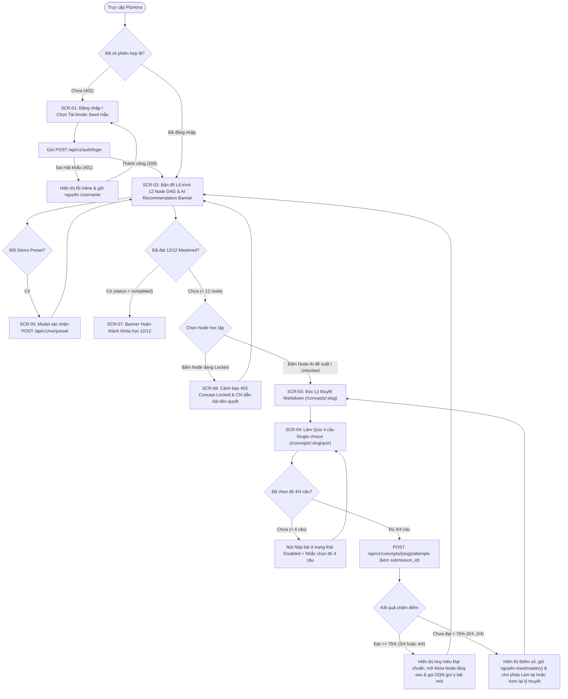

# Hệ thống Thiết kế Giao diện Plumora (UI Design System)

Phiên bản: `1.2.0` — **APPROVED (Gate 1 Baseline + Stitch MCP Visual Outputs — Chủ dự án duyệt tại `D-13`, `D-14`, `D-15` ngày 2026-11-16)**.
Tài liệu kiến trúc liên kết: [Thiết kế hệ thống (`docs/design.md`)](design.md) (`v1.0.0`), [Đặc tả hành vi (`docs/spec.md`)](spec.md) (`v1.0.0`), [Sổ quyết định (`docs/decisions.md`)](decisions.md) (`v1.1.0`).

> **Lưu ý thẩm quyền:** Toàn bộ bảng phối màu Chồi Cây Non (*Botanical Sprout & Sunlit Canopy*), typography, design tokens, quy tắc 100% SVG vector icons `lucide-react` (cấm tuyệt đối emoji), danh mục 8 màn hình (`SCR-01`–`SCR-08`) và bản xem trước wireframe dưới đây đã được chủ dự án phê duyệt chính thức làm **Gate 1 Baseline (`v1.0.0`)** tại `D-12`, `D-13` và `D-14`.

---

## 1. Định hướng Thị giác & Thương hiệu (Brand & Visual Direction)

### 1.1. Câu chuyện Thương hiệu: Chồi Cây Non (*Plumule $\rightarrow$ Plumora*)
- Tên gọi **Plumora** bắt nguồn từ *Plumule* (chồi mầm / chồi cây non trong thực vật học). Hệ thống coi hành trình chinh phục 12 khái niệm Backend như sự phát triển tự nhiên của một cái cây tri thức:
  1. **Hạt giống ngủ yên (`Locked / Dormant Seed`):** Các khái niệm chưa đủ điều kiện tiên quyết, mang sắc Xám Đá / Đất Ấm (`Warm Stone`).
  2. **Mầm non đang hé (`Unlocked / Sprouting Shoot`):** Các khái niệm đã mở khóa và sẵn sàng tiếp nhận kiến thức, mang sắc Xanh Ngọc Lá Mạ (`Teal / Sage Shoot`).
  3. **Đỉnh sinh trưởng đón nắng (`Recommended by DQN / Sunlit Apical Bud`):** Khái niệm được mô hình Học tăng cường (`DQN`) tính toán là điểm phát triển tối ưu tiếp theo, mang sắc **Vàng Nắng Sớm (`Sunlit Amber / Warm Gold`)** nổi bật tự nhiên giữa tán lá.
  4. **Tán lá trưởng thành (`Mastered >= 75% / Mature Canopy`):** Khái niệm đã thông thạo vững chắc, mang sắc **Xanh Rừng Sâu (`Deep Forest & Sprout Green`)**.

### 1.2. Quy tắc Bắt buộc về Biểu tượng (Strict Vector Iconography — Cấm Emoji)
- **Cấm tuyệt đối sử dụng ký tự Emoji** (như check xanh, ổ khóa, tên lửa, ngôi sao...) ở bất kỳ đâu trên giao diện web hoặc trong tài liệu thiết kế.
- Toàn bộ biểu tượng bắt buộc dùng **SVG Vector Icons đồng nhất từ thư viện `lucide-react`** (`stroke-width: 1.75px`, kích thước chuẩn `16px / 20px / 24px`, gắn `aria-hidden="true"` khi đi kèm nhãn chữ):
  - Biểu trưng thương hiệu Plumora: `<Sprout />`
  - Node đã thông thạo (`Mastered >= 75%`): `<CheckCircle2 />`
  - Node được AI khuyến nghị (`Recommended by DQN`): `<Compass />`
  - Node đã mở khóa (`Unlocked < 75%`): `<CircleDot />`
  - Node đang khóa (`Locked`): `<Lock />`
  - Bài học lý thuyết: `<BookOpen />`
  - Bài kiểm tra Quiz: `<FileCheck2 />`
  - Bằng chứng mô hình RL & Checkpoint: `<Activity />`, `<ShieldCheck />`
  - Thanh chuyển đổi Hồ sơ mẫu (`Demo Presets`): `<SlidersHorizontal />`

---

## 2. Hệ thống Design Tokens (Màu sắc Thực vật, Typography, Spacing)

### 2.1. Bảng Phối màu "Botanical Sprout & Sunlit Canopy" (Đạt chuẩn tương phản WCAG 2.1 AA)

| Token CSS / Lớp Tailwind | Mã Hex | Tỷ lệ tương phản (WCAG 2.1 AA) | Ý nghĩa ngữ nghĩa & Quy tắc sử dụng |
| --- | --- | --- | --- |
| `--bg-canvas` (`bg-[#F6F8F5]`) | `#F6F8F5` | — | Nền tổng thể màu Trắng Kem Lá Nhạt (Warm Botanical Alabaster), dịu mắt khi đọc lâu |
| `--bg-surface` (`bg-white`) | `#FFFFFF` | — | Nền thẻ bài học (Card), khung đọc Markdown, khung làm Quiz |
| `--bg-subtle` (`bg-stone-100`) | `#F5F5F4` | — | Nền khu vực phụ, thanh công cụ và thẻ node đang bị khóa (`Locked`) |
| `--border-default` (`border-[#D8E2D8]`) | `#D8E2D8` | — | Viền thẻ mặc định pha sắc xanh xám thực vật nhẹ |
| `--text-primary` (`text-[#14241B]`) | `#14241B` | `15.8:1` (trên `#FFFFFF`) | Chữ tiêu đề, nội dung bài học chính, câu hỏi Quiz (Xanh Đen Rừng Thẳm) |
| `--text-secondary` (`text-[#3F5247]`) | `#3F5247` | `7.9:1` (trên `#FFFFFF`) | Chữ phụ đề, mô tả điều kiện tiên quyết, metadata |
| `--text-muted` (`text-stone-600`) | `#57534E` | `5.8:1` (trên `#F5F5F4`) | Chữ trạng thái khóa, nhãn phụ (vượt chuẩn AA $\ge 4.5:1$) |
| `--brand-primary` (`bg-green-700`) | `#15803D` | `5.1:1` (với chữ `#FFFFFF`) | **Màu thương hiệu Plumora & Nút Primary CTA** (Xanh Chồi Rừng Sâu) |
| `--brand-hover` (`bg-green-800`) | `#166534` | `6.8:1` (với chữ `#FFFFFF`) | Trạng thái hover/active của nút Primary CTA |
| `--brand-sprout-accent` (`text-emerald-600` / `bg-emerald-500`) | `#16A34A` / `#22C55E` | — | Điểm nhấn biểu tượng `<Sprout />` và thanh tiến độ sinh trưởng |
| `--ai-sunlit-bg` (`bg-amber-50/80`) | `#FFFBEB` | — | Nền thẻ `AI Recommendation Banner` và node được `DQN` dẫn đường (Nắng Sớm) |
| `--ai-sunlit-border` (`border-amber-600`) | `#D97706` | `4.6:1` (trên `#FFFBEB`) | Viền nổi bật (`2px`) cho node đang được `DQN` khuyến nghị |
| `--ai-sunlit-text` (`text-amber-900`) | `#78350F` | `8.4:1` (trên `#FFFBEB`) | Chữ tiêu đề & huy hiệu `<Compass />` của khuyến nghị `DQN` |
| `--state-mastered` (`text-green-900` / `bg-green-50` / `border-green-600`) | `#14532D` / `#F0FDF4` / `#16A34A` | `9.2:1` | Node đã thông thạo ($\text{Mastery} \ge 75\%$) — Tán lá trưởng thành |
| `--state-unlocked` (`text-teal-900` / `bg-teal-50` / `border-teal-600`) | `#134E4A` / `#F0FDFA` / `#0D9488` | `8.7:1` | Node đã mở khóa (`is_eligible = 1.0`, $\text{Mastery} < 75\%$) — Mầm mới hé |
| `--state-locked` (`text-stone-600` / `bg-stone-100` / `border-stone-300`) | `#57534E` / `#F5F5F4` / `#D6D3D1` | `5.8:1` | Node chưa đủ điều kiện tiên quyết (`Locked`) — Hạt giống ngủ yên |
| `--state-error` (`text-rose-800` / `bg-rose-50` / `border-rose-300`) | `#9F1239` / `#FFF1F2` / `#FDA4AF` | `6.9:1` | Báo lỗi xác thực (`401`), chưa đạt ngưỡng Quiz ($< 75\%$), lỗi kết nối |

### 2.2. Typography & Phân cấp Chữ (Typography Scale)
- **Font hiển thị & Nội dung (`--font-sans`):** `'Plus Jakarta Sans', 'Inter', system-ui, -apple-system, sans-serif` (nét chữ hiện đại, thân thiện, hỗ trợ hoàn hảo dấu tiếng Việt).
- **Font kỹ thuật & Mã nguồn (`--font-mono`):** `'JetBrains Mono', 'Fira Code', monospace` (dùng cho mã `slug` như `db-transactions`, câu lệnh SQL/HTTP trong bài học, và mã băm `checkpoint_sha256`).
- **Thang kích thước chữ (Type Scale):**
  - `H1 (Page Title)`: `28px` (`1.75rem`), `line-height: 1.25`, `font-weight: 700`
  - `H2 (Section / Concept Title)`: `22px` (`1.375rem`), `line-height: 1.3`, `font-weight: 600`
  - `H3 (Card / Question Title)`: `18px` (`1.125rem`), `line-height: 1.4`, `font-weight: 600`
  - `Body Large (Lesson Markdown & Quiz Prompt)`: `16px` (`1rem`), `line-height: 1.65`, độ rộng dòng tối đa `68ch` giúp đọc lý thuyết thoải mái.
  - `Body Default (UI Controls)`: `14px` (`0.875rem`), `line-height: 1.5`
  - `Caption / Badge / Hash Metadata`: `12px` (`0.75rem`), `line-height: 1.4`, `font-weight: 500`

### 2.3. Hệ lưới Khoảng cách, Bo góc & Độ nổi (Spacing, Radius & Elevation)
- **Hệ lưới 8pt (`8pt Grid System`):** `4px (0.25rem)`, `8px (0.5rem)`, `12px (0.75rem)`, `16px (1rem)`, `24px (1.5rem)`, `32px (2rem)`, `48px (3rem)`.
- **Bo góc (`Border Radius`):** Nút bấm & Input `8px` (`rounded-lg`); Thẻ Node DAG & Khung Quiz `12px` (`rounded-xl`); Huy hiệu trạng thái `6px` (`rounded-md`).
- **Viền & Độ nổi:** Viền mặc định `1px solid #D8E2D8` kết hợp `shadow-sm`; node được `DQN` khuyến nghị dùng viền `2px solid #D97706` (`border-amber-600`) kèm `ring-4 ring-amber-100` để nổi bật như chồi non đón nắng giữa nền xanh thực vật.

---

## 3. Danh mục Màn hình 4 Nhóm (`4-Category Screen Inventory`) & Ánh xạ `AC-ID`

Hệ thống gồm **8 màn hình/trạng thái giao diện (`SCR-01` $\rightarrow$ `SCR-08`)** bao phủ đủ 4 phân nhóm:

| Mã MH (`Screen ID`) | Phân nhóm (`Category`) | Tên màn hình | Route / Vị trí | Mục tiêu cốt lõi & Nút hành động chính (`Primary CTA`) | Kích hoạt từ | Tiêu chí (`AC-ID`) |
| --- | --- | --- | --- | --- | --- | --- |
| **`SCR-01`** | `1. Primary View` | Đăng nhập, Đăng ký & Chọn nhanh Tài khoản Demo | `/login`, `/register` | Xác thực học viên hoặc chọn 1 trong 3 tài khoản Seed thật (`learner_new`, `learner_foundation`, `learner_api_stage`); CTA: `"Đăng nhập vào Lộ trình"` | Màn hình khởi đầu / Khi chưa có phiên | `PL-AUTH-01`, `PL-E2E-01` |
| **`SCR-02`** | `1. Primary View` | Bản đồ Lộ trình 12 Khái niệm (4 Tầng DAG) & Khuyến nghị AI | `/roadmap` | Quan sát toàn cảnh 12 node, tiến độ tổng thể, thẻ giải thích khuyến nghị của `DQN` và thanh `Demo Presets`; CTA: `"Học bài AI đề xuất"` | Sau khi đăng nhập / Thanh điều hướng chính | `PL-CONTENT-01`, `PL-REC-01`, `PL-REC-02`, `PL-E2E-01` |
| **`SCR-03`** | `2. Drill-Down` | Màn hình Học Lý thuyết Khái niệm (Markdown Reader) | `/concepts/:slug` | Đọc nội dung bài giảng Markdown của khái niệm đã mở khóa, xem các bài tiên quyết và điểm `mastery` hiện tại; CTA: `"Làm bài Quiz kiểm tra (4 câu)"` | Nhấp vào node `Unlocked`/`Mastered` trên `SCR-02` hoặc từ `AI Banner` | `PL-CONTENT-01`, `PL-E2E-01` |
| **`SCR-04`** | `2. Drill-Down / Form` | Khung Làm Quiz 4 Câu Single-choice & Phản hồi Mastery | `/concepts/:slug/quiz` | Trả lời đủ 4 câu hỏi trắc nghiệm, nộp bài với `submission_id` (chống nộp trùng), xem điểm số, biên đạt $\ge 75\%$ và cập nhật `mastery`; CTA: `"Nộp bài kiểm tra"` $\rightarrow$ `"Nhận bài học tiếp theo từ AI"` | Nút CTA trên `SCR-03` hoặc nút `"Làm Quiz"` trên thẻ node `SCR-02` | `PL-QUIZ-01`, `PL-PROGRESS-01`, `PL-E2E-01` |
| **`SCR-05`** | `3. Overlay / Modal` | Hộp thoại Xác nhận Đặt lại Tiến độ theo Hồ sơ mẫu (`Demo Preset Modal`) | Modal trên `/roadmap` | Cảnh báo rõ việc áp dụng Preset (`new_learner`, `foundation_ready`, `api_stage_ready`) sẽ ghi đè tiến độ của tài khoản hiện tại; CTA: `"Xác nhận áp dụng Preset"` | Chọn 1 Preset trên thanh `Demo Presets` ở `SCR-02` | `PL-CONTENT-01`, `PL-PROGRESS-01` |
| **`SCR-06`** | `3. Overlay / Drawer` | Ngăn kéo Chi tiết Bằng chứng RL & Lịch sử Làm bài (`RL Provenance & History Drawer`) | Slide-over Drawer bên phải trên `/roadmap` | Hiển thị minh bạch vector Observation 24 chiều, nguồn `policy_source` (`dqn` / `dqn_masked_q` / `fallback_rule`), `state_source` (`redis_cache` / `postgres_fallback`), `checkpoint_sha256` và lịch sử các lần nộp `QuizAttempt`; CTA: `"Đóng"` | Nhấp `"Bằng chứng AI & Lịch sử"` trên `SCR-02` | `PL-REC-01`, `PL-REC-02`, `PL-PROGRESS-01` |
| **`SCR-07`** | `4. Edge & System View` | Trạng thái Hoàn thành Khóa học 12/12 Node & Trạng thái Chưa có Lịch sử | Banner/View trên `/roadmap` & Drawer | Thông báo hoàn tất khi đạt `12/12 Mastered >= 75%` (`status = "completed"`) kèm thống kê tổng số lượt làm bài, hoặc hướng dẫn khi tài khoản mới chưa có lượt nộp nào; CTA: `"Ôn tập lại bài bất kỳ"` / `"Chọn Preset khác"` | Khi `mastered_count == 12` hoặc `attempts.length == 0` | `PL-REC-02`, `PL-CONTENT-01` |
| **`SCR-08`** | `4. Edge & System View` | Màn hình Chặn Bài học Đang Khóa (`403 Concept Locked`) & Cảnh báo Chế độ Fallback | `/concepts/:slug` (khi Locked) & Alert Banner | Giải thích rõ những bài tiên quyết nào cần đạt $\ge 75\%$ trước khi mở khóa bài này, hoặc hiển thị cảnh báo trung thực khi hệ thống chạy ở chế độ `fallback_rule` / `postgres_fallback`; CTA: `"Quay về Bản đồ & Học bài tiên quyết"` | Truy cập URL trực tiếp vào bài đang `Locked` hoặc khi Redis/Checkpoint gặp sự cố | `PL-QUIZ-01`, `PL-REC-02` |

---

## 4. Kiểm tra Giải phẫu 8 Điểm (`8-Point Page Anatomy`) cho các Màn hình Chính

1. **Định hướng & Điều hướng (`Orientation & Navigation`):**
   - Header cố định gồm: Biểu tượng SVG `<Sprout />` + chữ **Plumora**, thanh tiến độ tổng quát (`Đã thông thạo X / 12 khái niệm`), nút mở `RL Provenance Drawer` (`<Activity /> Bằng chứng AI`), tên người học (`display_name`) và nút `<LogOut /> Đăng xuất`.
   - Breadcrumb rõ ràng trên `SCR-03` và `SCR-04`: `Bản đồ lộ trình / Tầng 2: Giao thức & Dữ liệu / Giao thức HTTP/HTTPS / Làm bài Quiz`.
2. **Bộ lọc & Chuyển đổi Nhanh (`Filter & Preset Controls`):**
   - Trên `SCR-02`: Bộ lọc nhanh theo trạng thái node (`Tất cả (12)`, `AI Đề xuất (1)`, `Đã mở khóa`, `Đã thông thạo`, `Đang khóa`) và thanh chọn nhanh 3 `Demo Presets` (`Mới bắt đầu`, `Xong Nền tảng`, `Tầng API`).
3. **Hiển thị Dữ liệu & Trạng thái (`Data Display & Status Visualization` — Chỉ dùng SVG Icon `lucide-react`):**
   - Mỗi thẻ Node trên DAG (`DagNodeCard`) hiển thị đủ **5 thông tin**: (1) Nhãn tầng & mã `slug` monospace, (2) Tên khái niệm, (3) Huy hiệu trạng thái kèm SVG icon chuẩn (`<Lock /> Đang khóa`, `<CircleDot /> Đã mở khóa`, `<Compass /> AI Khuyến nghị`, `<CheckCircle2 /> Đã thông thạo`), (4) Thanh phần trăm `Mastery` (`0%` / `25%` / `50%` / `75%` / `100%` với vạch đích tại mốc `75%`), và (5) Danh sách các node tiên quyết.
4. **Kiểm soát Dữ liệu & Tiến trình (`Progress & Step Controls`):**
   - Trên `SCR-04` (`Quiz View`): Bộ đếm `"Đã chọn X / 4 câu hỏi"` và thanh chỉ báo tiến độ làm bài.
5. **Phân cấp Hành động (`Action Hierarchy — Fitts's Law`):**
   - Mỗi màn hình chỉ có **1 nút Primary CTA** màu Xanh Chồi Rừng Sâu (`#15803D`, chiều cao tối thiểu `44px`); các hành động phụ (`Quay lại`, `Xem bằng chứng AI`) dùng nút viền (`Outline`); hành động đặt lại tiến độ (`Reset Preset`) có hộp thoại xác nhận `SCR-05`.
6. **Phản hồi Hệ thống (`System Feedback & Alerts`):**
   - Toast góc trên bên phải khi áp dụng Preset hoặc đăng nhập thành công; Banner cảnh báo khi `policy_source = "fallback_rule"` hoặc `state_source = "postgres_fallback"`.
7. **Trạng thái Trống & Đang tải (`Empty & Loading States`):**
   - Skeleton giữ nguyên kích thước lưới 4 tầng DAG khi đang tải `GET /api/v1/roadmap`; trạng thái trống có hướng dẫn khi chưa có lịch sử làm Quiz.
8. **Micro-copy & Khả năng tiếp cận (`WCAG 2.1 AA`):**
   - Mọi trạng thái luôn kết hợp **Màu sắc + Kiểu viền + Biểu tượng SVG `lucide-react` + Nhãn chữ tiếng Việt** (không bao giờ chỉ dựa vào màu sắc đơn thuần và không dùng emoji).

---

## 5. Sơ đồ Luồng Trải nghiệm Người học (`UX User Flows`)



---

## 6. Đặc tả Component Dùng chung & Ma trận 5 Trạng thái UX (`Ideal / Loading / Empty / Error / Disabled`)

| Component | Vai trò & Props chính | `Ideal` | `Loading` | `Empty` | `Error` | `Disabled` |
| --- | --- | --- | --- | --- | --- | --- |
| `AiRecommendationBanner` | Hiển thị bài học `DQN` khuyên học tiếp theo (`concept`, `policy_source`, `state_source`, `guardrail_applied`, `checkpoint_sha256`) | Nền Vàng Nắng Sớm (`#FFFBEB`), viền `#D97706`, icon `<Compass />`, tên bài học được đề xuất, lý do, huy hiệu `DQN Policy` + mã băm 8 ký tự đầu, nút `"Bắt đầu học bài này"` (`#15803D`) | Khung shimmer skeleton cao `112px` kèm chữ `"AI đang phân tích trạng thái 24 chiều..."` | Khi đạt 12/12 bài (`status = "completed"`): chuyển sang thẻ hoàn tất khóa học `SCR-07` | Khi thiếu checkpoint (`policy_source = "fallback_rule"`) hoặc lỗi mạng: hiển thị rõ nhãn `"Chế độ Fallback theo tầng DAG"` + nút `"Thử lại"` | Khi đang gửi kết quả Quiz chưa xong: khóa tạm thời nút xin khuyến nghị mới |
| `DagNodeCard` | Thẻ biểu diễn 1 trong 12 khái niệm trên lưới 4 tầng (`slug`, `title`, `tier`, `mastery`, `status`, `prerequisites`, `isRecommended`) | Viền và huy hiệu SVG theo trạng thái (`<Lock /> Locked`, `<CircleDot /> Unlocked`, `<Compass /> Recommended`, `<CheckCircle2 /> Mastered`), thanh tiến độ có vạch mốc `75%` | Skeleton card kích thước cố định `280x140px` không gây nhảy bố cục (`CLS = 0`) | `mastery = 0%`: hiển thị `"Chưa làm bài (0%)"` | Nếu tải chi tiết thất bại: báo lỗi nhỏ ngay trên thẻ kèm nút tải lại | Khi `status == "locked"`: nền xám đá `#F5F5F4`, icon `<Lock />`, nhấp vào hiện rõ tooltip `"Cần đạt >= 75% ở: [Tên bài tiên quyết]"` |
| `DemoPresetToolbar` | Thanh chuyển đổi nhanh 3 trạng thái mẫu (`new_learner`, `foundation_ready`, `api_stage_ready`) | Hiển thị icon `<SlidersHorizontal />` và 3 nút chọn Preset kèm mô tả số node đã hoàn thành | Hiện spinner SVG trên nút Preset đang áp dụng (`Đang đồng bộ PostgreSQL & Redis...`) | Không áp dụng (luôn có 3 Presets cố định) | Toast báo lỗi nếu `POST /api/v1/me/preset` thất bại | Khóa cả 3 nút trong lúc request cập nhật đang chạy |
| `McqQuizForm` | Khung 4 câu hỏi trắc nghiệm Single-choice (`questions[4]`, `submissionId`) | Hiển thị 4 câu hỏi, mỗi câu 4 lựa chọn `A, B, C, D` dạng radio card có vùng bấm lớn ($\ge 48\text{px}`), viền xanh `#15803D` khi đang chọn | Khi bấm `"Nộp bài"`: nút chuyển sang `"Đang chấm điểm..."` và khóa chỉnh sửa đáp án | Không áp dụng (Seed đảm bảo luôn đủ 4 câu) | Khi lỗi mạng lúc nộp: giữ nguyên 4 đáp án đã chọn và cùng `submission_id` để bấm `"Gửi lại an toàn (Idempotent Retry)"` | Nút `"Nộp bài kiểm tra"` ở trạng thái `Disabled` khi số câu đã chọn $< 4$, kèm dòng nhắc `"Vui lòng chọn đủ 4/4 câu hỏi"` |
| `ProvenanceBadge` | Huy hiệu minh bạch nguồn AI & nguồn State (`policy_source`, `state_source`, `guardrail_applied`) | Icon `<Cpu />` / `<Database />` kèm nhãn rõ ràng: `DQN Policy`, `DQN Masked Q`, hoặc `Fallback Rule`; `Redis Cache` hoặc `PG Fallback` | Skeleton pill `96x24px` | — | Báo viền đỏ/vàng khi `degraded = true` | — |

---

## 7. Quy tắc Hiển thị Tiến độ, Điều kiện Tiên quyết, Khuyến nghị RL & Khả năng Tiếp cận

1. **Quy tắc Hiển thị Tiến độ & Ngưỡng 75% (`D-06`):**
   - Thanh tiến độ của mỗi node chia làm 4 vạch rõ ràng (`25%`, `50%`, **`75% (Mốc Đạt)`**, `100%`).
   - Khi `mastery` đạt `75%` ($3/4$ câu) hoặc `100%` ($4/4$ câu), thanh chuyển sang màu Xanh Rừng Sâu (`#16A34A`) kèm icon SVG `<CheckCircle2 />` và nhãn `ĐÃ THÔNG THẠO (MASTERED)`. Nếu học viên làm lại đạt điểm thấp hơn (ví dụ $2/4 = 50\%$), giao diện hiển thị: `"Điểm lượt này: 50% (2/4) — Điểm thông thạo bảo lưu: 75% (Đã đạt chuẩn)"`.
2. **Quy tắc Minh bạch Khuyến nghị RL (`D-07`, [rl-evidence.md](../.agents/rules/rl-evidence.md)):**
   - Giao diện **bắt buộc hiển thị trung thực** giá trị `policy_source` từ API:
     - `policy_source == "dqn"`: Hiển thị huy hiệu `<Cpu /> Đề xuất bởi DQN Policy` + mã `SHA-256` rút gọn của checkpoint.
     - `policy_source == "dqn_masked_q"`: Hiển thị huy hiệu `<ShieldCheck /> Đề xuất bởi DQN (Lọc Q-value hợp lệ DAG)` kèm chú thích `guardrail_applied = true`.
     - `policy_source == "fallback_rule"`: Hiển thị cảnh báo `<AlertTriangle /> Đề xuất dự phòng theo tầng DAG (Chưa nạp Checkpoint DQN)` — tuyệt đối không hiển thị nhãn `DQN` khi đang fallback.
3. **Responsive, Điều hướng Bàn phím & Khả năng Tiếp cận (`WCAG 2.1 AA`):**
   - **Responsive Breakpoints:**
     - `Desktop (>= 1024px)`: Hiển thị lưới 4 tầng DAG rõ ràng, `RL Provenance Drawer` mở cạnh phải.
     - `Tablet (768px - 1023px)`: Lưới 2 cột cho mỗi tầng DAG.
     - `Mobile (< 768px)`: Danh sách xếp dọc theo Tầng 1 $\rightarrow$ Tầng 4, các nút bấm chiếm trọn chiều ngang (`w-full`, chiều cao $\ge 44\text{px}$).
   - **Keyboard Navigation & Screen Reader (`a11y`):**
     - Mọi node DAG, lựa chọn đáp án `A/B/C/D` và nút bấm đều đi qua được bằng phím `Tab` / `Shift+Tab` với viền focus rõ nét màu Xanh Chồi Rừng (`focus-visible:ring-2 focus-visible:ring-green-700 focus-visible:ring-offset-2`).
     - Trong màn hình Quiz (`SCR-04`), hỗ trợ phím mũi tên hoặc phím `1-4` để chọn đáp án trong câu hỏi đang focus.
     - Vùng kết quả chấm điểm Quiz và thẻ `AI Recommendation Banner` gắn thuộc tính `aria-live="polite"`.

---

## 8. Bản Xem Trước Wireframe / Mockup Trực Quan (Không Dùng Emoji — Ký hiệu `[SVG: ...]` đại diện cho `lucide-react`)

### 8.1. Bản xem trước `SCR-02`: Bản đồ Lộ trình 12 Khái niệm DAG & AI Recommendation Banner (`/roadmap`)

```text
+----------------------------------------------------------------------------------------------------+
| [SVG:Sprout] PLUMORA — Lộ trình Backend RL   [Tiến độ: 4/12 Đã thông thạo (33%)]  [SVG:Activity AI]|
| Nền: #F6F8F5 (Botanical Alabaster)                       [SVG:User] learner_foundation  [Đăng xuất]|
+----------------------------------------------------------------------------------------------------+
| [SVG:Sliders] HỒ SƠ MẪU (DEMO PRESETS):  [ 1. Mới bắt đầu (0/12) ] [(*) 2. Xong Nền tảng (4/12)]   |
+----------------------------------------------------------------------------------------------------+
| [SVG:Compass] KHUYẾN NGHỊ TỪ MÔ HÌNH HỌC TĂNG CƯỜNG (DQN POLICY) — Nền Vàng Nắng #FFFBEB / #D97706 |
| +------------------------------------------------------------------------------------------------+ |
| | [SVG:Compass] Bài học đề xuất tiếp theo: [Tầng 2] #4. Transaction (ACID) & Indexing trong RDBMS| |
| | Lý do: Bạn đã đạt chuẩn "CSDL Quan hệ & SQL (75%)". Hoàn thành bài này sẽ mở khóa Tầng 3 API.  | |
| | Policy: [SVG:Cpu DQN Policy (Unmasked)] | State: [SVG:Zap Redis Cache v5] | SHA: a8f3...91c2   | |
| |                                                 [ Nút CTA #15803D: Bắt đầu học bài này -> ]    | |
| +------------------------------------------------------------------------------------------------+ |
+----------------------------------------------------------------------------------------------------+
| BẢN ĐỒ LỘ TRÌNH KIẾN THỨC BACKEND (12 KHÁI NIỆM — 4 TẦNG TIÊN QUYẾT DAG)                           |
| Bộ lọc: (● Tất cả 12)  (○ AI Đề xuất 1)  (○ Đã mở khóa 3)  (○ Đã thông thạo 4)  (○ Đang khóa 5)    |
|                                                                                                    |
| === TẦNG 1: NỀN TẢNG CỐT LÕI (ROOT NODES) ======================================================== |
| +----------------------------------------------+    +--------------------------------------------+ |
| | [0] net-internet   [SVG:CheckCircle2 100%]   |    | [1] os-basics      [SVG:CheckCircle2 75%]  | |
| | Màu: Xanh Rừng #F0FDF4 / Viền #16A34A        |    | Màu: Xanh Rừng #F0FDF4 / Viền #16A34A      | |
| | Internet & Mô hình Mạng cơ bản               |    | Hệ điều hành, Process/Thread & I/O         | |
| | [████████████████████] 100% (Mốc đạt: 75%)   |    | [███████████████░░░░░] 75% (Mốc đạt: 75%)  | |
| | Tiên quyết: Không có         [Xem bài | Quiz]|    | Tiên quyết: Không có       [Xem bài | Quiz]| |
| +----------------------------------------------+    +--------------------------------------------+ |
|                        │                                                  │                        |
|                        ▼                                                  ▼                        |
| === TẦNG 2: GIAO THỨC & CƠ SỞ DỮ LIỆU ============================================================ |
| +----------------------------------------------+    +--------------------------------------------+ |
| | [2] web-http       [SVG:CheckCircle2 75%]    |    | [3] db-relational  [SVG:CheckCircle2 75%]  | |
| | Giao thức HTTP/HTTPS                         |    | CSDL Quan hệ & SQL cơ bản                  | |
| | [███████████████░░░░░] 75%                   |    | [███████████████░░░░░] 75%                 | |
| | Cần: net-internet (Đạt)      [Xem bài | Quiz]|    | Cần: os-basics (Đạt)       [Xem bài | Quiz]| |
| +----------------------------------------------+    +--------------------------------------------+ |
|                                                               │                         │          |
|                                               ┌───────────────┘                         ▼          |
|                                               ▼                                                    |
| +----------------------------------------------+    +--------------------------------------------+ |
| | ╔══════════════════════════════════════════╗ |    | [5] db-nosql       [SVG:CircleDot 25%]     | |
| | ║ [4] db-transactions [SVG:Compass AI GỢI Ý]║ |    | Màu: Xanh Ngọc Lá Mạ #F0FDFA / #0D9488    | |
| | ║ Màu: Vàng Nắng #FFFBEB / Viền #D97706    ║ |    | CSDL NoSQL (Document & Key-Value)          | |
| | ║ Transaction (ACID) & Indexing            ║ |    | [█████░░░░░░░░░░░░░░░] 25% (Chưa đạt 75%)  | |
| | ║ [░░░░░░░░░░░░░░░░░░░░] 0% (Đã mở khóa)   ║ |    | Cần: db-relational (Đạt)   [Học bài | Quiz]| |
| | ║ Cần: db-relational (Đạt)  [Học bài ngay] ║ |    +--------------------------------------------+ |
| | ╚══════════════════════════════════════════╝ |                                                   |
| +----------------------------------------------+                                                   |
|                                                                                                    |
| === TẦNG 3: THIẾT KẾ API & QUẢN LÝ TRẠNG THÁI ==================================================== |
| +----------------------------------------------+    +--------------------------------------------+ |
| | [6] api-rest       [SVG:CircleDot 0%]        |    | [7] api-validation [SVG:Lock LOCKED 0%]    | |
| | Màu: Xanh Ngọc Lá Mạ #F0FDFA / #0D9488       |    | Màu: Xám Đá Ấm #F5F5F4 / Viền #D6D3D1      | |
| | Thiết kế RESTful API chuẩn                   |    | Validation, Serialization & Xử lý lỗi API  | |
| | Cần: web-http (Đạt)          [Học bài | Quiz]|    | [SVG:Lock] Cần đạt >=75% ở: api-rest       | |
| +----------------------------------------------+    +--------------------------------------------+ |
| +----------------------------------------------+    +--------------------------------------------+ |
| | [8] api-data       [SVG:Lock LOCKED 0%]      |    | [9] cache-redis    [SVG:Lock LOCKED 0%]    | |
| | Kết nối API với Database & Query Patterns    |    | Caching & Quản lý State với Redis          | |
| | [SVG:Lock] Cần: db-transactions, api-rest    |    | [SVG:Lock] Cần: db-nosql, api-rest         | |
| +----------------------------------------------+    +--------------------------------------------+ |
|                                                                                                    |
| === TẦNG 4: BẢO MẬT BACKEND CƠ BẢN =============================================================== |
| +----------------------------------------------+    +--------------------------------------------+ |
| | [10] sec-authn     [SVG:Lock LOCKED 0%]      |    | [11] sec-api       [SVG:Lock LOCKED 0%]    | |
| | Xác thực & Phân quyền (Session/JWT, RBAC)    |    | Bảo mật API (SQLi, Rate Limit, CORS)       | |
| | [SVG:Lock] Cần: api-rest, cache-redis        |    | [SVG:Lock] Cần: api-validation, api-data...| |
| +----------------------------------------------+    +--------------------------------------------+ |
+----------------------------------------------------------------------------------------------------+
```

### 8.2. Bản xem trước `SCR-03` & `SCR-04`: Đọc Lý thuyết & Làm Quiz 4 Câu Single-choice (`/concepts/:slug/quiz`)

```text
+----------------------------------------------------------------------------------------------------+
| [SVG:ArrowLeft] Quay về Bản đồ   |  Tầng 2 / [4] db-transactions: Transaction (ACID) & Indexing    |
+----------------------------------------------------------------------------------------------------+
| [ Tab 1: [SVG:BookOpen] Bài học Lý thuyết ]  [(*) Tab 2: [SVG:FileCheck2] Làm Quiz (4 câu) ]       |
+----------------------------------------------------------------------------------------------------+
| ĐỀ KIỂM TRA TRẮC NGHIỆM KHÁCH QUAN (4 CÂU SINGLE-CHOICE — ĐIỂM ĐẠT CHUẨN >= 75% TỨC >= 3/4 CÂU)    |
| Tiến độ chọn đáp án: [███████████████░░░░░] Đã chọn 3 / 4 câu hỏi                                  |
|                                                                                                    |
| Câu 1 / 4: Tính chất nào trong bộ ACID đảm bảo rằng một giao dịch (Transaction) hoặc được thực     |
| hiện trọn vẹn tất cả các bước, hoặc không có bước nào được ghi nhận nếu xảy ra lỗi giữa chừng?    |
|   (●) A. Atomicity (Tính nguyên tử)          [Viền Xanh Chồi Rừng #15803D, Nền #F0FDF4]            |
|   ( ) B. Consistency (Tính nhất quán)                                                              |
|   ( ) C. Isolation (Tính cô lập)                                                                   |
|   ( ) D. Durability (Tính bền vững)                                                                |
|                                                                                                    |
| Câu 2 / 4: Khi hai Transaction chạy đồng thời...                                                   |
|   ( ) A. ...   (●) B. ...   ( ) C. ...   ( ) D. ...                                                |
|                                                                                                    |
| Câu 3 / 4: Đánh chỉ mục (B-Tree Index) trên cột thường dùng trong mệnh đề WHERE giúp...            |
|   ( ) A. ...   ( ) B. ...   (●) C. ...   ( ) D. ...                                                |
|                                                                                                    |
| Câu 4 / 4: [Chưa chọn đáp án — Vui lòng chọn 1 phương án dưới đây]                                 |
|   ( ) A. ...   ( ) B. ...   ( ) C. ...   ( ) D. ...                                                |
|                                                                                                    |
| +------------------------------------------------------------------------------------------------+ |
| | [SVG:Info] Bạn cần chọn đủ 4/4 câu hỏi để mở khóa nút Nộp bài. (ID lượt nộp: 7b9e...410a)      | |
| |                                           [ [SVG:Lock] Nộp bài kiểm tra (Còn thiếu 1 câu) ]    | |
| +------------------------------------------------------------------------------------------------+ |
+----------------------------------------------------------------------------------------------------+
| SAU KHI NỘP BÀI THÀNH CÔNG (VÍ DỤ ĐẠT 3/4 CÂU = 75%):                                              |
| +------------------------------------------------------------------------------------------------+ |
| | [SVG:CheckCircle2] ĐẠT CHUẨN THÔNG THẠO KHÁI NIỆM (ĐIỂM LƯỢT NÀY: 75% — 3/4 CÂU ĐÚNG)          | |
| | • Điểm thông thạo cập nhật (max): 0% ──► 75% (Đạt ngưỡng >= 75% — Màu Xanh Rừng #16A34A)       | |
| | • Đã đồng bộ PostgreSQL (state_version = 6) & Redis State Cache.                               | |
| |   [ Làm lại Quiz để đạt 100% ]             [ Nút CTA #15803D: Nhận bài khuyến nghị tiếp theo ] | |
| +------------------------------------------------------------------------------------------------+ |
+----------------------------------------------------------------------------------------------------+
```

---

## 9. Biên bản Giao diện Sinh từ Stitch MCP (`Generated Output Review — APPROVED tại D-15`)

- **Stitch Project Resource ID:** `projects/1237345840857188241` (`Plumora — Adaptive Backend Learning Path (RL MVP)`)
- **Stitch Design System Asset ID:** `assets/14991308797519536796` (`Plumora Botanical Sprout & Sunlit Canopy`, version `2`)
- **Trạng thái phê duyệt đầu ra:** **`approved` (`D-15` / `O-11` — Chủ dự án phê duyệt ngày 2026-11-16)** làm chuẩn thị giác chính thức cho việc triển khai Frontend trong `SLICE-01`.

| Mã MH (`Screen ID`) | Stitch Screen Resource Name | File Ảnh & HTML (`projects/1237345840857188241/files/...`) | Mã băm `SHA-256` ảnh PNG xuất ra | Bằng chứng kiểm tra (`Inspection Evidence`) | Quyết định của Chủ dự án (`D-15` / `O-11`) |
| --- | --- | --- | --- | --- | --- |
| **`SCR-01`** (Đăng nhập & 3 Tài khoản Seed thật) | `projects/1237345840857188241/screens/eb65366969174dd490f801b025070213` | PNG: `5acbb0b93e8444d18e3edc46f7a01b05`<br>HTML: `e993a2115bd14a7a8c5f16d6721a1d63` | `3a3d5b719174c6f4a600f7bda37bb95ddcc625d0acf9188b638970b4d071283b` | Bố cục 2 cột rõ ràng: form đăng nhập chuẩn `D-11` bên trái, 3 tài khoản Seed thật (`learner_new`, `learner_foundation`, `learner_api_stage`) bên phải; không emoji, không màu tím | **`approved` (`D-15` — Chủ dự án)** |
| **`SCR-02`** (Bản đồ 12 Khái niệm 4 Tầng DAG & DQN Banner) | `projects/1237345840857188241/screens/2c9e5833473a4127b1b9f18a32dc50f4` | PNG: `14121cde3a0249109c6a9f69f915d468`<br>HTML: `91d2da84033042f6bce2496f3f64d99e` | `1d88d784e717781ce4026d9098feaf3bbd476ce9f63538dad61d24445abc16de` | Hiển thị đủ 12 node 4 tầng DAG, thanh `Demo Presets`, thẻ `DQN Recommendation Banner` màu Vàng Nắng `#FFFBEB`/`#D97706` cho `db-transactions` kèm `SHA-256` và `redis_cache (v5)` | **`approved` (`D-15` — Chủ dự án)** |
| **`SCR-03`** (Đọc Lý thuyết Markdown `db-transactions`) | `projects/1237345840857188241/screens/404835853d18408cb7f69734e346a966` | PNG: `1863f49945b84348ac59b1f4d2d1edb8`<br>HTML: `56f2f30f7e0d4dae91d233f5a02b4593` | `7ab2d824572edd401a7df61a7dc33447113ade57066ba58995994dd32dbeb8a5` | Bố cục đọc 2 cột: bảng ACID, khối lệnh SQL `JetBrains Mono`, hộp đánh đổi B-Tree Index, sidebar tiên quyết (`db-relational` $\rightarrow$ `api-data`) và CTA chuyển sang Quiz | **`approved` (`D-15` — Chủ dự án)** |
| **`SCR-04`** (Làm Quiz 4 câu Single-choice & Phản hồi Mastery) | `projects/1237345840857188241/screens/cbdb75a539e8432da8456023c40e70e9` | PNG: `10f62db00e5e44f88c47ecd61c3614a1`<br>HTML: `1d11fe59a0d440d28385a7be32ec6906` | `ffb68ec41a97000fd79d21447f6dd2cb71cf5a448ae89f675ef525f3fc1edc28` | Hiển thị đủ 4 câu hỏi Single-choice, `submission_id` chống nộp trùng, thẻ `PASSED >= 75% (3/4)`, cập nhật `max(old, score)`, trạng thái `PostgreSQL COMMITTED` + `Redis UPDATED` và gợi ý bài tiếp theo `api-rest` | **`approved` (`D-15` — Chủ dự án)** |
| **`SCR-06`** (Drawer Bằng chứng RL 24 chiều & Lịch sử) | `projects/1237345840857188241/screens/6265788d661f4e1aa269760e7d959564` | PNG: `596d6772b1274b738670b634b06073ac`<br>HTML: `12c70893fffd495ca0e2ffd2d43debb0` | `8aab21eba005d62877e559f6b533f1b405deca6c6a0d8cf69fcc33bf635eb950` | Ngăn kéo trượt 560px trên nền `SCR-02` làm mờ: hiển thị `policy_source: dqn`, `guardrail_applied: false`, bảng Vector Observation 24 chiều (`12 mastery + 12 is_eligible`) và mã băm `checkpoint_sha256` | **`approved` (`D-15` — Chủ dự án)** |
